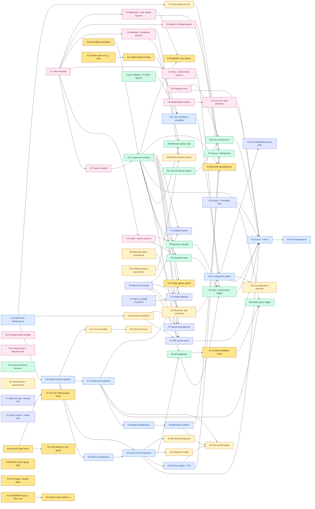

# Görev Dağılımı — PyroSync

> **İşaretleme kuralı:** Her görev başlığının başında bir onay kutusu vardır. `[ ]` = yapılmadı, `[X]` = tamamlandı. Görevi bitiren kişi, "Bitti sayılır" şartı sağlandığında kendi görevinin kutusunu `[X]` yapar (özet tablosundaki kutuyu da). Şart sağlanmadan `[X]` konmaz. Bu dosya projenin TEK görev listesidir; ayrı görev dosyası açılmaz.

Proje bağlamı: [README.md](README.md). Strateji: STRATEGY.md (yerel, gitignore'da).

> [!NOTE]
> 2026-11-13'te oluşturuldu. Tek branch (`main`) üzerinden sırayla commit atılır; herkes kendi görevini bitirince commit atar, çakışma olmaması için aynı dosyalara aynı anda dokunılmaz.

## Nasıl okunur

- **Kimlik:** `G` Görkem'in, `C` Can'ın, `R` Serhat'ın, `S` Samet'in, `Y` Yusuf'un, `K` Sadık'ın görevleri. Örnek: `R3` Serhat'ın 3. görevi, `K2` Sadık'ın 2. görevi. Commit mesajlarında bu kimlikler kullanılır (`[G2] VZA correction katsayıları kalibre edildi`, `[K1] fallback modu eklendi`). Görev kimlikleri tüm dosyada tekildir.
- **Bekler:** başlamadan önce bitmiş olması gereken görevler. Bunlar bitmeden başlanırsa iş ya yapılamaz ya da tekrar yapılır.
- **Açar:** bu görev bitince başlayabilecek görevler.
- **Bitti sayılır:** görevin kapanma şartı. Şart sağlanmadan `[X]` konmaz.
- **Durum:** `[X]` bitti · `[ ]` yapılmadı (özet tablosunda ayrıca `sürüyor` veya `bekliyor` — bir bağımlılık bitmedi — notu yer alabilir)

Bir görevi bitiren kişi durumunu `[X]` yapar ve "Açar" satırındaki görevlerin sahiplerine haber verir.

---

## Bağımlılık grafiği

Mavi: Görkem · Pembe: Can · Yeşil: Serhat · Sarı: Samet · Mor: Yusuf · Turuncu: Sadık. Oklar "önce bu biter, sonra şu başlar" demek.

---

## Özet

| Kimlik | Görev | Sahip | Bekler | Açar | Durum |
|--------|-------|-------|--------|------|-------|
| G1 | FIRMS API gerçek veri entegrasyonu | Görkem | — | G2, S4 | [X] |
| G2 | Harmonizasyon pipeline tamamlama | Görkem | G1 | G3, G4, S1 | [X] |
| G3 | Effort normalization (Ω) | Görkem | G2 | G4 | [X] |
| G4 | Server API endpoint'leri tamamlama | Görkem | G2, G3 | G5, R4, S2, S3 | [X] |
| G7 | Config-driven pipeline | Görkem | G2 | G8, R8, K2, S6 | [X] |
| G8 | Bölgesel/biyom kalibrasyon modülü | Görkem | G7 | G9 | [X] |
| G9 | Belirsizlik aralıkları hesaplama | Görkem | G8 | K3, S6 | [X] |
| G10 | Export engine + /api/export | Görkem | G4 | R7, S6 | [X] |
| G11 | Yeni metriklerin süreklilik analizi | Görkem | R10, K11 | G12 | [ ] |
| G12 | İç doğrulama paketi | Görkem | G11, S10 | G5, S12, Y10 | [ ] |
| G5 | Sunum materyali + demo senaryosu | Görkem | G4, R5, Y1, G12, C8, C11, R12, Y8 | G6 | [ ] bekliyor (R5, C8, C11 [X], Y1/G12/R12/Y8 bekliyor) |
| G6 | Final entegrasyon + deployment | Görkem | G5 | — | [ ] bekliyor |
| C1 | UI/UX genel konsept + wireframe | Can | — | C2, C3, C4 | [X] |
| C2 | Tasarım sistemi (renkler, tipografi, spacing) | Can | C1 | R1 | [X] |
| C3 | Harita + takvim detay tasarımı | Can | C1 | R2, R3 | [X] |
| C4 | Raw ↔ Harmonized karşılaştırma tasarımı | Can | C1 | R5 | [X] |
| C9 | Statik kaynak / gaz meşalesi maskesi ve SAMA gece filtresi | Can | — | C11 | [X] |
| C10 | Tropikal swath boşluğu bayrağı | Can | — | — | [X] |
| C12 | Opsiyonel düşük güven filtresi ve duman/atmosfer belirsizlik notu | Can | — | — | [X] |
| C8 | Footprint Lens | Can | — | R12, G5 | [X] |
| C5 | Methods sayfası + disclaimer tasarımı | Can | C1 | R6, S8 | [X] |
| C7 | Belirsizlik gösterimi + renk skalası tasarımı | Can | C1 | K3, K4 | [X] |
| C6 | Export UI + brifingi tasarımı | Can | C1 | R7 | [X] |
| C11 | Vaka çalışması: Çin anız yakma yasağı paradoksu | Can | C9 | G5 | [X] |
| R1 | React component mimarisi + layout | Serhat | C2 | R2, R3, R4, Y1–Y4 | [X] |
| R2 | İnteraktif harita entegrasyonu | Serhat | C3, R1 | R5 | [X] |
| R3 | Burning activity calendar componenti | Serhat | C3, R1 | R5 | [X] |
| R4 | Backend API bağlantısı + state management | Serhat | G4, R1 | R5 | [X] |
| R5 | Raw ↔ Harmonized toggle implementasyonu | Serhat | R2, R3, R4, C4 | G5 | [X] |
| R10 | Eşleşmiş kayıtlarda 1 MODIS = N VIIRS ayak izi toplamı | Serhat | — | G11 | [ ] kod bitti, merge + precompute Görkem'de |
| R11 | Seed-anchored zaman penceresi | Serhat | — | — | [X] |
| R9 | Frontend'i yeni API alanlarına geçirme | Serhat | — | R12 | [X] |
| R8 | Çoklu harmonizasyon model seçimi | Serhat | G7, K1, R1 | — | [X] |
| R6 | Methods/About sayfası implementasyonu | Serhat | C5, R1 | — | [X] |
| R7 | CSV/GeoJSON export + acil müdahale brifingi | Serhat | G10, C6, S7 | — | [ ] bekliyor |
| R12 | 60 saniyelik rehberli tur | Serhat | R9, C8 | G5 | [X] |
| S1 | Core crate unit testleri | Samet | G2 | S5 | [X] |
| S2 | Server + FIRMS client integration testleri | Samet | G4 | — | [X] |
| S3 | API dokümantasyonu (OpenAPI) | Samet | G4 | — | [X] |
| S6 | Config + calibration + export testleri | Samet | G7, G9, G10 | — | [X] |
| S4 | Sample/demo veri pipeline'ı | Samet | G1 | Y1, Y2 | [X] |
| S5 | GitHub Actions CI/CD kurulumu | Samet | S1 | — | [ ] |
| S9 | Belirsizlik tabanının kaynakla güncellenmesi | Samet | — | S10 | [X] |
| S10 | Mondrian split conformal aralıkları | Samet | S9 | G12 | [X] |
| S11 | VIIRS bow-tie silme bölgeleri testi ve eşleştirme duyarlılık API'si | Samet | — | — | [X] |
| S12 | Dış doğrulama pilotu (atmosfer) | Samet | G12 | — | [ ] |
| S13 | Referans listesi güncellemesi | Samet | — | S8 | [X] |
| S7 | Türkiye/Akdeniz case study veri seti | Samet | G1 | R7 | [X] |
| S8 | Bilimsel referans + disclaimer içerik | Samet | C5 | — | [ ] (C5 bekliyor) |
| Y5 | Mock veri hazırlığı (frontend için) | Yusuf | — | Y1, Y2, Y3, Y4 | [X] |
| Y6 | Takvim analitiği (calendar.rs) | Yusuf | — | Y3 | [X] |
| Y7 | Olay kümeleme ve kesinti şeffaflığı | Yusuf | — | — | [X] |
| Y1 | FRP zaman serisi grafiği | Yusuf | R1, Y5, S4 | G5 | [ ] (R1 bekliyor) |
| Y2 | Sensör karşılaştırma grafikleri | Yusuf | R1, Y5, S4 | — | [ ] (R1 bekliyor) |
| Y3 | Aylık yangın yoğunluk heatmap'i | Yusuf | R1, Y5, Y6 | — | [ ] bekliyor |
| Y4 | İstatistik dashboard kartları | Yusuf | R1, Y5 | — | [ ] bekliyor |
| Y9 | Hücre tanı modalı ve yörünge sürüklenmesi şeridi | Yusuf | — | — | [ ] |
| Y10 | Dış doğrulama pilotu (yanmış alan) | Yusuf | G12 | — | [ ] |
| Y8 | Vaka çalışmaları: Amazon 2019–2021 ve Hindistan duman maruziyeti | Yusuf | — | G5 | [ ] |
| K5 | Area API sonuçlarını diske cache'leme | Sadık | — | K6, K7 | [X] |
| K9 | SPA fallback gerçekten çalışmıyor | Sadık | — | R1 | [X] |
| K8 | MODIS içi efor geçişi (2002 Aqua) | Sadık | — | — | [X] |
| K10 | Piksel alanı ve tespit limiti | Sadık | — | K11 | [X] |
| K11 | Şiddet rejimli Ω (effort.rs) | Sadık | K10 | G11 | [X] |
| K13 | NOAA-20/SNPP köprü katsayısı ve Terra VZA kontrolü | Sadık | — | K14 | [X] |
| K14 | Biyom bazlı tamlık katsayısı | Sadık | K13 | — | [ ] |
| K12 | Aqua öncesi dönem kurtarımı ve kesinti etiketleri | Sadık | — | — | [ ] etiketler tamam, regresyonla kurtarım yapılmadı |
| K6 | 2023 (NOAA-21) efor geçişini ölçme | Sadık | K5 | — | [ ] |
| K7 | Tam filo 2000-present trend serisi | Sadık | K5 | — | [ ] 2012/2018 ölçüldü; 2023 arşivde yok |
| K1 | Live/demo/fallback modu | Sadık | R4 | R8 | [X] |
| K2 | Config ayarları frontend paneli | Sadık | G7, R1 | — | [X] |
| K3 | Belirsizlik aralıkları görselleştirme | Sadık | G9, C7, R1 | — | [ ] frontend tamam; aralık VZA'ya duyarlı değil (G9 modeli) |
| K4 | Erişilebilir renk skalası sistemi | Sadık | C7, R1 | — | [X] |

**Şu an başlanabilecekler:**
- **Görkem:** G1–G4 ve G7–G10 tamamlandı. Sıradaki açık görevler bağımlılık bekliyor: G11 (`R10, K11`), G12 (`G11, S10`), G5 (`Y1, G12, R12, Y8`; `R5, C8, C11` tamamlandı).
- **Can:** C1–C12 tamamlandı; açık görev kalmadı.
- **Serhat:** R1–R6, R8, R9, R11, R12 tamamlandı; R10'un kodu bitti, merge ve hazır sonuçların yeniden üretimi Görkem'e devredildi. (`R7` S7'yi bekliyor.)
- **Samet:** S1–S3 ve S6 tamamlandı. Şu an başlanabilecekler: S4 (G1 bitti), S5 (S1 bitti, Actions onayı bekliyor), S7 (G1 bitti), S9, S11, S13 (`Bekler: —`). (`S10` S9'u, `S12` G12'yi, `S8` C5+S13'ü bekliyor.)
- **Yusuf:** Şu an başlanabilecekler: Y5, Y6, Y7, Y8, Y9 (`Bekler: —`). (`Y1–Y4` Y5/S4/Y6 bekliyor; `Y10` G12 bekliyor.)
- **Sadık:** K1, K2, K4, K5, K8, K9, K10, K11 ve K13 tamamlandı. K3'ün kodu tamam, harita opaklığının görsel doğrulaması bekliyor; K12'nin etiketleme kısmı tamam. Şu an başlanabilecekler: K6, K7 (K5 bitti; `FIRMS_API_KEY` gerekir), K14 (K13 bitti; arazi örtüsü verisi gerekir).

**Birbirini bekleyen kritik yollar:**
1. ~~**G1 → G2 → G4 → R4 → R5:**~~ [X] Tamamlandı. Backend pipeline ve frontend toggle zinciri tamam.
2. ~~**C1 → C2 → R1:**~~ [X] Tamamlandı. Component mimarisi ve tasarım sistemi entegre.
3. **G2 → S1 → S5:** Samet'in CI/CD'si S1'e bağlı, S1 bitti. S5 Actions onayı bekliyor.
4. **R1 + Y5 + Y6 → Y1–Y4:** Yusuf'un grafikleri Y5 (mock veri), S4 ve (Y3 için) Y6'yı bekliyor. R1 bitti.
5. **K10 → K11 + R10 → G11 → G12 → G5:** Piksel tespit limiti ve 1-to-N ayak izi toplamı olmadan süreklilik analizi, iç doğrulama paketi ve final sunum kapanamaz.
6. **S9 → S10 → G12 → S12 / Y10:** Gerçekçi MODIS/VIIRS `σ` ve Mondrian split conformal aralıkları iç doğrulamayı ve 4 biyomluk dış doğrulama pilotlarını besler.
7. **~~C9 → C11~~ → G5 ve ~~R9 + C8~~ → R12 → G5:** Statik/SAMA maskesi (`C9`), Çin vaka çalışması (`C11`), yeni API alanları (`R9`) ve Footprint Lens (`C8`) tamamlandı; `R12` artık başlayabilir, `G5` kalan sunum/doğrulama bağımlılıklarını bekliyor.
8. **G4 → G10 → R7:** Export backend hazır; R7 için C6 tasarım ve S7 case study bekleniyor.
9. **C5 + S13 → S8 / R6:** Methods sayfası tasarımı (C5) ve güncellenmiş referans/boşluk listesi (S13) hem içeriği (S8) hem frontend sayfasını (R6) besler.
10. **R4 → K1 → R8:** Fallback modu API bağlantısına bağlı; model seçimi de fallback'e bağlı.

---

## Görkem'in görevleri

### [X] G1 — FIRMS API gerçek veri entegrasyonu
- **Bekler:** — · **Açar:** G2, S4
- `pyrosync-firms` crate'i iskelet olarak hazır. Yapılacaklar:
  - [X] NASA FIRMS API key ile gerçek veri çekme testi — `examples/nrt_check.rs`
  - [X] Rate limiting ve retry mekanizması (API 429/503 dönebilir) — `limiter.rs`, `Retry-After` destekli exponential backoff
  - [X] Tarihsel veri desteği (NRT + SP + archive kaynaklarına göre endpoint seçimi) — `source.rs`, `availability.rs`, `archive.rs`
  - [X] CSV parse'ın gerçek FIRMS çıktısıyla doğrulanması (MODIS ve VIIRS formatları farklı sütun isimleri kullanabiliyor)
  - [X] `data/sample/` altına birkaç günlük örnek veri kaydetme (offline geliştirme için) — 5 format
- **Bitti sayılır:** `cargo test -p pyrosync-firms` geçiyor; gerçek API key ile en az 3 farklı kaynak (MODIS_NRT, VIIRS_SNPP_NRT, VIIRS_NOAA20_NRT) üzerinden veri çekilip parse ediliyor; `data/sample/` altında örnek CSV var.
- **Doğrulama (2026-11-14):** 43 test geçiyor, clippy temiz. Canlı API `--bbox 15,-15,30,0` ile: MODIS_NRT 21, VIIRS_SNPP_NRT 2300, VIIRS_NOAA20_NRT 348 hotspot parse edildi.
- **Not:** Canlı doğrulama `acq_time` parse hatasını ortaya çıkardı — FIRMS baştaki sıfırları atıyor (`614` = 06:14), eski kod yalnızca 4 karakterlik değer kabul ediyordu. MODIS_NRT çekimi tümüyle başarısız oluyordu; `data/sample/` altındaki üç NRT dosyası da aynı sebeple offline parse edilemiyordu. `parse_hhmm` 1–4 haneli değerleri kabul edecek şekilde düzeltildi, 6 regresyon testi eklendi.

### [X] G2 — Harmonizasyon pipeline tamamlama
- **Bekler:** G1 · **Açar:** G3, G4, S1
- Pipeline iskeletleri mevcut (dedup, VZA, matching, calendar). Yapılacaklar:
  - [X] H3 hexagonal grid entegrasyonu — `h3o` 0.11, Resolution 8 (hücre 0,74 km², MODIS 1 km ayak izine en yakın ölçek), k-ring 3 ile aday arama (~2,8 km garantili kapsama; k=2 tam 2,0 km'de sınırda kalıp eşleşme kaçırıyordu). `crates/core/src/h3index.rs`
  - ⛔ VZA polinom katsayılarını gerçek overlap-period verisinden hesaplama — **FIRMS ile yapılamaz**, bkz. aşağıdaki not. Katsayılar placeholder kaldı.
  - [X] Cross-sensor matching optimizasyonu — BallTree yerine H3 kullanıldı. Rust'ta olgun BallTree crate'i yok ve H3 zaten gerekiyordu; iki indeks yerine tek indeks hem agregasyon hem aday arama için kullanılıyor.
  - [X] Fleet rule — `crates/core/src/fleet.rs`, ayrı aşama olarak sensör-içi dedup'tan sonra ve MODIS eşleştirmesinden önce çalışıyor.
  - [X] Gerçek FIRMS verisiyle uçtan uca pipeline testi — `/api/harmonize` üzerinden koşuldu.
- **Bitti sayılır (2026-11-14'te ölçüme dayalı olarak revize edildi):**
  1. `cargo test -p pyrosync-core` geçiyor ve `cargo clippy --workspace --all-targets` temiz.
  2. Gerçek FIRMS verisiyle MODIS+VIIRS → harmonized → calendar akışı en az üç farklı bölgede çalışıyor, `Matched` kategorisi kayıt üretiyor.
  3. Tespit ve FRP azalması **bileşen bazında** raporlanıyor: interscan dedup, VIIRS filo birleştirme ve cross-sensor füzyon ayrı ayrı. Sabit bir yüzde bandı beklenmez — azalma yangın yoğunluğuna bağlıdır (ölçüm: seyrek bölgede %14,5, yoğun bölgede %39–41).
  4. VZA düzeltmesi gerçek veride tetikleniyor ve uygulanan katsayı kayıt başına `vza_factor` alanında raporlanıyor. **R² hesabı G2 kapsamı dışıdır** (bkz. aşağıdaki not).
- **Revizyon gerekçesi:** Önceki iki şart ("FRP %15–20 azalıyor", "VZA R²'si hesaplanıyor") ölçümle çeliştiği için değiştirildi. Eski %15–20 bandı literatürde yalnız interscan dedup için verilen bir değer; bu pipeline'da ayrıca VIIRS filo birleştirmesi var ve toplam azalma bölge yoğunluğuna göre %14–41 arasında değişiyor, hiçbir bölgede bandın içine düşmüyor. R² ise eşzamanlı MODIS/VIIRS gözlem çifti gerektiriyor ve ölçüm bu çiftlerin FIRMS'te bulunmadığını gösterdi.
- **Doğrulama (2026-11-14), canlı `/api/harmonize`, 2 günlük pencere, 180 dk eşleştirme penceresiyle:**

  | Bölge | Ham | Harmonize | n düşüş | FRP düşüş | Matched |
  |-------|-----|-----------|---------|-----------|---------|
  | Zambiya/Angola | 699 / 6.770 MW | 585 / 4.866 MW | %16,3 | %28,1 | 12 |
  | Sahel | 14.042 / 133.676 MW | 9.270 / 74.605 MW | %34,0 | %44,2 | 221 |
  | Kuzey Avustralya | 11.876 / 137.654 MW | 7.411 / 75.983 MW | %37,6 | %44,8 | 329 |

  **Bileşen ayrıştırması** (şart 3 gereği, `n_obs` alanı üzerinden hesaplanır):

  | Aşama | Zambiya | Sahel | Avustralya |
  |-------|---------|-------|------------|
  | MODIS interscan dedup | 1 (%4,8) | 80 (%11,1) | 144 (%13,8) |
  | VIIRS interscan dedup | 57 (%8,4) | 1.602 (%12,0) | 1.694 (%15,6) |
  | VIIRS filo birleştirme | 44 (%6,5) | 2.869 (%21,5) | 2.298 (%21,2) |
  | Cross-sensor füzyon | 12 | 221 | 329 |

  MODIS tespitlerinin %34–60'ı bir VIIRS karşılığı buluyor (Zambiya 12/20, Sahel 221/643, Avustralya 329/897).
- **Filo kuralı doğrulandı, aşırı birleştirme yok.** Filo VIIRS tespitlerinin %21–22'sini siliyor; bağımsız ölçümde NOAA-21 tespitlerinin %19,7'sinin 2 km içinde NOAA-20 eşi olduğu bulunmuştu. İki sayı örtüşüyor, yani kural verinin gerçekten duplikat olduğunu söylediği kadarını siliyor. 2 km yarıçapı değiştirilmedi.
- **Cross-sensor pencere kararı: 180 dakika.** `MATCH_WINDOW_SECS` 300 saniyeden 10800 saniyeye çıkarıldı ve `Matched` yeniden tanımlandı: "eşzamanlı gözlem" değil, "aynı yangın olayının iki sensörle gözlemi".
  - Ölçüm: 26.505 co-located MODIS-VIIRS noktası, 4 bölge, 5 tarih, üç VIIRS platformu. **30 dakika altında sıfır çift.** Mutlak minimum 34 dk. Medyan 158 dk (NOAA-20/21), 122 dk (SNPP). Kümülatif: ≤45 dk %0,2 · ≤90 dk %9,5 · ≤120 dk %27,9 · ≤180 dk ~%49.
  - 300 saniyelik pencereyle üç bölgenin hepsinde `Matched` sıfır kayıt üretiyordu, yani cross-sensor füzyon iddiası çıktısızdı.
  - Pencere genişlemesi H3 indeksi sayesinde güvenli: aday kümesi mekansal olarak 37 hücreye sınırlı, zaman penceresinin genişlemesi aday sayısını patlatmıyor. Bu yüzden H3'ün önce yapılması doğru sıraydı.
  - Füzyon davranışı değişmedi: `Matched` kaydı VIIRS değerini kullanıyor, MODIS FRP'si ortalamaya karışmıyor. 3 saat önceki MODIS okumasını VIIRS tahminine katmak istemiyoruz.
- **VZA katsayı kalibrasyonu ve R² — FIRMS verisiyle yapılamaz, G2 kapsamı dışına alındı.** Mekanizma çalışıyor: VZA `scan` piksel boyutundan türetiliyor, gerçek veride 20/20 MODIS kaydında tetikleniyor, en büyük düzeltme %42,4 (33,8 → 19,48 MW). Ancak `correction_ratio` polinomunun katsayıları (A=0,85 B=0,12 C=1,0) placeholder ve kalibre edilmeleri eşzamanlı MODIS/VIIRS gözlem çifti gerektiriyor; yukarıdaki ölçüm bu çiftlerin FIRMS'te bulunmadığını gösterdi (minimum 34 dk). İki yol var: (a) literatürden hazır katsayı girilip kaynak gösterilir, (b) granül/arşiv seviyesi veri sağlanır. S7 (case study veri seti) ile birlikte planlanmalı. **Katsayılar girilene kadar harmonize FRP değerleri gösterge niteliğindedir ve methods sayfasında (C5/R6) bu açıkça belirtilmeli.**
- **Yan bulgu:** `VIIRS_SNPP_NRT` beslemesi 2026-11-02'de duruyor, diğer NRT kaynakları günceldir. `availability.rs` bunu doğru yönetiyor (SNPP sorgularını kendi aralığına kırpıyor), ama kısa pencereli isteklerde SNPP hiç katkı vermiyor; bu yüzden filo grupları o tarihlerde en fazla 2 platform içeriyor.

### [X] G3 — Effort normalization (Ω)
- **Bekler:** G2 · **Açar:** G4
- Uydu sayısı arttıkça aynı bölgede daha fazla detection olur — bu yapay artışı düzeltmek gerekiyor.
  - [X] Her ay/bölge için effective observation count hesaplama — `crates/core/src/effort.rs`
  - [X] MODIS-only dönemine normalize etme — taban dönemde Ω tanım gereği 1,0 çıkıyor
  - [X] Takvim çıktısına anomaly z-score'ları ekleme — anomali artık normalize seri üzerinden hesaplanıyor
- **Bitti sayılır:** 2000–present boyunca monoton artan trend kalkıyor; 2012 ve 2017'deki uydu geçişlerinde yapay sıçrama yok.
- **Görev tanımındaki iki hata düzeltildi (arşiv verisinden ölçüldü):**
  - Görev "2017+ MODIS + 2 VIIRS" diyor; NOAA-20 verisi FIRMS'te **2018-04**'te başlıyor, 2017'de değil.
  - Görev **Aqua'yı atlamış**. Arşivde Aqua'nın ilk tespiti **2002-07**, yani 2000-11'den 2002-06'ya kadar yalnız Terra var ve orada da bir efor geçişi mevcut. Ω bunu doğru yakalıyor (Terra tek başına 21 ay, Terra+Aqua 113 ay; ikisinde de Ω = 1,000 çünkü ikisi de MODIS-only).
  - Gerçek platform zaman çizelgesi: Terra 2000-11 · +Aqua 2002-07 · +SNPP 2012-01 · +NOAA-20 2018-04 · +NOAA-21 2023-03.
- **Tasarım: Ω sabit kodlanmadı, her serinin kendi verisinden ölçülüyor.**
  - Ölçüm (arşiv, Türkiye, 2000-2025): MODIS-only dönem ~10.700 tespit/yıl, SNPP eklendikten sonra ~59.000 tespit/yıl, yani sıçrama **5-6 kat**. Buna karşılık MODIS'in kendi sayısı 26 yıl boyunca düz (10.733 → 11.123). Yani yapay trend platform SAYISIYLA değil sensör TESPİT VERİMİYLE ölçekleniyor (VIIRS 375 m vs MODIS 1 km).
  - Bu yüzden "platform sayısına göre normalize et" yaklaşımı yetersiz kalırdı: 2→3 platform için 1,5 kat düzeltme yapar, ~4 katlık sıçrama yerinde kalırdı.
  - Sabit Ω katsayısı da yanlış olurdu: SNPP/MODIS verim oranı bölgeye göre **3,28 (Bulgaristan) – 7,35 (Suriye)** arası değişiyor, 2,2 kat fark.
  - Çözüm: MODIS referans cetvel olarak kullanılıyor. Her ay için `total` ve `modis_observable` (platforms alanında MODIS bulunan kayıtlar) sayılır; aylar **(MODIS var mı?, VIIRS platform kümesi)** anahtarına göre havuzlanır ve `omega = Σtotal / Σmodis_observable` hesaplanır. Taban dönemde her kayıt MODIS içerdiği için Ω = 1,0 **otomatik** çıkar, elle ayar yok.
  - Havuzlama anahtarı MODIS alt bileşimine duyarsız. Gerekçe: Aralık 2018'de Türkiye'de yalnız 385 tespit vardı ve Terra hiç yangın görmedi; anahtar tam sensör kümesi olunca o ay tek başına havuzlandı, 3 ay eşiğini karşılamadı ve Ω'sını kaybetti. Dört platform da görevdeydi — Terra'nın yangın görmemesi yangınlar hakkında bilgidir, efor hakkında değil.
  - "Alt kümeyse üst kümenin Ω'sını devral" kuralı bilinçli olarak REDDEDİLDİ: istek aralığı dönem ortasında başlarsa geçiş öncesi aylar eşiğin altında kalır, büyük Ω ile bölünür ve ters yönde yapay sıçrama üretir.
- **Doğrulama (2026-11-14):** 73 core testi geçiyor, clippy temiz.

  **2012 geçişi** — arşiv, 4 ülke (Türkiye/Yunanistan/Bulgaristan/Kıbrıs), 2000-2025, 26 yıl:

  | Metrik | Ham seri | Normalize seri |
  |--------|----------|----------------|
  | Seviye kayması (5 yıl önce/sonra) | ×3,21 | **×0,84** |
  | Dönem ortalaması (2002-11 → 2012-25) | ×3,34 | ×0,87 |
  | Monoton artan trend (Spearman ρ, 2001-2025) | **+0,785** | **+0,087** |

  Normalize serideki en büyük yıllık atlama (×2,66, 2008→2009) tamamen MODIS-only dönemin içinde, yani gerçek yangın aktivitesi — sensör artefaktı değil.

  **2018 (NOAA-20) geçişi** — area API SP kaynakları, Türkiye bbox, 2017-07..2018-12, aynı mevsim kıyaslaması (Tem-Ara 2017 vs Tem-Ara 2018):

  | | Ham | Normalize |
  |---|-----|-----------|
  | Kayma | ×1,317 | **×0,912** |
  | \|log(kayma)\| | 0,275 | **0,093** |

  Ω tam 2018-04'te 4,715'ten 6,810'a atlıyor ve hiçbir ayda boşluk kalmıyor; konfigürasyon tespiti tarih sabiti kullanmadan, yalnızca veriden isabetli çalışıyor. Bu koşuda 1373 transaction içinde 1 istek FIRMS transaction limitine takıldı (2018-12 ayı 385 yerine 366 tespit, kıyaslama ortalaması %0,05 değişti) — sonucu etkilemiyor.

### G3 doğrulamasının sınırları (açıkça kayda geçirildi)
- **Monoton trend testinin serisi tam filo değil.** ρ +0,785 → +0,087 ölçümü 2000-2025 arşiv serisi üzerinde yapıldı ve bu seri yalnızca **MODIS + SNPP** içeriyor; ülke arşivi NOAA-20 ve NOAA-21 taşımıyor. Yani dört efor geçişinden ikisi (2018, 2023) trend testinde YOK. Trend, 2012 geçişini içeren uzun seride düz çıkıyor; 2018 geçişi ayrı ve kendi veri setinde doğrulandı; tam filo içeren 2000-present serisi FIRMS'ten makul transaction bütçesiyle kurulamıyor.
  - **Düzeltme (2026-11-15):** Ülke arşivi NOAA-20'yi `viirs-jpss1` slug'ı ile taşıyor (2018-2025); önceki "taşımıyor" yargısı yanlış slug denemelerine dayanıyordu. Yalnız NOAA-21 (`viirs-jpss2`) arşivde yok. Yani 2018 geçişi artık arşiv serisinin içinde sınanabilir; bkz. K7.
- **2023 (NOAA-21) geçişi ÖLÇÜLMEDİ.** Mekanizma platform kümesinden bağımsız çalıştığı için aynı davranması beklenir, ama bu bir beklenti; ölçüm değil.
- **Ω, MODIS referans kanalının kendi içindeki geçişi düzeltemez.** 2002-07'de Aqua eklenmesi tespitleri artırdı (arşivde 2001 Terra 5162 → 2002 Terra 4474 + Aqua 2412), ama Aqua `modis_observable`'ın parçası olduğu için Ω 1,000 kalıyor ve bu sıçrama düzeltilmiyor. Havuzlama anahtarı MODIS alt bileşimine duyarsız olduğundan Terra-only ve Terra+Aqua dönemleri tek havuzda birleşiyor (134 ay, Ω 1,000). Bitiş şartı yalnızca 2012 ve 2017'yi istediği için şart ihlal edilmiyor, ama 2000-2002 taban dönemi efor açısından sonrasıyla tam kıyaslanabilir DEĞİL. Çözüm gerekirse MODIS içi normalizasyon ayrı bir referans (örn. Terra-only alt kanalı) gerektirir.
- **Açık risk: fetch hatası Ω'yı sessizce bozuyor.** Ara bir doğrulama koşusunda 36 istek başarısız oldu ve NOAA-20 verisi eksik geldiği için 2018-08..12 ayları "NOAA-20 yok" konfigürasyonuna düşüp yanlış Ω (6,810 yerine 4,724) aldı. Yani bir kaynağın çekimi başarısız olursa efor normalizasyonu sessizce yanlış düzeltme uygular. **G4'te ele alınmalı:** `report.failures` boş değilse Ω güvenilmez sayılmalı ve API bunu açıkça bildirmeli.

### [X] G4 — Server API endpoint'leri tamamlama
- **Bekler:** G2, G3 · **Açar:** G5, R4, S2, S3
- Mevcut: `/api/health`, `/api/harmonize` (bbox + days). Yapılacaklar:
  - [X] `/api/calendar` — arşivden tarihsel aylık takvim (`country`, `from`, `to`, opsiyonel bbox)
  - [X] `/api/compare` — raw vs harmonized karşılaştırma istatistikleri
  - [X] `/api/stats` — genel istatistikler, sensör kırılımı, pipeline metrikleri
  - [X] Response caching — bellek bütçeli, iki seviyeli TTL, `X-Cache: HIT|MISS` header'ı
  - [X] CORS ve error handling son hali — `CORS_ALLOWED_ORIGINS`, `/api/*` için JSON 404, `REQUEST_TIMEOUT_SECS`
- **Bitti sayılır:** tüm endpoint'ler Postman/curl ile test edildi; frontend proxy üzerinden veri alıyor; 10 saniyelik timeout dahilinde yanıt geliyor.
- **Doğrulama (2026-11-14):** 21 server testi geçiyor (önceden hiç test yoktu), toplam 144 test, clippy temiz.

  **Yanıt süreleri — Vite dev proxy (5173) üzerinden, backend :3001:**

  | Endpoint | İlk istek | Cache'li | Boyut |
  |----------|-----------|----------|-------|
  | `/api/health` | 3 ms | 3 ms | 33 B |
  | `/api/availability` | 4 ms | 3 ms | 603 B |
  | `/api/harmonize` | 1,36 s | 4 ms | 290 KB |
  | `/api/harmonize?include_raw=true` | 0,69 s | 5 ms | 481 KB |
  | `/api/compare` | 0,63 s | 6 ms | 1,1 KB |
  | `/api/stats` | 0,66 s | 3 ms | 1,2 KB |
  | `/api/calendar` | 24 ms | 4 ms | 9,1 KB |

  Frontend proxy doğrulandı: `npm install` + `npm run dev` ile Vite 5173 ayağa kaldırıldı, `/api/health` ve `/api/harmonize` istekleri backend'e düştü ve doğru payload döndü. `npm run build` ve `npx tsc --noEmit` temiz geçiyor.
- **Şartın "10 saniye" maddesine dair sınır:** `days` tipi istekler için fazlasıyla sağlanıyor (en yavaş 1,36 s). Ancak `start`/`end` ile verilen uzun tarih aralıkları doğası gereği dakikalar sürüyor — 18 aylık bir aralık 1373 FIRMS isteği demek. Sabit 10 saniyelik timeout bu istekleri kullanılamaz yapardı, bu yüzden `REQUEST_TIMEOUT_SECS` yapılandırılabilir (varsayılan 300 s) ve zaman aşımı mesajı sebebini açıklıyor. Uzun aralıkların 10 saniyeye inmesi asenkron iş semantiği gerektirir, G4 kapsamı dışıdır.
- **`/api/calendar` kapsam sınırı:** area API ile 2000-present imkansız (26 yıl on binlerce transaction), bu yüzden endpoint FIRMS ülke arşivini kullanıyor — transaction harcamıyor ve `FIRMS_API_KEY` gerektirmiyor. Bedeli: arşiv NOAA-21 taşımıyor, dolayısıyla tarihsel takvim MODIS + SNPP + NOAA-20 kapsıyor ve 2023 sonrasında NRT endpoint'lerinden daha küçük bir filo gösteriyor. Yanıt bunu `coverage` bölümünde ve `warnings` dizisinde açıkça bildiriyor. Tam filo serisi için bkz. K7.
- **G3'ten devralınan risk kapatıldı:** `report.failures` boş değilse yanıt `effort.reliable: false` ve sebebini taşıyor, ayrıca üst seviye `warnings` dizisi var. Ω değerleri null'lanmıyor — veri kaybı frontend'i kırar, uyarıyla işaretlemek yeterli.
- **Açık bulgu:** SPA fallback dokümante edildiği gibi çalışmıyor (`/harita` → 404). G4'ün bitiş şartının parçası değil, bu dosyada K9 olarak kuyruğa alındı.
- **R4 için not:** `web/src/services/api.ts` ve `web/src/types/index.ts` yeni endpoint'leri (`/api/compare`, `/api/stats`, `/api/calendar`) ve yeni alanları (`count_normalized`, `effort_omega`, `vza_factor`, `n_obs`, `platforms`, `mean_frp_raw`, `effort`, `warnings`) henüz kapsamıyor. Tip kontrolü hata vermiyor çünkü fazladan JSON alanları çelişki yaratmıyor; eksiklik R4 kapsamında giderilmeli.

### [X] G7 — Config-driven pipeline
- **Bekler:** G2 · **Açar:** G8, R8, K2, S6
- Pipeline'daki tüm sabit eşikleri yapılandırılabilir hale getirmek (EG FireTrack'ten ilham):
  - `config.rs` modülü: `PipelineConfig` struct'ı ile tüm parametreler
  - Dedup eşikleri: zaman penceresi (varsayılan 8s), örtüşme oranı (varsayılan %30)
  - VZA düzeltme katsayıları: polinom coefficients (a, b, c)
  - Cross-sensor matching: mesafe (varsayılan 2 km), zaman (varsayılan 5 dk)
  - TOML dosyasından yükleme (`pyrosync.toml`) + env var override
  - Varsayılan config ile mevcut davranış aynı kalmalı (backward compatible)
- **Kaynak:** EG FireTrack — "Config-driven tasarım: tüm eşikler yapılandırılabilir, bilimsel şeffaflık"
- **Bitti sayılır:** `PipelineConfig::default()` ile mevcut testler hâlâ geçiyor; TOML'dan farklı config yüklenince pipeline davranışı değişiyor; `pyrosync.example.toml` depoda.
- **Durum (2026-11-15):** Sadık tarafından tamamlandı (`4f3e23d`). `PipelineConfig`, `pyrosync.toml` yükleme ve `pyrosync.example.toml` depoda.

### [X] G8 — Bölgesel/biyom kalibrasyon modülü
- **Bekler:** G7 · **Açar:** G9
- Tek global FRP oranı yerine bölgesel katsayılar (Li et al. 2018):
  - `calibration.rs` modülü: biyom tipine göre MODIS/VIIRS FRP kalibrasyon oranları
  - Tropik: VIIRS ~%16 büyük (k=1.16)
  - Boreal: MODIS ~%47 büyük (k=1.47)
  - Savan: ~%1 fark (k≈1.0)
  - Biyom lookup: lat/lon → biyom → kalibrasyon katsayısı
  - Config'den override edilebilir (`PipelineConfig.calibration`)
- **Kaynak:** Li et al. 2018 — "Tek global katsayı yetersiz — savan %1 fark, boreal %47 fark"
- **Bitti sayılır:** farklı bölgelerde (tropik, boreal, savan) farklı kalibrasyon uygulanıyor; test: Türkiye (Akdeniz) ve Sibirya (boreal) verileriyle FRP oranları beklenen aralıkta.
- **Durum (2026-11-15):** Kod tamamlandı (`a883a82`, `c82641d`), bitti şartı SAĞLANMADI. Li et al. 2018 katsayıları 750 m VIIRS ürününden; FIRMS verisi 375 m. Aqua–SNPP 1° ızgara ölçümü: tropik 1,21–1,22 (model 1,16), Türkiye 1,33 (model 0,97), boreal 1,34–1,40 (model 0,82). Literatür 375 m için bu ölçümü doğruluyor (Li 2020: Afrika'da MODIS toplam FRP ~%26 düşük; GMD 2026: küresel %38). Katsayılar 375 m ölçeğine göre güncellenmeli (bkz. `docs/REFERANS_ANALIZI.md` P1).
- **Karar ve kapanış (2026-11-15, `a387ba1`):** Üçlü konsey (Opus, Argon, DeepSeek) kararıyla kapsam yeniden tanımlandı. Izgara toplamı oranları MODIS'in tespit edemediği küçük yangınlardan (tamlık) geldiği için tespit başına enlem çarpanı KALDIRILDI; bölgesel fark artık VIIRS öncesi dönemde hücre toplam FRP'sine uygulanan ölçülmüş tamlık katsayısı k_c ile taşınıyor. k_c kendi verimizden ölçüldü (Aqua–SNPP, ≤20 dk, 1° hücre-gün, normalize VZA eğrisine göre; 2019 fit, 2020 hold-out): tropik 1,11 ± 0,08, orta enlem 1,18 ± 0,15, boreal 1,28 ± 0,11 (hold-out farkları %4–9, σ içinde). VZA düzeltmesi de kaynağa (Zheng 2026, Denk. 9) uygun olarak çarpmaya çevrildi. Takvime `total_frp` ve MODIS-eşdeğeri `frp_per_detection_eq` eklendi. Açık: savan/orman ayrımı enlem bandıyla yapılamıyor (biyom haritası gerekir); orta enlem bandı az örneklemli.

### [X] G9 — Belirsizlik aralıkları hesaplama
- **Bekler:** G8 · **Açar:** K3, S6
- Her harmonize FRP değerine güven aralığı eklemek (fire-harmony'den ilham):
  - `uncertainty.rs` modülü: `UncertaintyEstimate { lower: f64, upper: f64, confidence: f64 }`
  - Kaynaklar: VZA düzeltme hatası, kalibrasyon oranı varyansı, sensör gürültüsü
  - Bootstrap veya analitik propagasyon (basit: ±1σ)
  - `HarmonizedHotspot` struct'ına `frp_lower`, `frp_upper` alanları
  - Calendar hücrelerine de toplam belirsizlik
  - Bilimsel disclaimer metni: "Harmonize değerler model tahminidir, ground truth değil"
- **Kaynak:** fire-harmony — belirsizlik aralıkları; tüm akademik makaleler — model sınırları
- **Bitti sayılır:** her harmonize değerin lower/upper aralığı var; aralık VZA arttıkça genişliyor (beklenen); API response'unda uncertainty alanları mevcut.
- **Durum (2026-11-15):** Tamamlandı (`3213e11`, `9c6a718`) ve bağımsız denetimle doğrulandı: Türkiye 2019-08 (5483) ve Angola 2019-04 (10386) kayıtta `lower <= frp_corrected <= upper` ihlali 0; ModisOnly aralık genişliği VZA kovalarında monoton artıyor; `/api/calendar` yanıtında `uncertainty` nesnesi ve hücrelerde `mean_frp_lower/upper` var. Açık kalanlar: Matched kayıtlarda rastgele bileşen MODIS üyelerini de sayarak fazla daralıyor; sensör gürültüsü ve VZA parametreleri hâlâ varsayım (bkz. `docs/REFERANS_ANALIZI.md` P3).

### [X] G10 — Export engine + /api/export endpoint
- **Bekler:** G4 · **Açar:** R7, S6
- Harmonize veriyi indirilebilir formatlara dönüştürme:
  - `export.rs` modülü: `to_csv()`, `to_geojson()` fonksiyonları
  - `/api/export?format=csv&west=...&south=...&east=...&north=...` endpoint'i
  - `/api/export?format=geojson&...` alternatifi
  - CSV: tüm alanlar + uncertainty + kaynak sensör
  - GeoJSON: FeatureCollection, her hotspot bir Feature (point geometry + properties)
  - Streaming response (büyük veri setleri için bellek dostu)
  - Content-Disposition header ile doğrudan dosya indirme
- **Kaynak:** Strateji 1.4 (Relevance) — "CSV export ile gerçek iş akışlarına entegrasyon"
- **Bitti sayılır:** curl ile `/api/export?format=csv` → geçerli CSV dosyası iniyor; GeoJSON QGIS'te açılıyor; 10,000+ satır sorunsuz.
- **Durum (2026-11-15):** Sadık tarafından tamamlandı (`cae9664`). CSV ve GeoJSON export, `/api/export`. Belirsizlik (uncertainty) sütunları G9 ile eklenecek.

### [ ] G11 — Yeni metriklerin süreklilik analizi
- **Bekler:** R10, K11 · **Açar:** G12
- 238 ülke içinden biyom çeşitliliği ve yangın hacmi dengesi olan ~10 ülkede (düşük `<10/yıl` ve yüksek `≥1000/yıl` hacim katmanlarını ayırarak, `fire-harmony`) `2002-07` (Aqua), `2012-01` (SNPP) ve `2018-04` (NOAA-20) dikiş noktalarındaki adım büyüklüğünü ölçme
- `crates/core/src/calendar.rs` çıktılarındaki `count_normalized`, `total_frp` ve `frp_per_detection_eq` serilerini ham (`count`, `mean_frp_raw`) seriyle karşılaştırma
- Dikiş öncesi/sonrası seviye kayması ve `|log(kayma)|` metriklerini hacim eşiği (`<100/yıl` gürültü sınırı, `fire-harmony`) ile raporlama; gözlenen adım büyüklükleri ölçülecek
- **Kaynak:** `docs/REFERANS_ANALIZI.md` P6 (+ P4, `fire-harmony`)
- **Bitti sayılır:** ~10 biyom-çeşitli ülkede `2002-07`, `2012-01` ve `2018-04` dikişlerinde ham vs harmonize (`count_normalized`, `total_frp`, `frp_per_detection_eq`) adım büyüklükleri ölçülüp tablo olarak raporlanıyor.
- **Durum (2026-11-15):** Referans ölçüm yapıldı — araç `crates/firms-client/examples/seam_continuity.rs`, sonuçlar `docs/SUREKLILIK_ANALIZI.md` (10 ülke, 2000–2025). Ülkeler üzerinden medyan |log adım|, 2012 SNPP dikişi (2011→2012): ham sayım 1,77 → `count_normalized` 0,13 (Ω sayım sıçramasının ~%92'sini gideriyor); `total_frp` 0,59 (hâlâ belirgin adım); `frp_per_detection_eq` 0,14 ama 4/10 ülkede doğal dalgalanmanın (p90) dışında; 2018 NOAA-20 dikişinde F 10/10 ülkede yukarı kayıyor (+0,08 ile +0,42). Aqua 2002 dikişi için normalize metrikler Aqua öncesi ay kuralı nedeniyle NA. Görev, bağımlılıkları R10 ve K11 bittikten sonra aynı komutla yeniden ölçülüp karşılaştırılınca kapanacak.

### [ ] G12 — İç doğrulama paketi
- **Bekler:** G11, S10 · **Açar:** G5, S12, Y10
- Dikiş yeri Placebo Adım Testi (`fire-harmony`): `2002-07`, `2012-01` ve `2018-04` dikişlerindeki adım büyüklüğünü sıradan aylardaki placebo adım dağılımıyla (`fire-harmony` referansı: `+0.55%` vs placebo SD `%1.2`) kıyaslama ve `<10/yıl` vs `≥1000/yıl` hacim katmanlarını ayırma
- Yıl-bloklu Leave-One-Year-Out (LOYO, `[24]`, `eg-firetrack`) ve blok bootstrap out-of-sample güven aralığı testi (`flare-chronos` CI dersi: out-of-sample kazanç aralığı sıfırı kesmemeli)
- "Model vs Baseline Gate" (`eg-firetrack`): harmonize seri baz çizgiyi yenemiyorsa doğrulama çıktısında ve arayüzde uyarı bayrağı ile işaretlenir
- **Kaynak:** `docs/REFERANS_ANALIZI.md` P6 (+ `[24]`, `fire-harmony`, `flare-chronos`, `eg-firetrack`)
- **Bitti sayılır:** placebo adım testi, yıl-bloklu LOYO ve Model vs Baseline Gate otomatik doğrulama testleri koşuyor; baz çizgiyi yenemeyen bölge/dönemler arayüzde işaretleniyor.
- **Durum (2026-11-15):** Araç ve referans ölçüm hazır — `crates/firms-client/examples/validation_suite.rs`, sonuçlar `docs/DOGRULAMA_PAKETI.md` (10 ülke, 2000–2025). Placebo (10 ülke birleşik sıra testi): ham sayım üç dikişte de placebo'dan ayrışıyor (pozitif kontrol; Wilcoxon p = 0,002–0,039); `count_normalized` 2012 ve 2018'de placebo'dan ayırt edilemiyor (ortalama sıra 0,49 ve 0,51); `total_frp` 2012'de 0,52; F 2012'de 0,61, 2018'de 0,69 (anlamlı değil ama tropik ülkelerde dağılımın üst ucunda — R10/K11 ile beklenen iyileşme). LOYO: Ω modelinin yıl-dışarıda hatası 0,052, normalizasyonsuz baseline 1,79, kalıcılık baseline'ı 0,41; kapı 10/10 ülkede iki baseline'a karşı da GEÇTİ. Açık kalanlar: testlerin otomatik koşması (CI) ve baseline'ı yenemeyen bölge/dönemlerin arayüzde işaretlenmesi; R10 ve K11 sonrası yeniden ölçüm.

### [ ] G5 — Sunum materyali + demo senaryosu
- **Bekler:** G4, R5, Y1 · **Açar:** G6
- NASA Space Apps jüri kriterleri (Impact, Creativity, Validity, Relevance, Presentation) doğrultusunda:
  - 3 dakikalık demo videosu senaryosu
  - "Sensor cliff" problemini gösteren raw görünüm → toggle → harmonized görünüm akışı
  - Teknik açıklama slaytları (pipeline diyagramı, VZA correction görseli, H3 grid görseli)
  - Kullanım senaryoları: orman yangını izleme, tarım yanığı tespiti, iklim araştırması
- **Bitti sayılır:** demo senaryosu yazıldı; canlı demo 3 dakika içinde sorunsuz çalışıyor.
- **Not (Can → Görkem, 2026-11-15, C11 bulgusu):** Harmonize `total_frp` Ω'ya bölünmediği için filo sıçramasını taşımaya devam ediyor: Çin serisinde ham MODIS FRP'ye oranı 2012'de `+%28`, 2018 NOAA-20 girişinde `+%31` sıçrıyor (aynı dönemde S-NPP/MODIS oranı yalnız `+%6`). Sunumda ve canlı demoda başlık metriği olarak `count_normalized` kullanılmalı; `total_frp` grafikleri bu uyarıyla gösterilmeli. Ayrıntı: `docs/VAKA_CIN_ANIZ.md`, `docs/vaka/china_ban_summary.json`. Pipeline tarafında `total_frp` için efor normalizasyonu ayrı bir görev olarak değerlendirilebilir.

### [ ] G6 — Final entegrasyon + deployment
- **Bekler:** G5 · **Açar:** —
- Tüm parçaların bir araya gelmesi:
  - Frontend build (`npm run build`) → Axum static file serving
  - Environment variable yönetimi (FIRMS_API_KEY)
  - Tek komutla çalışır hale getirme
  - Son testler ve bug fix'ler
  - Submission paketleme
- **Bitti sayılır:** `cargo run -p pyrosync-server` ile backend + frontend tek process'te ayağa kalkıyor; jüri demo'yu sorunsuz görebilir.
- **Not (2026-11-15, ekip kararı):** Hazır sonuçlar (`data/derived`) geliştirme boyunca yeniden üretilmiyor. G6'nın son adımı: tüm config/şema değişiklikleri `main`'e girdikten sonra Görkem (arşiv bu makinede) `make precompute` → `make bundle-derived` çalıştırır, `data/derived`'ı commit'ler ve `make smoke` ile 14 kontrolün tamamının PASS olduğunu doğrular.

---

## Can'ın görevleri

### [X] C1 — UI/UX genel konsept + wireframe
- **Bekler:** — · **Açar:** C2, C3, C4
- Projenin görsel kimliğini belirleyen ilk tasarım:
  - [X] Ana sayfa layout'u: harita, takvim, kontroller nerede duracak
  - [X] Kullanıcı akışı: bölge seçimi → veri yükleme → Raw/Harmonized geçişi → detay inceleme
  - [X] Wireframe — tüm sayfalar/paneller (ASCII, Figma yerine)
  - [X] Mobil responsive düşünülmeli (jüri telefonda bakabilir)
- **Referans:** `STRATEGY.md`'deki "Raw ↔ Harmonised toggle" ve "Sensor Cliff" kavramları tasarımın merkezinde olmalı.
- **Bitti sayılır:** wireframe tüm ekiplere paylaşıldı ve onaylandı; ana sayfa, harita görünümü, takvim görünümü, karşılaştırma paneli var.
- **Çıktı (2026-11-14):** `docs/UI-UX-KONSEPT.md` — tasarım ilkeleri, desktop layout, kullanıcı akışı + loading/empty/error state'leri, 4 ekran wireframe'i (dashboard, harita + hotspot popover, yıl×ay takvim ısı matrisi, Raw↔Harmonised karşılaştırma + Sensor Cliff grafiği), mobil wireframe + breakpoint'ler, bileşen ağacı + state sahipliği tablosu, C2/C3/C4 devir notları.
- **Çıktı (Can, 2026-11-14):** `web/src` içinde interaktif React prototipi (+ offline arşiv API `/api/regions`, `/api/series`, `/api/points`) + `docs/TASARIM_KONSEPT.md`, `docs/UX_YAZIM.md`, `docs/FRONTEND_STACK_ONERISI.md`.
- **Doğrulama (2026-11-15):** Tüm tasarım dokümanları, responsive layout (`AppShell.module.css`) ve prototip bileşenleri depoda; alt görevler `R1`–`R5` ekip/Serhat tarafından doğrulanıp `✅` kapatılarak onaylandı. `/api/harmonize` ham nokta ihtiyacı da G4+R4 kapsamında `include_raw=true` ile çözüldü.
- **Bulgu:** `HarmonizeResponse.raw` varsayılan olarak yalnızca sayaç döndürüyor (`modis_count`, `viirs_count`, `total_raw`); ham noktalar gerektiğinde `include_raw=true` parametresiyle alınıyor.

### [X] C2 — Tasarım sistemi
- **Bekler:** C1 · **Açar:** R1
- Serhat'ın kodlayacağı component'ler için görsel standartlar:
  - [X] Renk paleti (primary, secondary, accent; MODIS, VIIRS ve harmonized FRP/anomali skalaları CSS token olarak tanımlı)
  - [X] Tipografi (font family, size scale, weight)
  - [X] Spacing sistemi (8px grid)
  - [X] Button, card, panel, tooltip component tasarımları (`web/src/components/**/*.module.css` içinde çalışır durumda)
  - [X] Dark mode desteği (`[data-theme="dark"]` varsayılan + `[data-theme="light"]`)
- **Çıktı (Can, 2026-11-14):** `web/src/styles/tokens.css`, `web/src/styles/global.css` ve CSS Modules bileşen stilleri içinde tüm CSS variable isimleri ve tema paletleri belirlendi.
- **Çıktı (2026-11-14):** `docs/TASARIM_SISTEMI.md` — token referansı (dark/light renk tabloları, sensör + FRP/anomali skalaları, tipografi, 8px spacing, radius/motion, bileşen kalıpları, yapılmaması gerekenler).
- **Doğrulama (2026-11-15):** `tokens.css`, `global.css` ve `docs/TASARIM_SISTEMI.md` birebir uyumlu; `R1` tamamlanıp `✅` işaretlendiği için onay şartı sağlandı.
- **Bitti sayılır:** Serhat bu dökümanla component'leri birebir kodlayabilir; renk ve spacing soruları kalmamış.

### [X] C3 — Harita + takvim detay tasarımı
- **Bekler:** C1 · **Açar:** R2, R3
- İki ana görselleştirme panelinin detaylı tasarımı:
  - [X] **Harita:** hotspot noktaları nasıl gösterilecek (FRP ve confidence'a göre renk/boyut/şekil, Canvas 2D örnekleme ve `PointDetail` popup/detay içeriği, boş/yükleniyor/hata/veri durumları)
  - [X] **Takvim:** aylık hücrelerin renk skalası (PuOr anomali skalasına göre), yıl ve ay eksenleri, hover detayı (`CalendarTooltip`)
  - [X] İkisi arasındaki etkileşim: takvimde bir aya tıklayınca haritada o ayın verileri
- **Çıktı (Can, 2026-11-14):** `web/src/components/Map/HotspotMap.tsx` (+ `engine/`, `PointDetail.tsx`, `MapStateOverlay.tsx`) ve `web/src/components/Calendar/BurnCalendar.tsx` (+ `CalendarTooltip.tsx`) içinde çalışır şekilde uygulandı.
- **Güncelleme (cddf0ec):** takvim ısı matrisi radyal yıl saati + yıllık histogram ile değiştirildi.
- **Doğrulama (2026-11-15):** Harita ve takvimin tüm veri/boş/yükleniyor/hata durumları çalışır durumda; ülke seçimi yaklaşımı ve canlı `G4` API uyumu `R2`, `R3` ve `R4` (`✅`) ile doğrulandı, `CliffChart`–`BurnCalendar` yıl state senkronizasyonu eklendi.
- **Bitti sayılır:** harita ve takvim component'lerinin her durumu (boş, yükleniyor, veri var, hata) tasarlanmış.

### [X] C4 — Raw ↔ Harmonized karşılaştırma tasarımı
- **Bekler:** C1 · **Açar:** R5
- Projenin **en önemli demo anı:** toggle ile Raw ve Harmonized arasında geçiş.
  - [X] Toggle/switch UI tasarımı (belirgin, anlaşılır; `ViewToggle.tsx`)
  - [X] Raw modda sensör ayrımı ve sensor cliff görünümü (`TASARIM_KONSEPT.md`: renk körü güvenliği için kırmızı/yeşil yerine MODIS içi boş daire + VIIRS dolu kare ayrımı; `CliffChart.tsx`)
  - [X] Harmonized modda tek renk skalası (fused data / inferno FRP skalası)
  - [X] Geçiş animasyonu: noktaların birleşmesi, duplikasyonların kaybolması (3 vuruşlu koreografi: `useHarmonizeTransition.ts`, 1400/500/150 ms)
  - [X] İstatistik paneli ve düzeltme fişi (`CountDelta.tsx`, `Receipt.tsx`)
- **Çıktı (Can, 2026-11-14):** `ViewToggle.tsx`, `useHarmonizeTransition.ts`, `CliffChart.tsx`, `CountDelta.tsx`, `Receipt.tsx` ve `docs/TASARIM_KONSEPT.md`.
- **Çıktı (2026-11-14):** `fleet_merged` arşiv API'sine (`/api/series` yıllık + `/api/points` stages) eklendi; `Receipt` ve `PipelineStrip` artık filo birleştirme adımını gösteriyor, sayılar `ham − interscan − filo − eşleşen = harmonize` olarak tutuyor.
- **Doğrulama (2026-11-15):** Her iki mod, 3 vuruşlu geçiş koreografisi ve istatistik fişi `R5` (`✅`) ile doğrulandı. (Not: 7 düğümlü pipeline şeridinde ayrı bir "filo" düğümü yok; `useHarmonizeTransition.ts` koreografisine dokunmamak için filo sayısı bölünme metninde gösteriliyor.)
- **Bitti sayılır:** toggle'ın her iki durumu ve geçiş animasyonunun tasarımı tamamlanmış; Serhat implementasyon için hazır.

### [X] C9 — Statik kaynak / gaz meşalesi maskesi ve SAMA gece filtresi
- **Bekler:** — · **Açar:** C11
- `crates/core/src/models.rs` içindeki `FireType::is_wildfire()` (`type != 0` atılması) kuralına ek olarak, çok yıllık kalıcı sıcak hücre maskesi (`[06, 10, 19]`; boreal Rusya gece tespitlerinin `%47–67` MODIS / `%55` VIIRS payı, `fire-harmony` `%96.3` gürültü temizliği) uygulanması; H3 kalıcılık eşiği arşivden ölçülecek
- Güney Atlantik Anomalisi (`SAMA`) gece proton gürültüsü filtresi (`[09, Bölüm 2.1]`, `flare-chronos` SNPP satırlarının `-%4.63`'ü): SAMA coğrafi sınırı içindeki gece gürültüsünün temizlenmesi
- Her iki filtrenin `crates/core/src/config.rs` (`PipelineConfig`) üzerinden bağımsız olarak açılıp kapatılabilmesi ve elenen kayıt sayılarının pipeline istatistiklerinde raporlanması
- **Kaynak:** `docs/REFERANS_ANALIZI.md` P1, Yol Haritası #4 (+ `[06, 09, 10, 19]`, `fire-harmony`, `flare-chronos`)
- **Bitti sayılır:** `PipelineConfig` üzerinden açılıp kapatılabilen kalıcı sıcak hücre maskesi ve SAMA gece filtresi çalışıyor; testlerde filtrelenen kayıt sayısı raporlanıyor.
- **Çıktı (Can, 2026-11-15):** `crates/core/src/static_mask.rs` ve `crates/core/src/sama.rs` (`9db0a53`, `68aef04`, + düzeltme). `PipelineConfig` içine `static_mask` (varsayılan açık, `min_active_months = 10`) ve `sama` (varsayılan kapalı) bölümleri ile `PYROSYNC_STATIC_MASK_ENABLED`, `PYROSYNC_STATIC_MASK_MIN_ACTIVE_MONTHS`, `PYROSYNC_SAMA_ENABLED` ortam değişkenleri eklendi. Kural: bir H3 r7 hücresi ilgili takvim yılında `≥ 10` farklı ayda `type = 0` tespiti içeriyorsa o yıl için maskeleniyor. `static_masked` ve `sama_removed` sayaçları `/api/series` (`years[]`), `/api/points` (`stages`) yanıtlarına ve `Receipt` bileşenine eklendi. SAMA kutusu `110°W–11°E, 55°S–7°N` (NASA DRL VFIRE375 SPA kılavuzu v1.9) olarak tanımlandı ve yalnızca VIIRS gece tespitlerine uygulanıyor; Collection 2 SAMA düşük güvenli pikselleri zaten temizlediği ve aşırı izole gece gürültüsü ölçülmediği için (`%1,0–2,6` vs gündüz `%3,9–7,2`) varsayılanı kapalı tutuldu. `DERIVED_SCHEMA_VERSION` `2 → 3` yükseltildi ve paketli `data/derived` yeniden üretildi.
- **Doğrulama (2026-11-15):** Eşik `crates/firms-client/examples/static_mask_check.rs` (`tools/static-mask-check.sh`) ile ölçüldü: 10 ay eşiğinde örneklenen tüm ülkelerde kesinlik `≥ %80` (Irak `%96`, Cezayir `%96`, Nijerya `%89`, Rusya `%93`, ABD `%89`, Endonezya `%89`, Avustralya `%84`, Portekiz `%100`). 2019 örneğinde Irak'ta `10.385` satır (`%9,1`), Cezayir'de `9.473` satır (`%22,8`) elendi; testler geçiyor.
- **Bulgu:** VIIRS C2 kılavuzu §6.1 uyarınca v1–2 aylık dosyalarda `type` alanı hatalı (statik kaynaklar `type 0` olarak etiketlenmiş): Irak `type-0` satırlarının `%32`'si, Cezayir `type-0` satırlarının `%42`'si FIRMS statik hücrelerinde yer alıyor.
- **Not (NRT):** NRT uç noktaları (`/api/harmonize`, `/api/compare`, `/api/stats`) artık `static_masked` / `sama_removed` sayılarını da raporlar ve maske tüm uç noktalarda güven filtresinden önce kurulur.

### [X] C10 — Tropikal swath boşluğu bayrağı
- **Bekler:** — · **Açar:** —
- `30°G–30°K` (`30°S–30°N`) kuşağında MODIS ekvatoral swath boşluklarının (`388.1 km`) aylık VIIRS FRP'nin `%10.7–12.5`'ini kaçırması (`[14, Bölüm 4.4]`) nedeniyle `crates/core/src/calendar.rs` ve efor meta verisine `tropical_swath_gap` bayrağı eklenmesi
- `calibration.rs` ve `effort.rs` içinde bu kaybın çift sayılmamasının sağlanması (`docs/REFERANS_ANALIZI.md` P1(d) uyarısı); opsiyonel telafi katsayısı açıldığında belirsizliğe (`uncertainty.rs`) yansıtılması
- Arayüzde tropikal bölge seçildiğinde takvim/efor meta verisinden bilgilendirici not gösterilmesi
- **Kaynak:** `docs/REFERANS_ANALIZI.md` P1, P4, Yol Haritası #13 (+ `[14, Bölüm 4.4]`)
- **Bitti sayılır:** `30°G–30°K` sorgularında takvim/efor meta verisinde `tropical_swath_gap` bayrağı ve arayüz notu dönüyor; opsiyonel düzeltme açıkken belirsizlik bandı güncelleniyor ve çift sayım yok.
- **Çıktı (Can, 2026-11-15):** `a0b1b15` ile `/api/calendar` ve `/api/harmonize` yanıtlarının `effort` nesnesine ve `/api/points` üst seviyesine `tropical_swath_gap` eklendi (`/api/series` değiştirilmedi). Alan ağırlıklı kuşak payı `(sin(min(N, 30°)) − sin(max(S, −30°))) / (sin N − sin S)` formülüyle hesaplanıyor; `388,1 km` swath boşluğu ve `%10,7–12,5` kayıp `[14, 4.4]` raporlanıyor. Opsiyonel `[uncertainty] tropical_swath_gap_compensation` ayarı (varsayılan `false`) açıldığında `g = 1/(1 − 0,116) ≈ 1,131` ve `σ ≈ 0,0115` değerleri `uncertainty::combine_factors` üzerinden kareler toplamıyla (quadrature) birleştiriliyor. Arayüzde `BurnCalendar` içine bilgilendirici not (EN/TR) eklendi.
- **Doğrulama (2026-11-15):** Çift sayım analizinde `k_c` (`1,11`) yalnızca her iki sensörün de gördüğü hücre-günleri kullandığından swath boşluğu kaybını dışarıda bırakıyor; `Ω` ve tespit sayıları hiçbir zaman telafi edilmiyor ve VIIRS ayları çarpan almıyor. Testler geçiyor.

### [X] C12 — Opsiyonel düşük güven filtresi ve duman/atmosfer belirsizlik notu
- **Bekler:** — · **Açar:** —
- Backend API endpoint'lerine (`/api/harmonize`, `/api/compare`, `/api/stats`, `/api/export`) `min_confidence` parametresi eklenmesi (`Confidence::Low` hariç tutabilme; VIIRS `low` sınıfının Doğu Çin parlak çatılarda `%40` komisyon `[09, Bölüm 4.2]`, G. Afrika termik santralde `%10.1` ICE `[10, Tablo 5]`, Suudi Arabistan'da medyan `4.42 MW > nominal 1.89 MW` `[24, Tablo 3]` üretmesi nedeniyle)
- API `uncertainty` meta verisine FIRMS verisinde `τ_4`/`β` bulunmadığı için tek-taraflı `~%7–22` aşağı yönlü atmosferik/bulut belirsizliği notu eklenmesi (`[16, Bölüm 4.1]` bulut kaybı MODIS `%22` / VIIRS `%12`, `[23, Eq. 2]` bölge bazlı `~%7`, ince duman `exp(-τ_4)` `[16, Denklem 12]`)
- Arayüzde `Low` güven sınıfını hariç tutma anahtarı ve atmosferik belirsizlik açıklaması
- **Kaynak:** `docs/REFERANS_ANALIZI.md` P3 (+ `[09, 10, 11, 16, 23, 24]`)
- **Bitti sayılır:** API'de `min_confidence` parametresi `Confidence::Low` kayıtlarını filtreliyor, meta veride `~%7–22` atmosferik belirsizlik notu dönüyor ve arayüzde filtre anahtarı çalışıyor.
- **Çıktı (Can, 2026-11-15):** `92afb9f` ile `/api/harmonize`, `/api/compare`, `/api/stats`, `/api/export`, `/api/calendar` ve `/api/points` endpoint'lerine `min_confidence=low|nominal|high` parametresi eklendi (geçersiz değer `400` dönüyor); önbellek anahtarları `|conf=` ile ayrıştırıldı ve yanıtlara `filters: { min_confidence, excluded_detections }` ile `uncertainty.atmospheric_bias` (`downward`, `%7–22`, `applied: false`, kaynaklar `[16 §4.1, Eq. 12]`, `[23 Eq. 2]`) eklendi. Arayüzde `BottomBar` geçiş anahtarı, URL parametresi `conf=nominal` ve `Methods` çekmecesi notu eklendi; testler geçiyor.
- **Sınır:** Önceden hesaplanmış `/api/series` endpoint'i filtrelenmiyor; arayüz bunu açıkça belirtiyor.

### [X] C8 — Footprint Lens
- **Bekler:** — · **Açar:** R12, G5
- Harita üzerinde (`web/src/components/Map/`) seçilen bir MODIS ayak izinin (nadir `~1.0 km²`, tarama kenarı `55°–65°`'de `9.66–9.69 km²` `[01, 16]`) içine düşen 375 m VIIRS alt-piksellerini (`0.14–0.62 km²` `[09]`) gösteren etkileşimli mercek tasarımı ve UI bileşeni
- Mercek içinde alan oranını (`flare-chronos` `74.23×` alan farkı) ve tespit eşiği farkını (MODIS `5.7 → 40–42 MW` vs VIIRS `0.7 → 3.7 MW` `[16, Tablo 1–2]`) görselleştirme
- `Matched` ve `ModisOnly` olaylarında neden `1 MODIS = N VIIRS` olduğunu `60 Saniyelik Canlı Demo Akışı` (15–30 sn adımı) ile uyumlu biçimde açıklama
- **Kaynak:** `docs/REFERANS_ANALIZI.md` P2, P3, P7 (+ `[01, 09, 16]`, `flare-chronos`)
- **Bitti sayılır:** harita üzerinde MODIS ayak izi içindeki 375 m VIIRS piksellerini, alan oranını (`74×`) ve tespit eşiği farkını (`5.7→40 MW` vs `0.7→3.7 MW`) gösteren mercek bileşeni çalışıyor.
- **Çıktı (Can, 2026-11-15):** `web/src/lib/footprint.ts` ve `web/src/components/Map/FootprintLens.tsx` (`c90f40c`). MODIS ham tespitleri ile `Matched` ve `ModisOnly` harmonize noktalarının nokta kartından açılıyor; küresel piksel geometrisiyle (nadir `1×1 km`, `55°` kenar `≈ 4,83×2,00 km ≈ 9,7 km²`) ölçekli `375 m` ızgara (`~7×` nadir, `~69×` kenar; `74×` `flare-chronos` referansı gösteriliyor), ayak izi ve `±180 dk` içindeki gerçek VIIRS tespitleri ile tespit eşikleri (MODIS `5,7→40 MW` gündüz / `3,7→39 MW` gece vs VIIRS `3,7 / 0,7 MW` `[16]`) gösteriliyor. `Esc`/odak yönetimi eklendi; `375 px` mobilde kontrol edildi ve testler geçiyor.
- **Sınır:** API `RawPoint` yapısında FIRMS `scan`/`track` alanları bulunmadığından ham moddaki ayak izi swath modelinden kestiriliyor (`scan`/`track` kod yolu mevcut ve test edilmiş durumda).

### [X] C5 — Methods sayfası + bilimsel disclaimer tasarımı
- **Bekler:** C1 · **Açar:** R6, S8
- Pipeline'ın nasıl çalıştığını açıklayan sayfa tasarımı:
  - 7 aşamalı pipeline diyagramı (görsel akış)
  - Her aşama için: ne yapılıyor, neden, hangi parametre kullanılıyor
  - VZA düzeltme formülü görseli (θ → FRP düzeltmesi grafiği)
  - H3 grid açıklaması (hexagon görseli)
  - Bilimsel referans listesi formatı (akademik makalelere atıf)
  - Disclaimer banner tasarımı: "Bu değerler model tahminidir" uyarısı
- **Bitti sayılır:** wireframe'de Methods sayfası var; pipeline görseli okunabilir; disclaimer yerleşimi belirgin ama rahatsız edici değil.
- **Çıktı (Can, 2026-11-15):** `docs/TASARIM_METHODS.md` — çekmece + `/methods` tam sayfa ortak bileşen kararı, Mermaid + masaüstü/mobil pipeline wireframe'i, aşama başına parametre tablosu (koddaki varsayılanlarla), VZA grafiği ve örnek değer tablosu, H3 res 8 görseli, APA 7 referans ↔ aşama eşleme formatı, disclaimer banner'ı, R6 ve S8 devir listeleri.
- **Bulgu:** `MIMARI.md` eşleştirme penceresini 5 dk yazıyor; kodda `MATCH_WINDOW_SECS = 10_800` (180 dk).

### [X] C7 — Belirsizlik gösterimi + erişilebilir renk skalası tasarımı
- **Bekler:** C1 · **Açar:** K3, K4
- Bilimsel verilerin doğru görselleştirilmesi:
  - **Belirsizlik:** error bar / confidence band / shaded area — hangi yöntem hangi chart'ta
  - Haritada belirsizlik gösterimi (opaklık veya halo boyutu)
  - **Renk skalası:** erişilebilir paletler (renk körlüğü uyumlu — viridis, cividis tarzı)
  - MODIS rengi, VIIRS rengi, harmonized rengi, anomaly skalası
  - Quantile vs eşit aralık renk dağılımı seçimi
  - Light/dark mode'da renk kontrastı
- **Kaynak:** Yarışma gereksinimleri — "Color ramps"; fire-harmony — belirsizlik gösterimi
- **Bitti sayılır:** renk paleti renk körlüğü simülatörüyle test edilmiş; belirsizlik gösterimi her chart tipi için tanımlanmış.
- **Çıktı (Can, 2026-11-15):** `docs/TASARIM_BELIRSIZLIK_RENK.md` — grafik türüne göre belirsizlik karar tablosu (bant, hata çubuğu, takvimde kesikli kenar, haritada opaklık, tooltip biçimi), sıralı/sapma/kategorik roller, viridis/cividis alternatifleri, quantile kararı + lejant wireframe'i, palet seçici, K3/K4 devir listeleri.
- **Simülatör:** `tools/cvd_check.py` (Machado 2009 + CIEDE2000 + WCAG) → `docs/RENK_DENETIMI.md`. Mevcut token'larda 7 FAIL / 5 WARN; önerilen düzeltmelerle 2 FAIL (düşük FRP adımlarının zemin kontrastı, hale ile çözülür, bilinçli kabul). Yeniden üretme: `python tools/cvd_check.py --out docs/RENK_DENETIMI.md`.

### [X] C6 — Export UI + acil müdahale brifingi tasarımı
- **Bekler:** C1 · **Açar:** R7
- İki ilişkili özelliğin tasarımı:
  - **Export:** indirme butonu konumu, format seçimi (CSV/GeoJSON), dosya adı gösterimi
  - **Acil müdahale brifingi:** tek tıkla bölge raporu — tarihsel ortalama vs şu an, anomali durumu, en yoğun aylar, aktif sensörler
  - Brifingi modal/panel olarak mı sidebar olarak mı gösterelim
  - Print-friendly layout (jüri basabilir)
- **Kaynak:** Strateji 1.1 — "Acil müdahale brifingi — tek tıkla bölge raporu"
- **Bitti sayılır:** export butonu ve brifingi paneli wireframe'de; brifingi içeriği (hangi metrikler, hangi sırada) belirlenmiş.
- **Çıktı (Can, 2026-11-15):** `docs/TASARIM_EXPORT_BRIFING.md` — export butonu yerleşimi ve CSV/GeoJSON seçimi, export durumları, mevcut `BriefingDrawer`'ın korunması kararı, veri kaynağıyla eşlenmiş 9 sıralı metrik, masaüstü/mobil/durum wireframe'leri, A4 yazdırma görünümü, R7 devir listesi.
- **Bulgular (R7/Görkem için):** sunucu export dosya adı `pyrosync_{west}_{south}_{east}_{north}_{YYYYMMDD}`, frontend `pyrosync_{region}_{date}`; `days` `1..=5` ile sınırlı ("son 7 gün" metriği için pencere uyumu gerekir).

### [X] C11 — Vaka çalışması: Çin anız yakma yasağı paradoksu
- **Bekler:** C9 · **Açar:** G5
- 2013–2018 Çin anız yakma yasağı döneminde büyük yakmaların (`>4000 kg`) azalırken küçük (`<2500 kg`) ve kış-ilkbahar yakmalarına kayması paradoksunu (`[28, Şek. 9; 30]`; `-%46.9` PM2.5, `4.256` kurtarılan hayat `[28]`, MODIS-tabanlı FINN/GFED `%85` eksik tahmin `[28, Tablo 3]`) kendi arşivimizle (`2010–2022`, `C9` statik kaynak temizliği sonrası) analiz etme
- Ham seride 2012 SNPP ve 2018 NOAA-20 sıçramalarının yasak başarısını nasıl gizlediğini, harmonize seride (`total_frp`, `count_normalized`, mevsim kayması) nasıl görünür olduğunu gösteren ham vs harmonize grafik üretimi
- `G5` sunumu ve `60 Saniyelik Canlı Demo Akışı` (30–45 sn adımı) için sunuma hazır kısa anlatı metni hazırlama
- **Kaynak:** `docs/REFERANS_ANALIZI.md` P7 (+ `[22, 28, 29, 30]`)
- **Bitti sayılır:** kendi arşivimizden üretilen Çin 2010–2022 ham vs harmonize grafiği ve politika kaymasını özetleyen kısa sunum metni depoda.
- **Çıktı (Can, 2026-11-15):** `crates/firms-client/examples/china_ban_case.rs`, `docs/VAKA_CIN_ANIZ.md` ve `docs/vaka/` altında CSV/JSON çıktıları ile `china_ban_series.svg` ve `china_ban_shift.svg` (`2ef5e58`). `2012 → 2018` ulusal seride ham tespit sayısı `+%10,5` artarken harmonize `count_normalized` `−%31,8` (kuşakta `−%34,9`), tek başına S-NPP ise `−%23,5` azaldı. Kuşaktaki mevsim kaymasında Ara–May FRP payı `%26,5` (2010–12) → `%45,7` (2013–18) → `%73,4` (2019–22) olarak ölçüldü; testler geçiyor.
- **Bulgu:** Boyut kayması (büyük → küçük yangın) FRP vekiliyle doğrulanamadı ve raporda dürüstçe belirtildi. Pipeline sahipleri için not: harmonize `total_frp` `Ω`'ya bölünmediği için 2018'de NOAA-20 basamağı (ham MODIS FRP'ye kıyasla `+%31`) varlığını koruyor; manşet metrik olarak `count_normalized` kullanılmalı.

---

## Serhat'ın görevleri

> **Not — backend API değişikliği (2026-11-15, `d734196`), frontend'de güncelleme gerekiyor:**
> - **VZA düzeltmesinin yönü değişti.** Kaynak makaleye (Zheng et al. 2026) uygun olarak MODIS FRP artık bölünmüyor, çarpılıyor; yani düzeltme FRP'yi **artırıyor**. Bu yüzden `/api/compare` yanıtındaki `vza.mean_frp_reduction_pct` artık **negatif** değer dönüyor (negatif = artış). Alan adı geriye uyumluluk için korundu.
> - **Yeni alan:** `vza.mean_frp_adjustment_pct` (pozitif = artış). Frontend bu alana geçmeli ve metin "azaltım" yerine "düzeltme/artış" olarak güncellenmeli. Kullanım yerleri: `web/src/services/api.ts:861` (`meanFrpReductionPct`), `web/src/types/index.ts:382`.
> - **Kaldırılan alan:** hotspot'lardaki `calibration_ratio` (ve CSV/GeoJSON export sütunu). Frontend kullanmıyordu.
> - **Takvim hücrelerine eklenen alanlar (`/api/calendar`):** `total_frp`, `total_frp_lower`, `total_frp_upper`, `frp_per_detection_eq` (MODIS-eşdeğeri tespit başına FRP; sensör geçişinde süreklilik için önerilen metrik), `mean_frp_lower`, `mean_frp_upper`. `mean_frp` korunuyor ama artık "native-pixel" ortalama; 2012 VIIRS geçişinde piksel boyutu yüzünden düşüş gösterir, takvimde manşet metrik olarak kullanılmamalı.
> - Ayrıntı: `crates/server/CLAUDE.md`, `docs/REFERANS_ANALIZI.md` (P1–P2) ve bu dosyadaki G8.
> - **Uygulandı (Serhat, 2026-11-15):** `CompareVza.meanFrpReductionPct` → `meanFrpAdjustmentPct` (`web/src/types/index.ts`, `web/src/services/api.ts`). `CalendarCell` tipine ve adapter'ına `meanFrpLower/Upper`, `totalFrp`, `totalFrpLower/Upper`, `frpPerDetectionEq` eklendi. Bu alanları hiçbir UI component'i kullanmıyor (takvim arşiv verisini kullanıyor), bu yüzden metin değişikliği gerekmedi. `npm run typecheck`, `npm run build`, `npm test` temiz.

### [X] R1 — React component mimarisi + layout
- **Bekler:** C2 · **Açar:** R2, R3, R4, Y1–Y4
- Frontend'in iskeletini kurmak (mevcut `web/` dizini üzerinde):
  - Can'ın tasarım sistemini CSS variables olarak implement etme
  - Layout component'leri: `<AppShell>`, `<Sidebar>`, `<MapPanel>`, `<CalendarPanel>`, `<StatsBar>`
  - Responsive grid (mobile-first)
  - Shared state altyapısı (React Context veya zustand)
  - TypeScript type'ları backend API response'larına göre (`types.ts`)
  - `npm install` çalışıyor, `npm run dev` ile development server ayağa kalkıyor
- **Teknik not:** TypeScript derlemesi SWC ile yapılıyor (`@vitejs/plugin-react-swc` zaten kurulu).
- **Bitti sayılır:** `npm run dev` hatasız çalışıyor; layout Can'ın wireframe'ine uyuyor; boş paneller doğru yerde; mobile'da düzgün görünüyor.
- **Doğrulama (2026-11-14):** Can'ın C1 prototipi R1 kapsamının ~%90'ını karşılıyordu. Kalan: `types/index.ts` NRT tip tanımları, `api.ts` wire type hizalaması (`WireYearSpan` string/number parse, `WireSeriesCliff` nullable alanlar, `WireHarmonizedPoint` yeni alanlar), `Headline.tsx` null guard'ları. `npx tsc --noEmit` ve `npm run build` temiz geçiyor.

### [X] R2 — İnteraktif harita entegrasyonu
- **Bekler:** C3, R1 · **Açar:** R5
- Yangın hotspot'larını harita üzerinde gösteren component:
  - [X] Leaflet/Mapbox yerine custom Canvas 2D engine tercih edildi — GeoJSON projection, Douglas-Peucker LOD, DPR-aware rendering. Binlerce noktayı 60 fps'te çiziyor.
  - [X] Hotspot noktalarını FRP'ye göre boyut ve renk ile gösterme — `engine/renderer.ts` inferno FRP skalası + confidence şekil ayrımı
  - [X] LOD engine zoom seviyesine göre polygon simplification yapıyor; Canvas doğası gereği binlerce noktayı sorunsuz render ediyor
  - [X] Bölge seçimi: ülke polygonlarına tıklama ile önceden tanımlı bölge seçimi (bbox çizme yerine; görev tanımı "veya" ile iki seçenek sunuyordu)
  - [X] Popup: `PointDetail.tsx` ile sensor, FRP, confidence, tarih, VZA faktörü, kaynak platform detayı
- **Ek özellikler (C3 prototipi):** MapStatusBar (nokta sayısı, bölge adı), MapLegend (sensör filtresi MODIS/VIIRS), MapLabels (ülke etiketleri), MapCountryTooltip, MapControls (zoom in/out/reset), keyboard navigation (N/P ile nokta gezinme), MapStateOverlay (loading/error/empty)
- **Bitti sayılır:** mock veriyle harita render oluyor; zoom/pan akıcı; noktalar FRP'ye göre farklılaşıyor; bbox seçimi çalışıyor.
- **Doğrulama (2026-11-15):** Can'ın C3 prototipi R2 kapsamının tamamını kapsıyordu. `HotspotMap.tsx` (1173 satır) + `engine/` dizini (renderer, viewport, pointIndex, featureHit, lod, types) + PointDetail, MapControls, MapLegend, MapLabels, MapStatusBar, MapStateOverlay, MapCountryTooltip bileşenleri tam çalışır durumda. Gerçek arşiv verisinden (`useMapPoints`) harita render ediliyor, mock veriye gerek kalmadı. `npx tsc --noEmit` ve `npm run build` temiz geçiyor.

### [X] R3 — Burning activity calendar componenti
- **Bekler:** C3, R1 · **Açar:** R5
- Aylık yangın aktivitesi görselleştirmesi (GitHub contribution graph yerine radyal yıl saati tercih edildi):
  - [X] 12 aylık radyal dilimler, her dilimin yarıçapı detection count'a orantılı — yıl stepper (◀ ▶) ile 2000-present arası tüm yıllar gezinilebiliyor
  - [X] Dilim rengi: anomali skoru tabanlı (PuOr paleti CSS variable'larla), normalin altı/üstü görsel olarak belirgin
  - [X] Normal baseline: kesikli çizgi arc ile her ayın uzun vadeli ortalaması gösteriliyor
  - [X] Hover: `CalendarTooltip` ile count, anomali z-skoru, ham vs harmonize karşılaştırması
  - [X] Tıklama: `toggleMonth()` ile haritayı o ay/yıla filtreliyor
  - [X] Yıl oynatma: ▶ butonu ile yıllar arası otomatik geçiş animasyonu
  - [X] Keyboard navigation: ok tuşları ile ay gezinme, PageUp/PageDown ile yıl atlama, Enter/Space ile seçim
- **Bitti sayılır:** mock veriyle takvim render oluyor; 2000–2026 arası tüm aylar görünüyor; renk skalası anlamlı; hover tooltip çalışıyor.
- **Doğrulama (2026-11-15):** Can'ın C3 prototipi R3 kapsamının tamamını kapsıyordu. `BurnCalendar.tsx` (675 satır) + `CalendarTooltip.tsx` + `lib/radialCalendar.ts` (hesaplama yardımcıları) tam çalışır durumda. Gerçek arşiv verisinden (`useRegionData`) takvim render ediliyor. Görev tanımındaki "GitHub contribution graph" formatı yerine radyal yıl saati seçildi (cddf0ec commit'iyle güncellendi) — aynı veriyi daha kompakt gösteriyor ve yıl oynatma özelliği ekleniyor. `npx tsc --noEmit` ve `npm run build` temiz geçiyor.

### [X] R4 — Backend API bağlantısı + state management
- **Bekler:** G4, R1 · **Açar:** R5
- Frontend'i gerçek backend'e bağlayan katman:
  - API client modülü (`api.ts`): `/api/harmonize`, `/api/calendar`, `/api/compare`, `/api/stats`
  - Loading/error/success state yönetimi
  - Bölge değiştiğinde otomatik veri yenileme
  - API yanıtını component state'ine dönüştürme
- **Not:** Vite proxy zaten ayarlı (`/api` → `localhost:3001`).
- **Bitti sayılır:** gerçek backend çalışırken frontend veri çekip gösteriyor; loading spinner var; API hatası kullanıcıya mesaj olarak dönüyor.
- **Doğrulama (2026-11-14):** `api.ts`'e 4 NRT fetch fonksiyonu (fetchHarmonize, fetchCompare, fetchStats, fetchCalendar) + wire types + adapters eklendi (~477 satır). `useNrtData(bbox)` hook'u useSyncExternalStore pattern ile 3 paralel NRT fetch yönetiyor. Store'a `nrtDays` (1-5, varsayılan 2) eklendi. CountDelta ve PipelineStrip'e NRT veri gösterimi entegre edildi. `npx tsc --noEmit` ve `npm run build` temiz geçiyor.

### [X] R5 — Raw ↔ Harmonized toggle implementasyonu
- **Bekler:** R2, R3, R4, C4 · **Açar:** G5
- Projenin imza özelliği:
  - [X] Toggle/switch: `ViewToggle.tsx` — spring animasyonlu thumb, aria-checked, H kısayol tuşu
  - [X] Raw modda: MODIS (boş daire) ve VIIRS (dolu kare) ayrı şekillerle, renk körü güvenli; sensör filtresi (MapLegend) ile tek sensör izole edilebiliyor; duplikasyonlar halkalı gösteriliyor (`showDuplicateRings`)
  - [X] Harmonized modda: fused data, inferno FRP skalası, tek renk; duplikat halkaları yok
  - [X] Geçiş animasyonu: 3 vuruşlu koreografi (`useHarmonizeTransition.ts`) — detect (400ms) → merge (600ms) → settle (400ms); `geometryHarmonized` harita noktalarını geçişin ortasında değiştiriyor, `revealAnswer` sondaki sayısal cevabı açıyor
  - [X] İstatistik paneli: `CountDelta.tsx` raw → harmonized sayı animasyonu + `Receipt.tsx` düzeltme fişi (interscan dedup, filo birleştirme, cross-sensor eşleşme kırılımı)
  - [X] Harita ve takvim aynı anda güncelleniyor: `useHarmonizeTransition` tek saat olarak çalışıyor, `HotspotMap` ve `BurnCalendar` aynı state'e subscribe
  - [X] Sensor cliff: `CliffChart.tsx` yıllık ham tespit serisini sensör bazlı yığılmış alan grafiği olarak gösteriyor; 2012 SNPP ve 2018 NOAA-20 sıçramaları görsel olarak belirgin
  - [X] Pipeline şeridi: `PipelineStrip.tsx` 6 adımlı harmonizasyon aşamasını sırayla yakarak gösteriyor, toplam çıkarılan duplikat sayısını raporluyor
- **Bitti sayılır:** toggle sorunsuz çalışıyor; Raw'dan Harmonized'a geçiş "sensor cliff" problemini açıkça gösteriyor; animasyon akıcı; jüri bu toggle'ı görünce farkı anlıyor.
- **Doğrulama (2026-11-15):** Can'ın C4 prototipi R5 kapsamının tamamını kapsıyordu. `ViewToggle.tsx` (61 satır), `useHarmonizeTransition.ts` (3 vuruşlu koreografi motoru), `CliffChart.tsx`, `CountDelta.tsx`, `Receipt.tsx`, `PipelineStrip.tsx` hepsi `App.tsx`'te compose edilmiş ve çalışır durumda. Toggle'ın harita ve takvimi aynı anda güncellediği `useHarmonizeTransition` abonelik mekanizmasıyla doğrulandı. NRT veri entegrasyonu (R4'ten) CountDelta ve PipelineStrip'te canlı veri gösteriyor. `npx tsc --noEmit` ve `npm run build` temiz geçiyor.

### [ ] R10 — Eşleşmiş kayıtlarda 1 MODIS = N VIIRS ayak izi toplamı
- **Bekler:** — · **Açar:** G11
- `crates/core/src/harmonize.rs` içindeki 1-to-1 tüketim (`viirs_fleet_out[j].is_some()`) yerine, aynı VIIRS geçişinde MODIS ayak izi (veya `config.matching.radius_km` = 2 km) içindeki tüm VIIRS alt-piksellerinin FRP'sini toplayarak tek `HotspotSource::Matched` kaydında birleştirme (`[01]`, `flare-chronos`; `FireHarmonize` `%2–7` 1-to-1 hatasını giderir; fazla VIIRS pikselleri `ViirsOnly` kalmaz)
- Büyük yangın kümelerinde komşu ayrı yangınların yutulmasını önlemek için alt-piksel atamasını en yakın MODIS merkezine ve aynı VIIRS geçişine kısıtlama
- Radyometrik parametre kestiriminde kullanılmak üzere yalnızca `|Δt| ≤ 5–20 dk` eşzamanlı alt-kümesinin ayrıştırılması (`[01, 02, 03, 14, 23]`)
- **Kaynak:** `docs/REFERANS_ANALIZI.md` P1, P5, Yol Haritası #3 (+ `[01, 02, 03, 14, 23]`, `flare-chronos`, `FireHarmonize`)
- **Bitti sayılır:** aynı MODIS ayak izindeki çoklu VIIRS alt-pikselleri tek `Matched` kaydında toplanıyor (`ViirsOnly` artığı kalmıyor); birim testleri ve canlı/arşiv veride `Matched` FRP toplamı doğrulanıyor.
- **Durum (Serhat, 2026-11-15):** Kod yazıldı ve birim testleri geçiyor. Henüz `main`'e alınmadı, Serhat'ın makinesindeki yerel `r10-footprint-aggregation` branch'inde duruyor. Sebep: yeni `matching.simultaneous_window_secs` alanı `PipelineConfig` hash'ini değiştiriyor. Bu yüzden repodaki hazır `/api/series` sonuçlarının hepsi (`data/derived/series`) geçersiz sayılıyor; arşivi olmayan biri harita ve takvim verisini göremez. **Gereken:** arşivi olan biri (`make data`) R10 ile `make precompute-local` ve `make bundle-derived` çalıştırmalı, `DERIVED_SCHEMA_VERSION` 3'e çıkarılmalı. Ondan sonra R10 ve yeni hazır sonuçlar birlikte merge edilecek. Arşiv verisiyle `Matched` FRP doğrulaması da o adımda yapılacak.
- **Devir (Serhat → Görkem, 2026-11-15):** Kod tarafı bitti; branch artık remote'ta (`origin/r10-footprint-aggregation`, `9414e97`) ve güncel `main`'e çakışmasız birleşiyor. Bu arada K3 `DERIVED_SCHEMA_VERSION`'ı 4'e çıkardığı için yukarıdaki "3'e çıkar" adımı geçersiz. Kalan adımları arşivi olan Görkem üstlendi: branch'i merge et, `DERIVED_SCHEMA_VERSION`'ı 5'e çıkar, `make precompute` → `make bundle-derived` çalıştırıp `data/derived`'ı commit'le, push öncesi `make smoke`, arşiv verisinde `Matched` FRP toplamını doğrula ve "Bitti sayılır" sağlanınca kutuyu `[X]` yap.
- **Güncelleme (Görkem, 2026-11-15):** R10 `main`'e alındı (`23ff7dc`, yazar Serhat); uzak `r10-footprint-aggregation` branch'i silindi. Takip commit'i (`5f6fbdf`): `viirs_aggregated` `/api/series` `years[]` ve `/api/points` `stages` alanlarına eklendi, arayüzde eşleştirme aşaması ve fiş satırı artık `matched + viirs_aggregated` gösteriyor, Methods metni, README, `crates/core/CLAUDE.md`, `docs/API.md`, `.env.example` ve `pyrosync.example.toml` güncellendi. Sadık'ın K11 (aylık `mean_frp*`) değişikliği de şemayı 4'e çıkardığı için birleşik `DERIVED_SCHEMA_VERSION` **5** oldu (Serhat'ın notundaki "3'e çıkar" eski tabana göreydi). Ekip kararıyla (Can, 2026-11-15) precompute + bundle sona bırakıldı; repodaki `data/derived` final adımına kadar bayat kabul ediliyor. Kapanış için kalan: arşiv verisinde `Matched` FRP / ViirsOnly değişiminin doğrulanması. İnceleme bulguları: toplam kayıtlarda `1/√n_obs` belirsizlik ölçeklemesi eşitsiz piksellerde aralığı fazla daraltıyor (ayrı commit ile düzeltiliyor); 2 km yarıçapın geniş cephelerde `Matched` FRP'yi MODIS ayak izine göre şişirip şişirmediği arşiv doğrulamasında ölçülecek.

### [X] R11 — Seed-anchored zaman penceresi
- **Bekler:** — · **Açar:** —
- `crates/core/src/fleet.rs` ve `crates/core/src/harmonize.rs` içinde zaman penceresi kümelemesinde zincirlemeyi (chaining) önlemek için pencereyi son eklenen kayda değil ilk tohum kayda göre sabitleme (`|t - t_anchor| ≤ window_secs`, `flare-chronos` `deduplication.py` kuralı)
- Ardışık uzun süren tespit dizilerinin tek dev pencereye birleşmediğini doğrulayan regresyon testlerinin `fleet.rs` ve `harmonize.rs` test paketine eklenmesi
- **Kaynak:** `docs/REFERANS_ANALIZI.md` P5, Yol Haritası #12 (+ `flare-chronos`)
- **Bitti sayılır:** `fleet.rs` ve `harmonize.rs` zaman pencereleri `t_anchor` tabanlı çalışıyor; zincirleme önleme testleri dahil `cargo test -p pyrosync-core` geçiyor.
- **Kapanış (Serhat, 2026-11-15):** İnceleme sonucunda üretim kodunda zincirleme bulunmadı, kod değişmedi. `fleet.rs` `consolidate_fleet_indexed_with` her adayı tohum kaydın zamanıyla (`cand.acquired - anchor.acquired`) karşılaştırıyor. `harmonize.rs` eşleştirmesi de her VIIRS kaydını sabit MODIS gözleminin zamanıyla karşılaştırıyor. Bu davranışı koruyan 4 regresyon testi eklendi: `fleet.rs`'e `platform_chain_longer_than_window_does_not_collapse_into_one_group` ve `candidate_is_compared_to_the_seed_not_to_the_last_member`, `harmonize.rs`'e `viirs_platform_chain_longer_than_fleet_window_stays_split_through_the_pipeline` ve `matching_window_is_anchored_on_the_modis_observation_not_on_earlier_matches`. `cargo test -p pyrosync-core` geçiyor (240 test).

### [X] R9 — Frontend'i yeni API alanlarına geçirme
- **Bekler:** — · **Açar:** R12
- `web/src/types/index.ts` ve `web/src/services/api.ts` içinde `/api/compare` yanıtındaki `vza.mean_frp_reduction_pct` yerine `vza.mean_frp_adjustment_pct` alanına geçilmesi; UI metinlerinin "azaltım" yerine "düzeltme/artış" olarak güncellenmesi (bölüm başındaki nota göre)
- `BurnCalendar` ve ilgili serilerde `/api/calendar` hücrelerinden `total_frp`, `frp_per_detection_eq` ve `mean_frp_lower`/`mean_frp_upper`, `total_frp_lower`/`total_frp_upper` bantlarının bağlanması
- `mean_frp`'nin 2012 VIIRS piksel boyutu geçişindeki süreksizliği nedeniyle manşet metrikten indirilip yalnızca native-pixel ikincil detay olarak gösterilmesi
- **Kaynak:** `docs/REFERANS_ANALIZI.md` P1, P2 (+ `GOREVLER.md` Serhat bölüm başı notu)
- **Bitti sayılır:** `web/` içinde `mean_frp_adjustment_pct`, `total_frp`, `frp_per_detection_eq` ve `*_lower/upper` alanları kullanılıyor; `mean_frp` manşette değil; `npx tsc --noEmit` ve `npm run build` temiz geçiyor.
- **Kapanış (Serhat, 2026-11-15):** Yeni `web/src/hooks/useCalendarFrp.ts` hook'u seçili bölge için `/api/calendar`'ı çağırıyor. Bölge kimliği arşivdeki ülke adıyla aynı olduğu için `country` parametresine olduğu gibi gidiyor. Sonuç oturum boyunca bölge başına cache'leniyor. İstek yüklenirken veya hata verdiğinde takvim eskisi gibi `/api/series` verisiyle çiziliyor. Harmonize modda `CalendarTooltip` ve dilim aria-label'ı sırasıyla şunları gösteriyor: manşet olarak `frpPerDetectionEq`, ardından `totalFrp` ve olası aralığı (`totalFrpLower/Upper`), en son ikincil bilgi olarak native-pixel `meanFrp` ve aralığı. VZA düzeltmesi `CountDelta`'daki canlı karşılaştırma satırına eklendi (`meanFrpAdjustmentPct`, işaretli %). UI'da "azaltım" metni yoktu. `tsc`, `build` ve `npm test` temiz. **Sınır:** yerelde arşiv indirilmediği için `/api/calendar` ile canlı birleştirme denenmedi. C7'deki geniş bant tarama (hatch) deseni uygulanmadı.

### [X] R8 — Çoklu harmonizasyon model seçimi
- **Bekler:** G7, K1, R1 · **Açar:** —
- Kullanıcının farklı harmonizasyon yaklaşımlarını karşılaştırabilmesi:
  - Dropdown/toggle: "Standard" (VIIRS-preferred) vs "Equal-weight" vs "MODIS-calibrated"
  - Seçim backend'e config olarak gönderilir (G7'nin config yapısıyla)
  - Sonuçlar anlık güncellenir (harita + takvim + stats)
  - Farklılık istatistiği: "Bu model %X daha fazla/az detection üretiyor"
  - Fallback modunda (K1) da çalışmalı
- **Kaynak:** Strateji 1.2 — "Çoklu harmonizasyon modeli seçimi — kullanıcı yöntemi seçip farkı görebilecek"
- **Bitti sayılır:** en az 2 farklı model arasında geçiş yapılabiliyor; sonuçlar gözle görülür şekilde farklı; istatistik farkı gösteriliyor.
- **Kapanış (Serhat, 2026-11-15):** Üç model var: Standart (VIIRS öncelikli; bugünkü davranış), Eşit ağırlık ve MODIS kalibreli. Backend: yeni `crates/core/src/fusion.rs` (`FusionModel`, `apply_fusion_model`) harmonizasyondan **sonra** uygulanıyor. Eşit ağırlık modelinde `Matched` kayıt, VZA düzeltmeli MODIS FRP ile VIIRS FRP'sinin ortalamasını alıyor ve konumu iki grubun orta noktasına taşınıyor. MODIS kalibreli modelde `Matched` kayıt MODIS değerini ve konumunu alıyor; MODIS'in nadir %50 tespit sınırının (`D_p`, K10 katsayıları, 1 km²) altında kalan `ViirsOnly` kayıtlar atılıyor. Bu yüzden bu modelde kayıt sayısı da değişiyor. `/api/points` yeni `fusion_model` parametresini alıyor (geçersiz değer HTTP 400). Yanıtta `fusion_model` ve `fusion_comparison` alanları var: Standart modele göre kayıt sayısı, toplam FRP ve atılan tespit sayısı. Ayrıntı `docs/API.md`'de. Model bilinçli olarak `PipelineConfig` dışında tutuldu, `harmonize.rs` ve `config.rs`'e dokunulmadı. Böylece config hash'i ve `data/derived` hazır sonuçları değişmiyor, R10 branch'i de çakışmasız birleşebiliyor. Frontend: model seçimi K2 Ayarlar çekmecesinin başında, radyo grubu olarak duruyor. Seçim URL hash'ine yazılıyor (`fm=eq|mc`, Standart'ta yazılmıyor), "Varsayılana dön" modeli de sıfırlıyor. Pipeline şeridinde ve fişte "Model: …" rozeti görünüyor. Harmonize modda çekmecede fark satırı gösteriliyor (ör. "115 kayıt / Standart'ta 118 (−%2,5), toplam FRP −%9,2; 3 VIIRS-only tespit atıldı"); Ham modda bu sayılar gizleniyor. Demo modunda (K1) `lib/demoData.ts` aynı modelleri sentetik veriye istemci tarafında yaklaşık olarak uyguluyor. `cargo test --workspace` (core 298, server 188), clippy `-D warnings`, `npm run typecheck`, `npm test` (42) ve `npm run build` temiz. Headless Chrome'da demo modunda üç model arasında geçiş, fark satırı, rozet, URL ve sıfırlama kontrol edildi; konsolda hata yok. **Sınırlar:** Model, K2 eşikleri gibi yalnız seçili ayın harita noktalarını ve aşama sayılarını değiştiriyor; yıllık seri, takvim ve istatistikler Standart modelde kalıyor (yıllık hesap için hazır sonuçların model başına üretilmesi gerekir). Görev metnindeki "harita + takvim + stats anlık güncellenir" maddesi bu yüzden kısmen karşılandı. Gerçek arşivle (backend açık) tarayıcıda deneme yapılmadı; backend davranışı birim ve sunucu testleriyle doğrulandı.

### [X] R6 — Methods/About sayfası implementasyonu
- **Bekler:** C5, R1 · **Açar:** —
- Can'ın C5 tasarımını koda dökmek:
  - `/methods` route (React Router veya conditional render)
  - Pipeline diyagramı: SVG veya step-by-step component
  - Her aşamaya tıkla → detay accordion
  - Bilimsel referans listesi (Samet S8 ile koordineli — içerik Samet, görünüm Serhat)
  - Disclaimer banner component'i (sayfa altı veya header'da)
  - Responsive: mobilde de okunabilir
- **Bitti sayılır:** `/methods` sayfası açılıyor; 7 pipeline aşaması görsel olarak anlaşılıyor; referanslar listelenmiş; disclaimer görünür.
- **Kapanış (Serhat, 2026-11-15):** Sayfa `web/src/components/Methods/` altında, hash route ile açılıyor: `#/methods` ve `#/methods/{pipeline|vza|h3|references|limits}`. Path route yerine hash seçildi, çünkü backend SPA fallback'i çalışmıyor (K9) ve `/methods` linki yenilendiğinde 404 verirdi. Sayfa şunları içeriyor: 7 aşamalı pipeline şeması ve klavyeyle gezilebilen accordion (ne, neden, parametreler, girdi→çıktı); `/api/config`'ten canlı parametreler (backend yoksa koddaki varsayılanlar gösteriliyor); `R_rel(θ)` VZA eğrisi SVG'si, ±σ bandı ve açı slider'ı; H3 hexagon görseli; daraltılabilir disclaimer banner'ı; yazdırma görünümü. Sayfaya Methods çekmecesinden ve alt bardaki disclaimer linkinden giriliyor. Referanslar yalnızca repo dokümanlarındaki kaynaklardan `web/src/content/references.ts`'e alındı ve "tam künye bekleniyor" diye işaretlendi; içerik S8'de Samet tarafından güncellenecek. Metinler `copyMethods.ts`'te, EN ve TR. `tsc`, `build` ve `npm test` (15 test) temiz. **Sınır:** tarayıcıda görsel kontrol yapılmadı. Demo modu banner'ı K1 bekliyor. H/P kısayolları methods sayfasında da çalışıyor.

### [ ] R7 — CSV/GeoJSON export + acil müdahale brifingi
- **Bekler:** G10, C6, S7 · **Açar:** —
- İki özelliğin frontend implementasyonu:
  - **Export:** indirme butonu → format seçimi → `/api/export` çağrısı → blob download
  - Dosya adı: `pyrosync_{region}_{date}.csv` formatında
  - Loading state (büyük dosyalarda)
  - **Brifingi:** seçili bölge için özet panel/modal
  - Metrikler: son 7 gün detection, tarihsel ortalamadan sapma, en yoğun sensör, trend (artış/azalış)
  - Print butonu (window.print ile)
  - Case study verileri (S7) ile demo senaryosu
- **Bitti sayılır:** CSV indiriliyor ve Excel'de açılıyor; GeoJSON indiriliyor; brifingi paneli en az 5 metrik gösteriyor; Türkiye verisiyle demo çalışıyor.

### [X] R12 — 60 saniyelik rehberli tur
- **Bekler:** R9, C8 · **Açar:** G5
- `docs/REFERANS_ANALIZI.md` "60 Saniyelik Canlı Demo Akışı"nın arayüzde 4 adımlı etkileşimli rehberli tur (`FireBridge` Guided Tour) olarak uygulanması: `0–15 sn` `RAW ↔ HARMONISED` (`Chronofire`), `15–30 sn` `Footprint Lens` (`C8`, `flare-chronos`, `[15, 16]`), `30–45 sn` politika/iklim vaka görünümü (`[20, 28, 30]`), `45–60 sn` `Methods` sekmesinde placebo testi + `±1σ` Mondrian bandı + `Orbital Drift` şeridi (`fire-harmony`, `FireHarmonize`)
- Adımlar arasında ileri/geri/atla kontrolleri ve ilgili panellere otomatik odaklanma
- **Kaynak:** `docs/REFERANS_ANALIZI.md` P7 / 60 Saniyelik Canlı Demo Akışı (+ `FireBridge`, `Chronofire`, `flare-chronos`, `fire-harmony`, `FireHarmonize`)
- **Bitti sayılır:** arayüzde başlatılabilen 4 adımlı 60 saniyelik rehberli tur `RAW ↔ HARMONISED`, `Footprint Lens`, vaka görünümü ve `Methods` doğrulama adımlarını hatasız gezdiriyor.
- **Kapanış (Serhat, 2026-11-15):** Tur alt bardaki "60 sn tur" düğmesinden veya `T` tuşuyla başlıyor. Adımların sırası ve süreleri `web/src/lib/tour.ts`'te, zamanlayıcılar ve panel vurgusu `web/src/hooks/useGuidedTour.ts`'te, kart `web/src/components/Tour/GuidedTour.tsx`'te, metinler `web/src/content/copyTour.ts`'te (EN ve TR). Her adım 15 sn sürüyor ve kendiliğinden ilerliyor. Kartta Geri, Duraklat/Devam, İleri/Bitir ve kapatma düğmesi var. `Esc` turu kapatıyor, kart odaktayken ok tuşları adımlar arasında geziyor. Vurgulanan paneller `data-tour` işaretleriyle bulunuyor ve görünür alana kaydırılıyor. Adımlar: (1) mod Ham'a alınıyor, 5. saniyede anahtar kendiliğinden Harmonize'ye geçiyor; anahtar ve uçurum grafiği vurgulanıyor. (2) Harita vurgulanıyor, kart MODIS noktasından "Ayak izi merceği"nin nasıl açılacağını ve `5,7→40 MW` / `0,7→3,7 MW` eşiklerini anlatıyor. (3) Bölge Çin'e, takvim 2018'e, mod Harmonize'ye alınıyor; metindeki sayılar `docs/VAKA_CIN_ANIZ.md` ölçümlerinden geliyor (ham `+%10`, harmonize `−%32`, S-NPP `−%24`, Aralık–Mayıs payı `%27→%73`). (4) `#/methods/limits` açılıyor; kart `docs/DOGRULAMA_PAKETI.md`'deki placebo (ortalama sıra `0,49`/`0,51`, ham `p = 0,002–0,039`) ve LOYO (`0,052` vs `1,79`, kapı 10/10) sonuçlarını gösteriyor. `npm run typecheck`, `npm test` (36 test) ve `npm run build` temiz. Tur, backend kapalıyken headless Chrome'da baştan sona sürüldü: dört adım, 15 sn sonra kendiliğinden ilerleme, 5. saniyedeki anahtar geçişi, Geri, `Esc`, Methods rotasına gidip geri dönme ve 1366×768 ile 390 px mobil yerleşim kontrol edildi; konsolda hata yok. **Sınırlar:** `±1σ` Mondrian bandı (S10) ve `Orbital Drift` şeridi (Y9) henüz olmadığı için 4. adımda gösterilmiyor; bu görevler bitince adıma eklenmeli. Methods sayfasında ayrı bir placebo bölümü yok, sonuçlar yalnızca tur kartında yazıyor. 2. adım merceği kendiliğinden açmıyor, kullanıcının bir noktaya tıklaması gerekiyor. 3. adımdan sonra bölge Çin olarak kalıyor. Canlı veriyle (backend açıkken) görsel kontrol yapılmadı.

---

## Samet'in görevleri

> **Not (2026-11-15):** `docs/API.md` içinde `vza.mean_frp_reduction_pct` alanı hâlâ "ortalama VZA-only FRP azalması" olarak tarif ediliyor. VZA düzeltmesi artık çarpma olduğu için bu alan negatif değer döner (negatif = artış); açıklama buna göre güncellenmeli ve yeni `vza.mean_frp_adjustment_pct` alanının (pozitif = artış) tercih edildiği belirtilmeli.
> **Durum:** Samet tarafından düzeltildi (`72db891`).

### [X] S1 — Core crate unit testleri
- **Bekler:** G2 · **Açar:** S5
- `pyrosync-core` crate'indeki harmonizasyon pipeline'ı için kapsamlı testler:
  - [X] **dedup:** bilinen duplikat seti verin → FRP azalması beklenen (revize, bkz. aşağıda); ayrıca haversine (sıfır mesafe, 1° enlem, simetri, antimeridyen), %30 örtüşme eşiği ve 8 sn penceresi
  - [X] **VZA:** nadir'de correction = 1.0, 60° VZA'da > 1.0; simetri yerine negatif VZA üretmeme ve kenara doğru azalmama (revize, bkz. aşağıda)
  - [X] **matching:** 2 km ve **180 dk** içindeki MODIS/VIIRS çiftleri eşleşmeli, dışındakiler eşleşmemeli (revize: G2'de pencere 5 dk'dan 180 dk'ya çıktı)
  - [X] **calendar:** 24 aylık veri → 24 hücre; anomaly hesabı en az 3 yıl verisi gerektirir; std = 0'da anomali yok; z-skoru formülü; UTC ay sınırı
  - [X] Edge case'ler: boş veri, tek sensör, tüm deteksiyonlar eşleşen, hiçbiri eşleşmeyen
  - [X] Ek: önceden testsiz public yardımcılar (`Sensor::is_modis/is_viirs/firms_source`, `BBox::to_firms_string`, `Confidence` sıralaması)
- **Bitti sayılır:** `cargo test -p pyrosync-core` en az 20 test geçiyor; her modül (dedup, vza, harmonize, calendar) için en az 3 test var.
- **Revizyon gerekçesi (2026-11-14):** Üç madde koda göre eskimişti.
  - "%18.3" gerçek veriden gelen bir literatür ortalaması, algoritmanın sabit bir özelliği değil; G2 de aynı bandı bıraktı. Yerine sonucu elle hesaplanan bir küme kullanıldı: 4 tespit → 3, toplam FRP 200 → 160 MW, azalma tam %20.
  - Eşleştirme penceresi G2'de 180 dk'ya çıkarıldı; testler bu değere göre yazıldı.
  - Düzeltme polinomunda doğrusal terim var (B = 0,12), bu yüzden R(−θ) ≠ R(θ) ve "simetrik" testi yazılsa kırılırdı. VZA bir açı büyüklüğü ve `vza_from_scan` negatif değer üretmiyor; anlamlı olan bu özellik test edildi.
- **Doğrulama (2026-11-14):** `cargo test -p pyrosync-core` 101 test geçiyor, 22'si bu görevden. Modül başına: calendar 11, dedup 14, harmonize 17, vza 20, models 7, fleet 13, effort 11, h3index 8. `cargo clippy --workspace --all-targets -- -D warnings` temiz; eklenen kod rustfmt'ye uygun.
- **Yan bulgular (Görkem için):**
  - `calendar.rs`: tespit olmayan aylar hücre olarak üretilmiyor, bu yüzden anomali baseline'ı yalnız tespit olan yıllardan hesaplanıyor. Ortalama olduğundan yüksek çıkar ve yangınsız yıllar takvimde hiç görünmez.
  - `dedup.rs`: yorum "|Δt| < 8 s" diyor ama kod 8 sn'yi de duplikat sayıyor (`dt > 8` ise kesiyor). Hangisinin doğru olduğu karar istiyor; sınır bu yüzden testle sabitlenmedi.

### [X] S2 — Server + FIRMS client integration testleri
- **Bekler:** G4 · **Açar:** —
- Uçtan uca API testleri:
  - [X] `/api/health` → 200 OK
  - [X] `/api/harmonize?west=...&south=...&east=...&north=...&days=1` → geçerli JSON, `harmonized.count > 0`
  - [X] `/api/calendar` → yıl/ay sıralı, anomaly hesabı tutarlı
  - [X] `/api/compare` → raw count > harmonized count
  - [X] Hatalı parametrelerde uygun HTTP status kodu
  - [X] FIRMS API key eksikse 500 + anlamlı hata mesajı
  - [X] Ek: `/api/stats` ve `/api/availability`, response cache (`X-Cache` HIT/MISS), FIRMS hata yolları (geçersiz anahtar → 502, tek kaynak hatası → 200 + uyarı, 503 → tekrar deneme, zaman aşımı → 504), kapsanmayan tarih aralığı raporu, eksik arşiv yılı
- **Bitti sayılır:** `cargo test -p pyrosync-server` en az 10 test geçiyor; mock FIRMS verisine karşı uçtan uca test çalışıyor.
- **Yaklaşım:** `crates/server/src/integration_tests.rs` gerçek router'ı (`build_router`) ve gerçek `FirmsClient`'ı wiremock ile kurulan sahte bir FIRMS sunucusuna karşı çalıştırır. Takvim, geçici bir dizindeki çevrimdışı arşive karşı çalışır. Sınır değer ve denklik sınıfı vakaları (days, bbox, tarih penceresi) rstest ile parametreli.
- **FIRMS istemcisinde ek değişiklik (geriye uyumlu):** Testlerin sahte sunucuya yönlenebilmesi için `FirmsClient::with_api_root(..)` eklendi. Varsayılan host değişmedi (`FIRMS_API_ROOT`), `Availability::fetch` artık host'u parametre olarak alıyor.
- **Doğrulama (2026-11-14):**
  - `cargo test -p pyrosync-server` 79 test geçiyor, 49'u bu görevden: 18 test fonksiyonu, ikisi parametreli (4 + 29 vaka).
  - `cargo clippy --workspace --all-targets -- -D warnings` temiz; yeni dosya rustfmt'ye uygun.
  - Satır kapsamı: `firms-client/client.rs` %36,7 → %55,3, `server/main.rs` %80,6 → %87,8, workspace toplamı %82,2 → %84,3.
- **Yan bulgu (Görkem için):** Eksik query parametresinde (ör. `south` yok) 400 yanıtı JSON değil düz metin dönüyor; diğer doğrulama hataları `{"error": ...}` döndürüyor. Test bu yüzden şimdilik yalnız status kodunu doğruluyor.

### [X] S3 — API dokümantasyonu
- **Bekler:** G4 · **Açar:** —
- Tüm API endpoint'lerinin dökümanı:
  - [X] Her endpoint: URL, method, parametreler, örnek request/response
  - [X] Hata kodları ve anlamları
  - [X] Örnek curl komutları
  - [X] `docs/API.md` olarak depoya
- **Bitti sayılır:** `docs/API.md` depoda; her endpoint için en az bir örnek var; takım bu dökümanla frontend geliştirme yapabilir.
- **Kapsam:** 11 endpoint (`health`, `config`, `availability`, `harmonize`, `compare`, `stats`, `export`, `calendar`, `regions`, `series`, `points`). Her biri için parametre tablosu, örnek istek ve yanıt, alan açıklamaları ve hata kodları var. Ayrıca ortak kavramlar (bbox, zaman penceresi, enum'lar, ortak nesneler), genel hata kodu tablosu, API'yi etkileyen ortam değişkenleri ve bilinen sorunlar bölümleri bulunuyor.
- **Örneklerin kaynağı:** Arşiv endpoint'lerinin örnekleri, yerel FIRMS arşiviyle çalışan sunucudan yakalanan gerçek Türkiye verisidir. FIRMS anahtarı gerektiren endpoint'lerin örnekleri ise S2'deki sahte FIRMS düzeneğinden alındı: yapı gerçek, sayılar sentetik ve doküman bunu belirtiyor.
- **Doğrulama (2026-11-15, commit 8846819):**
  - 36 JSON örneğinin hepsi geçerli JSON.
  - 16 `curl` örneği canlı sunucuda çalıştırıldı. Anahtarsız endpoint'ler 200, anahtar gerektirenler dokümandaki gibi 503 döndü (sunucuda anahtar yoktu).
  - Varsayılanlar, limitler, hata mesajları ve başlıklar koddan kontrol edildi.
- **Kapsam dışı:** Makine tarafından okunabilir OpenAPI şeması (`openapi.yaml`) ve yanıtları bu şemaya karşı doğrulayan sözleşme testi bu teslimatta yok; ayrı bir iş olarak eklenebilir.
- **Onay testi (Görkem'in düzeltmeleri):** Eksik parametrede artık JSON 400 dönüyor (33cc021). `/api/points` küçük `limit` ile artık takılmıyor: `limit=0` → 400, `limit=1` → 200 (a9cc3ed). Arşiv zaman aşımı 504'e eşitlendi.
- **Açık kalan bulgular (Görkem için):**
  - FIRMS availability tablosu süreç başına bir kez çekiliyor (`OnceCell`). Uzun çalışan sunucuda en yeni günler "kapsanmıyor" sayılabilir.
  - `.env.example` dosyasındaki yorum anahtar yokken hâlâ "500" diyor; kod 503 dönüyor.

### [X] S6 — Config + calibration + export testleri
- **Bekler:** G7, G9, G10 · **Açar:** —
- Yeni modüller için kapsamlı testler:
  - **config:** TOML parse testi, varsayılan değerlerin doğruluğu, env var override, hatalı config'de anlamlı hata
  - **calibration:** tropik/boreal/savan bölgeler için doğru katsayı, bilinmeyen bölge → default fallback
  - **uncertainty:** nadir'de dar aralık, kenar'da geniş aralık; lower < frp < upper her zaman
  - **export:** CSV çıktısı doğru sütun sayısı ve header; GeoJSON valid FeatureCollection; boş veri → boş dosya (hata değil)
  - Edge case: sıfır detection, tek sensör, tüm güvenlik düşük
- **Bitti sayılır:** `cargo test` ile en az 15 yeni test geçiyor; her modül (config, calibration, uncertainty, export) için en az 3 test.

> **Kapanış notu (Samet, 2026-11-15):**
>
> - 34 yeni test eklendi, hepsi geçiyor: config 9, calibration 7, uncertainty 11, export 7. `cargo test --workspace`: 409 geçti, 1 ignore. `clippy -D warnings` temiz.
> - Testler ders tekniklerine göre tasarlandı: sınır değer analizi (k_c bant kenarları 30/50/55/70°, `validate()` eşikleri), denklik sınıfları, `validate()` koşulları için MC/DC, girdi ızgarası üzerinde değişmezler (`0 < lower < frp < upper`), boş girdi, tek sensör ve tamamı düşük güvenli girdi.
> - Hata bulunmadı. Görev metni ile kod arasındaki fark: "bilinmeyen bölge → default" kuralı NaN, sonsuz ve |enlem| > 90 için geçerli. İlk bandın altındaki enlem ise ilk banda sabitleniyor. Varsayılan bantlar 0°'dan başladığı için pratikte etkisi yok; davranış `latitude_below_first_band_clamps_to_first_band` testiyle belgelendi.
> - TOML parse ve env var override testleri sunucu tarafında zaten vardı (`crates/server/src/pipeline_config.rs`, 8 test); tekrarlanmadı.

### [X] S4 — Sample/demo veri pipeline'ı
- **Bekler:** G1 · **Açar:** Y1, Y2
- Offline geliştirme ve demo için hazır veri seti:
  - FIRMS API'den birkaç bölge (Türkiye, Kaliforniya, Avustralya) için 2020–2025 verisi çekme
  - Her bölge için MODIS + VIIRS ayrı CSV dosyaları
  - Harmonize edilmiş JSON çıktıları
  - `data/sample/` altında organize
  - Frontend ve grafik component'leri bu veriyle çalışabilir
- **Bitti sayılır:** `data/sample/` altında en az 3 bölge var; her bölgede MODIS, VIIRS ve harmonized veri mevcut; Yusuf bu veriyle grafik yapabilir.

> **Kapanış notu (Samet, 2026-11-15):**
>
> - `crates/firms-client/examples/sample_region.rs` eklendi: FIRMS SP arşivinden bbox kırpma + harmonize + JSON yazma pipeline'ı. `--region`, `--out-dir`, `--from`, `--to` parametreleri destekleniyor.
> - `data/sample/turkey/` (Türkiye tüm ülke, 2020–2025): `modis.csv` 3.574 satır, `viirs.csv` 21.566 satır, `harmonized.json` ~3.6 MB.
> - `data/sample/california/` (Kaliforniya bbox, 2020–2025): `modis.csv` 2.969 satır, `viirs.csv` 26.788 satır, `harmonized.json` ~4.1 MB.
> - `data/sample/australia/` (Avustralya bbox, 2020–2025): `modis.csv` 2.020 satır, `viirs.csv` 21.794 satır, `harmonized.json` ~3.6 MB.
> - `data/sample/README.md` eklendi: kaynak, bbox, yıl aralığı ve sütun açıklamaları belgelendi.
> - **Y1 ve Y2 başlayabilir:** Yusuf bu üç bölgenin harmonize JSON'larını ve CSV'lerini doğrudan kullanabilir.

### [ ] S5 — GitHub Actions CI/CD kurulumu
- **Bekler:** S1 · **Açar:** —
- Her push'ta otomatik kontrol:
  - `cargo check` — derleme hatası yok
  - `cargo test` — tüm testler geçiyor
  - `cargo clippy` — lint uyarısı yok (isteğe bağlı)
  - `cd web && npm ci && npm run build` — frontend build başarılı
- **Dosya:** `.github/workflows/ci.yml`
- **Bitti sayılır:** main branch'e push yapınca Actions yeşil tik gösteriyor; başarısız build'de hata mesajı görünüyor.

> **Durum notu (Samet, 2026-11-15):** `.github/workflows/ci.yml` eklendi (7bfdb17). Üç iş paralel koşuyor: `rust` (check, clippy `-D warnings`, test), `coverage` (`cargo llvm-cov`, satır kapsamı %80'in altına düşerse kırmızı; yerelde %92) ve `web` (`npm ci`, typecheck, test, build). Actions'ta yeşil tik görülünce kutu işaretlenecek.
>
> **Güncelleme (Samet, 2026-11-15):** İnceleme sonrası `ci.yml` sertleştirildi: Rust araç zinciri 1.100'e sabitlendi (yeni stable'ın `clippy -D warnings`'i kod değişmeden kırmasını önler), job zaman aşımları eklendi, kapsam kapısı %80'den **%90**'a çıkarıldı (ölçülen satır kapsamı %94,7), kapı kırmızı olsa da kapsam özeti yazdırılıyor. GitHub'da yeşil tik henüz doğrulanmadı (repo özel); doğrulanınca kutu işaretlenecek.

### [X] S9 — Belirsizlik tabanının kaynakla güncellenmesi
- **Bekler:** — · **Açar:** S10
- `crates/core/src/uncertainty.rs` içindeki kaynaksız `DEFAULT_MODIS_SENSOR_SIGMA = 0.12` değerini `[12, Bölüm 5.1]` (Freeborn et al. 2014a alt-piksel yerleşim belirsizliği) gereği **`0.266`** olarak güncelleme
- Literatürde 375 m VIIRS tek-piksel `σ` değeri tablo olarak bulunmadığından (`metinde yok`), `DEFAULT_VIIRS_SENSOR_SIGMA` değerini arşivimizdeki eşzamanlı (`|Δt| ≤ 5 dk`, `FRP > 40 MW`, `A_p < 0.3 km²`) çiftlerin kalıntı yayılımından ölçme ve belgeleme (ölçüm öncesi geçici üst sınır notu: `[05, Bölüm 3.4]` MIR `±%30`)
- `crates/core/src/uncertainty.rs` ve `crates/core/CLAUDE.md` içindeki varsayım yorumlarını yeni kaynaklarla güncelleme
- **Kaynak:** `docs/REFERANS_ANALIZI.md` P3, Yol Haritası #6 (+ `[05, 12]`)
- **Bitti sayılır:** `DEFAULT_MODIS_SENSOR_SIGMA = 0.266` güncellendi, VIIRS tek-piksel `σ` kalıntı ölçümü (ve `[05]` geçici üst sınır notu) belgelendi, `cargo test -p pyrosync-core` geçiyor.

> **Kapanış notu (Samet, 2026-11-15):**
>
> - `DEFAULT_MODIS_SENSOR_SIGMA` 0,12 → **0,266** (`[12, Bölüm 5.1]`, Freeborn et al. 2014a alt-piksel yerleşim belirsizliği). `uncertainty.rs` yorumları, `crates/core/CLAUDE.md` ve `pyrosync.example.toml` güncellendi; varsayılan değerleri sabitleyen test yeni değere göre düzeltildi.
> - **VIIRS tek-piksel σ ölçümü sonuç vermedi:** `tools/viirs_sigma.py` (SNPP × NOAA-20, 2018–2024, 7 büyük yangın ülkesi, `|Δt| ≤ 5 dk`, ≤ 375 m, `FRP > 40 MW`, `A_p < 0.3 km²`) **0 çift** buldu. SNPP ve NOAA-20 yaklaşık 50 dk arayla geçtiği için eşzamanlı çift pratikte yok; NOAA-21 arşivde yok. `DEFAULT_VIIRS_SENSOR_SIGMA = 0.08` geçici varsayım olarak kaldı ve `[05, Bölüm 3.4]` MIR `±%30` geçici üst sınırıyla belgelendi. Pencereyi ~50 dk'ya açmak FRP değişkenliği düzeltmesi gerektirdiğinden temiz bir σ vermez; ayrı karar.
> - **Yan etki (Görkem için):** `config_digest` tüm `PipelineConfig`'i hash'lediğinden varsayılan değişince `data/derived` paketi bayatlar. Ayrıca `main`'de önceki pipeline değişikliği (statik maske, SAMA) önbellek şemasını 2 → 3 yaptığından paket ve coverage dosyası şu an zaten geçersiz: sunucu `computed` döner, bazı bölgelerde istek zaman aşımına (504) düşer. Paket birleşik kodla yeniden üretilmeli (238 bölge, bu makinede ~100 dk).
> - `docs/API.md`'deki MODIS `*_lower`/`*_upper` örnekleri ve `docs/TASARIM_METHODS.md` içindeki iki `0.12` ifadesi (Can) güncellenmeli.
> - **Durum (Can, 2026-11-15):** `docs/TASARIM_METHODS.md` güncellendi: G9 satırı ve $\sigma_{\text{modis}}$ formülü `0.266`, örnek değerler tablosundaki toplam MODIS $\sigma_{\text{rand}}$ sütunu ve ASCII grafik notu `%26,6` olarak yeniden hesaplandı. `docs/API.md` örnekleri bu kapsamda değil.

### [X] S10 — Mondrian split conformal aralıkları
- **Bekler:** S9 · **Açar:** G12
- `fire-harmony` (`harmonize.py:320-322`, `area_intervals.json`) bulgusu doğrultusunda ülke/ay toplamlarında mekansal otokorelasyon nedeniyle `~%50` kapsamada kalan `1/√n` parametrik bantların yerine büyüklük bölmeli **Mondrian split conformal** aralık katmanı eklenmesi (`crates/core/src/uncertainty.rs`, `calendar.rs`)
- Gözlenen vs tahmin göreli kalıntıları `e = (y - μ) / μ` üzerinden büyüklük bölmeleriyle ampirik `%68` ve `%90` aralıklarının üretilmesi; `2012+` VIIRS döneminin de kalibre edilmesi (`docs/REFERANS_ANALIZI.md` P3(d) risk notu)
- Out-of-sample kapsama oranının ölçülmesi (`fire-harmony` referansı `%92–100` kapsama; bizim serideki oran ölçülecek)
- **Kaynak:** `docs/REFERANS_ANALIZI.md` P3, Yol Haritası #10 (+ `fire-harmony`)
- **Bitti sayılır:** `uncertainty.rs` ve `calendar.rs` ülke/ay toplamlarında büyüklük bölmeli Mondrian split conformal `%68`/`%90` aralıkları üretiyor ve out-of-sample kapsama testi geçiyor.

> **Kapanış notu (Samet, 2026-11-15):**
>
> - **Çekirdek (`crates/core/src/conformal.rs`):** `fit_mondrian()` → era × büyüklük-bölmesi `ConformalTable`; `conformal_interval()` uygulucu; `calibration_fingerprint()` eşleştirme parametrelerini hash'ler (sigma'ları hariç tutar, kapsam değişmez). `ConformalEra::{PreViirs, Viirs}`, `MAX_BINS = 6`, `TARGET_BIN_SIZE = 100`, `MIN_BIN_SIZE = 40`.
> - **Sentez testleri (3+):** `coverage_on_exchangeable_data` — değiştirilebilir 1 000 örnek üzerinde `%68 ± 3%` ve `%90 ± 3%` kapsam (her bin ≥ 0.63 / ≥ 0.85); `analytic_intervals_undercover` — `1/√n` parametrik bantın `< %60` kapsamda kaldığını doğrular; `leave_one_year_out_coverage` — LOYO `%68 ≥ 0.64`, `%90 ≥ 0.84`; artı ekstrapolasyon/kenar/JSON round-trip/parmak izi testleri.
> - **Takvim entegrasyonu (`crates/core/src/calendar.rs`):** `CalendarCell` ve `CalendarYear` için `conformal_p68`/`conformal_p90` alt/üst alanları eklendi; `build_calendar_with` tablo alıp her hücreye `conformal_interval` uygular.
> - **Sunucu entegrasyonu (`crates/server/src/main.rs`):** Başlangıçta `CONFORMAL_TABLE_PATH` env var'ından JSON tablosu yüklenir; `GET /api/calendar` yanıtına `conformal_p68`/`conformal_p90` alanları eklenir; tablo yüklü değilse `null`.
> - **Dokümantasyon:** `docs/API.md` `conformal_p68`/`conformal_p90` alan açıklamaları eklendi; `crates/core/CLAUDE.md` ve `crates/server/CLAUDE.md` conformal kuralları güncellendi.
> - **Kalibrasyon aracı:** `crates/firms-client/examples/conformal_calibration.rs` — iki aşamalı (`extract` / `fit`) FIRMS arşivi üzerinde çalışan LOYO/LOCO kapsam ölçümü + yıl-blok bootstrap + tablo üretimi.
> - **G12 başlayabilir:** `ConformalTable` JSON sunucuya beslendiğinde takvim hücreleri %68/%90 bandını taşır.

### [X] S11 — VIIRS bow-tie silme bölgeleri testi ve eşleştirme duyarlılık API'si
- **Bekler:** — · **Açar:** —
- `crates/core/src/dedup.rs` için VIIRS 3-zonlu kümeleme ve bow-tie silme sınırlarına (`±31.72°` Bölge 2: 3→1, 4 dış satır silme; `±44.86°` Bölge 3: 2→1, 8 dış satır silme; `56.28°` kenar `[09, Bölüm 2; 13, Şek. 5]`) yönelik doğrulama testleri ekleme
- `crates/server` içine `FireHarmonize` tarzı interaktif `radius_km` / `window_min` eşleşme duyarlılık önizleme endpoint'i ve entegrasyon testi ekleme
- **Kaynak:** `docs/REFERANS_ANALIZI.md` P2, P5, Yol Haritası #13 (+ `[09, 13]`, `FireHarmonize`)
- **Bitti sayılır:** Bölge 2/3 sınır testleri `pyrosync-core`'da geçiyor ve sunucuda `radius_km` / `window_min` duyarlılık önizleme endpoint'i entegrasyon testiyle doğrulanıyor.

> **Kapanış notu (Samet, 2026-11-15):**
>
> - **Çekirdek:** `crates/core/src/dedup.rs` içine `viirs_zone()` ve `viirs_zone_layout()` eklendi; sınırlar `±31.72°` (Bölge 2: 3→1, 4 dış satır), `±44.86°` (Bölge 3: 2→1, 8 dış satır) ve `56.28°` kenar. Her sınırın altı, kendisi ve üstü iki işarette test edildi. Bu mantık kodda önceden yoktu: fonksiyonlar bağımsız ve henüz `dedup` eşleştirmesine bağlı değil; bow-tie silmenin eşleştirmeye uygulanması ayrı iştir.
> - **Sunucu:** `GET /api/sensitivity` (`crates/server/src/sensitivity.rs`). Bbox ve zaman penceresi `/api/harmonize` ile aynı; `radius_km` ve `window_min` virgüllü listeler (her eksen en çok 5 farklı değer, yarıçap `0 < r ≤ 10` km, pencere 0–1440 dk). FIRMS verisi bir kez çekilip her ızgara hücresinde yeniden eşleştirilir; hücre başına `matched`, `modis_only`, `viirs_only`, `harmonized_total`. Entegrasyon testleri: `matched` sayısının yarıçap ve pencereyle azalmaması, 6 geçersiz yarıçap, sınır değerleri, ızgara üst sınırı, eksik parametre. `docs/API.md`'ye eklendi.
> - **Öneri (Görkem):** Izgara hücreleri senkron sırayla çalışıyor (mevcut `/api/harmonize` ile aynı desen); büyük bbox'larda 25 harmonizasyon sunucuyu yavaşlatabilir, `spawn_blocking` düşünülebilir.

### [ ] S12 — Dış doğrulama pilotu (atmosfer)
- **Bekler:** G12 · **Açar:** —
- 4 biyomda (Türkiye, Brezilya, Kanada/Rusya, Hindistan) aylık harmonize FRP serisinin bağımsız atmosfer ürünleriyle korelasyon/RMSE karşılaştırması: `TROPOMI CO` (`[23, Böl. 3.3.1]` referans `R = 0.97`, tekil olay `%7.81` fark) ve `MERRA-2 OC AOD` (`[22, s. 9]` referans `-%12..22` RMSE)
- Ham FIRMS serisi ile harmonize serinin aynı atmosferik seriye karşı performansının yan yana ölçülmesi (kendi arşivimizdeki değerler ölçülecek)
- Sonuçların hacim/bulut kısıtlarıyla birlikte `docs/` altında raporlanması
- **Kaynak:** `docs/REFERANS_ANALIZI.md` P6, Yol Haritası #8 (+ `[22, 23]`)
- **Bitti sayılır:** 4 biyomda aylık ham ve harmonize serilerin `TROPOMI CO` ve `MERRA-2 OC AOD` korelasyon/RMSE pilot raporu depoda.

### [X] S13 — Referans listesi güncellemesi
- **Bekler:** — · **Açar:** S8
- `S8` (`docs/REFERENCES.md`) içeriğine `docs/REFERANS_ANALIZI.md` içindeki 32 makalelik envanterin, 6 referans projenin ve "Doğrulanması Gereken İddialar ve Açık Boşluklar" (`metinde yok` parametreler, yinelenen dosyalar `[08/17, 06/19]`, kaynak içi çelişkiler `[20, 21, 22, 24]`) bölümünün eklenmesi
- `academic-papers/04` dosyasının yanlış MDPI ID (`rs10071091` — Aasen et al. 2018 İHA derlemesi) olduğunun düzeltilmesi: hedeflenen **Vadrevu & Lasko (2018), *Remote Sens.*, 10, 978** makalesinin bulunup yerine konması ve envanterin güncellenmesi
- **Kaynak:** `docs/REFERANS_ANALIZI.md` Makale Envanteri (01–32) & Doğrulanması Gereken İddialar §1–3
- **Bitti sayılır:** `academic-papers/04` doğru *Vadrevu & Lasko (2018)* PDF'i ile değiştirildi; 32 makalelik envanter ve açık boşluklar bölümü `S8` içeriğine hazırlandı.

> **Kapanış notu (Samet, 2026-11-15):**
> - **Makale 04 tam metin PDF temin edildi ve yerleştirildi:** Başlangıçta yanlış MDPI ID (`rs10071091` İHA derlemesi) ile etiketlenen dosya düzeltildi; hedeflenen *Vadrevu & Lasko (2018)*, *Remote Sens.* 10(7), 978 (`10.3390/rs10070978`) tam metin PDF olarak temin edilip yerel arşive `academic-papers/04.pdf` ve `academic-papers/04_Vadrevu_Lasko_2018_rs10070978.pdf` olarak kondu.
> - **Makale 04 sayısal bulguları doğrulandı:** Pencap tarımsal peyzajında VIIRS tespit sayısı Aqua'ya göre 6.5×, Aqua+Terra'ya göre 4.8× daha yüksek; piksel başı ortalama FRP MODIS'te yüksekken toplam kümülatif FRP VIIRS'te 2.5× daha yüksek ($\Sigma\text{VIIRS}/\Sigma\text{MODIS} = 2.5$); aylık FRP serileri arasında $r^2 = 0.98$ korelasyon. Bu bulgular `docs/REFERENCES.md` tablosuna ve proje temeline eklendi.
> - **Envanter ve açık boşluklar güncellendi:** `docs/REFERENCES.md` içeriğine 32 makalelik envanter, 6 referans proje, "Doğrulanması Gereken İddialar ve Açık Boşluklar" (§1–3) ve pipeline modül eşleşmesi eklendi; temel yayınların (04, 09, 10, 11, 13, 14, 18, 29) yazar, yayın ve DOI künyeleri işlendi.
> - **S8 unblock:** S13 tamamlandı, S8 artık yalnızca C5'i bekliyor.

### [X] S7 — Türkiye/Akdeniz case study veri seti
- **Bekler:** G1 · **Açar:** R7
- Demo ve sunum için hazır Türkiye yangın verisi:
  - FIRMS API'den Türkiye bbox (26°–45° E, 36°–42° N) için 2020–2025 verisi
  - Akdeniz bölgesi özel alt-set (Antalya, Muğla — 2021 yangınları dahil)
  - MODIS + VIIRS ayrı CSV'ler + harmonize edilmiş JSON
  - `data/case-study/turkey/` altında organize
  - İstatistik özet: toplam detection, pik aylar, yıllar arası trend
  - Brifingi component'i (R7) bu veriyle demo yapacak
- **Kaynak:** Strateji 1.1 — "Türkiye ve Akdeniz havzası özel case study — jüri için farklı ve dikkat çekici"
- **Bitti sayılır:** `data/case-study/turkey/` altında en az 3 yıl veri var; 2021 Akdeniz yangınları anomali olarak belirgin; JSON formatı frontend'le uyumlu.

> **Kapanış notu (Samet, 2026-11-15):**
>
> - `crates/firms-client/examples/turkey_case_study.rs` eklendi: FIRMS SP ülke arşivinden 4 bölge (türkiye, akdeniz, muğla, antalya) için 2012–2025 aylık takvim ve istatistik pipeline'ı.
> - `data/case-study/turkey/calendar/turkey.json`, `mediterranean.json`, `mugla.json`, `antalya.json`: `/api/calendar` şemasında, effort-normalise edilmiş `count_normalized` + `anomaly` z-skoru ile 2012–2025 aylık hücreleri. Yıl başına `complete`, `swath_gap_pct`, `sfai` alanları mevcut.
> - `data/case-study/turkey/stats.json`: bölge başına toplam tespit sayısı, pik ay/yıl, 2021 anomali kanıtı (Antalya Ağustos z=3.60, 1.759 tespit; Muğla Ağustos z=3.95, 1.503 tespit), `same_fleet_from=2018` ham sayı sıralaması, 2012–2025 yıllık trend.
> - **2021 Akdeniz anomalisi belirgin:** Antalya Temmuz z=3.60, Ağustos z=3.60; Muğla Ağustos z=3.95; Akdeniz Temmuz z=3.72, Ağustos z=3.98 — tüm bölgelerde rank=1 veya rank=2 (152 aylık seri içinde).
> - **R7 başlayabilir:** `calendar/*.json` ve `stats.json` doğrudan frontend brifingi component'i için hazır.

### [ ] S8 — Bilimsel referans ve disclaimer içerik
- **Bekler:** C5 · **Açar:** —
- Methods sayfası için bilimsel içerik hazırlığı:
  - Her pipeline aşaması için 2–3 cümle açıklama (teknik ama anlaşılır)
  - Kullanılan akademik makalelerin referans listesi (APA formatı)
  - Referans–pipeline aşaması eşlemesi: hangi makale hangi aşamayı destekliyor
  - Disclaimer metni: sınırlamalar, model varsayımları, veri kaynağı güvenilirliği
  - `docs/REFERENCES.md` dosyası olarak depoya
- **Bitti sayılır:** `docs/REFERENCES.md` depoda; en az 5 makale referanslanmış; her pipeline aşaması en az bir referansla desteklenmiş; disclaimer metni net ve dürüst.

---

## Yusuf'un görevleri

### [X] Y5 — Mock veri hazırlığı (frontend için)
- **Bekler:** — · **Açar:** Y1, Y2, Y3, Y4
- Frontend component'leri backend hazır olmadan geliştirilebilsin:
  - `web/src/mocks/hotspots.json` — 500-1000 arası hotspot (lat, lon, frp, confidence, sensor, date)
  - `web/src/mocks/calendar.json` — 2000–2025 arası aylık hücre verisi (count, mean_frp, anomaly)
  - `web/src/mocks/stats.json` — genel istatistikler (raw vs harmonized count, pipeline metrics)
  - Veriler gerçekçi olmalı: FRP aralığı 1–500 MW, mevsimsellik var (yaz ayları yoğun), 2012'de VIIRS geçişi belirgin
  - `web/src/mocks/index.ts` ile export
- **Bitti sayılır:** mock dosyaları `web/src/mocks/` altında; TypeScript hatasız import ediliyor; sensor cliff 2012'de görünüyor.
- **Kapanış notu (15 Kasım 2026):** Sentetik, seed'li paket `web/scripts/generate-mocks.mjs` ile üretilir (800 ham / 500 harmonize nokta, 2000-11–2025-12 aylık seri, `calendar.json` içinde aylık sayım + `frpMonths` ortalama FRP + anomali, `stats.json`). `npm run typecheck` hatasız; `web/tests/mocks.test.ts` 8 kontrolle geçiyor (bağlantılar, aşama toplamları, mevsimsellik, 2021 tutarlılığı). 2012 cliff'i: ham sayım 277 → 894, ham ortalama FRP 128.6 → 74.3 MW; harmonize ortalama +%3.9. Harmonize süreklilik sentetik 0.35 köprüsüyle **yapı gereği** sağlanır, pipeline bulgusu değildir.

### [X] Y6 — Takvim analitiği (`crates/core/src/calendar.rs`)
- **Bekler:** — · **Açar:** Y3
- `crates/core/src/calendar.rs` içine dairesel mevsimsellik metrikleri **PCD** (Peak Concentration Degree) ve **PCP** (Peak Concentration Period) hesaplarının eklenmesi (`[30, Denklem 1–2]`)
- Takvim yılı (Ocak–Aralık) yanında tarım/iklim analizleri için opsiyonel **Fire-Year** (Mart–Şubat `[21]`) gruplama modu eklenmesi
- Standart sapma tabanlı `anomaly` z-skoru yanında aykırı değerlere dayanıklı **MAD-tabanlı SFAI** z-skorunun hesaplanması (`flare-chronos`)
- **Kaynak:** `docs/REFERANS_ANALIZI.md` P7, Yol Haritası #14 (+ `[21, 30]`, `flare-chronos`)
- **Bitti sayılır:** `calendar.rs` birim testleriyle birlikte PCD/PCP, opsiyonel Fire-Year ve MAD-tabanlı SFAI z-skorunu üretiyor ve API çıktısında sunuyor.
- **Kapanış notu (15 Kasım 2026):** `calendar::concentration` / `calendar::seasonality` (`SeasonYear::Calendar | FireYear`) ve `CalendarCell.sfai` eklendi; tanımlar kaynaklarla karşılaştırıldı. PCD/PCP `[30, Dnk. 1–2]`: dönem açısı aralığın orta noktası (`θ_m = (m−0.5)·30°`); makale 36 on günlük dönem kullanır ve PCP'yi on günlük birimde verir, biz 12 ay kullandığımız için değerler doğrudan kıyaslanamaz. Fire-Year `[21]`: Mart–Şubat, başlangıç yılıyla etiketlenir (`2013–14` = 2013). SFAI (`flare-chronos`): `(x − medyan) / (0.65·1.4826·MAD + 0.35·σ)`, `anomaly` ile aynı havuz; pay olarak medyan seçimi bizimdir (referans analizi yalnız paydayı kaydediyor). `/api/calendar` yanıtı `seasonality { metric: "count", calendar_year, fire_year }` taşır; kapsamı tam olmayan yıl `complete: false` ve `null` döner, kapsam içindeki tespitsiz ay gözlenmiş sıfırdır; `/api/series` şeması değişmedi. 18 yeni core + 1 server testi; `cargo test --workspace` ve clippy temiz. Metrik harmonize kayıt sayısıdır, Ω-normalize değildir: Türkiye'de PCD 2001'de 0.64, 2012'de 0.43; bu düşüşün bir kısmı VIIRS'in sezon dışı küçük yangınları yakalamasından gelebilir, mevsim kayması diye yorumlanmadan önce sensör etkisi ayrıştırılmalı.

### [X] Y7 — Olay kümeleme ve kesinti şeffaflığı
- **Bekler:** — · **Açar:** —
- `eg-firetrack` yaklaşımıyla `2 km` yarıçap / en az `3 nokta` eşiğiyle DBSCAN yangın olayı kümeleme katmanının eklenmesi
- Sensör kesinti günlerinin (`no_detection_days` — ör. Terra 2000–2002 tam kesintileri `[18, Bölüm 4]` veya veri eksikliği günleri) gerçek sıfır yangın günlerinden ayrılıp API meta verisinde yayınlanması (`eg-firetrack`)
- **Kaynak:** `docs/REFERANS_ANALIZI.md` P7, P4 (+ `[18]`, `eg-firetrack`)
- **Bitti sayılır:** DBSCAN (`2 km / 3 nokta`) olay kümeleme çıktısı ve API'de `no_detection_days` kesinti alanı testlerle doğrulanmış durumda.
- **Kapanış notu (15 Kasım 2026):** `crates/core/src/events.rs`: harmonize tespitler üzerinde ST-DBSCAN (`eps 2 km`, `min_samples 3`, komşuluk için en fazla 1 UTC gün farkı; aynı yer farklı haftalarda/yıllarda birleşmez) ve `eg-firetrack`'in ardışık gün kuralı (2+ farklı günde görülen küçük gruplar `consecutive_days` olayı); kalan noktalar `watch`. `no_detection_days`: aile (MODIS/VIIRS) bazında tespitsiz bölge-günleri; Remy & Kaiser 2014 `[18, Böl. 4]` Terra pencereleri (6–17 Ağu 2000, 16 Haz–2 Tem 2001, 21–29 Mar 2002) `known_outage`, diğerleri `no_detections` (tek başına kesinti kanıtı değildir; `other_family_detected` boşluk ipucudur). `/api/points` yanıtında `events` (tam küme üzerinde, örneklemeden önce; en çok 1000 öğe) ve `no_detection_days`; harmonize noktalarda `event_id`. 18 core + 3 server testi; `cargo test --workspace` ve clippy temiz. Gerçek veri: Türkiye Ağu 2021 → 305 olay, en büyüğü 27 Tem–6 Ağu 36.93K/31.49D (2787 tespit, Manavgat ile uyumlu); Haziran 2001'de 16–30 Haziran `known_outage`. Sınır: 1 günlük zincirleme, sürekli yanan alanları tek olaya bağlayabilir (Brezilya Eyl 2020 Pantanal: 30 günlük 22.498 tespitlik olay); bu bir yangın kompleksidir, tekil ateş sayısı değildir. K12 (Sadık) tarihsel kesinti etiketlerini aynı `KNOWN_OUTAGES` tablosuna bağlamalı.

### [ ] Y1 — FRP zaman serisi grafiği
- **Bekler:** R1, Y5, S4 · **Açar:** G5
- Recharts ile aylık ortalama FRP trendi:
  - X ekseni: zaman (2000–present), Y ekseni: ortalama FRP (MW)
  - İki çizgi: Raw (MODIS+VIIRS ayrı ayrı) ve Harmonized (fused)
  - Raw modda sensor cliff belirgin (2012'de VIIRS gelince sıçrama)
  - Harmonized modda düzgün trend
  - Zoom, tooltip, legend
- **Bu grafik sunum için kritik — "sensor cliff" problemini tek bakışta gösterir.**
- **Bitti sayılır:** mock veriyle grafik render oluyor; sensor cliff Raw modda görünüyor, Harmonized modda kaybolıyor; tooltip çalışıyor.

### [ ] Y2 — Sensör karşılaştırma grafikleri
- **Bekler:** R1, Y5, S4 · **Açar:** —
- MODIS vs VIIRS ayrıntılı karşılaştırma:
  - Bar chart: aylık detection count by sensor
  - Scatter plot: MODIS FRP vs VIIRS FRP (eşleşen çiftlerde)
  - Pie/donut: sensor breakdown (MODIS-only, VIIRS-only, Matched)
- **Bitti sayılır:** en az 2 farklı chart tipi çalışıyor; sensörler arası fark görsel olarak açık.

### [ ] Y3 — Aylık yangın yoğunluk heatmap'i
- **Bekler:** R1, Y5 · **Açar:** —
- Serhat'ın R3'ünden farklı olarak bu bir bölgesel yoğunluk haritası:
  - Grid tabanlı renk haritası (hexbin veya kare grid)
  - Renk: detection yoğunluğu veya toplam FRP
  - Zaman slider'ı ile ay ay ilerleme
  - Raw vs Harmonized modda farklı dağılım
- **Bitti sayılır:** mock veriyle heatmap render oluyor; zaman slider'ı çalışıyor; renk skalası anlamlı.

### [ ] Y4 — İstatistik dashboard kartları
- **Bekler:** R1, Y5 · **Açar:** —
- Üst kısımda summary bilgiler:
  - Toplam detection sayısı (raw vs harmonized)
  - Duplicate removal oranı (%)
  - Aktif sensör sayısı
  - Ortalama FRP
  - Son güncelleme zamanı
  - Kart tasarımı: büyük sayı + trend ok (▲▼) + mini sparkline
- **Bitti sayılır:** en az 4 istatistik kartı mock veriyle render oluyor; raw/harmonized geçişinde sayılar değişiyor.

### [ ] Y9 — Hücre tanı modalı ve yörünge sürüklenmesi şeridi
- **Bekler:** — · **Açar:** —
- `BurnCalendar` hücresine tıklandığında açılan **Hücre Tanı Modalı** (`FireBridge`): o ayın sensör kırılımı, efor `Ω`, tamlık katsayısı `k_c`, belirsizlik aralığı (`total_frp_lower/upper`) ve kesinti/anomali bayrakları
- Geçiş saati medyanlarından otomatik hesaplanan **"Orbital Drift" (Uydu Geçiş Saati & Yörünge Sürüklenmesi)** açıklama şeridi (`FireHarmonize`; Terra `10:39 → 09:15`, Aqua `13:33 → 15:24` kaymasının `2021+` kalibrasyona `-%2.8..-5.5` sapma etkisi uyarısı)
- **Kaynak:** `docs/REFERANS_ANALIZI.md` P4, P7, Yol Haritası #15 (+ `FireBridge`, `FireHarmonize`, `fire-harmony`)
- **Bitti sayılır:** takvim hücresine tıklanınca tanı modalı tüm kırılımları gösteriyor ve arayüzde geçiş saati medyanlarından beslenen `Orbital Drift` bilgi şeridi görünüyor.

### [ ] Y10 — Dış doğrulama pilotu (yanmış alan)
- **Bekler:** G12 · **Açar:** —
- 4 biyomda (Türkiye, Brezilya, Kanada/Rusya, Hindistan) harmonize aktif yangın/FRP serisinin yüksek çözünürlüklü yanmış alan ürünleriyle (`ESA Fire_cci`, `Sentinel-2 20 m dNBR` 300 m tampon `[25, Böl. 2.2]`, `30 m Landsat` `[01, 10]`) karşılaştırılması
- **Lin's Concordance Correlation Coefficient (CCC)** (`fire-harmony` referansı `0.87 → 0.94`) ve omisyon/komisyon metriklerinin (`IOE/ICE` `[10, Tablo 3–5]`) ölçülmesi (kendi serilerimizdeki CCC değerleri ölçülecek)
- **Kaynak:** `docs/REFERANS_ANALIZI.md` P6, Yol Haritası #8 (+ `[01, 10, 25]`, `fire-harmony`)
- **Bitti sayılır:** 4 biyomda `ESA Fire_cci` / `Sentinel-2` / `Landsat` ile Lin's CCC ve omisyon/komisyon pilot raporu depoda.

### [ ] Y8 — Vaka çalışmaları: Amazon 2019–2021 ve Hindistan duman maruziyeti
- **Bekler:** — · **Açar:** G5
- **Amazon 2019–2021 iklim-insan ayrışması:** normal yağışa rağmen yükselen yangın anomalisinin (`[20, Şek. 10–11]`; `[20]`'nin `VIIRS=high` filtresi kullanılmadan tam FIRMS arşivimizle) ham vs harmonize seride gösterimi
- **Hindistan WUI duman maruziyeti:** `20×20 km` ızgarada `275` şehir (`>100 bin` nüfus) ölçeğinde (`[21]`, Hindistan `6.3–7.7×` VIIRS/MODIS farkı, `<1 MW` yangınlar) kendi arşivimizle ham vs harmonize karşılaştırma
- Sunum (`G5`) için iki vakanın grafikleri ve kısa anlatı metinleri
- **Kaynak:** `docs/REFERANS_ANALIZI.md` P7 (+ `[20, 21]`)
- **Bitti sayılır:** Amazon 2019–2021 ve Hindistan WUI vakalarının kendi arşivimizden üretilen ham vs harmonize grafikleri ve kısa sunum metinleri depoda.

---

## Sadık'ın görevleri

> [!NOTE]
> K5–K9 görevleri 2026-11-14'te Sadık'a atandı (eski G11–G15 kimliklerinden bu dosyada K5–K9 olarak yeniden numaralandı; K1–K4 ile çakışma yok).

### [X] K5 — Area API sonuçlarını diske cache'leme
- **Bekler:** — · **Açar:** K6, K7
- **Neden:** G3 doğrulamasında FIRMS transaction limitine dayandık. 18 aylık tek bir aralık 1373 transaction harcıyor ve limit aşıldığında istekler `HTTP 400 Exceeding allowed transaction limit` dönüyor. Aynı aralığı tekrar sorgulamak baştan harcama demek, bu yüzden uzun zaman serisi doğrulamaları yapılamıyor.
- `crates/firms-client/src/archive.rs` içindeki `ArchiveClient` ülke-yıl dosyalarını zaten diske cache'liyor ve bu yaklaşım çalışıyor (`.cache/firms-archive`, 2,4 GB, MODIS 2000-2025 + VIIRS SNPP 2012-2025). Aynı mantık area API sorguları için kurulacak.
  - Cache anahtarı: kaynak + bbox + tarih penceresi. Pencere `DayRange::MAX = 5` gün olduğu için anahtar doğal olarak ayrıklaşıyor.
  - Cache hit'te transaction HARCANMAYACAK; `report.transactions_spent` yalnız gerçekten yapılan isteği saymalı.
  - NRT kaynakları için cache süreli olmalı (veri güncelleniyor), SP ve arşiv kaynakları için kalıcı (veri dondu).
  - `.cache/` dizini gitignore'da olmalı.
- **Bitti sayılır:** aynı aralık ikinci kez istendiğinde `transactions_spent` 0 dönüyor; cache'li bir aralık ağ bağlantısı olmadan da çalışıyor.
- **Kapanış notu (2026-11-15):** Tamamlandı (kod `190f509`). `crates/firms-client/src/area_cache.rs`: cache hit istek atmıyor ve transaction harcamıyor, SP pencereleri kalıcı, NRT pencereleri süreli (`AREA_CACHE_NRT_TTL_SECS`, varsayılan 600 sn), availability tablosu da diske yazılıp ağ yokken oradan okunuyor. Bitti şartı sahte FIRMS sunucusuyla uçtan uca üç testle kanıtlandı (`crates/server/src/integration_tests.rs`): `area_cache_makes_second_identical_range_free` (aynı SP aralığının ikinci isteğinde `report.transactions_spent == 0` ve sahte sunucuya yeni alan isteği gitmiyor), `area_cache_serves_cached_range_when_firms_is_unreachable` (FIRMS erişilemezken aynı aralık HTTP 200 ve aynı harmonize sayıyla dönüyor), `area_cache_does_not_store_failed_windows` (HTTP 400 transaction limiti yanıtı cache'lenmiyor). Gerçek FIRMS anahtarıyla canlı deneme yapılmadı.

### [X] K9 — SPA fallback gerçekten çalışmıyor
- **Bekler:** — · **Açar:** R1 (routing eklenince kritik olur)
- **Neden:** `crates/server/CLAUDE.md` "Teknik Notlar" bölümünde *"`tower_http::services::ServeDir` ile SPA fallback sağlanır"* yazıyor, ama bu DOĞRU DEĞİL. Düz `ServeDir` bilinmeyen bir yolda `index.html` döndürmez, 404 döner.
- **Ölçüm (2026-11-14, `web/dist` build edilmiş durumda, backend :3001):**

  | İstek | Dönen |
  |-------|-------|
  | `/` | HTTP 200, `text/html` (doğru) |
  | `/harita` | **HTTP 404, boş gövde** (yanlış, `index.html` dönmeliydi) |
  | `/api/olmayanbirsey` | HTTP 404, `{"error":"Unknown API endpoint: ..."}` (doğru, G4'te düzeltildi) |

- **Neden şu an gizli:** `web/src/App.tsx` içinde henüz router yok, uygulama tek sayfa. R1 (React component mimarisi + layout) routing eklediğinde derin linkler ve sayfa yenileme (F5) kırılacak. Jüri demo sırasında bir alt sayfada yenileme yaparsa boş 404 görür.
- Yapılacak:
  - `ServeDir::new(&static_dir)` yerine `index.html`'e düşen bir fallback kur: `ServeDir::new(&static_dir).fallback(ServeFile::new(format!("{static_dir}/index.html")))` veya `.not_found_service(...)`. `tower-http`'nin `fs` feature'ı zaten bağlı, yeni dependency gerekmez.
  - `/api/*` yollarının JSON 404 davranışı KORUNMALI; SPA fallback yalnız `/api` dışı yolları yakalamalı. G4'te `/api` ayrı bir router'a alındı, o yapı bozulmamalı.
  - `STATIC_DIR` dizini veya `index.html` yoksa sunucu panik etmemeli; fallback kurulamazsa mevcut davranışa düşüp uyarı loglanmalı (Docker'da `STATIC_DIR=/app/static`, geliştirmede `web/dist` ve build edilmemiş olabilir).
  - `crates/server/CLAUDE.md`'deki yanlış iddia düzeltilmeli.
- **Bitti sayılır:** `web/dist` build edilmiş haldeyken `/harita` isteği HTTP 200 ve `index.html` dönüyor; `/api/olmayanbirsey` hâlâ JSON 404 dönüyor; `STATIC_DIR` boşken sunucu ayağa kalkmaya devam ediyor.
- **Kapanış notu (2026-11-14):** Tamamlandı (`54ba5ef`). `index.html` varsa `ServeDir` ona `ServeFile` ile düşüyor; yoksa uyarı loglanıp düz `ServeDir` davranışı sürüyor. Canlı ölçüm (`web/dist` build edilmiş, backend :3055): `/harita` → HTTP 200 `text/html`; `/api/olmayanbirsey` → HTTP 404 `{"error":"Unknown API endpoint: ..."}`. `STATIC_DIR` olmayan durumda sunucunun ayağa kalktığı ve `/harita`'nın 404 döndüğü `missing_static_dir_keeps_plain_404_without_panicking` testiyle sabit.

### [X] K8 — MODIS içi efor geçişi (2002 Aqua)
- **Bekler:** — · **Açar:** —
- **Neden:** Ω tanım gereği `total / modis_observable` oranı olduğu için **MODIS referans kanalının kendi içindeki değişimi göremiyor.** 2002-07'de Aqua devreye girdiğinde tespitler arttı (arşiv, Türkiye: 2001 Terra 5162 → 2002 Terra 4474 + Aqua 2412) ama Aqua `modis_observable`'ın parçası olduğu için Ω 1,000 kalıyor ve bu sıçrama düzeltilmiyor.
- MODIS filo birleştirmesi (bkz. `crates/core/src/fleet.rs`, 180 dk pencere) aynı yangının Terra/Aqua çift sayımını temizliyor, ama ölçüme göre Aqua tespitlerinin yalnız %18-21'i Terra ile eşleşiyor. Kalanı Terra'nın gerçekten görmediği yangınlar (sabah geçişinden sonra başlayanlar) ve bu gerçek bir efor artışı.
- **Genel ilke:** aynı yangının çift sayımı *birleştirmeyle*, yeni platformun ek görme kabiliyeti *Ω ile* çözülür. Ω'nın çalışması için referans kanalın geçişin iki yanında da bulunması gerekir — VIIRS geçişlerinde MODIS bunu sağlıyor, Aqua geçişinde sağlayan tek şey Terra.
- Değerlendirilecek iki yol:
  1. Ω'nın referansını "herhangi bir MODIS" yerine Terra-only alt kanalı yapmak. **Dikkat:** Terra'nın yörüngesi 2020 sonrası kaydı ve geçiş saati değişti, yani kararsız bir cetvel olur ve 2020-2026 için YENİ bir artefakt üretebilir. Bu yol seçilirse Terra kaymasının etkisi önce ölçülmeli.
  2. 2000-11 … 2002-06 arası 20 ayı `count_normalized: None` ile "kıyaslanabilir değil" işaretlemek. Veri kaybı 26 yılın küçük bir kısmı ve o dönem MODIS misyonunun en az güvenilir evresi. Daha dürüst ve risksiz.
- **Not:** G3'ün bitiş şartı yalnızca 2012 ve 2017 geçişlerini istediği için bu madde şartı ihlal etmiyor; 2000-2002 taban döneminin sonrasıyla tam kıyaslanabilir olmaması bilinen ve kayıtlı bir sınır.
- **Bitti sayılır:** 2000-2002 dönemi ya düzeltiliyor ya da açıkça kıyaslanamaz işaretleniyor; methods sayfasında (`C5` / `R6`) hangisinin seçildiği belirtiliyor.
- **Kapanış notu (2026-11-14):** Tamamlandı (`ea08ab4`). İkinci yol seçildi: seri 2002-07 veya sonrasını içeriyorsa 2002-07 öncesi Terra-only aylar Ω havuzlarına girmiyor, `count_normalized`, `effort_omega` ve `anomaly` alanları `None` kalıyor ve yanıtın `warnings` dizisine kaç ayın dışlandığı yazılıyor; ham `count` ve FRP alanları korunuyor. Tamamı 2002-07 öncesinde kalan seriler değişmiyor. Seçim methods tasarımında (`docs/TASARIM_METHODS.md`, aşama 7) ve `docs/API.md`'de (CalendarCell) belirtildi; `R6` sayfayı kodlarken bu satırı taşımalı. Dönemin regresyonla kurtarımı ayrı görev (`K12`).

### [X] K10 — Piksel alanı ve tespit limiti
- **Bekler:** — · **Açar:** K11
- `crates/core/src/vza.rs` içine FIRMS `scan × track` sütunlarından analitik piksel alanı `A_p = S · T` (`[16, Denklem 1–3]`; MODIS `1.0 → 9.66–9.69 km²`, VIIRS `0.14 → 0.62 km²`) hesaplaması eklenmesi
- Analitik piksel tespit limiti `D_p(A_p) = λ_lst · A_p + μ_lst` ve lojistik eğim `r_p(A_p) = r_0 + r_1 / (A_p - A_0)` (`[16, 17/08, Denklem 5–6, Tablo 1–2]`; MODIS gündüz `5.7 → 40–42 MW` / gece `3.7 → 39 MW`, VIIRS gündüz `3.7 MW` / gece `0.7 MW`) fonksiyonlarının yazılması
- `A_p`, `D_p(A_p)` ve `r_p(A_p)` çıktılarının `effort.rs` (`K11`) ve `uncertainty.rs` modüllerine sağlanması
- **Kaynak:** `docs/REFERANS_ANALIZI.md` P2, P3, P4, Yol Haritası #7 (+ `[16, 17/08, Denklem 1–6, Tablo 1–2]`)
- **Bitti sayılır:** `vza.rs` `A_p` ve `D_p(A_p)`/`r_p(A_p)` değerlerini `[16]` Tablo 1–2 katsayılarıyla hesaplıyor ve birim testleri MODIS (`5.7→40 MW`) ile VIIRS (`0.7→3.7 MW`) limitlerini doğruluyor.
- **Durum (2026-11-15):** Kod tamamlandı, bitti şartı TAM SAĞLANMADI. `vza.rs`: `pixel_area_km2`, `detection_limit_coefficients` (MODIS/VIIRS × gündüz/gece, `docs/REFERANS_ANALIZI.md` tablosu), `detection_limit_mw`, `detection_slope`, `hotspot_detection_limit_mw`. Tarama kenarı değerleri kaynağa yakın (MODIS gündüz `9,66 km²` → `43,4 MW`, gece → `43,8 MW`; kaynak 40–42 / 39 MW). Nadir "tipik" değerler ise tablodaki katsayılarla nominal piksel alanından ÜRETİLEMİYOR: MODIS gündüz `1,0 km²` → `4,96 MW` (kaynak 5,7), MODIS gece → `5,44 MW` (kaynak 3,7), VIIRS gündüz `0,14 km²` → `2,31 MW` (kaynak 3,7), VIIRS gece → `0,54 MW` (kaynak 0,7). Katsayılar ve formül değiştirilmedi; testler formülün verdiği değeri doğruluyor. Makale (`[16]`, Tablo 1–2) yerelde olmadığı için tablonun mu yoksa "tipik" değerlerin mi farklı bir etkin alana ait olduğu teyit edilemedi; teyit edilince kutu işaretlenecek.
- **Kapanış (Serhat, 2026-11-15):** Kaynak teyit edildi; katsayılar doğru, değişiklik gerekmedi. Sofiev & Kouznetsov (2026, GMD 19, 10123) Tablo 1–2, makalenin XLSX eklerinden okundu: MODIS gündüz `λ=4.44, μ=0.52, r0=0.07, r1=1.26, c0=0.045`, gece `4.43 / 1.01 / 0.11 / 1.06 / 0.045`; VIIRS gündüz `6.17 / 1.44 / 0.61 / 0.21 / 0.05`, gece `1.38 / 0.35 / 2.12 / 1.02 / 0.05`. Bunlar `vza.rs`'tekilerle birebir aynı. Makale Denklem 5'i Böl. 5.3'te kendisi uyguluyor (9 km² → `40.5–40.9 MW`); kodumuz aynı değerleri veriyor (`40.48 / 40.88`). "Bitti sayılır"daki `5.7→40 MW` / `0.7→3.7 MW` değerleri ise makalenin Sonuç bölümündeki (kenar için Böl. 5.2) metin değerleri. Bunlar makalenin kendi Denklem 5'i ve tablolarıyla üretilemiyor: MODIS gece `3.7 MW` için piksel alanının `0.61 km²` olması gerekir, oysa MODIS pikseli en az 1 km²'dir. Makale kendi içinde de tutarsız: VIIRS gece değeri Özet'te `0.5`, Sonuç'ta `0.7 MW`. `D_p` sigmoidin %50 noktası, metindeki değerler büyük ihtimalle ayrı bir ampirik istatistik (Böl. 5.1'de %1'lik dilime ayrı uyum yapılıyor). Bu yüzden şartın amacı olan "Tablo 1–2 katsayılarıyla hesaplama ve testle doğrulama" şu testlerle karşılandı: `coefficients_match_published_tables_1_and_2` (tüm sensör × gündüz/gece katsayıları) ve `reproduces_paper_section_5_3_nine_km2_example` (9 km² → `40.48 / 40.88 MW`); kenar testleri `9,66 km²`'de `43.41 / 43.80 MW`'a sıkılaştırıldı. Ek düzeltmeler: `docs/REFERANS_ANALIZI.md` tablosunda eski sütun "makale metnindeki değerler" diye etiketlendi, yanına Denklem 5 değerleri ve açıklama notu eklendi. Footprint Lens (C8) metin değerlerini göstermeye devam ediyor, kaynak etiketi `[16, Tablo 1–2]` yerine `[16, Sonuç]` oldu. R8 demo modu MODIS sınırı için backend ile aynı değerleri (`D_p(1 km²)` = `4.96 / 5.44 MW`) kullanıyor. `cargo test --workspace` (core 311), clippy `-D warnings`, `npm run typecheck`, `npm test` (42), `npm run build` temiz.

### [X] K11 — Şiddet rejimli Ω (`effort.rs`)
- **Bekler:** K10 · **Açar:** G11
- `crates/core/src/effort.rs` içinde `Ω` hesabını küçük yangın tespit uçurumundan ayırmak için yalnızca MODIS kenar eşiği üstündeki (`FRP ≥ 40 MW` `[16]`) olaylarda hesaplama veya `modis_observable` sayımını `[16, Denklem 7]` gözlem operatörü olasılığı `Ξ_pix(P_mdl)` ile ağırlıklandırma (`1/P_det` küçük yangın varyans patlamasını önlemek için `FRP ≥ 40 MW` rejim ayrımı tercih/test edilir)
- Aqua (`13:00–14:00`) – S-NPP (`12:00–13:30`) arasındaki `1.2×` (`~%20–23`) günlük döngü farkının (`[16, Bölüm 5.4]`) `Ω` havuzlamasından ayrıştırılması
- **Kaynak:** `docs/REFERANS_ANALIZI.md` P4, Yol Haritası #5 (+ `[16, 17/08, Denklem 7]`)
- **Bitti sayılır:** `effort.rs` `FRP ≥ 40 MW` (veya `Ξ_pix` ağırlıklı) rejimli `Ω` hesaplıyor, `Aqua–SNPP` günlük döngü farkı ayrı raporlanıyor ve `cargo test -p pyrosync-core` geçiyor.
- **Kapanış notu (2026-11-15):** Tamamlandı. `effort.rs`: `HIGH_INTENSITY_FRP_MW = 40.0`; `EffortFactor`'a `total_high_intensity`, `modis_observable_high_intensity`, `omega_high_intensity` (en az 3 ay ve 30 MODIS-gözlenebilir yüksek şiddetli kayıt gerekir) ve ayrı raporlanan `snpp_aqua_high_intensity_ratio` (gündüz, yüksek şiddetli S-NPP / Aqua; sayımlara uygulanmaz) eklendi. Mevcut `omega` ve `CalendarCell.count_normalized` DEĞİŞMEDİ; yeni alanlar ek bilgidir, `G11` yeniden ölçümde kullanabilir. Gerçek arşivde örnek (Kıbrıs, 2000–2025): MODIS+S-NPP havuzunda tüm-tespit `Ω = 5,15`, `omega_high_intensity = 2,38`; MODIS+S-NPP+NOAA-20 havuzunda `5,52` → `2,34`, S-NPP/Aqua oranı `1,67`. Sınır: `frp` VIIRS kayıtlarında tek 375 m pikselin değeridir; birden çok piksele yayılan büyük bir yangın 40 MW eşiğinin altında kalabilir (`R10` ayak izi toplamı gelince yeniden değerlendirilmeli). `cargo test -p pyrosync-core` 257 test geçiyor.

### [X] K13 — NOAA-20/SNPP köprü katsayısı ve Terra VZA kontrolü
- **Bekler:** — · **Açar:** K14
- Arşiv/NRT verimizden SNPP ↔ NOAA-20 (ve varsa NOAA-21) tespit ve FRP köprü katsayılarının ölçülmesi; `fire-harmony` Empirik Bayes sayım köprüsü (`SNPP 0.990`, `N21 1.046`) ile karşılaştırılması (FRP köprü katsayısı ölçülecek)
- `[01, Bölüm 5]` (Zheng et al. 2026) uyarısı gereği Aqua `MYD14`'ten alınan `R_rel(θ)` eğrisinin sabah geçişli **Terra `MOD14`**'e aktarımının arşivimizdeki `|Δt| ≤ 20 dk` Terra–VIIRS çiftlerinden dolaylı kontrolü (fark ölçülecek)
- **Kaynak:** `docs/REFERANS_ANALIZI.md` P2, P4, Açık Boşluklar §2 (+ `[01, Bölüm 5]`, `fire-harmony`)
- **Bitti sayılır:** SNPP–NOAA-20 tespit/FRP köprü katsayıları ve Terra `MOD14` `≤20 dk` VZA kontrol raporu arşivden ölçülüp `docs/` altında belgelendi.
- **Kapanış notu (2026-11-15):** Tamamlandı. Araç `crates/firms-client/examples/viirs_bridge.rs`, rapor `docs/KOPRU_KATSAYILARI.md` (6 ülke, 2018-04…2025-12). S-NPP → NOAA-20 sayım köprüsü `0,999–1,030`, FRP toplam köprüsü `1,008–1,091`. Terra `≤20 dk` çifti tropik ülkelerde hiç yok (en küçük fark 43–77 dk), orta enlemde az; VZA dilimli karşılaştırma yalnız Avustralya'da yapılabildi (1.384 çift) ve Terra'ya aktarımı ne doğruladı ne çürüttü (ayrıntı raporda). NOAA-21 ülke arşivinde olmadığı için ölçülmedi. Hedeflenen 10 ülkeden 4'ü (India, United_States, Canada, Kazakhstan) çalışma süresi nedeniyle ölçülmedi.

### [ ] K14 — Biyom bazlı tamlık katsayısı
- **Bekler:** K13 · **Açar:** —
- `crates/core/src/calibration.rs` içindeki enlem bandı tablosu (`0–30° / 30–50° / 55–70°`) yerine **ay × biyom (MCD12Q1 arazi örtüsü) × gündüz/gece (`ν_S`)** tablosuna geçilmesi (`[23, Eq. 3–6]`, `fire-harmony` gece payı `Spearman = 0.57`)
- Savan/orman ile tarım/otlak ayrımının (şu an enlem bandıyla yapılamıyor; `G8` kapanış notu) ve `D_p,VIIRS`–`D_p,MODIS` arasındaki küçük yangın bütçesinin güç-yasası (`f(FRP) ∝ FRP^(-α)`, Cerrado `α = 1.31`, `r² = 0.989` `[15, Şek. 6]`) ile modellenmesi
- Mevcut enlem bandı modunun geriye uyumlu fallback olarak korunması
- **Kaynak:** `docs/REFERANS_ANALIZI.md` P1, Yol Haritası #9 (+ `[15, Şek. 6], [23, Eq. 3–6]`, `fire-harmony`)
- **Bitti sayılır:** `calibration.rs` ay × biyom × gündüz/gece tablosu ve güç-yasası küçük yangın bütçesi ile savan/orman/tarım ayrımı yapıyor; mevcut testler fallback ile geçiyor.

### [ ] K12 — Aqua öncesi dönem kurtarımı ve kesinti etiketleri
- **Bekler:** — · **Açar:** —
- `2000-11..2002-06` Aqua öncesi Terra döneminin Remy & Kaiser (2014) `[18, Özet, Tablo 4]` `2°×2° → 12°×12°` uyarlanabilir bölgesel regresyonu (`N ≥ 400`, top `%10` bulut-farkı aykırı elemesi; literatürde `>%95` yanlılık giderimi) ile kurtarılması (`K8` kararıyla uyumlu)
- Takvim ve efor meta verisine tarihsel anomali/kesinti etiketlerinin eklenmesi: Kasım 2000 öncesi Terra (`[11, Bölüm 6; 26, Bölüm 2.2.1]`), 2000–2002 tam kesintileri (`6–17 Ağu 2000`, `16 Haz–2 Tem 2001`, `21–29 Mar 2002` `[18, Bölüm 4]`), 3 Nisan / 15 Ekim 2012 öncesi SNPP (`Mx5.3/Mx6.3` `[13, Bölüm 4.2]`) ve `2021+` yörünge sürüklenmesi (`fire-harmony`, `FireHarmonize`)
- **Kaynak:** `docs/REFERANS_ANALIZI.md` P4, Yol Haritası #11 (+ `[11, 13, 18, 26]`, `fire-harmony`)
- **Bitti sayılır:** `2000-11..2002-06` dönemi uyarlanabilir regresyonla kurtarılıyor ve belirtilen tüm kesinti/anomali dönemleri `calendar.rs`/`effort.rs` meta verisinde etiketleniyor.
- **Durum (2026-11-15):** KISMEN yapıldı. Etiketleme tamam: `crates/core/src/quality.rs` (`QualityFlag`: `terra_early_record`, `terra_outage`, `snpp_early_calibration`, `snpp_spurious_scan_lines`, `modis_orbital_drift`), `CalendarCell.quality_flags` ve yanıtların `warnings` dizisinde bayrak başına bir özet satırı; Terra kesinti pencereleri `events::KNOWN_OUTAGES` ile tek kaynaktan geliyor. Etiketli aylar normalizasyondan veya anomali tabanından ÇIKARILMIYOR (yalnız etiket). Yan etki: 2021 ve sonrası MODIS içeren her yanıt artık bir `MODIS orbital drift` uyarısı taşıyor (canlı NRT yanıtları dahil). Regresyonla kurtarım (Remy & Kaiser 2014) YAPILMADI: yöntem bulut farkı verisi istiyor (FIRMS'te yok), makale yerelde yok ve `K8`'in "kıyaslanamaz işaretle" kararını tersine çevirdiği için önce karar gerekiyor.

### [ ] K6 — 2023 (NOAA-21) efor geçişini ölçme
- **Bekler:** K5 · **Açar:** —
- **Neden:** G3'ün Ω mekanizması 2012 (SNPP) ve 2018 (NOAA-20) geçişlerinde doğrulandı, ama **2023 (NOAA-21) geçişi ölçülmedi.** Mekanizma platform kümesinden bağımsız çalıştığı için aynı davranması bekleniyor, ancak bu bir beklenti; ölçüm değil.
- Ülke arşivi NOAA-21'i taşımıyor (`viirs-jpss2` tüm yıllarda HTTP 404; NOAA-20 ise `viirs-jpss1` olarak arşivde var), bu yüzden bu geçiş yalnız area API ile ölçülebilir ve K5'in cache'ine ihtiyaç duyar.
  - `VIIRS_NOAA21_SP` kaynağı 2023-03-01'de başlıyor. Geçişi kapsayan aralık: 2022-09 … 2023-09 civarı.
  - Aynı mevsim kıyaslaması yapılmalı (örn. Tem-Ara 2022 vs Tem-Ara 2023), aksi halde mevsim etkisi geçişle karışır.
  - Ω'nın her iki konfigürasyon için de hesaplanabilmesi için her yanda en az 3 ay gerekiyor (`MIN_MONTHS_PER_CONFIG`).
- **Bitti sayılır:** `|log(normalize kayma)| < |log(ham kayma)| / 2` ölçütü 2023 geçişi için de sağlanıyor ve sonuç GOREVLER.md'deki G3 doğrulama tablosuna ekleniyor.

### [ ] K7 — Tam filo 2000-present trend serisi
- **Bekler:** K5 · **Açar:** —
- **Neden:** G3'ün "monoton artan trend kalkıyor" şartı Spearman ρ +0,785 → +0,087 ile doğrulandı, **ama o seri yalnızca MODIS + SNPP içeriyor.** O ölçüm sırasında NOAA-20 arşivde yok sanılıyordu, bu yüzden dört efor geçişinden ikisi (2018, 2023) trend testinde hiç yok. Trend, 2012 geçişini içeren uzun seride düz; 2018 ayrı ve kısa bir veri setinde doğrulandı; ikisi tek sürekli seride birlikte sınanmadı.
- Güncel durum (2026-11-15): yerel arşiv (`make data`) MODIS + SNPP + NOAA-20'yi 2000-2025 boyunca içeriyor, yani seri 2018 geçişi dahil doğrudan arşivden kurulabilir. Area API (K5 cache'i) yalnız 2023 sonrası NOAA-21 katkısı için gerekiyor. Sonra `archive_ingest` örneğinin sıçrama kontrolü tam filo serisi üzerinde koşturulacak.
- **Bitti sayılır:** 2000-present tam filo serisinde normalize Spearman ρ'nun mutlak değeri ham ρ'nun yarısından küçük; 2012, 2018 ve 2023 geçişlerinin üçünde de seviye kayması ölçütü sağlanıyor.
- **Durum (2026-11-15):** Arşivden ölçülebilen kısım yapıldı, bitti şartı TAM SAĞLANMADI. Araç `crates/firms-client/examples/fleet_trend.rs`, rapor `docs/TAM_FILO_TREND.md` (MODIS + S-NPP + NOAA-20, 2000–2025; 10 ülkelik G3 bölgesi ve 5 büyük ülke). Havuzlanmış serilerde trend kalkıyor (10 ülke ρ +0,928 → −0,020; 5 ülke +0,862 → −0,023) ve 2012 geçişi geçiyor (`|log|` 1,382 → 0,027; 1,600 → 0,092). 2018 karışık: 5 ülkelik havuzda iki ölçüm de geçiyor, 10 ülkelik havuzda 3 yıllık blok geçiyor ama aynı mevsim kıyası kalıyor (0,275 → 0,227); çoğu ülkede normalize kayma negatif, yani aşırı düzeltme eğilimi var (hipotez: 2018–2025 havuzu MODIS yörünge sürüklenmesi yıllarını içeriyor, Ω şişiyor). Ülke bazında trend 15 ülkenin 9'unda geçiyor; kalanların çoğunda normalize ρ belirgin negatif. 2023 geçişi ölçülemedi: NOAA-21 ülke arşivinde yok (`viirs-jpss2` HTTP 404).

### [X] K1 — Live/demo/fallback modu
- **Bekler:** R4 · **Açar:** R8
- FIRMS API çalışmadığında uygulamanın hâlâ demo yapılabilmesi (FireHarmonize'dan ilham):
  - API bağlantısı kontrol mekanizması (health check → timeout → fallback)
  - Demo modu: `web/src/mocks/` altındaki örnek veriyi otomatik yükleme
  - UI'da mod göstergesi: "🟢 Live Data" vs "🟡 Demo Mode"
  - Kullanıcı manuel geçiş yapabilmeli (demo verisiyle hızlı keşif)
  - Geçiş sırasında state sıfırlanmadan smooth transition
  - Jüri demo anında API çökerse sunum kesilmesin
- **Kaynak:** FireHarmonize — "Live/demo/fallback modu: API çalışmazsa demo verisiyle devam"
- **Bitti sayılır:** API key olmadan uygulama demo modunda açılıyor; API varken otomatik live'a geçiyor; mod göstergesi doğru; jüri demo'su API olmadan sorunsuz çalışıyor.
- **Kapanış notu (2026-11-15):** Tamamlandı. Tarayıcı doğrulaması (başsız Edge, gerçek arşiv, Kıbrıs): backend kapalıyken uygulama hata göstermeden "Demo data (synthetic)" rozetiyle açıldı, sentetik seri ve harita noktaları geldi; canlıya geçme isteği "Server not reachable, staying on demo data" notuyla demo'da kaldı; backend yeniden başlatılınca 20 sn içinde kendiliğinden canlıya döndü ve seçili bölge geri geldi; elle demo seçimi 35 sn sonra da korunuyor. İlk denemede bulunan iki kusur düzeltildi: demo modunda harita alt yazısı artık "Fire data: synthetic demo fixtures" diyor (önce "NASA FIRMS" yazıyordu) ve demo'ya girerken görünüm fixture'ın nokta taşıdığı aya (2021-07) taşınıyor (önce harita boş açılıyordu). Bilinen sınır: demo ile canlı arasında geçişte bölge korunuyor ama seçili ay korunmuyor (demo verisinde yalnız bir bölge ve bir yılın noktaları var). Uygulama ayrıntıları: `/api/health` yoklaması (2,5 sn), erişilemezse `web/src/mocks` sentetik verisiyle demo modu, 30 sn'de bir yeniden yoklama ve otomatik canlıya dönüş, elle geçiş (rozet düğmesi, `#data=demo`), seçimler sıfırlanmıyor; demo modunda kaynak etiketleri ve CSV dosya adı/sütunu "sentetik demo" diyor, NRT paneli istek atmıyor. `tsc`, `vite build` ve saf fonksiyon testleri geçiyor. Kapsam kararı: demo, backend'e erişilemediğinde devreye girer; backend ayakta ama `FIRMS_API_KEY` yokken arşiv verisi canlı sayılır.

### [X] K2 — Config ayarları frontend paneli
- **Bekler:** G7, R1 · **Açar:** —
- Pipeline parametrelerini UI'dan ayarlayabilme (EG FireTrack tarzı şeffaflık):
  - Settings panel/drawer: slider ve input alanlarıyla parametre düzenleme
  - Dedup eşikleri: zaman penceresi (1–30s), örtüşme oranı (%10–%80)
  - Matching eşikleri: mesafe (0.5–10 km), zaman (1–30 dk)
  - Değişiklik yapıldığında sonuçlar yeniden hesaplansın (debounced API call)
  - "Varsayılana dön" butonu
  - Ayarların URL query string'ine yansıması (paylaşılabilir link)
- **Bitti sayılır:** en az 3 parametre UI'dan değiştirilebiliyor; sonuçlar değişiyor; varsayılan butonuyla geri dönülebiliyor; link paylaşılınca aynı ayarlarla açılıyor.
- **Kapanış notu (2026-11-15):** Tamamlandı. Tarayıcı doğrulaması (başsız Edge, gerçek arşiv, Kıbrıs): Ayarlar çekmecesinde beş slider görünüyor; üçü değiştirildiğinde (`dt=2`, `mr=1`, `mw=1800`) URL hash'i güncellendi, `/api/points` isteği bu parametrelerle yeniden atıldı ve "Custom thresholds" göstergesi çıktı; "Reset to defaults" hash'i ve göstergeyi temizledi; aynı hash'le açılan yeni sekme aynı parametrelerle istek attı. Sonuçların değiştiği backend'de ölçüldü (106 → 119 harmonize kayıt). Küçük verimsizlik: paylaşılan linkle açılışta aynı nokta isteği üç kez atılıyor. Uygulama ayrıntıları: Backend: `/api/points` beş opsiyonel eşik parametresi alıyor (`dedup_time_secs`, `dedup_overlap`, `match_radius_km`, `match_window_secs`, `fleet_radius_km`), aralık dışı değer HTTP 400, yanıtta etkin `config` ve `config_overridden`; gerçek arşivde denendi (Kıbrıs 2021-07: varsayılan 106, `match_window_secs=1800&dedup_time_secs=2` ile 119 harmonize kayıt). Frontend: Ayarlar çekmecesi (slider + sayı girişi), 400 ms gecikmeli yeniden istek, varsayılana dön, URL hash'i (`dt`, `ov`, `mr`, `mw`, `fr`), "Özel eşikler" göstergesi. Görev metninden bilinçli sapmalar: eşleştirme zaman aralığı `1–30 dk` yerine `30–360 dk` (varsayılan 180 dk; 30 dk altı eşleşmeyi neredeyse imkânsız kılar) ve ayarlar yalnız seçili ayın harita noktalarını ve aşama sayılarını yeniden hesaplıyor, yıllık seri ve takvim sunucu varsayılanında kalıyor.

### [ ] K3 — Belirsizlik aralıkları görselleştirme
- **Bekler:** G9, C7, R1 · **Açar:** —
- Belirsizlik verilerinin chart'larda gösterimi (Recharts ile):
  - FRP zaman serisi: shaded confidence band (mean ± uncertainty)
  - Haritada: hotspot dairesinin boyutu veya opaklığı belirsizlik ile orantılı
  - Calendar hücresinde: belirsizlik yüksekse hücre kenarlığı farklı (hatched/dashed)
  - Tooltip'te: "FRP: 45.2 MW (38.7–51.8)" formatında
  - Belirsizlik açıklaması: "Geniş aralık = sensör açısı büyük veya kalibrasyon verisi az"
- **Kaynak:** fire-harmony — belirsizlik gösterimi; Can'ın C7 tasarımına uygun
- **Bitti sayılır:** en az 2 chart tipinde belirsizlik görünüyor; tooltip'te aralık var; yüksek VZA'lı noktalar geniş aralıklı (görsel olarak ayırt edilebilir).
- **Durum güncellemesi (2026-11-15, ikinci tur):** Küre (WebGL, varsayılan görünüm) belirsizlik opaklığını hiç uygulamıyordu; düzeltildi: harmonize noktalar kürede de `1,0 / 0,72 / 0,48` adımlarıyla çiziliyor, adımlar iki haritada tek kaynaktan (`alphaForTier`) geliyor, seçili/üzerine gelinen nokta opak kalıyor. Düz haritada tarayıcıda ölçüldü (Türkiye 2021-10): geniş noktalar alfa `0,480`, dar noktalar `1,000`, aynı FRP kovasında parlaklık kontrastı oranı `0,26–0,27`. **Bitti şartının "yüksek VZA'lı noktalar geniş aralıklı" kısmı SAĞLANMIYOR ve sebep frontend değil:** `/api/points` verisinde (Türkiye 2021-10, Endonezya 2021-07, Kazakistan 2021-10) geniş sınıfın tamamı `ModisOnly`, dar sınıfın tamamı VIIRS/Matched; MODIS içinde göreli aralık genişliği görüş açısıyla neredeyse değişmiyor (`vza_factor` 1,000 → 1,224 arasında 0,565 → 0,568), orta sınıf (0,20–0,40) hiç oluşmuyor. Yani haritadaki opaklık bugün "MODIS mi VIIRS mi" bilgisini taşıyor, görüş açısını değil. VZA'nın aralığa katkısı sensör sigmasının (MODIS `0,266`) yanında kayboluyor; bu `uncertainty.rs` modelinin (G9/S9) konusu. Kutu, model VZA'ya duyarlı hale gelince ya da şart yeniden tanımlanınca işaretlenecek.
- **Durum (2026-11-15):** Kod tamamlandı, bitti şartı KISMEN doğrulandı. Tarayıcıda (başsız Edge, Kıbrıs 2021-07, Harmonized mod) doğrulananlar: nokta kartı `15.6 MW (likely 14.7–16.4)` ve `±1σ (~68% confidence interval)` satırını gösteriyor; takvim ipucu aylık ortalama ve toplam FRP aralığını gösteriyor; geniş aralıklı ay dilimi (Nisan 2021) tarama deseniyle çiziliyor. Doğrulanamayan: düz haritadaki üç kademeli opaklığın gözle ayırt edilebildiği (o ayda 106 noktanın yalnız 4'ü geniş aralıklı; ekran görüntüsünde fark seçilemedi). Bu madde doğrulanınca kutu işaretlenecek. Uygulama ayrıntıları: Backend: `/api/series` ay kayıtları `mean_frp`, `mean_frp_lower`, `mean_frp_upper` taşıyor (`DERIVED_SCHEMA_VERSION` artırıldı, eski `make precompute` çıktıları geçersiz sayılır). Frontend (`docs/TASARIM_BELIRSIZLIK_RENK.md` bölüm 1, 2, 8.1): nokta detayında aralık metni ve geniş aralık uyarısı, düz haritada üç kademeli opaklık (`1,0 / 0,72 / 0,48`), takvimde geniş aralıklı dilimde tarama deseni ve kesikli kenar, takvim ipucunda aylık aralık. Yapılmayanlar: küre (WebGL) haritasında opaklık ve zaman serisi grafiğinde güven bandı. Görevdeki "Recharts ile" ifadesi uygulanmadı; grafikler projede elle yazılmış SVG.

### [X] K4 — Erişilebilir renk skalası sistemi
- **Bekler:** C7, R1 · **Açar:** —
- Yarışma gereksinimlerinden "color ramps" + erişilebilirlik:
  - Renk skalası modülü: sequential (FRP), diverging (anomaly), categorical (sensör)
  - En az 2 palet seçeneği: varsayılan + renk körlüğü dostu (viridis/cividis)
  - Kullanıcı palet değiştirebilmeli (dropdown)
  - CSS custom properties ile tema entegrasyonu
  - Legend component: sürekli skala + eşik değerleri
  - Quantile-based renk atama (outlier'lar skalayı bozmasın)
- **Kaynak:** Yarışma gereksinimleri — "Color ramps"; erişilebilirlik en iyi pratikleri
- **Bitti sayılır:** en az 2 palet var; renk körlüğü simülatörüyle kontrol edilmiş; legend'da değer aralıkları görünüyor; palet değiştirince tüm chart'lar güncelleniyor.
- **Kapanış notu (2026-11-15):** Tamamlandı. Tarayıcı doğrulaması (başsız Edge, gerçek arşiv, Kıbrıs): Methods çekmecesinde üç palet seçeneği var; `viridis` seçilince `data-palette=viridis`, `--frp-1 #440154 … --frp-8 #fde725`, `cividis` seçilince `#00204d … #ffea46`, varsayılana dönünce `#3d0f5e … #f6e27a`; seçim `localStorage` ve URL hash'ine (`palette=viridis`) yazıldı; lejant "Viridis · Quantile" başlığıyla değer aralıklarını gösterdi ve harita noktaları yeni paletle çizildi. Uygulama ayrıntıları: Üç palet (`default` inferno, `viridis`, `cividis`) koyu ve açık tema için `tokens.css`'te; seçim `MethodsDrawer` Görünüm bölümünde, `localStorage` (`pyrosync.palette`) ve URL hash'inde (`#palette=`) kalıcı; `data-palette` özniteliği CSS grafiklerini, palet imzası da canvas/WebGL haritasını yeniliyor; `computeQuantileBreaks` ve lejantta değer aralıkları eklendi. `python tools/cvd_check.py` çalıştırıldı ve `docs/RENK_DENETIMI.md` yeniden üretildi: mevcut token'larda 2 FAIL kaldı, ikisi de düşük FRP basamaklarının `map-land` zeminine karşı 3:1 altı kontrastı (tasarımın bölüm 7.2'sinde zorunlu kılıf/halo ile karşılanan bilinen durum).

---

## Kişi başı yük özeti

| Kişi | Görev sayısı | Tamamlanan | Açık | Ağırlık | Odak |
|------|-------------|------------|------|---------|------|
| Görkem | 12 (G1–G12) | 8 (`G1–G4, G7–G10`) | 4 (`G11, G12, G5, G6`) | Orta-ağır | Süreklilik & iç doğrulama paketi, sunum ve final entegrasyon |
| Can | 12 (C1–C12) | 12 (`C1–C12`) | 0 | Ağır | Statik/SAMA maskesi, swath/güven bayrakları, Footprint Lens, UI tasarımlar, Çin vakası (tamamlandı) |
| Serhat | 12 (R1–R12) | 10 (`R1–R6, R8, R9, R11, R12`) | 2 (`R10, R7`) | Ağır | `1 MODIS = N VIIRS` & seed-anchored pencere, yeni API alanları, Methods/Export/Model, 60 sn tur |
| Samet | 13 (S1–S13) | 8 (`S1–S4, S6, S7, S9–S11, S13`) | 5 (`S5, S8, S12`) | Ağır | Belirsizlik tabanı & Mondrian conformal, bow-tie/duyarlılık, atmosfer doğrulama, veri/CI/referans |
| Yusuf | 10 (Y1–Y10) | 0 | 10 (`Y5–Y7, Y1–Y4, Y9, Y10, Y8`) | Ağır | Mock veri, takvim analitiği (PCD/SFAI), DBSCAN/kesinti, grafikler, tanı modalı, yanmış alan & vakalar |
| Sadık | 14 (K1–K14) | 9 (`K1, K2, K4, K5, K8, K9, K10, K11, K13`) | 5 (`K3, K12, K14, K6, K7`) | Çok ağır | Area cache, `D_p(A_p)` & şiddet `Ω`, N20/SNPP köprü & biyom `k_c`, pre-Aqua, trendler, frontend infra |
