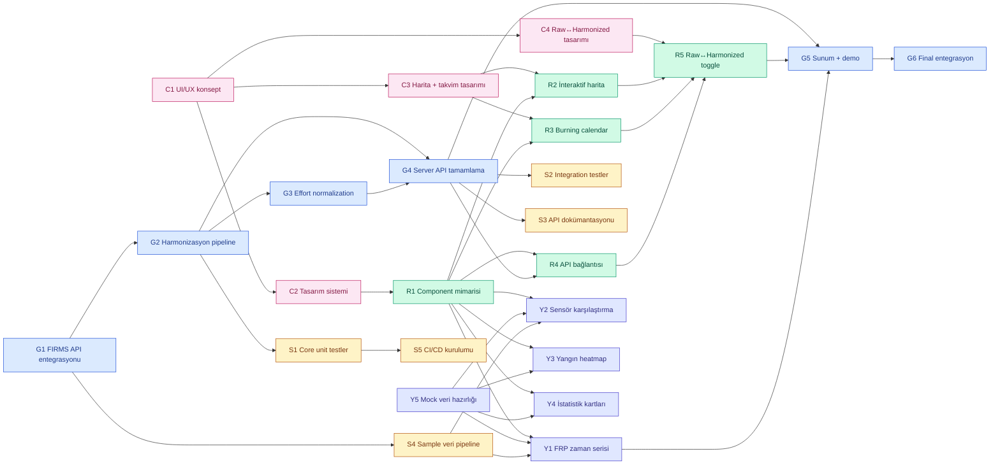

# Görev Dağılımı — PyroSync

Proje bağlamı: [README.md](README.md). Strateji: STRATEGY.md (yerel, gitignore'da).

> [!NOTE]
> 2026-11-13'te oluşturuldu. Tek branch (`main`) üzerinden sırayla commit atılır; herkes kendi görevini bitirince commit atar, çakışma olmaması için aynı dosyalara aynı anda dokunulmaz.

## Nasıl okunur

- **Kimlik:** `G` Görkem'in, `C` Can'ın, `R` Serhat'ın, `S` Samet'in, `Y` Yusuf'un görevleri. Örnek: `R3` Serhat'ın 3. görevi. Commit mesajlarında bu kimlikler kullanılır (`[G2] VZA correction katsayıları kalibre edildi`).
- **Bekler:** başlamadan önce bitmiş olması gereken görevler. Bunlar bitmeden başlanırsa iş ya yapılamaz ya da tekrar yapılır.
- **Açar:** bu görev bitince başlayabilecek görevler.
- **Bitti sayılır:** görevin kapanma şartı. Şart sağlanmadan ✅ konmaz.
- **Durum:** ✅ bitti · 🔄 sürüyor · ⬜ başlayabilir · ⏸ bekliyor (bir bağımlılık bitmedi)

Bir görevi bitiren kişi durumunu ✅ yapar ve "Açar" satırındaki görevlerin sahiplerine haber verir.

---

## Bağımlılık grafiği

Mavi: Görkem · Pembe: Can · Yeşil: Serhat · Sarı: Samet · Mor: Yusuf. Oklar "önce bu biter, sonra şu başlar" demek.

---

## Özet

| Kimlik | Görev | Sahip | Bekler | Açar | Durum |
|--------|-------|-------|--------|------|-------|
| G1 | FIRMS API gerçek veri entegrasyonu | Görkem | — | G2, S4 | ⬜ |
| G2 | Harmonizasyon pipeline tamamlama | Görkem | G1 | G3, G4, S1 | ⏸ |
| G3 | Effort normalization (Ω) | Görkem | G2 | G4 | ⏸ |
| G4 | Server API endpoint'leri tamamlama | Görkem | G2, G3 | G5, R4, S2, S3 | ⏸ |
| G5 | Sunum materyali + demo senaryosu | Görkem | G4, R5, Y1 | G6 | ⏸ |
| G6 | Final entegrasyon + deployment | Görkem | G5 | — | ⏸ |
| C1 | UI/UX genel konsept + wireframe | Can | — | C2, C3, C4 | ⬜ |
| C2 | Tasarım sistemi (renkler, tipografi, spacing) | Can | C1 | R1 | ⏸ |
| C3 | Harita + takvim detay tasarımı | Can | C1 | R2, R3 | ⏸ |
| C4 | Raw ↔ Harmonized karşılaştırma tasarımı | Can | C1 | R5 | ⏸ |
| R1 | React component mimarisi + layout | Serhat | C2 | R2, R3, R4, Y1–Y4 | ⏸ |
| R2 | İnteraktif harita entegrasyonu | Serhat | C3, R1 | R5 | ⏸ |
| R3 | Burning activity calendar componenti | Serhat | C3, R1 | R5 | ⏸ |
| R4 | Backend API bağlantısı + state management | Serhat | G4, R1 | R5 | ⏸ |
| R5 | Raw ↔ Harmonized toggle implementasyonu | Serhat | R2, R3, R4, C4 | G5 | ⏸ |
| S1 | Core crate unit testleri | Samet | G2 | S5 | ⏸ |
| S2 | Server + FIRMS client integration testleri | Samet | G4 | — | ⏸ |
| S3 | API dokümantasyonu (OpenAPI) | Samet | G4 | — | ⏸ |
| S4 | Sample/demo veri pipeline'ı | Samet | G1 | Y1, Y2 | ⏸ |
| S5 | GitHub Actions CI/CD kurulumu | Samet | S1 | — | ⏸ |
| Y1 | FRP zaman serisi grafiği | Yusuf | R1, Y5, S4 | G5 | ⏸ |
| Y2 | Sensör karşılaştırma grafikleri | Yusuf | R1, Y5, S4 | — | ⏸ |
| Y3 | Aylık yangın yoğunluk heatmap'i | Yusuf | R1, Y5 | — | ⏸ |
| Y4 | İstatistik dashboard kartları | Yusuf | R1, Y5 | — | ⏸ |
| Y5 | Mock veri hazırlığı (frontend için) | Yusuf | — | Y1, Y2, Y3, Y4 | ⬜ |

**Şu an başlanabilecekler:**
- **Görkem:** G1 — FIRMS API client iskelet hazır, gerçek veriye bağlama.
- **Can:** C1 — UI/UX konsept tasarımı, hiçbir şeye bağımlı değil.
- **Yusuf:** Y5 — Mock veri JSON dosyaları, hiçbir şeye bağımlı değil.

**Birbirini bekleyen kritik yollar:**
1. **G1 → G2 → G4 → R4 → R5:** Backend pipeline'ı tamamlanmadan frontend gerçek veriyle çalışamaz. Bu sürede Serhat, Can'ın tasarımlarıyla mock veri üzerinde çalışır.
2. **C1 → C2 → R1:** Serhat'ın component mimarisi Can'ın tasarım sistemine bağlı. Can'ın ilk çıktısı Serhat'ın başlamasını belirler.
3. **G2 → S1 → S5:** Samet'in testleri pipeline kodu yazıldıktan sonra başlar. O zamana kadar S4 (sample veri) ile meşgul olabilir.
4. **R1 + Y5 → Y1–Y4:** Yusuf'un grafikleri hem component altyapısını hem mock veriyi bekler. Y5'i erken bitirip R1'e kadar başka işlerle ilgilenebilir.

---

## Görkem'in görevleri

### G1 — FIRMS API gerçek veri entegrasyonu ⬜
- **Bekler:** — · **Açar:** G2, S4
- `pyrosync-firms` crate'i iskelet olarak hazır. Yapılacaklar:
  - NASA FIRMS API key ile gerçek veri çekme testi
  - Rate limiting ve retry mekanizması (API 429/503 dönebilir)
  - Tarihsel veri desteği (NRT + SP + archive kaynaklarına göre endpoint seçimi)
  - CSV parse'ın gerçek FIRMS çıktısıyla doğrulanması (MODIS ve VIIRS formatları farklı sütun isimleri kullanabiliyor)
  - `data/sample/` altına birkaç günlük örnek veri kaydetme (offline geliştirme için)
- **Bitti sayılır:** `cargo test -p pyrosync-firms` geçiyor; gerçek API key ile en az 3 farklı kaynak (MODIS_NRT, VIIRS_SNPP_NRT, VIIRS_NOAA20_NRT) üzerinden veri çekilip parse ediliyor; `data/sample/` altında örnek CSV var.

### G2 — Harmonizasyon pipeline tamamlama ⏸
- **Bekler:** G1 · **Açar:** G3, G4, S1
- Pipeline iskeletleri mevcut (dedup, VZA, matching, calendar). Yapılacaklar:
  - H3 hexagonal grid entegrasyonu — mekansal agregatör olarak. `h3o` crate ile 1 km MODIS pikselini H3 hücresine eşleme, aynı hücredeki VIIRS deteksiyonlarıyla gruplama.
  - VZA polinom katsayılarını gerçek overlap-period verisinden hesaplama (şu an placeholder).
  - Cross-sensor matching'de BallTree ile O(n log n) optimizasyonu (şu an O(n²)).
  - Fleet rule: aynı anda birden fazla VIIRS uydusu gördüğünde ortalama alma (toplama değil).
  - Gerçek FIRMS verisiyle uçtan uca pipeline testi.
- **Bitti sayılır:** `cargo test -p pyrosync-core` geçiyor; gerçek veriyle MODIS+VIIRS → harmonized → calendar akışı çalışıyor; dedup sonrası FRP %15–20 azalıyor (beklenen), VZA correction R²'si hesaplanıyor.

### G3 — Effort normalization (Ω) ⏸
- **Bekler:** G2 · **Açar:** G4
- 2000–2012 arası yalnız MODIS, 2012–2017 MODIS + 1 VIIRS, 2017+ MODIS + 2 VIIRS, 2023+ MODIS + 3 VIIRS. Uydu sayısı arttıkça aynı bölgede daha fazla detection olur — bu yapay artışı düzeltmek gerekiyor.
  - Her ay/bölge için effective observation count hesaplama
  - MODIS-only dönemine normalize etme (2000–2012 baseline)
  - Takvim çıktısına anomaly z-score'ları ekleme
- **Bitti sayılır:** 2000–present boyunca monoton artan trend kalkıyor; 2012 ve 2017'deki uydu geçişlerinde yapay sıçrama yok.

### G4 — Server API endpoint'leri tamamlama ⏸
- **Bekler:** G2, G3 · **Açar:** G5, R4, S2, S3
- Mevcut: `/api/health`, `/api/harmonize` (bbox + days). Yapılacaklar:
  - `/api/calendar` — belirli bölge için aylık burning activity calendar (2000–present)
  - `/api/compare` — aynı bölge ve zaman dilimi için raw vs harmonized karşılaştırma istatistikleri
  - `/api/stats` — genel istatistikler (toplam detection, sensor breakdown, pipeline metrics)
  - Response caching (aynı bbox+days tekrar sorulduğunda API'ye gitmeme)
  - CORS ve error handling son hali
- **Bitti sayılır:** tüm endpoint'ler Postman/curl ile test edildi; frontend proxy üzerinden veri alıyor; 10 saniyelik timeout dahilinde yanıt geliyor.

### G5 — Sunum materyali + demo senaryosu ⏸
- **Bekler:** G4, R5, Y1 · **Açar:** G6
- NASA Space Apps jüri kriterleri (Impact, Creativity, Validity, Relevance, Presentation) doğrultusunda:
  - 3 dakikalık demo videosu senaryosu
  - "Sensor cliff" problemini gösteren raw görünüm → toggle → harmonized görünüm akışı
  - Teknik açıklama slaytları (pipeline diyagramı, VZA correction görseli, H3 grid görseli)
  - Kullanım senaryoları: orman yangını izleme, tarım yanığı tespiti, iklim araştırması
- **Bitti sayılır:** demo senaryosu yazıldı; canlı demo 3 dakika içinde sorunsuz çalışıyor.

### G6 — Final entegrasyon + deployment ⏸
- **Bekler:** G5 · **Açar:** —
- Tüm parçaların bir araya gelmesi:
  - Frontend build (`npm run build`) → Axum static file serving
  - Environment variable yönetimi (FIRMS_API_KEY)
  - Tek komutla çalışır hale getirme
  - Son testler ve bug fix'ler
  - Submission paketleme
- **Bitti sayılır:** `cargo run -p pyrosync-server` ile backend + frontend tek process'te ayağa kalkıyor; jüri demo'yu sorunsuz görebilir.

---

## Can'ın görevleri

### C1 — UI/UX genel konsept + wireframe ⬜
- **Bekler:** — · **Açar:** C2, C3, C4
- Projenin görsel kimliğini belirleyen ilk tasarım:
  - Ana sayfa layout'u: harita, takvim, kontroller nerede duracak
  - Kullanıcı akışı: bölge seçimi → veri yükleme → Raw/Harmonized geçişi → detay inceleme
  - Wireframe (Figma veya kağıt üzeri) — tüm sayfalar/paneller
  - Mobil responsive düşünülmeli (jüri telefonda bakabilir)
- **Referans:** `STRATEGY.md`'deki "Raw ↔ Harmonised toggle" ve "Sensor Cliff" kavramları tasarımın merkezinde olmalı.
- **Bitti sayılır:** wireframe tüm ekiplere paylaşıldı ve onaylandı; ana sayfa, harita görünümü, takvim görünümü, karşılaştırma paneli var.

### C2 — Tasarım sistemi ⏸
- **Bekler:** C1 · **Açar:** R1
- Serhat'ın kodlayacağı component'ler için görsel standartlar:
  - Renk paleti (primary, secondary, accent; MODIS için bir renk, VIIRS için bir renk, harmonized için bir renk)
  - Tipografi (font family, size scale, weight)
  - Spacing sistemi (8px grid)
  - Button, card, panel, tooltip component tasarımları
  - Dark mode desteği düşünülmeli
- **Çıktı:** Figma dosyası veya tasarım dökümanı; CSS variable isimleri belirlenmiş.
- **Bitti sayılır:** Serhat bu dökümanla component'leri birebir kodlayabilir; renk ve spacing soruları kalmamış.

### C3 — Harita + takvim detay tasarımı ⏸
- **Bekler:** C1 · **Açar:** R2, R3
- İki ana görselleştirme panelinin detaylı tasarımı:
  - **Harita:** hotspot noktaları nasıl gösterilecek (renk, boyut, opacity → FRP ve confidence'a göre), cluster davranışı, popup içeriği
  - **Takvim:** aylık hücrelerin renk skalası (anomaly'ye göre), yıl ve ay eksenleri, hover detayı
  - İkisi arasındaki etkileşim: takvimde bir aya tıklayınca haritada o ayın verileri
- **Bitti sayılır:** harita ve takvim component'lerinin her durumu (boş, yükleniyor, veri var, hata) tasarlanmış.

### C4 — Raw ↔ Harmonized karşılaştırma tasarımı ⏸
- **Bekler:** C1 · **Açar:** R5
- Projenin **en önemli demo anı:** toggle ile Raw ve Harmonized arasında geçiş.
  - Toggle/switch UI tasarımı (belirgin, anlaşılır)
  - Raw modda sensör renkleri farklı (MODIS mavi, VIIRS kırmızı; sensor cliff görülsün)
  - Harmonized modda tek renk skalası (fused data)
  - Geçiş animasyonu: noktaların birleşmesi, duplikasyonların kaybolması
  - İstatistik paneli: "Raw: 1,247 detections → Harmonized: 892 detections (28% duplicate removed)"
- **Bitti sayılır:** toggle'ın her iki durumu ve geçiş animasyonunun tasarımı tamamlanmış; Serhat implementasyon için hazır.

---

## Serhat'ın görevleri

### R1 — React component mimarisi + layout ⏸
- **Bekler:** C2 · **Açar:** R2, R3, R4, Y1–Y4
- Frontend'in iskeletini kurmak (mevcut `web/` dizini üzerinde):
  - Can'ın tasarım sistemini CSS variables olarak implement etme
  - Layout component'leri: `<AppShell>`, `<Sidebar>`, `<MapPanel>`, `<CalendarPanel>`, `<StatsBar>`
  - Responsive grid (mobile-first)
  - Shared state altyapısı (React Context veya zustand)
  - TypeScript type'ları backend API response'larına göre (`types.ts`)
  - `npm install` çalışıyor, `npm run dev` ile development server ayağa kalkıyor
- **Teknik not:** TypeScript derlemesi SWC ile yapılıyor (`@vitejs/plugin-react-swc` zaten kurulu).
- **Bitti sayılır:** `npm run dev` hatasız çalışıyor; layout Can'ın wireframe'ine uyuyor; boş paneller doğru yerde; mobile'da düzgün görünüyor.

### R2 — İnteraktif harita entegrasyonu ⏸
- **Bekler:** C3, R1 · **Açar:** R5
- Yangın hotspot'larını harita üzerinde gösteren component:
  - Leaflet veya Mapbox GL JS entegrasyonu (tercih: react-leaflet, ücretsiz)
  - Hotspot noktalarını FRP'ye göre boyut ve renk ile gösterme
  - Cluster davranışı (zoom out'ta binlerce nokta birleşsin)
  - Bölge seçimi (bbox çizme veya önceden tanımlı bölgeler)
  - Popup: hotspot detayı (sensor, FRP, confidence, tarih)
- **Bitti sayılır:** mock veriyle harita render oluyor; zoom/pan akıcı; noktalar FRP'ye göre farklılaşıyor; bbox seçimi çalışıyor.

### R3 — Burning activity calendar componenti ⏸
- **Bekler:** C3, R1 · **Açar:** R5
- GitHub contribution graph benzeri aylık ısı haritası:
  - X ekseni: yıllar (2000–present), Y ekseni: aylar (Ocak–Aralık)
  - Hücre rengi: detection count veya mean FRP'ye göre (seçilebilir)
  - Anomaly gösterimi: normal yıllardan sapan aylar vurgulu
  - Hover: detay tooltip (count, mean FRP, anomaly z-score)
  - Tıklama: haritayı o ay/yıla filtreler
- **Bitti sayılır:** mock veriyle takvim render oluyor; 2000–2026 arası tüm aylar görünüyor; renk skalası anlamlı; hover tooltip çalışıyor.

### R4 — Backend API bağlantısı + state management ⏸
- **Bekler:** G4, R1 · **Açar:** R5
- Frontend'i gerçek backend'e bağlayan katman:
  - API client modülü (`api.ts`): `/api/harmonize`, `/api/calendar`, `/api/compare`, `/api/stats`
  - Loading/error/success state yönetimi
  - Bölge değiştiğinde otomatik veri yenileme
  - API yanıtını component state'ine dönüştürme
- **Not:** Vite proxy zaten ayarlı (`/api` → `localhost:3001`).
- **Bitti sayılır:** gerçek backend çalışırken frontend veri çekip gösteriyor; loading spinner var; API hatası kullanıcıya mesaj olarak dönüyor.

### R5 — Raw ↔ Harmonized toggle implementasyonu ⏸
- **Bekler:** R2, R3, R4, C4 · **Açar:** G5
- Projenin imza özelliği:
  - Toggle/switch component (Can'ın C4 tasarımına göre)
  - Raw modda: MODIS ve VIIRS ayrı renklerle, duplikasyonlar dahil
  - Harmonized modda: fused data, tek renk skalası
  - Geçiş animasyonu (noktaların birleşmesi/ayrılması)
  - İstatistik paneli güncellenmesi (detection sayıları, FRP ortalamaları)
  - Harita ve takvim aynı anda güncellenmeli
- **Bitti sayılır:** toggle sorunsuz çalışıyor; Raw'dan Harmonized'a geçiş "sensor cliff" problemini açıkça gösteriyor; animasyon akıcı; jüri bu toggle'ı görünce farkı anlıyor.

---

## Samet'in görevleri

### S1 — Core crate unit testleri ⏸
- **Bekler:** G2 · **Açar:** S5
- `pyrosync-core` crate'indeki harmonizasyon pipeline'ı için kapsamlı testler:
  - **dedup:** bilinen duplikat seti verin → %18.3 FRP azalması beklenen
  - **VZA:** nadir'de correction = 1.0, 60° VZA'da > 1.0; symemetrik
  - **matching:** 2 km ve 5 dk içindeki MODIS/VIIRS çiftleri eşleşmeli, dışındakiler eşleşmemeli
  - **calendar:** 24 aylık veri → 24 hücre; anomaly hesabı en az 3 yıl verisi gerektirir
  - Edge case'ler: boş veri, tek sensör, tüm deteksiyonlar eşleşen, hiçbiri eşleşmeyen
- **Bitti sayılır:** `cargo test -p pyrosync-core` en az 20 test geçiyor; her modül (dedup, vza, harmonize, calendar) için en az 3 test var.

### S2 — Server + FIRMS client integration testleri ⏸
- **Bekler:** G4 · **Açar:** —
- Uçtan uca API testleri:
  - `/api/health` → 200 OK
  - `/api/harmonize?west=...&south=...&east=...&north=...&days=1` → geçerli JSON, `harmonized.count > 0`
  - `/api/calendar` → yıl/ay sıralı, anomaly hesabı tutarlı
  - `/api/compare` → raw count > harmonized count
  - Hatalı parametrelerde uygun HTTP status kodu
  - FIRMS API key eksikse 500 + anlamlı hata mesajı
- **Bitti sayılır:** `cargo test -p pyrosync-server` en az 10 test geçiyor; mock FIRMS verisine karşı uçtan uca test çalışıyor.

### S3 — API dokümantasyonu ⏸
- **Bekler:** G4 · **Açar:** —
- Tüm API endpoint'lerinin dökümanı:
  - Her endpoint: URL, method, parametreler, örnek request/response
  - Hata kodları ve anlamları
  - Örnek curl komutları
  - `docs/API.md` olarak depoya
- **Bitti sayılır:** `docs/API.md` depoda; her endpoint için en az bir örnek var; takım bu dökümanla frontend geliştirme yapabilir.

### S4 — Sample/demo veri pipeline'ı ⏸
- **Bekler:** G1 · **Açar:** Y1, Y2
- Offline geliştirme ve demo için hazır veri seti:
  - FIRMS API'den birkaç bölge (Türkiye, Kaliforniya, Avustralya) için 2020–2025 verisi çekme
  - Her bölge için MODIS + VIIRS ayrı CSV dosyaları
  - Harmonize edilmiş JSON çıktıları
  - `data/sample/` altında organize
  - Frontend ve grafik component'leri bu veriyle çalışabilir
- **Bitti sayılır:** `data/sample/` altında en az 3 bölge var; her bölgede MODIS, VIIRS ve harmonized veri mevcut; Yusuf bu veriyle grafik yapabilir.

### S5 — GitHub Actions CI/CD kurulumu ⏸
- **Bekler:** S1 · **Açar:** —
- Her push'ta otomatik kontrol:
  - `cargo check` — derleme hatası yok
  - `cargo test` — tüm testler geçiyor
  - `cargo clippy` — lint uyarısı yok (isteğe bağlı)
  - `cd web && npm ci && npm run build` — frontend build başarılı
- **Dosya:** `.github/workflows/ci.yml`
- **Bitti sayılır:** main branch'e push yapınca Actions yeşil tik gösteriyor; başarısız build'de hata mesajı görünüyor.

---

## Yusuf'un görevleri

### Y5 — Mock veri hazırlığı (frontend için) ⬜
- **Bekler:** — · **Açar:** Y1, Y2, Y3, Y4
- Frontend component'leri backend hazır olmadan geliştirilebilsin:
  - `web/src/mocks/hotspots.json` — 500-1000 arası hotspot (lat, lon, frp, confidence, sensor, date)
  - `web/src/mocks/calendar.json` — 2000–2025 arası aylık hücre verisi (count, mean_frp, anomaly)
  - `web/src/mocks/stats.json` — genel istatistikler (raw vs harmonized count, pipeline metrics)
  - Veriler gerçekçi olmalı: FRP aralığı 1–500 MW, mevsimsellik var (yaz ayları yoğun), 2012'de VIIRS geçişi belirgin
  - `web/src/mocks/index.ts` ile export
- **Bitti sayılır:** mock dosyaları `web/src/mocks/` altında; TypeScript hatasız import ediliyor; sensor cliff 2012'de görünüyor.

### Y1 — FRP zaman serisi grafiği ⏸
- **Bekler:** R1, Y5, S4 · **Açar:** G5
- Recharts ile aylık ortalama FRP trendi:
  - X ekseni: zaman (2000–present), Y ekseni: ortalama FRP (MW)
  - İki çizgi: Raw (MODIS+VIIRS ayrı ayrı) ve Harmonized (fused)
  - Raw modda sensor cliff belirgin (2012'de VIIRS gelince sıçrama)
  - Harmonized modda düzgün trend
  - Zoom, tooltip, legend
- **Bu grafik sunum için kritik — "sensor cliff" problemini tek bakışta gösterir.**
- **Bitti sayılır:** mock veriyle grafik render oluyor; sensor cliff Raw modda görünüyor, Harmonized modda kaybolıyor; tooltip çalışıyor.

### Y2 — Sensör karşılaştırma grafikleri ⏸
- **Bekler:** R1, Y5, S4 · **Açar:** —
- MODIS vs VIIRS ayrıntılı karşılaştırma:
  - Bar chart: aylık detection count by sensor
  - Scatter plot: MODIS FRP vs VIIRS FRP (eşleşen çiftlerde)
  - Pie/donut: sensor breakdown (MODIS-only, VIIRS-only, Matched)
- **Bitti sayılır:** en az 2 farklı chart tipi çalışıyor; sensörler arası fark görsel olarak açık.

### Y3 — Aylık yangın yoğunluk heatmap'i ⏸
- **Bekler:** R1, Y5 · **Açar:** —
- Serhat'ın R3'ünden farklı olarak bu bir bölgesel yoğunluk haritası:
  - Grid tabanlı renk haritası (hexbin veya kare grid)
  - Renk: detection yoğunluğu veya toplam FRP
  - Zaman slider'ı ile ay ay ilerleme
  - Raw vs Harmonized modda farklı dağılım
- **Bitti sayılır:** mock veriyle heatmap render oluyor; zaman slider'ı çalışıyor; renk skalası anlamlı.

### Y4 — İstatistik dashboard kartları ⏸
- **Bekler:** R1, Y5 · **Açar:** —
- Üst kısımda summary bilgiler:
  - Toplam detection sayısı (raw vs harmonized)
  - Duplicate removal oranı (%)
  - Aktif sensör sayısı
  - Ortalama FRP
  - Son güncelleme zamanı
  - Kart tasarımı: büyük sayı + trend ok (▲▼) + mini sparkline
- **Bitti sayılır:** en az 4 istatistik kartı mock veriyle render oluyor; raw/harmonized geçişinde sayılar değişiyor.
