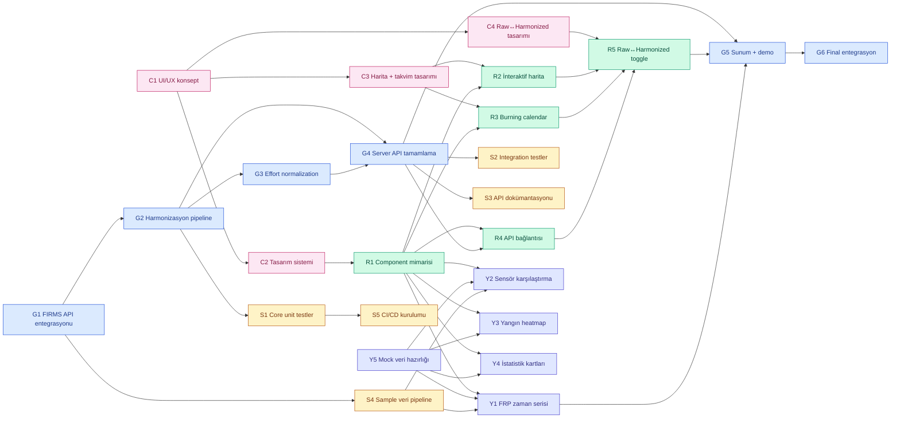

# Görev Dağılımı — PyroSync

Proje bağlamı: [README.md](README.md). Strateji: STRATEGY.md (yerel, gitignore'da).

> [!NOTE]
> 2026-11-13'te oluşturuldu. Tek branch (`main`) üzerinden sırayla commit atılır; herkes kendi görevini bitirince commit atar, çakışma olmaması için aynı dosyalara aynı anda dokunulmaz.

## Nasıl okunur

- **Kimlik:** `G` Görkem'in, `C` Can'ın, `R` Serhat'ın, `S` Samet'in, `Y` Yusuf'un, `K` Sadık'ın görevleri. Örnek: `R3` Serhat'ın 3. görevi. Commit mesajlarında bu kimlikler kullanılır (`[G2] VZA correction katsayıları kalibre edildi`).
- **Bekler:** başlamadan önce bitmiş olması gereken görevler. Bunlar bitmeden başlanırsa iş ya yapılamaz ya da tekrar yapılır.
- **Çapraz dosya atıfları:** `GOREVLER2.md`'deki görevlere `v2:` prefix'iyle atıf yapılır (örnek `v2:C5`). GOREVLER2.md de bu dosyaya `v1:` prefix'iyle atıf yapar.
- **Açar:** bu görev bitince başlayabilecek görevler.
- **Bitti sayılır:** görevin kapanma şartı. Şart sağlanmadan ✅ konmaz.
- **Durum:** ✅ bitti · 🔄 sürüyor · ⬜ başlayabilir · ⏸ bekliyor (bir bağımlılık bitmedi)

Bir görevi bitiren kişi durumunu ✅ yapar ve "Açar" satırındaki görevlerin sahiplerine haber verir.

---

## Bağımlılık grafiği

Mavi: Görkem · Pembe: Can · Yeşil: Serhat · Sarı: Samet · Mor: Yusuf. Oklar "önce bu biter, sonra şu başlar" demek.

---

## Özet

| Kimlik | Görev | Sahip | Bekler | Açar | Durum |
|--------|-------|-------|--------|------|-------|
| G1 | FIRMS API gerçek veri entegrasyonu | Görkem | — | G2, S4 | ✅ |
| G2 | Harmonizasyon pipeline tamamlama | Görkem | G1 | G3, G4, S1 | ✅ |
| G3 | Effort normalization (Ω) | Görkem | G2 | G4 | ✅ |
| G4 | Server API endpoint'leri tamamlama | Görkem | G2, G3 | G5, R4, S2, S3 | ✅ |
| G5 | Sunum materyali + demo senaryosu | Görkem | G4, R5, Y1 | G6 | ⏸ (R5 ✅, Y1 bekliyor) |
| G6 | Final entegrasyon + deployment | Görkem | G5 | — | ⏸ |
| C1 | UI/UX genel konsept + wireframe | Can | — | C2, C3, C4 | ✅ |
| C2 | Tasarım sistemi (renkler, tipografi, spacing) | Can | C1 | R1 | ✅ |
| C3 | Harita + takvim detay tasarımı | Can | C1 | R2, R3 | ✅ |
| C4 | Raw ↔ Harmonized karşılaştırma tasarımı | Can | C1 | R5 | ✅ |
| R1 | React component mimarisi + layout | Serhat | C2 | R2, R3, R4, Y1–Y4 | ✅ |
| R2 | İnteraktif harita entegrasyonu | Serhat | C3, R1 | R5 | ✅ |
| R3 | Burning activity calendar componenti | Serhat | C3, R1 | R5 | ✅ |
| R4 | Backend API bağlantısı + state management | Serhat | G4, R1 | R5 | ✅ |
| R5 | Raw ↔ Harmonized toggle implementasyonu | Serhat | R2, R3, R4, C4 | G5 | ✅ |
| S1 | Core crate unit testleri | Samet | G2 | S5 | ✅ |
| S2 | Server + FIRMS client integration testleri | Samet | G4 | — | ✅ |
| S3 | API dokümantasyonu (OpenAPI) | Samet | G4 | — | ✅ |
| S4 | Sample/demo veri pipeline'ı | Samet | G1 | Y1, Y2 | ⬜ |
| S5 | GitHub Actions CI/CD kurulumu | Samet | S1 | — | ⬜ |
| Y1 | FRP zaman serisi grafiği | Yusuf | R1, Y5, S4 | G5 | ⏸ |
| Y2 | Sensör karşılaştırma grafikleri | Yusuf | R1, Y5, S4 | — | ⏸ |
| Y3 | Aylık yangın yoğunluk heatmap'i | Yusuf | R1, Y5 | — | ⏸ |
| Y4 | İstatistik dashboard kartları | Yusuf | R1, Y5 | — | ⏸ |
| Y5 | Mock veri hazırlığı (frontend için) | Yusuf | — | Y1, Y2, Y3, Y4 | ⬜ |
| K5 | Area API sonuçlarını diske cache'leme | Sadık | — | K6, K7 | ⬜ |
| K6 | 2023 (NOAA-21) efor geçişini ölçme | Sadık | K5 | — | ⬜ |
| K7 | Tam filo 2000-present trend serisi | Sadık | K5 | — | ⬜ |
| K8 | MODIS içi efor geçişi (2002 Aqua) | Sadık | — | — | ⬜ |
| K9 | SPA fallback gerçekten çalışmıyor | Sadık | — | R1 | ⬜ |

**Şu an başlanabilecekler:**
- **Görkem:** G5 — Sunum materyali + demo senaryosu (Y1 bekliyor). R5 bitti, G4 bitti.
- **Can:** C1 ✅, C2 ✅, C3 ✅, C4 ✅. İlk faz UI/UX tasarım ve çalışan React prototipi (`web/src`) görevleri tamamlandı (sıradaki işler `GOREVLER2.md` içinde C5–C7).
- **Serhat:** R1 ✅, R2 ✅, R3 ✅, R4 ✅, R5 ✅. Tüm frontend görevleri tamamlandı.
- **Samet:** S5 — CI/CD (S1 bitti), S3 — OpenAPI dokümantasyonu (G4 bitti), S4 (G1 bitti).
- **Yusuf:** Y5 — Mock veri JSON dosyaları, hiçbir şeye bağımlı değil. R1 bitti, Y5 bitince Y1–Y4 açılır.

**Birbirini bekleyen kritik yollar:**
1. ~~**G1 → G2 → G4 → R4 → R5:**~~ ✅ Tamamlandı. Backend pipeline ve frontend toggle zinciri tamam.
2. ~~**C1 → C2 → R1:**~~ ✅ Tamamlandı. Component mimarisi ve tasarım sistemi entegre.
3. **G2 → S1 → S5:** Samet'in CI/CD'si S1'e bağlı, S1 bitti. S5 başlayabilir.
4. **R1 + Y5 → Y1–Y4:** Yusuf'un grafikleri Y5 (mock veri) bekliyor. R1 bitti.
5. **R5 → G5:** Serhat'ın frontend zinciri tamamlandı. G5 artık yalnızca Y1'i bekliyor.

---

## Görkem'in görevleri

### G1 — FIRMS API gerçek veri entegrasyonu ✅
- **Bekler:** — · **Açar:** G2, S4
- `pyrosync-firms` crate'i iskelet olarak hazır. Yapılacaklar:
  - ✅ NASA FIRMS API key ile gerçek veri çekme testi — `examples/nrt_check.rs`
  - ✅ Rate limiting ve retry mekanizması (API 429/503 dönebilir) — `limiter.rs`, `Retry-After` destekli exponential backoff
  - ✅ Tarihsel veri desteği (NRT + SP + archive kaynaklarına göre endpoint seçimi) — `source.rs`, `availability.rs`, `archive.rs`
  - ✅ CSV parse'ın gerçek FIRMS çıktısıyla doğrulanması (MODIS ve VIIRS formatları farklı sütun isimleri kullanabiliyor)
  - ✅ `data/sample/` altına birkaç günlük örnek veri kaydetme (offline geliştirme için) — 5 format
- **Bitti sayılır:** `cargo test -p pyrosync-firms` geçiyor; gerçek API key ile en az 3 farklı kaynak (MODIS_NRT, VIIRS_SNPP_NRT, VIIRS_NOAA20_NRT) üzerinden veri çekilip parse ediliyor; `data/sample/` altında örnek CSV var.
- **Doğrulama (2026-11-14):** 43 test geçiyor, clippy temiz. Canlı API `--bbox 15,-15,30,0` ile: MODIS_NRT 21, VIIRS_SNPP_NRT 2300, VIIRS_NOAA20_NRT 348 hotspot parse edildi.
- **Not:** Canlı doğrulama `acq_time` parse hatasını ortaya çıkardı — FIRMS baştaki sıfırları atıyor (`614` = 06:14), eski kod yalnızca 4 karakterlik değer kabul ediyordu. MODIS_NRT çekimi tümüyle başarısız oluyordu; `data/sample/` altındaki üç NRT dosyası da aynı sebeple offline parse edilemiyordu. `parse_hhmm` 1–4 haneli değerleri kabul edecek şekilde düzeltildi, 6 regresyon testi eklendi.

### G2 — Harmonizasyon pipeline tamamlama ✅
- **Bekler:** G1 · **Açar:** G3, G4, S1
- Pipeline iskeletleri mevcut (dedup, VZA, matching, calendar). Yapılacaklar:
  - ✅ H3 hexagonal grid entegrasyonu — `h3o` 0.11, Resolution 8 (hücre 0,74 km², MODIS 1 km ayak izine en yakın ölçek), k-ring 3 ile aday arama (~2,8 km garantili kapsama; k=2 tam 2,0 km'de sınırda kalıp eşleşme kaçırıyordu). `crates/core/src/h3index.rs`
  - ⛔ VZA polinom katsayılarını gerçek overlap-period verisinden hesaplama — **FIRMS ile yapılamaz**, bkz. aşağıdaki not. Katsayılar placeholder kaldı.
  - ✅ Cross-sensor matching optimizasyonu — BallTree yerine H3 kullanıldı. Rust'ta olgun BallTree crate'i yok ve H3 zaten gerekiyordu; iki indeks yerine tek indeks hem agregasyon hem aday arama için kullanılıyor.
  - ✅ Fleet rule — `crates/core/src/fleet.rs`, ayrı aşama olarak sensör-içi dedup'tan sonra ve MODIS eşleştirmesinden önce çalışıyor.
  - ✅ Gerçek FIRMS verisiyle uçtan uca pipeline testi — `/api/harmonize` üzerinden koşuldu.
- **Bitti sayılır (2026-11-14'te ölçüme dayalı olarak revize edildi):**
  1. `cargo test -p pyrosync-core` geçiyor ve `cargo clippy --workspace --all-targets` temiz.
  2. Gerçek FIRMS verisiyle MODIS+VIIRS → harmonized → calendar akışı en az üç farklı bölgede çalışıyor, `Matched` kategorisi kayıt üretiyor.
  3. Tespit ve FRP azalması **bileşen bazında** raporlanıyor: interscan dedup, VIIRS filo birleştirme ve cross-sensor füzyon ayrı ayrı. Sabit bir yüzde bandı beklenmez — azalma yangın yoğunluğuna bağlıdır (ölçüm: seyrek bölgede %14,5, yoğun bölgede %39–41).
  4. VZA düzeltmesi gerçek veride tetikleniyor ve uygulanan katsayı kayıt başına `vza_factor` alanında raporlanıyor. **R² hesabı G2 kapsamı dışıdır** (bkz. aşağıdaki not).
- **Revizyon gerekçesi:** Önceki iki şart ("FRP %15–20 azalıyor", "VZA R²'si hesaplanıyor") ölçümle çeliştiği için değiştirildi. Eski %15–20 bandı literatürde yalnız interscan dedup için verilen bir değer; bu pipeline'da ayrıca VIIRS filo birleştirmesi var ve toplam azalma bölge yoğunluğuna göre %14–41 arasında değişiyor, hiçbir bölgede bandın içine düşmüyor. R² ise eşzamanlı MODIS/VIIRS gözlem çifti gerektiriyor ve ölçüm bu çiftlerin FIRMS'te bulunmadığını gösterdi.
- **Doğrulama (2026-11-14), canlı `/api/harmonize`, 2 günlük pencere, 180 dk eşleştirme penceresiyle:**

  | Bölge | Ham | Harmonize | n düşüş | FRP düşüş | Matched |
  |-------|-----|-----------|---------|-----------|---------|
  | Zambiya/Angola | 699 / 6.770 MW | 585 / 4.866 MW | %16,3 | %28,1 | 12 |
  | Sahel | 14.042 / 133.676 MW | 9.270 / 74.605 MW | %34,0 | %44,2 | 221 |
  | Kuzey Avustralya | 11.876 / 137.654 MW | 7.411 / 75.983 MW | %37,6 | %44,8 | 329 |

  **Bileşen ayrıştırması** (şart 3 gereği, `n_obs` alanı üzerinden hesaplanır):

  | Aşama | Zambiya | Sahel | Avustralya |
  |-------|---------|-------|------------|
  | MODIS interscan dedup | 1 (%4,8) | 80 (%11,1) | 144 (%13,8) |
  | VIIRS interscan dedup | 57 (%8,4) | 1.602 (%12,0) | 1.694 (%15,6) |
  | VIIRS filo birleştirme | 44 (%6,5) | 2.869 (%21,5) | 2.298 (%21,2) |
  | Cross-sensor füzyon | 12 | 221 | 329 |

  MODIS tespitlerinin %34–60'ı bir VIIRS karşılığı buluyor (Zambiya 12/20, Sahel 221/643, Avustralya 329/897).
- **Filo kuralı doğrulandı, aşırı birleştirme yok.** Filo VIIRS tespitlerinin %21–22'sini siliyor; bağımsız ölçümde NOAA-21 tespitlerinin %19,7'sinin 2 km içinde NOAA-20 eşi olduğu bulunmuştu. İki sayı örtüşüyor, yani kural verinin gerçekten duplikat olduğunu söylediği kadarını siliyor. 2 km yarıçapı değiştirilmedi.
- **Cross-sensor pencere kararı: 180 dakika.** `MATCH_WINDOW_SECS` 300 saniyeden 10800 saniyeye çıkarıldı ve `Matched` yeniden tanımlandı: "eşzamanlı gözlem" değil, "aynı yangın olayının iki sensörle gözlemi".
  - Ölçüm: 26.505 co-located MODIS-VIIRS noktası, 4 bölge, 5 tarih, üç VIIRS platformu. **30 dakika altında sıfır çift.** Mutlak minimum 34 dk. Medyan 158 dk (NOAA-20/21), 122 dk (SNPP). Kümülatif: ≤45 dk %0,2 · ≤90 dk %9,5 · ≤120 dk %27,9 · ≤180 dk ~%49.
  - 300 saniyelik pencereyle üç bölgenin hepsinde `Matched` sıfır kayıt üretiyordu, yani cross-sensor füzyon iddiası çıktısızdı.
  - Pencere genişlemesi H3 indeksi sayesinde güvenli: aday kümesi mekansal olarak 37 hücreye sınırlı, zaman penceresinin genişlemesi aday sayısını patlatmıyor. Bu yüzden H3'ün önce yapılması doğru sıraydı.
  - Füzyon davranışı değişmedi: `Matched` kaydı VIIRS değerini kullanıyor, MODIS FRP'si ortalamaya karışmıyor. 3 saat önceki MODIS okumasını VIIRS tahminine katmak istemiyoruz.
- **VZA katsayı kalibrasyonu ve R² — FIRMS verisiyle yapılamaz, G2 kapsamı dışına alındı.** Mekanizma çalışıyor: VZA `scan` piksel boyutundan türetiliyor, gerçek veride 20/20 MODIS kaydında tetikleniyor, en büyük düzeltme %42,4 (33,8 → 19,48 MW). Ancak `correction_ratio` polinomunun katsayıları (A=0,85 B=0,12 C=1,0) placeholder ve kalibre edilmeleri eşzamanlı MODIS/VIIRS gözlem çifti gerektiriyor; yukarıdaki ölçüm bu çiftlerin FIRMS'te bulunmadığını gösterdi (minimum 34 dk). İki yol var: (a) literatürden hazır katsayı girilip kaynak gösterilir, (b) granül/arşiv seviyesi veri sağlanır. S7 (case study veri seti) ile birlikte planlanmalı. **Katsayılar girilene kadar harmonize FRP değerleri gösterge niteliğindedir ve methods sayfasında (C5/R6) bu açıkça belirtilmeli.**
- **Yan bulgu:** `VIIRS_SNPP_NRT` beslemesi 2026-11-02'de duruyor, diğer NRT kaynakları günceldir. `availability.rs` bunu doğru yönetiyor (SNPP sorgularını kendi aralığına kırpıyor), ama kısa pencereli isteklerde SNPP hiç katkı vermiyor; bu yüzden filo grupları o tarihlerde en fazla 2 platform içeriyor.

### G3 — Effort normalization (Ω) ✅
- **Bekler:** G2 · **Açar:** G4
- Uydu sayısı arttıkça aynı bölgede daha fazla detection olur — bu yapay artışı düzeltmek gerekiyor.
  - ✅ Her ay/bölge için effective observation count hesaplama — `crates/core/src/effort.rs`
  - ✅ MODIS-only dönemine normalize etme — taban dönemde Ω tanım gereği 1,0 çıkıyor
  - ✅ Takvim çıktısına anomaly z-score'ları ekleme — anomali artık normalize seri üzerinden hesaplanıyor
- **Bitti sayılır:** 2000–present boyunca monoton artan trend kalkıyor; 2012 ve 2017'deki uydu geçişlerinde yapay sıçrama yok.
- **Görev tanımındaki iki hata düzeltildi (arşiv verisinden ölçüldü):**
  - Görev "2017+ MODIS + 2 VIIRS" diyor; NOAA-20 verisi FIRMS'te **2018-04**'te başlıyor, 2017'de değil.
  - Görev **Aqua'yı atlamış**. Arşivde Aqua'nın ilk tespiti **2002-07**, yani 2000-11'den 2002-06'ya kadar yalnız Terra var ve orada da bir efor geçişi mevcut. Ω bunu doğru yakalıyor (Terra tek başına 21 ay, Terra+Aqua 113 ay; ikisinde de Ω = 1,000 çünkü ikisi de MODIS-only).
  - Gerçek platform zaman çizelgesi: Terra 2000-11 · +Aqua 2002-07 · +SNPP 2012-01 · +NOAA-20 2018-04 · +NOAA-21 2023-03.
- **Tasarım: Ω sabit kodlanmadı, her serinin kendi verisinden ölçülüyor.**
  - Ölçüm (arşiv, Türkiye, 2000-2025): MODIS-only dönem ~10.700 tespit/yıl, SNPP eklendikten sonra ~59.000 tespit/yıl, yani sıçrama **5-6 kat**. Buna karşılık MODIS'in kendi sayısı 26 yıl boyunca düz (10.733 → 11.123). Yani yapay trend platform SAYISIYLA değil sensör TESPİT VERİMİYLE ölçekleniyor (VIIRS 375 m vs MODIS 1 km).
  - Bu yüzden "platform sayısına göre normalize et" yaklaşımı yetersiz kalırdı: 2→3 platform için 1,5 kat düzeltme yapar, ~4 katlık sıçrama yerinde kalırdı.
  - Sabit Ω katsayısı da yanlış olurdu: SNPP/MODIS verim oranı bölgeye göre **3,28 (Bulgaristan) – 7,35 (Suriye)** arası değişiyor, 2,2 kat fark.
  - Çözüm: MODIS referans cetvel olarak kullanılıyor. Her ay için `total` ve `modis_observable` (platforms alanında MODIS bulunan kayıtlar) sayılır; aylar **(MODIS var mı?, VIIRS platform kümesi)** anahtarına göre havuzlanır ve `omega = Σtotal / Σmodis_observable` hesaplanır. Taban dönemde her kayıt MODIS içerdiği için Ω = 1,0 **otomatik** çıkar, elle ayar yok.
  - Havuzlama anahtarı MODIS alt bileşimine duyarsız. Gerekçe: Aralık 2018'de Türkiye'de yalnız 385 tespit vardı ve Terra hiç yangın görmedi; anahtar tam sensör kümesi olunca o ay tek başına havuzlandı, 3 ay eşiğini karşılamadı ve Ω'sını kaybetti. Dört platform da görevdeydi — Terra'nın yangın görmemesi yangınlar hakkında bilgidir, efor hakkında değil.
  - "Alt kümeyse üst kümenin Ω'sını devral" kuralı bilinçli olarak REDDEDİLDİ: istek aralığı dönem ortasında başlarsa geçiş öncesi aylar eşiğin altında kalır, büyük Ω ile bölünür ve ters yönde yapay sıçrama üretir.
- **Doğrulama (2026-11-14):** 73 core testi geçiyor, clippy temiz.

  **2012 geçişi** — arşiv, 4 ülke (Türkiye/Yunanistan/Bulgaristan/Kıbrıs), 2000-2025, 26 yıl:

  | Metrik | Ham seri | Normalize seri |
  |--------|----------|----------------|
  | Seviye kayması (5 yıl önce/sonra) | ×3,21 | **×0,84** |
  | Dönem ortalaması (2002-11 → 2012-25) | ×3,34 | ×0,87 |
  | Monoton artan trend (Spearman ρ, 2001-2025) | **+0,785** | **+0,087** |

  Normalize serideki en büyük yıllık atlama (×2,66, 2008→2009) tamamen MODIS-only dönemin içinde, yani gerçek yangın aktivitesi — sensör artefaktı değil.

  **2018 (NOAA-20) geçişi** — area API SP kaynakları, Türkiye bbox, 2017-07..2018-12, aynı mevsim kıyaslaması (Tem-Ara 2017 vs Tem-Ara 2018):

  | | Ham | Normalize |
  |---|-----|-----------|
  | Kayma | ×1,317 | **×0,912** |
  | \|log(kayma)\| | 0,275 | **0,093** |

  Ω tam 2018-04'te 4,715'ten 6,810'a atlıyor ve hiçbir ayda boşluk kalmıyor; konfigürasyon tespiti tarih sabiti kullanmadan, yalnızca veriden isabetli çalışıyor. Bu koşuda 1373 transaction içinde 1 istek FIRMS transaction limitine takıldı (2018-12 ayı 385 yerine 366 tespit, kıyaslama ortalaması %0,05 değişti) — sonucu etkilemiyor.

### G3 doğrulamasının sınırları (açıkça kayda geçirildi)
- **Monoton trend testinin serisi tam filo değil.** ρ +0,785 → +0,087 ölçümü 2000-2025 arşiv serisi üzerinde yapıldı ve bu seri yalnızca **MODIS + SNPP** içeriyor; ülke arşivi NOAA-20 ve NOAA-21 taşımıyor. Yani dört efor geçişinden ikisi (2018, 2023) trend testinde YOK. Trend, 2012 geçişini içeren uzun seride düz çıkıyor; 2018 geçişi ayrı ve kendi veri setinde doğrulandı; tam filo içeren 2000-present serisi FIRMS'ten makul transaction bütçesiyle kurulamıyor.
  - **Düzeltme (2026-11-15):** Ülke arşivi NOAA-20'yi `viirs-jpss1` slug'ı ile taşıyor (2018-2025); önceki "taşımıyor" yargısı yanlış slug denemelerine dayanıyordu. Yalnız NOAA-21 (`viirs-jpss2`) arşivde yok. Yani 2018 geçişi artık arşiv serisinin içinde sınanabilir; bkz. K7.
- **2023 (NOAA-21) geçişi ÖLÇÜLMEDİ.** Mekanizma platform kümesinden bağımsız çalıştığı için aynı davranması beklenir, ama bu bir beklenti; ölçüm değil.
- **Ω, MODIS referans kanalının kendi içindeki geçişi düzeltemez.** 2002-07'de Aqua eklenmesi tespitleri artırdı (arşivde 2001 Terra 5162 → 2002 Terra 4474 + Aqua 2412), ama Aqua `modis_observable`'ın parçası olduğu için Ω 1,000 kalıyor ve bu sıçrama düzeltilmiyor. Havuzlama anahtarı MODIS alt bileşimine duyarsız olduğundan Terra-only ve Terra+Aqua dönemleri tek havuzda birleşiyor (134 ay, Ω 1,000). Bitiş şartı yalnızca 2012 ve 2017'yi istediği için şart ihlal edilmiyor, ama 2000-2002 taban dönemi efor açısından sonrasıyla tam kıyaslanabilir DEĞİL. Çözüm gerekirse MODIS içi normalizasyon ayrı bir referans (örn. Terra-only alt kanalı) gerektirir.
- **Açık risk: fetch hatası Ω'yı sessizce bozuyor.** Ara bir doğrulama koşusunda 36 istek başarısız oldu ve NOAA-20 verisi eksik geldiği için 2018-08..12 ayları "NOAA-20 yok" konfigürasyonuna düşüp yanlış Ω (6,810 yerine 4,724) aldı. Yani bir kaynağın çekimi başarısız olursa efor normalizasyonu sessizce yanlış düzeltme uygular. **G4'te ele alınmalı:** `report.failures` boş değilse Ω güvenilmez sayılmalı ve API bunu açıkça bildirmeli.

### G4 — Server API endpoint'leri tamamlama ✅
- **Bekler:** G2, G3 · **Açar:** G5, R4, S2, S3
- Mevcut: `/api/health`, `/api/harmonize` (bbox + days). Yapılacaklar:
  - ✅ `/api/calendar` — arşivden tarihsel aylık takvim (`country`, `from`, `to`, opsiyonel bbox)
  - ✅ `/api/compare` — raw vs harmonized karşılaştırma istatistikleri
  - ✅ `/api/stats` — genel istatistikler, sensör kırılımı, pipeline metrikleri
  - ✅ Response caching — bellek bütçeli, iki seviyeli TTL, `X-Cache: HIT|MISS` header'ı
  - ✅ CORS ve error handling son hali — `CORS_ALLOWED_ORIGINS`, `/api/*` için JSON 404, `REQUEST_TIMEOUT_SECS`
- **Bitti sayılır:** tüm endpoint'ler Postman/curl ile test edildi; frontend proxy üzerinden veri alıyor; 10 saniyelik timeout dahilinde yanıt geliyor.
- **Doğrulama (2026-11-14):** 21 server testi geçiyor (önceden hiç test yoktu), toplam 144 test, clippy temiz.

  **Yanıt süreleri — Vite dev proxy (5173) üzerinden, backend :3001:**

  | Endpoint | İlk istek | Cache'li | Boyut |
  |----------|-----------|----------|-------|
  | `/api/health` | 3 ms | 3 ms | 33 B |
  | `/api/availability` | 4 ms | 3 ms | 603 B |
  | `/api/harmonize` | 1,36 s | 4 ms | 290 KB |
  | `/api/harmonize?include_raw=true` | 0,69 s | 5 ms | 481 KB |
  | `/api/compare` | 0,63 s | 6 ms | 1,1 KB |
  | `/api/stats` | 0,66 s | 3 ms | 1,2 KB |
  | `/api/calendar` | 24 ms | 4 ms | 9,1 KB |

  Frontend proxy doğrulandı: `npm install` + `npm run dev` ile Vite 5173 ayağa kaldırıldı, `/api/health` ve `/api/harmonize` istekleri backend'e düştü ve doğru payload döndü. `npm run build` ve `npx tsc --noEmit` temiz geçiyor.
- **Şartın "10 saniye" maddesine dair sınır:** `days` tipi istekler için fazlasıyla sağlanıyor (en yavaş 1,36 s). Ancak `start`/`end` ile verilen uzun tarih aralıkları doğası gereği dakikalar sürüyor — 18 aylık bir aralık 1373 FIRMS isteği demek. Sabit 10 saniyelik timeout bu istekleri kullanılamaz yapardı, bu yüzden `REQUEST_TIMEOUT_SECS` yapılandırılabilir (varsayılan 300 s) ve zaman aşımı mesajı sebebini açıklıyor. Uzun aralıkların 10 saniyeye inmesi asenkron iş semantiği gerektirir, G4 kapsamı dışıdır.
- **`/api/calendar` kapsam sınırı:** area API ile 2000-present imkansız (26 yıl on binlerce transaction), bu yüzden endpoint FIRMS ülke arşivini kullanıyor — transaction harcamıyor ve `FIRMS_API_KEY` gerektirmiyor. Bedeli: arşiv NOAA-21 taşımıyor, dolayısıyla tarihsel takvim MODIS + SNPP + NOAA-20 kapsıyor ve 2023 sonrasında NRT endpoint'lerinden daha küçük bir filo gösteriyor. Yanıt bunu `coverage` bölümünde ve `warnings` dizisinde açıkça bildiriyor. Tam filo serisi için bkz. GOREVLER2 G13.
- **G3'ten devralınan risk kapatıldı:** `report.failures` boş değilse yanıt `effort.reliable: false` ve sebebini taşıyor, ayrıca üst seviye `warnings` dizisi var. Ω değerleri null'lanmıyor — veri kaybı frontend'i kırar, uyarıyla işaretlemek yeterli.
- **Açık bulgu:** SPA fallback dokümante edildiği gibi çalışmıyor (`/harita` → 404). G4'ün bitiş şartının parçası değil, GOREVLER2 G15 olarak kuyruğa alındı.
- **R4 için not:** `web/src/services/api.ts` ve `web/src/types/index.ts` yeni endpoint'leri (`/api/compare`, `/api/stats`, `/api/calendar`) ve yeni alanları (`count_normalized`, `effort_omega`, `vza_factor`, `n_obs`, `platforms`, `mean_frp_raw`, `effort`, `warnings`) henüz kapsamıyor. Tip kontrolü hata vermiyor çünkü fazladan JSON alanları çelişki yaratmıyor; eksiklik R4 kapsamında giderilmeli.

### G5 — Sunum materyali + demo senaryosu ⏸
- **Bekler:** G4, R5, Y1 · **Açar:** G6
- NASA Space Apps jüri kriterleri (Impact, Creativity, Validity, Relevance, Presentation) doğrultusunda:
  - 3 dakikalık demo videosu senaryosu
  - "Sensor cliff" problemini gösteren raw görünüm → toggle → harmonized görünüm akışı
  - Teknik açıklama slaytları (pipeline diyagramı, VZA correction görseli, H3 grid görseli)
  - Kullanım senaryoları: orman yangını izleme, tarım yanığı tespiti, iklim araştırması
- **Bitti sayılır:** demo senaryosu yazıldı; canlı demo 3 dakika içinde sorunsuz çalışıyor.

### G6 — Final entegrasyon + deployment ⏸
- **Bekler:** G5 · **Açar:** —
- Tüm parçaların bir araya gelmesi:
  - Frontend build (`npm run build`) → Axum static file serving
  - Environment variable yönetimi (FIRMS_API_KEY)
  - Tek komutla çalışır hale getirme
  - Son testler ve bug fix'ler
  - Submission paketleme
- **Bitti sayılır:** `cargo run -p pyrosync-server` ile backend + frontend tek process'te ayağa kalkıyor; jüri demo'yu sorunsuz görebilir.

---

## Can'ın görevleri

### C1 — UI/UX genel konsept + wireframe ✅
- **Bekler:** — · **Açar:** C2, C3, C4
- Projenin görsel kimliğini belirleyen ilk tasarım:
  - ✅ Ana sayfa layout'u: harita, takvim, kontroller nerede duracak
  - ✅ Kullanıcı akışı: bölge seçimi → veri yükleme → Raw/Harmonized geçişi → detay inceleme
  - ✅ Wireframe — tüm sayfalar/paneller (ASCII, Figma yerine)
  - ✅ Mobil responsive düşünülmeli (jüri telefonda bakabilir)
- **Referans:** `STRATEGY.md`'deki "Raw ↔ Harmonised toggle" ve "Sensor Cliff" kavramları tasarımın merkezinde olmalı.
- **Bitti sayılır:** wireframe tüm ekiplere paylaşıldı ve onaylandı; ana sayfa, harita görünümü, takvim görünümü, karşılaştırma paneli var.
- **Çıktı (2026-11-14):** `docs/UI-UX-KONSEPT.md` — tasarım ilkeleri, desktop layout, kullanıcı akışı + loading/empty/error state'leri, 4 ekran wireframe'i (dashboard, harita + hotspot popover, yıl×ay takvim ısı matrisi, Raw↔Harmonised karşılaştırma + Sensor Cliff grafiği), mobil wireframe + breakpoint'ler, bileşen ağacı + state sahipliği tablosu, C2/C3/C4 devir notları.
- **Çıktı (Can, 2026-11-14):** `web/src` içinde interaktif React prototipi (+ offline arşiv API `/api/regions`, `/api/series`, `/api/points`) + `docs/TASARIM_KONSEPT.md`, `docs/UX_YAZIM.md`, `docs/FRONTEND_STACK_ONERISI.md`.
- **Doğrulama (2026-11-15):** Tüm tasarım dokümanları, responsive layout (`AppShell.module.css`) ve prototip bileşenleri depoda; alt görevler `R1`–`R5` ekip/Serhat tarafından doğrulanıp `✅` kapatılarak onaylandı. `/api/harmonize` ham nokta ihtiyacı da G4+R4 kapsamında `include_raw=true` ile çözüldü.
- **Bulgu:** `HarmonizeResponse.raw` varsayılan olarak yalnızca sayaç döndürüyor (`modis_count`, `viirs_count`, `total_raw`); ham noktalar gerektiğinde `include_raw=true` parametresiyle alınıyor.

### C2 — Tasarım sistemi ✅
- **Bekler:** C1 · **Açar:** R1
- Serhat'ın kodlayacağı component'ler için görsel standartlar:
  - ✅ Renk paleti (primary, secondary, accent; MODIS, VIIRS ve harmonized FRP/anomali skalaları CSS token olarak tanımlı)
  - ✅ Tipografi (font family, size scale, weight)
  - ✅ Spacing sistemi (8px grid)
  - ✅ Button, card, panel, tooltip component tasarımları (`web/src/components/**/*.module.css` içinde çalışır durumda)
  - ✅ Dark mode desteği (`[data-theme="dark"]` varsayılan + `[data-theme="light"]`)
- **Çıktı (Can, 2026-11-14):** `web/src/styles/tokens.css`, `web/src/styles/global.css` ve CSS Modules bileşen stilleri içinde tüm CSS variable isimleri ve tema paletleri belirlendi.
- **Çıktı (2026-11-14):** `docs/TASARIM_SISTEMI.md` — token referansı (dark/light renk tabloları, sensör + FRP/anomali skalaları, tipografi, 8px spacing, radius/motion, bileşen kalıpları, yapılmaması gerekenler).
- **Doğrulama (2026-11-15):** `tokens.css`, `global.css` ve `docs/TASARIM_SISTEMI.md` birebir uyumlu; `R1` tamamlanıp `✅` işaretlendiği için onay şartı sağlandı.
- **Bitti sayılır:** Serhat bu dökümanla component'leri birebir kodlayabilir; renk ve spacing soruları kalmamış.

### C3 — Harita + takvim detay tasarımı ✅
- **Bekler:** C1 · **Açar:** R2, R3
- İki ana görselleştirme panelinin detaylı tasarımı:
  - ✅ **Harita:** hotspot noktaları nasıl gösterilecek (FRP ve confidence'a göre renk/boyut/şekil, Canvas 2D örnekleme ve `PointDetail` popup/detay içeriği, boş/yükleniyor/hata/veri durumları)
  - ✅ **Takvim:** aylık hücrelerin renk skalası (PuOr anomali skalasına göre), yıl ve ay eksenleri, hover detayı (`CalendarTooltip`)
  - ✅ İkisi arasındaki etkileşim: takvimde bir aya tıklayınca haritada o ayın verileri
- **Çıktı (Can, 2026-11-14):** `web/src/components/Map/HotspotMap.tsx` (+ `engine/`, `PointDetail.tsx`, `MapStateOverlay.tsx`) ve `web/src/components/Calendar/BurnCalendar.tsx` (+ `CalendarTooltip.tsx`) içinde çalışır şekilde uygulandı.
- **Güncelleme (cddf0ec):** takvim ısı matrisi radyal yıl saati + yıllık histogram ile değiştirildi.
- **Doğrulama (2026-11-15):** Harita ve takvimin tüm veri/boş/yükleniyor/hata durumları çalışır durumda; ülke seçimi yaklaşımı ve canlı `G4` API uyumu `R2`, `R3` ve `R4` (`✅`) ile doğrulandı, `CliffChart`–`BurnCalendar` yıl state senkronizasyonu eklendi.
- **Bitti sayılır:** harita ve takvim component'lerinin her durumu (boş, yükleniyor, veri var, hata) tasarlanmış.

### C4 — Raw ↔ Harmonized karşılaştırma tasarımı ✅
- **Bekler:** C1 · **Açar:** R5
- Projenin **en önemli demo anı:** toggle ile Raw ve Harmonized arasında geçiş.
  - ✅ Toggle/switch UI tasarımı (belirgin, anlaşılır; `ViewToggle.tsx`)
  - ✅ Raw modda sensör ayrımı ve sensor cliff görünümü (`TASARIM_KONSEPT.md`: renk körü güvenliği için kırmızı/yeşil yerine MODIS içi boş daire + VIIRS dolu kare ayrımı; `CliffChart.tsx`)
  - ✅ Harmonized modda tek renk skalası (fused data / inferno FRP skalası)
  - ✅ Geçiş animasyonu: noktaların birleşmesi, duplikasyonların kaybolması (3 vuruşlu koreografi: `useHarmonizeTransition.ts`, 1400/500/150 ms)
  - ✅ İstatistik paneli ve düzeltme fişi (`CountDelta.tsx`, `Receipt.tsx`)
- **Çıktı (Can, 2026-11-14):** `ViewToggle.tsx`, `useHarmonizeTransition.ts`, `CliffChart.tsx`, `CountDelta.tsx`, `Receipt.tsx` ve `docs/TASARIM_KONSEPT.md`.
- **Çıktı (2026-11-14):** `fleet_merged` arşiv API'sine (`/api/series` yıllık + `/api/points` stages) eklendi; `Receipt` ve `PipelineStrip` artık filo birleştirme adımını gösteriyor, sayılar `ham − interscan − filo − eşleşen = harmonize` olarak tutuyor.
- **Doğrulama (2026-11-15):** Her iki mod, 3 vuruşlu geçiş koreografisi ve istatistik fişi `R5` (`✅`) ile doğrulandı. (Not: 7 düğümlü pipeline şeridinde ayrı bir "filo" düğümü yok; `useHarmonizeTransition.ts` koreografisine dokunmamak için filo sayısı bölünme metninde gösteriliyor.)
- **Bitti sayılır:** toggle'ın her iki durumu ve geçiş animasyonunun tasarımı tamamlanmış; Serhat implementasyon için hazır.

---

## Serhat'ın görevleri

> **Not — backend API değişikliği (2026-11-15, `d734196`), frontend'de güncelleme gerekiyor:**
> - **VZA düzeltmesinin yönü değişti.** Kaynak makaleye (Zheng et al. 2026) uygun olarak MODIS FRP artık bölünmüyor, çarpılıyor; yani düzeltme FRP'yi **artırıyor**. Bu yüzden `/api/compare` yanıtındaki `vza.mean_frp_reduction_pct` artık **negatif** değer dönüyor (negatif = artış). Alan adı geriye uyumluluk için korundu.
> - **Yeni alan:** `vza.mean_frp_adjustment_pct` (pozitif = artış). Frontend bu alana geçmeli ve metin "azaltım" yerine "düzeltme/artış" olarak güncellenmeli. Kullanım yerleri: `web/src/services/api.ts:861` (`meanFrpReductionPct`), `web/src/types/index.ts:382`.
> - **Kaldırılan alan:** hotspot'lardaki `calibration_ratio` (ve CSV/GeoJSON export sütunu). Frontend kullanmıyordu.
> - **Takvim hücrelerine eklenen alanlar (`/api/calendar`):** `total_frp`, `total_frp_lower`, `total_frp_upper`, `frp_per_detection_eq` (MODIS-eşdeğeri tespit başına FRP; sensör geçişinde süreklilik için önerilen metrik), `mean_frp_lower`, `mean_frp_upper`. `mean_frp` korunuyor ama artık "native-pixel" ortalama; 2012 VIIRS geçişinde piksel boyutu yüzünden düşüş gösterir, takvimde manşet metrik olarak kullanılmamalı.
> - Ayrıntı: `crates/server/CLAUDE.md`, `docs/REFERANS_ANALIZI.md` (P1–P2) ve `GOREVLER2.md` G8.
> - **Uygulandı (Serhat, 2026-11-15):** `CompareVza.meanFrpReductionPct` → `meanFrpAdjustmentPct` (`web/src/types/index.ts`, `web/src/services/api.ts`). `CalendarCell` tipine ve adapter'ına `meanFrpLower/Upper`, `totalFrp`, `totalFrpLower/Upper`, `frpPerDetectionEq` eklendi. Bu alanları hiçbir UI component'i kullanmıyor (takvim arşiv verisini kullanıyor), bu yüzden metin değişikliği gerekmedi. `npm run typecheck`, `npm run build`, `npm test` temiz.

### R1 — React component mimarisi + layout ✅
- **Bekler:** C2 · **Açar:** R2, R3, R4, Y1–Y4
- Frontend'in iskeletini kurmak (mevcut `web/` dizini üzerinde):
  - Can'ın tasarım sistemini CSS variables olarak implement etme
  - Layout component'leri: `<AppShell>`, `<Sidebar>`, `<MapPanel>`, `<CalendarPanel>`, `<StatsBar>`
  - Responsive grid (mobile-first)
  - Shared state altyapısı (React Context veya zustand)
  - TypeScript type'ları backend API response'larına göre (`types.ts`)
  - `npm install` çalışıyor, `npm run dev` ile development server ayağa kalkıyor
- **Teknik not:** TypeScript derlemesi SWC ile yapılıyor (`@vitejs/plugin-react-swc` zaten kurulu).
- **Bitti sayılır:** `npm run dev` hatasız çalışıyor; layout Can'ın wireframe'ine uyuyor; boş paneller doğru yerde; mobile'da düzgün görünüyor.
- **Doğrulama (2026-11-14):** Can'ın C1 prototipi R1 kapsamının ~%90'ını karşılıyordu. Kalan: `types/index.ts` NRT tip tanımları, `api.ts` wire type hizalaması (`WireYearSpan` string/number parse, `WireSeriesCliff` nullable alanlar, `WireHarmonizedPoint` yeni alanlar), `Headline.tsx` null guard'ları. `npx tsc --noEmit` ve `npm run build` temiz geçiyor.

### R2 — İnteraktif harita entegrasyonu ✅
- **Bekler:** C3, R1 · **Açar:** R5
- Yangın hotspot'larını harita üzerinde gösteren component:
  - ✅ Leaflet/Mapbox yerine custom Canvas 2D engine tercih edildi — GeoJSON projection, Douglas-Peucker LOD, DPR-aware rendering. Binlerce noktayı 60 fps'te çiziyor.
  - ✅ Hotspot noktalarını FRP'ye göre boyut ve renk ile gösterme — `engine/renderer.ts` inferno FRP skalası + confidence şekil ayrımı
  - ✅ LOD engine zoom seviyesine göre polygon simplification yapıyor; Canvas doğası gereği binlerce noktayı sorunsuz render ediyor
  - ✅ Bölge seçimi: ülke polygonlarına tıklama ile önceden tanımlı bölge seçimi (bbox çizme yerine; görev tanımı "veya" ile iki seçenek sunuyordu)
  - ✅ Popup: `PointDetail.tsx` ile sensor, FRP, confidence, tarih, VZA faktörü, kaynak platform detayı
- **Ek özellikler (C3 prototipi):** MapStatusBar (nokta sayısı, bölge adı), MapLegend (sensör filtresi MODIS/VIIRS), MapLabels (ülke etiketleri), MapCountryTooltip, MapControls (zoom in/out/reset), keyboard navigation (N/P ile nokta gezinme), MapStateOverlay (loading/error/empty)
- **Bitti sayılır:** mock veriyle harita render oluyor; zoom/pan akıcı; noktalar FRP'ye göre farklılaşıyor; bbox seçimi çalışıyor.
- **Doğrulama (2026-11-15):** Can'ın C3 prototipi R2 kapsamının tamamını kapsıyordu. `HotspotMap.tsx` (1173 satır) + `engine/` dizini (renderer, viewport, pointIndex, featureHit, lod, types) + PointDetail, MapControls, MapLegend, MapLabels, MapStatusBar, MapStateOverlay, MapCountryTooltip bileşenleri tam çalışır durumda. Gerçek arşiv verisinden (`useMapPoints`) harita render ediliyor, mock veriye gerek kalmadı. `npx tsc --noEmit` ve `npm run build` temiz geçiyor.

### R3 — Burning activity calendar componenti ✅
- **Bekler:** C3, R1 · **Açar:** R5
- Aylık yangın aktivitesi görselleştirmesi (GitHub contribution graph yerine radyal yıl saati tercih edildi):
  - ✅ 12 aylık radyal dilimler, her dilimin yarıçapı detection count'a orantılı — yıl stepper (◀ ▶) ile 2000-present arası tüm yıllar gezinilebiliyor
  - ✅ Dilim rengi: anomali skoru tabanlı (PuOr paleti CSS variable'larla), normalin altı/üstü görsel olarak belirgin
  - ✅ Normal baseline: kesikli çizgi arc ile her ayın uzun vadeli ortalaması gösteriliyor
  - ✅ Hover: `CalendarTooltip` ile count, anomali z-skoru, ham vs harmonize karşılaştırması
  - ✅ Tıklama: `toggleMonth()` ile haritayı o ay/yıla filtreliyor
  - ✅ Yıl oynatma: ▶ butonu ile yıllar arası otomatik geçiş animasyonu
  - ✅ Keyboard navigation: ok tuşları ile ay gezinme, PageUp/PageDown ile yıl atlama, Enter/Space ile seçim
- **Bitti sayılır:** mock veriyle takvim render oluyor; 2000–2026 arası tüm aylar görünüyor; renk skalası anlamlı; hover tooltip çalışıyor.
- **Doğrulama (2026-11-15):** Can'ın C3 prototipi R3 kapsamının tamamını kapsıyordu. `BurnCalendar.tsx` (675 satır) + `CalendarTooltip.tsx` + `lib/radialCalendar.ts` (hesaplama yardımcıları) tam çalışır durumda. Gerçek arşiv verisinden (`useRegionData`) takvim render ediliyor. Görev tanımındaki "GitHub contribution graph" formatı yerine radyal yıl saati seçildi (cddf0ec commit'iyle güncellendi) — aynı veriyi daha kompakt gösteriyor ve yıl oynatma özelliği ekleniyor. `npx tsc --noEmit` ve `npm run build` temiz geçiyor.

### R4 — Backend API bağlantısı + state management ✅
- **Bekler:** G4, R1 · **Açar:** R5
- Frontend'i gerçek backend'e bağlayan katman:
  - API client modülü (`api.ts`): `/api/harmonize`, `/api/calendar`, `/api/compare`, `/api/stats`
  - Loading/error/success state yönetimi
  - Bölge değiştiğinde otomatik veri yenileme
  - API yanıtını component state'ine dönüştürme
- **Not:** Vite proxy zaten ayarlı (`/api` → `localhost:3001`).
- **Bitti sayılır:** gerçek backend çalışırken frontend veri çekip gösteriyor; loading spinner var; API hatası kullanıcıya mesaj olarak dönüyor.
- **Doğrulama (2026-11-14):** `api.ts`'e 4 NRT fetch fonksiyonu (fetchHarmonize, fetchCompare, fetchStats, fetchCalendar) + wire types + adapters eklendi (~477 satır). `useNrtData(bbox)` hook'u useSyncExternalStore pattern ile 3 paralel NRT fetch yönetiyor. Store'a `nrtDays` (1-5, varsayılan 2) eklendi. CountDelta ve PipelineStrip'e NRT veri gösterimi entegre edildi. `npx tsc --noEmit` ve `npm run build` temiz geçiyor.

### R5 — Raw ↔ Harmonized toggle implementasyonu ✅
- **Bekler:** R2, R3, R4, C4 · **Açar:** G5
- Projenin imza özelliği:
  - ✅ Toggle/switch: `ViewToggle.tsx` — spring animasyonlu thumb, aria-checked, H kısayol tuşu
  - ✅ Raw modda: MODIS (boş daire) ve VIIRS (dolu kare) ayrı şekillerle, renk körü güvenli; sensör filtresi (MapLegend) ile tek sensör izole edilebiliyor; duplikasyonlar halkalı gösteriliyor (`showDuplicateRings`)
  - ✅ Harmonized modda: fused data, inferno FRP skalası, tek renk; duplikat halkaları yok
  - ✅ Geçiş animasyonu: 3 vuruşlu koreografi (`useHarmonizeTransition.ts`) — detect (400ms) → merge (600ms) → settle (400ms); `geometryHarmonized` harita noktalarını geçişin ortasında değiştiriyor, `revealAnswer` sondaki sayısal cevabı açıyor
  - ✅ İstatistik paneli: `CountDelta.tsx` raw → harmonized sayı animasyonu + `Receipt.tsx` düzeltme fişi (interscan dedup, filo birleştirme, cross-sensor eşleşme kırılımı)
  - ✅ Harita ve takvim aynı anda güncelleniyor: `useHarmonizeTransition` tek saat olarak çalışıyor, `HotspotMap` ve `BurnCalendar` aynı state'e subscribe
  - ✅ Sensor cliff: `CliffChart.tsx` yıllık ham tespit serisini sensör bazlı yığılmış alan grafiği olarak gösteriyor; 2012 SNPP ve 2018 NOAA-20 sıçramaları görsel olarak belirgin
  - ✅ Pipeline şeridi: `PipelineStrip.tsx` 6 adımlı harmonizasyon aşamasını sırayla yakarak gösteriyor, toplam çıkarılan duplikat sayısını raporluyor
- **Bitti sayılır:** toggle sorunsuz çalışıyor; Raw'dan Harmonized'a geçiş "sensor cliff" problemini açıkça gösteriyor; animasyon akıcı; jüri bu toggle'ı görünce farkı anlıyor.
- **Doğrulama (2026-11-15):** Can'ın C4 prototipi R5 kapsamının tamamını kapsıyordu. `ViewToggle.tsx` (61 satır), `useHarmonizeTransition.ts` (3 vuruşlu koreografi motoru), `CliffChart.tsx`, `CountDelta.tsx`, `Receipt.tsx`, `PipelineStrip.tsx` hepsi `App.tsx`'te compose edilmiş ve çalışır durumda. Toggle'ın harita ve takvimi aynı anda güncellediği `useHarmonizeTransition` abonelik mekanizmasıyla doğrulandı. NRT veri entegrasyonu (R4'ten) CountDelta ve PipelineStrip'te canlı veri gösteriyor. `npx tsc --noEmit` ve `npm run build` temiz geçiyor.

---

## Samet'in görevleri

### S1 — Core crate unit testleri ✅
- **Bekler:** G2 · **Açar:** S5
- `pyrosync-core` crate'indeki harmonizasyon pipeline'ı için kapsamlı testler:
  - ✅ **dedup:** bilinen duplikat seti verin → FRP azalması beklenen (revize, bkz. aşağıda); ayrıca haversine (sıfır mesafe, 1° enlem, simetri, antimeridyen), %30 örtüşme eşiği ve 8 sn penceresi
  - ✅ **VZA:** nadir'de correction = 1.0, 60° VZA'da > 1.0; simetri yerine negatif VZA üretmeme ve kenara doğru azalmama (revize, bkz. aşağıda)
  - ✅ **matching:** 2 km ve **180 dk** içindeki MODIS/VIIRS çiftleri eşleşmeli, dışındakiler eşleşmemeli (revize: G2'de pencere 5 dk'dan 180 dk'ya çıktı)
  - ✅ **calendar:** 24 aylık veri → 24 hücre; anomaly hesabı en az 3 yıl verisi gerektirir; std = 0'da anomali yok; z-skoru formülü; UTC ay sınırı
  - ✅ Edge case'ler: boş veri, tek sensör, tüm deteksiyonlar eşleşen, hiçbiri eşleşmeyen
  - ✅ Ek: önceden testsiz public yardımcılar (`Sensor::is_modis/is_viirs/firms_source`, `BBox::to_firms_string`, `Confidence` sıralaması)
- **Bitti sayılır:** `cargo test -p pyrosync-core` en az 20 test geçiyor; her modül (dedup, vza, harmonize, calendar) için en az 3 test var.
- **Revizyon gerekçesi (2026-11-14):** Üç madde koda göre eskimişti.
  - "%18.3" gerçek veriden gelen bir literatür ortalaması, algoritmanın sabit bir özelliği değil; G2 de aynı bandı bıraktı. Yerine sonucu elle hesaplanan bir küme kullanıldı: 4 tespit → 3, toplam FRP 200 → 160 MW, azalma tam %20.
  - Eşleştirme penceresi G2'de 180 dk'ya çıkarıldı; testler bu değere göre yazıldı.
  - Düzeltme polinomunda doğrusal terim var (B = 0,12), bu yüzden R(−θ) ≠ R(θ) ve "simetrik" testi yazılsa kırılırdı. VZA bir açı büyüklüğü ve `vza_from_scan` negatif değer üretmiyor; anlamlı olan bu özellik test edildi.
- **Doğrulama (2026-11-14):** `cargo test -p pyrosync-core` 101 test geçiyor, 22'si bu görevden. Modül başına: calendar 11, dedup 14, harmonize 17, vza 20, models 7, fleet 13, effort 11, h3index 8. `cargo clippy --workspace --all-targets -- -D warnings` temiz; eklenen kod rustfmt'ye uygun.
- **Yan bulgular (Görkem için):**
  - `calendar.rs`: tespit olmayan aylar hücre olarak üretilmiyor, bu yüzden anomali baseline'ı yalnız tespit olan yıllardan hesaplanıyor. Ortalama olduğundan yüksek çıkar ve yangınsız yıllar takvimde hiç görünmez.
  - `dedup.rs`: yorum "|Δt| < 8 s" diyor ama kod 8 sn'yi de duplikat sayıyor (`dt > 8` ise kesiyor). Hangisinin doğru olduğu karar istiyor; sınır bu yüzden testle sabitlenmedi.

### S2 — Server + FIRMS client integration testleri ✅
- **Bekler:** G4 · **Açar:** —
- Uçtan uca API testleri:
  - ✅ `/api/health` → 200 OK
  - ✅ `/api/harmonize?west=...&south=...&east=...&north=...&days=1` → geçerli JSON, `harmonized.count > 0`
  - ✅ `/api/calendar` → yıl/ay sıralı, anomaly hesabı tutarlı
  - ✅ `/api/compare` → raw count > harmonized count
  - ✅ Hatalı parametrelerde uygun HTTP status kodu
  - ✅ FIRMS API key eksikse 500 + anlamlı hata mesajı
  - ✅ Ek: `/api/stats` ve `/api/availability`, response cache (`X-Cache` HIT/MISS), FIRMS hata yolları (geçersiz anahtar → 502, tek kaynak hatası → 200 + uyarı, 503 → tekrar deneme, zaman aşımı → 504), kapsanmayan tarih aralığı raporu, eksik arşiv yılı
- **Bitti sayılır:** `cargo test -p pyrosync-server` en az 10 test geçiyor; mock FIRMS verisine karşı uçtan uca test çalışıyor.
- **Yaklaşım:** `crates/server/src/integration_tests.rs` gerçek router'ı (`build_router`) ve gerçek `FirmsClient`'ı wiremock ile kurulan sahte bir FIRMS sunucusuna karşı çalıştırır. Takvim, geçici bir dizindeki çevrimdışı arşive karşı çalışır. Sınır değer ve denklik sınıfı vakaları (days, bbox, tarih penceresi) rstest ile parametreli.
- **FIRMS istemcisinde ek değişiklik (geriye uyumlu):** Testlerin sahte sunucuya yönlenebilmesi için `FirmsClient::with_api_root(..)` eklendi. Varsayılan host değişmedi (`FIRMS_API_ROOT`), `Availability::fetch` artık host'u parametre olarak alıyor.
- **Doğrulama (2026-11-14):**
  - `cargo test -p pyrosync-server` 79 test geçiyor, 49'u bu görevden: 18 test fonksiyonu, ikisi parametreli (4 + 29 vaka).
  - `cargo clippy --workspace --all-targets -- -D warnings` temiz; yeni dosya rustfmt'ye uygun.
  - Satır kapsamı: `firms-client/client.rs` %36,7 → %55,3, `server/main.rs` %80,6 → %87,8, workspace toplamı %82,2 → %84,3.
- **Yan bulgu (Görkem için):** Eksik query parametresinde (ör. `south` yok) 400 yanıtı JSON değil düz metin dönüyor; diğer doğrulama hataları `{"error": ...}` döndürüyor. Test bu yüzden şimdilik yalnız status kodunu doğruluyor.

### S3 — API dokümantasyonu ✅
- **Bekler:** G4 · **Açar:** —
- Tüm API endpoint'lerinin dökümanı:
  - ✅ Her endpoint: URL, method, parametreler, örnek request/response
  - ✅ Hata kodları ve anlamları
  - ✅ Örnek curl komutları
  - ✅ `docs/API.md` olarak depoya
- **Bitti sayılır:** `docs/API.md` depoda; her endpoint için en az bir örnek var; takım bu dökümanla frontend geliştirme yapabilir.
- **Kapsam:** 11 endpoint (`health`, `config`, `availability`, `harmonize`, `compare`, `stats`, `export`, `calendar`, `regions`, `series`, `points`). Her biri için parametre tablosu, örnek istek ve yanıt, alan açıklamaları ve hata kodları var. Ayrıca ortak kavramlar (bbox, zaman penceresi, enum'lar, ortak nesneler), genel hata kodu tablosu, API'yi etkileyen ortam değişkenleri ve bilinen sorunlar bölümleri bulunuyor.
- **Örneklerin kaynağı:** Arşiv endpoint'lerinin örnekleri, yerel FIRMS arşiviyle çalışan sunucudan yakalanan gerçek Türkiye verisidir. FIRMS anahtarı gerektiren endpoint'lerin örnekleri ise S2'deki sahte FIRMS düzeneğinden alındı: yapı gerçek, sayılar sentetik ve doküman bunu belirtiyor.
- **Doğrulama (2026-11-15, commit 8846819):**
  - 36 JSON örneğinin hepsi geçerli JSON.
  - 16 `curl` örneği canlı sunucuda çalıştırıldı. Anahtarsız endpoint'ler 200, anahtar gerektirenler dokümandaki gibi 503 döndü (sunucuda anahtar yoktu).
  - Varsayılanlar, limitler, hata mesajları ve başlıklar koddan kontrol edildi.
- **Kapsam dışı:** Makine tarafından okunabilir OpenAPI şeması (`openapi.yaml`) ve yanıtları bu şemaya karşı doğrulayan sözleşme testi bu teslimatta yok; ayrı bir iş olarak eklenebilir.
- **Onay testi (Görkem'in düzeltmeleri):** Eksik parametrede artık JSON 400 dönüyor (33cc021). `/api/points` küçük `limit` ile artık takılmıyor: `limit=0` → 400, `limit=1` → 200 (a9cc3ed). Arşiv zaman aşımı 504'e eşitlendi.
- **Açık kalan bulgular (Görkem için):**
  - FIRMS availability tablosu süreç başına bir kez çekiliyor (`OnceCell`). Uzun çalışan sunucuda en yeni günler "kapsanmıyor" sayılabilir.
  - `.env.example` dosyasındaki yorum anahtar yokken hâlâ "500" diyor; kod 503 dönüyor.

### S4 — Sample/demo veri pipeline'ı ⏸
- **Bekler:** G1 · **Açar:** Y1, Y2
- Offline geliştirme ve demo için hazır veri seti:
  - FIRMS API'den birkaç bölge (Türkiye, Kaliforniya, Avustralya) için 2020–2025 verisi çekme
  - Her bölge için MODIS + VIIRS ayrı CSV dosyaları
  - Harmonize edilmiş JSON çıktıları
  - `data/sample/` altında organize
  - Frontend ve grafik component'leri bu veriyle çalışabilir
- **Bitti sayılır:** `data/sample/` altında en az 3 bölge var; her bölgede MODIS, VIIRS ve harmonized veri mevcut; Yusuf bu veriyle grafik yapabilir.

### S5 — GitHub Actions CI/CD kurulumu ⬜
- **Bekler:** S1 · **Açar:** —
- Her push'ta otomatik kontrol:
  - `cargo check` — derleme hatası yok
  - `cargo test` — tüm testler geçiyor
  - `cargo clippy` — lint uyarısı yok (isteğe bağlı)
  - `cd web && npm ci && npm run build` — frontend build başarılı
- **Dosya:** `.github/workflows/ci.yml`
- **Bitti sayılır:** main branch'e push yapınca Actions yeşil tik gösteriyor; başarısız build'de hata mesajı görünüyor.

---

## Yusuf'un görevleri

### Y5 — Mock veri hazırlığı (frontend için) ⬜
- **Bekler:** — · **Açar:** Y1, Y2, Y3, Y4
- Frontend component'leri backend hazır olmadan geliştirilebilsin:
  - `web/src/mocks/hotspots.json` — 500-1000 arası hotspot (lat, lon, frp, confidence, sensor, date)
  - `web/src/mocks/calendar.json` — 2000–2025 arası aylık hücre verisi (count, mean_frp, anomaly)
  - `web/src/mocks/stats.json` — genel istatistikler (raw vs harmonized count, pipeline metrics)
  - Veriler gerçekçi olmalı: FRP aralığı 1–500 MW, mevsimsellik var (yaz ayları yoğun), 2012'de VIIRS geçişi belirgin
  - `web/src/mocks/index.ts` ile export
- **Bitti sayılır:** mock dosyaları `web/src/mocks/` altında; TypeScript hatasız import ediliyor; sensor cliff 2012'de görünüyor.

### Y1 — FRP zaman serisi grafiği ⏸
- **Bekler:** R1, Y5, S4 · **Açar:** G5
- Recharts ile aylık ortalama FRP trendi:
  - X ekseni: zaman (2000–present), Y ekseni: ortalama FRP (MW)
  - İki çizgi: Raw (MODIS+VIIRS ayrı ayrı) ve Harmonized (fused)
  - Raw modda sensor cliff belirgin (2012'de VIIRS gelince sıçrama)
  - Harmonized modda düzgün trend
  - Zoom, tooltip, legend
- **Bu grafik sunum için kritik — "sensor cliff" problemini tek bakışta gösterir.**
- **Bitti sayılır:** mock veriyle grafik render oluyor; sensor cliff Raw modda görünüyor, Harmonized modda kaybolıyor; tooltip çalışıyor.

### Y2 — Sensör karşılaştırma grafikleri ⏸
- **Bekler:** R1, Y5, S4 · **Açar:** —
- MODIS vs VIIRS ayrıntılı karşılaştırma:
  - Bar chart: aylık detection count by sensor
  - Scatter plot: MODIS FRP vs VIIRS FRP (eşleşen çiftlerde)
  - Pie/donut: sensor breakdown (MODIS-only, VIIRS-only, Matched)
- **Bitti sayılır:** en az 2 farklı chart tipi çalışıyor; sensörler arası fark görsel olarak açık.

### Y3 — Aylık yangın yoğunluk heatmap'i ⏸
- **Bekler:** R1, Y5 · **Açar:** —
- Serhat'ın R3'ünden farklı olarak bu bir bölgesel yoğunluk haritası:
  - Grid tabanlı renk haritası (hexbin veya kare grid)
  - Renk: detection yoğunluğu veya toplam FRP
  - Zaman slider'ı ile ay ay ilerleme
  - Raw vs Harmonized modda farklı dağılım
- **Bitti sayılır:** mock veriyle heatmap render oluyor; zaman slider'ı çalışıyor; renk skalası anlamlı.

### Y4 — İstatistik dashboard kartları ⏸
- **Bekler:** R1, Y5 · **Açar:** —
- Üst kısımda summary bilgiler:
  - Toplam detection sayısı (raw vs harmonized)
  - Duplicate removal oranı (%)
  - Aktif sensör sayısı
  - Ortalama FRP
  - Son güncelleme zamanı
  - Kart tasarımı: büyük sayı + trend ok (▲▼) + mini sparkline
- **Bitti sayılır:** en az 4 istatistik kartı mock veriyle render oluyor; raw/harmonized geçişinde sayılar değişiyor.

---

## Sadık'ın görevleri

> [!NOTE]
> Bu görevler 2026-11-14'te GOREVLER2.md'den (G11–G15) taşındı ve Sadık'a atandı. İçerik aynen korunmuştur; yalnız kimlikler K5–K9 olarak yeniden numaralandı. GOREVLER2.md'deki K1–K4 ile çakışma yok.

### K5 — Area API sonuçlarını diske cache'leme ⬜
- **Bekler:** — · **Açar:** K6, K7
- **Neden:** G3 doğrulamasında FIRMS transaction limitine dayandık. 18 aylık tek bir aralık 1373 transaction harcıyor ve limit aşıldığında istekler `HTTP 400 Exceeding allowed transaction limit` dönüyor. Aynı aralığı tekrar sorgulamak baştan harcama demek, bu yüzden uzun zaman serisi doğrulamaları yapılamıyor.
- `crates/firms-client/src/archive.rs` içindeki `ArchiveClient` ülke-yıl dosyalarını zaten diske cache'liyor ve bu yaklaşım çalışıyor (`.cache/firms-archive`, 2,4 GB, MODIS 2000-2025 + VIIRS SNPP 2012-2025). Aynı mantık area API sorguları için kurulacak.
  - Cache anahtarı: kaynak + bbox + tarih penceresi. Pencere `DayRange::MAX = 5` gün olduğu için anahtar doğal olarak ayrıklaşıyor.
  - Cache hit'te transaction HARCANMAYACAK; `report.transactions_spent` yalnız gerçekten yapılan isteği saymalı.
  - NRT kaynakları için cache süreli olmalı (veri güncelleniyor), SP ve arşiv kaynakları için kalıcı (veri dondu).
  - `.cache/` dizini gitignore'da olmalı.
- **Bitti sayılır:** aynı aralık ikinci kez istendiğinde `transactions_spent` 0 dönüyor; cache'li bir aralık ağ bağlantısı olmadan da çalışıyor.

### K6 — 2023 (NOAA-21) efor geçişini ölçme ⬜
- **Bekler:** K5 · **Açar:** —
- **Neden:** G3'ün Ω mekanizması 2012 (SNPP) ve 2018 (NOAA-20) geçişlerinde doğrulandı, ama **2023 (NOAA-21) geçişi ölçülmedi.** Mekanizma platform kümesinden bağımsız çalıştığı için aynı davranması bekleniyor, ancak bu bir beklenti; ölçüm değil.
- Ülke arşivi NOAA-21'i taşımıyor (`viirs-jpss2` tüm yıllarda HTTP 404; NOAA-20 ise `viirs-jpss1` olarak arşivde var), bu yüzden bu geçiş yalnız area API ile ölçülebilir ve K5'in cache'ine ihtiyaç duyar.
  - `VIIRS_NOAA21_SP` kaynağı 2023-03-01'de başlıyor. Geçişi kapsayan aralık: 2022-09 … 2023-09 civarı.
  - Aynı mevsim kıyaslaması yapılmalı (örn. Tem-Ara 2022 vs Tem-Ara 2023), aksi halde mevsim etkisi geçişle karışır.
  - Ω'nın her iki konfigürasyon için de hesaplanabilmesi için her yanda en az 3 ay gerekiyor (`MIN_MONTHS_PER_CONFIG`).
- **Bitti sayılır:** `|log(normalize kayma)| < |log(ham kayma)| / 2` ölçütü 2023 geçişi için de sağlanıyor ve sonuç GOREVLER.md'deki G3 doğrulama tablosuna ekleniyor.

### K7 — Tam filo 2000-present trend serisi ⬜
- **Bekler:** K5 · **Açar:** —
- **Neden:** G3'ün "monoton artan trend kalkıyor" şartı Spearman ρ +0,785 → +0,087 ile doğrulandı, **ama o seri yalnızca MODIS + SNPP içeriyor.** O ölçüm sırasında NOAA-20 arşivde yok sanılıyordu, bu yüzden dört efor geçişinden ikisi (2018, 2023) trend testinde hiç yok. Trend, 2012 geçişini içeren uzun seride düz; 2018 ayrı ve kısa bir veri setinde doğrulandı; ikisi tek sürekli seride birlikte sınanmadı.
- Güncel durum (2026-11-15): yerel arşiv (`make data`) MODIS + SNPP + NOAA-20'yi 2000-2025 boyunca içeriyor, yani seri 2018 geçişi dahil doğrudan arşivden kurulabilir. Area API (K5 cache'i) yalnız 2023 sonrası NOAA-21 katkısı için gerekiyor. Sonra `archive_ingest` örneğinin sıçrama kontrolü tam filo serisi üzerinde koşturulacak.
- **Bitti sayılır:** 2000-present tam filo serisinde normalize Spearman ρ'nun mutlak değeri ham ρ'nun yarısından küçük; 2012, 2018 ve 2023 geçişlerinin üçünde de seviye kayması ölçütü sağlanıyor.

### K8 — MODIS içi efor geçişi (2002 Aqua) ⬜
- **Bekler:** — · **Açar:** —
- **Neden:** Ω tanım gereği `total / modis_observable` oranı olduğu için **MODIS referans kanalının kendi içindeki değişimi göremiyor.** 2002-07'de Aqua devreye girdiğinde tespitler arttı (arşiv, Türkiye: 2001 Terra 5162 → 2002 Terra 4474 + Aqua 2412) ama Aqua `modis_observable`'ın parçası olduğu için Ω 1,000 kalıyor ve bu sıçrama düzeltilmiyor.
- MODIS filo birleştirmesi (bkz. `crates/core/src/fleet.rs`, 180 dk pencere) aynı yangının Terra/Aqua çift sayımını temizliyor, ama ölçüme göre Aqua tespitlerinin yalnız %18-21'i Terra ile eşleşiyor. Kalanı Terra'nın gerçekten görmediği yangınlar (sabah geçişinden sonra başlayanlar) ve bu gerçek bir efor artışı.
- **Genel ilke:** aynı yangının çift sayımı *birleştirmeyle*, yeni platformun ek görme kabiliyeti *Ω ile* çözülür. Ω'nın çalışması için referans kanalın geçişin iki yanında da bulunması gerekir — VIIRS geçişlerinde MODIS bunu sağlıyor, Aqua geçişinde sağlayan tek şey Terra.
- Değerlendirilecek iki yol:
  1. Ω'nın referansını "herhangi bir MODIS" yerine Terra-only alt kanalı yapmak. **Dikkat:** Terra'nın yörüngesi 2020 sonrası kaydı ve geçiş saati değişti, yani kararsız bir cetvel olur ve 2020-2026 için YENİ bir artefakt üretebilir. Bu yol seçilirse Terra kaymasının etkisi önce ölçülmeli.
  2. 2000-11 … 2002-06 arası 20 ayı `count_normalized: None` ile "kıyaslanabilir değil" işaretlemek. Veri kaybı 26 yılın küçük bir kısmı ve o dönem MODIS misyonunun en az güvenilir evresi. Daha dürüst ve risksiz.
- **Not:** G3'ün bitiş şartı yalnızca 2012 ve 2017 geçişlerini istediği için bu madde şartı ihlal etmiyor; 2000-2002 taban döneminin sonrasıyla tam kıyaslanabilir olmaması bilinen ve kayıtlı bir sınır.
- **Bitti sayılır:** 2000-2002 dönemi ya düzeltiliyor ya da açıkça kıyaslanamaz işaretleniyor; methods sayfasında (`v2:C5` / `v2:R6`) hangisinin seçildiği belirtiliyor.

### K9 — SPA fallback gerçekten çalışmıyor ⬜
- **Bekler:** — · **Açar:** R1 (routing eklenince kritik olur)
- **Neden:** `crates/server/CLAUDE.md` "Teknik Notlar" bölümünde *"`tower_http::services::ServeDir` ile SPA fallback sağlanır"* yazıyor, ama bu DOĞRU DEĞİL. Düz `ServeDir` bilinmeyen bir yolda `index.html` döndürmez, 404 döner.
- **Ölçüm (2026-11-14, `web/dist` build edilmiş durumda, backend :3001):**

  | İstek | Dönen |
  |-------|-------|
  | `/` | HTTP 200, `text/html` (doğru) |
  | `/harita` | **HTTP 404, boş gövde** (yanlış, `index.html` dönmeliydi) |
  | `/api/olmayanbirsey` | HTTP 404, `{"error":"Unknown API endpoint: ..."}` (doğru, G4'te düzeltildi) |

- **Neden şu an gizli:** `web/src/App.tsx` içinde henüz router yok, uygulama tek sayfa. R1 (React component mimarisi + layout) routing eklediğinde derin linkler ve sayfa yenileme (F5) kırılacak. Jüri demo sırasında bir alt sayfada yenileme yaparsa boş 404 görür.
- Yapılacak:
  - `ServeDir::new(&static_dir)` yerine `index.html`'e düşen bir fallback kur: `ServeDir::new(&static_dir).fallback(ServeFile::new(format!("{static_dir}/index.html")))` veya `.not_found_service(...)`. `tower-http`'nin `fs` feature'ı zaten bağlı, yeni dependency gerekmez.
  - `/api/*` yollarının JSON 404 davranışı KORUNMALI; SPA fallback yalnız `/api` dışı yolları yakalamalı. G4'te `/api` ayrı bir router'a alındı, o yapı bozulmamalı.
  - `STATIC_DIR` dizini veya `index.html` yoksa sunucu panik etmemeli; fallback kurulamazsa mevcut davranışa düşüp uyarı loglanmalı (Docker'da `STATIC_DIR=/app/static`, geliştirmede `web/dist` ve build edilmemiş olabilir).
  - `crates/server/CLAUDE.md`'deki yanlış iddia düzeltilmeli.
- **Bitti sayılır:** `web/dist` build edilmiş haldeyken `/harita` isteği HTTP 200 ve `index.html` dönüyor; `/api/olmayanbirsey` hâlâ JSON 404 dönüyor; `STATIC_DIR` boşken sunucu ayağa kalkmaya devam ediyor.
