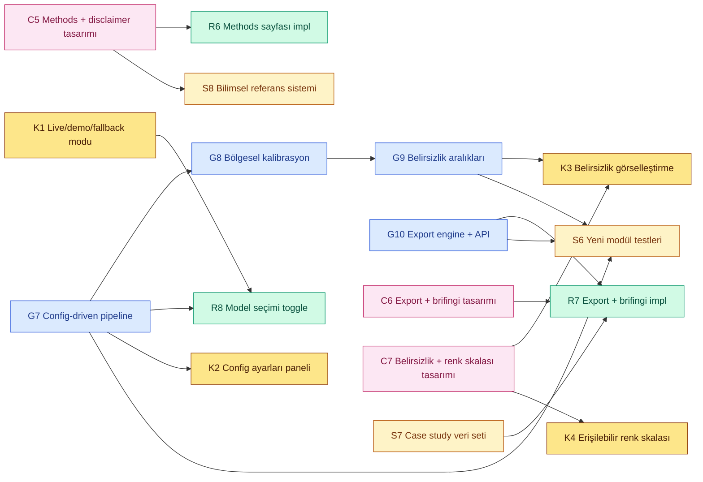

# Görev Dağılımı 2 — PyroSync (Eksik Özellikler)

Rakip analizi ve akademik makalelerden (STRATEGY.md) çıkan ancak ilk görev dağılımına (GOREVLER.md) yansımamış özellikler.

> [!NOTE]
> 2026-11-13'te oluşturuldu. GOREVLER.md'deki görev numaralandırmasını devam ettirir. Bağımlılıklarda `GOREVLER.md` görevlerine çapraz referans verilir.

## Nasıl okunur

- **Kimlik:** `G` Görkem, `C` Can, `R` Serhat, `S` Samet, `K` Sadık. Örnek: `K2` Sadık'ın 2. görevi. Commit mesajlarında bu kimlikler kullanılır (`[K1] fallback modu eklendi`).
- **Bekler:** başlamadan önce bitmiş olması gereken görevler. GOREVLER.md'deki görevler `v1:` prefix'iyle belirtilir.
- **Açar:** bu görev bitince başlayabilecek görevler.
- **Bitti sayılır:** görevin kapanma şartı. Şart sağlanmadan ✅ konmaz.
- **Durum:** ✅ bitti · 🔄 sürüyor · ⬜ başlayabilir · ⏸ bekliyor

---

## Bağımlılık grafiği

Mavi: Görkem · Pembe: Can · Yeşil: Serhat · Sarı: Samet · Turuncu: Sadık. Oklar "önce bu biter, sonra şu başlar" demek.

---

## Özet

| Kimlik | Görev | Sahip | Bekler | Açar | Durum |
|--------|-------|-------|--------|------|-------|
| G7 | Config-driven pipeline | Görkem | v1:G2 | G8, R8, K2, S6 | ⏸ |
| G8 | Bölgesel/biyom kalibrasyon modülü | Görkem | G7 | G9 | ⏸ |
| G9 | Belirsizlik aralıkları hesaplama | Görkem | G8 | K3, S6 | ⏸ |
| G10 | Export engine + /api/export | Görkem | v1:G4 | R7, S6 | ⏸ |
| G11 | Area API sonuçlarını diske cache'leme | Görkem | — | G12, G13 | ⬜ |
| G12 | 2023 (NOAA-21) efor geçişini ölçme | Görkem | G11 | — | ⬜ |
| G13 | Tam filo 2000-present trend serisi | Görkem | G11 | — | ⬜ |
| G14 | MODIS içi efor geçişi (2002 Aqua) | Görkem | — | — | ⬜ |
| C5 | Methods sayfası + disclaimer tasarımı | Can | v1:C1 | R6, S8 | ⏸ |
| C6 | Export UI + brifingi tasarımı | Can | v1:C1 | R7 | ⏸ |
| C7 | Belirsizlik gösterimi + renk skalası tasarımı | Can | v1:C1 | K3, K4 | ⏸ |
| R6 | Methods/About sayfası implementasyonu | Serhat | C5, v1:R1 | — | ⏸ |
| R7 | CSV/GeoJSON export + acil müdahale brifingi | Serhat | G10, C6, S7 | — | ⏸ |
| R8 | Çoklu harmonizasyon model seçimi | Serhat | G7, K1, v1:R1 | — | ⏸ |
| S6 | Config + calibration + export testleri | Samet | G7, G9, G10 | — | ⏸ |
| S7 | Türkiye/Akdeniz case study veri seti | Samet | v1:G1 | R7 | ⏸ |
| S8 | Bilimsel referans + disclaimer içerik | Samet | C5 | — | ⏸ |
| K1 | Live/demo/fallback modu | Sadık | v1:R4 | R8 | ⏸ |
| K2 | Config ayarları frontend paneli | Sadık | G7, v1:R1 | — | ⏸ |
| K3 | Belirsizlik aralıkları görselleştirme | Sadık | G9, C7, v1:R1 | — | ⏸ |
| K4 | Erişilebilir renk skalası sistemi | Sadık | C7, v1:R1 | — | ⏸ |

**Şu an başlanabilecekler:**
- **Can:** C5, C6, C7 — v1:C1 (UI konsept) bitmişse hepsine başlayabilir.
- **Samet:** S7 — v1:G1 (FIRMS API) bitmişse Türkiye verisi çekmeye başlayabilir.

**Kritik yollar:**
1. **v1:G2 → G7 → G8 → G9 → K3:** Config ve kalibrasyon tamamlanmadan belirsizlik hesaplanamaz ve görselleştirilemez.
2. **v1:G4 → G10 → R7:** Export backend hazır olmadan frontend export UI yapılamaz. S7 (case study) de R7'yi besler.
3. **C5 → R6 + S8:** Methods sayfası hem frontend implementasyon hem içerik için tasarımı bekler.
4. **v1:R4 → K1 → R8:** Fallback modu API bağlantısına bağlı; model seçimi de fallback'e bağlı.

---

## Görkem'in görevleri

### G7 — Config-driven pipeline ⏸
- **Bekler:** v1:G2 · **Açar:** G8, R8, K2, S6
- Pipeline'daki tüm sabit eşikleri yapılandırılabilir hale getirmek (EG FireTrack'ten ilham):
  - `config.rs` modülü: `PipelineConfig` struct'ı ile tüm parametreler
  - Dedup eşikleri: zaman penceresi (varsayılan 8s), örtüşme oranı (varsayılan %30)
  - VZA düzeltme katsayıları: polinom coefficients (a, b, c)
  - Cross-sensor matching: mesafe (varsayılan 2 km), zaman (varsayılan 5 dk)
  - TOML dosyasından yükleme (`pyrosync.toml`) + env var override
  - Varsayılan config ile mevcut davranış aynı kalmalı (backward compatible)
- **Kaynak:** EG FireTrack — "Config-driven tasarım: tüm eşikler yapılandırılabilir, bilimsel şeffaflık"
- **Bitti sayılır:** `PipelineConfig::default()` ile mevcut testler hâlâ geçiyor; TOML'dan farklı config yüklenince pipeline davranışı değişiyor; `pyrosync.example.toml` depoda.

### G8 — Bölgesel/biyom kalibrasyon modülü ⏸
- **Bekler:** G7 · **Açar:** G9
- Tek global FRP oranı yerine bölgesel katsayılar (Li et al. 2018):
  - `calibration.rs` modülü: biyom tipine göre MODIS/VIIRS FRP kalibrasyon oranları
  - Tropik: VIIRS ~%16 büyük (k=1.16)
  - Boreal: MODIS ~%47 büyük (k=1.47)
  - Savan: ~%1 fark (k≈1.0)
  - Biyom lookup: lat/lon → biyom → kalibrasyon katsayısı
  - Config'den override edilebilir (`PipelineConfig.calibration`)
- **Kaynak:** Li et al. 2018 — "Tek global katsayı yetersiz — savan %1 fark, boreal %47 fark"
- **Bitti sayılır:** farklı bölgelerde (tropik, boreal, savan) farklı kalibrasyon uygulanıyor; test: Türkiye (Akdeniz) ve Sibirya (boreal) verileriyle FRP oranları beklenen aralıkta.

### G9 — Belirsizlik aralıkları hesaplama ⏸
- **Bekler:** G8 · **Açar:** K3, S6
- Her harmonize FRP değerine güven aralığı eklemek (fire-harmony'den ilham):
  - `uncertainty.rs` modülü: `UncertaintyEstimate { lower: f64, upper: f64, confidence: f64 }`
  - Kaynaklar: VZA düzeltme hatası, kalibrasyon oranı varyansı, sensör gürültüsü
  - Bootstrap veya analitik propagasyon (basit: ±1σ)
  - `HarmonizedHotspot` struct'ına `frp_lower`, `frp_upper` alanları
  - Calendar hücrelerine de toplam belirsizlik
  - Bilimsel disclaimer metni: "Harmonize değerler model tahminidir, ground truth değil"
- **Kaynak:** fire-harmony — belirsizlik aralıkları; tüm akademik makaleler — model sınırları
- **Bitti sayılır:** her harmonize değerin lower/upper aralığı var; aralık VZA arttıkça genişliyor (beklenen); API response'unda uncertainty alanları mevcut.

### G10 — Export engine + /api/export endpoint ⏸
- **Bekler:** v1:G4 · **Açar:** R7, S6
- Harmonize veriyi indirilebilir formatlara dönüştürme:
  - `export.rs` modülü: `to_csv()`, `to_geojson()` fonksiyonları
  - `/api/export?format=csv&west=...&south=...&east=...&north=...` endpoint'i
  - `/api/export?format=geojson&...` alternatifi
  - CSV: tüm alanlar + uncertainty + kaynak sensör
  - GeoJSON: FeatureCollection, her hotspot bir Feature (point geometry + properties)
  - Streaming response (büyük veri setleri için bellek dostu)
  - Content-Disposition header ile doğrudan dosya indirme
- **Kaynak:** Strateji 1.4 (Relevance) — "CSV export ile gerçek iş akışlarına entegrasyon"
- **Bitti sayılır:** curl ile `/api/export?format=csv` → geçerli CSV dosyası iniyor; GeoJSON QGIS'te açılıyor; 10,000+ satır sorunsuz.

### G11 — Area API sonuçlarını diske cache'leme ⬜
- **Bekler:** — · **Açar:** G12, G13
- **Neden:** G3 doğrulamasında FIRMS transaction limitine dayandık. 18 aylık tek bir aralık 1373 transaction harcıyor ve limit aşıldığında istekler `HTTP 400 Exceeding allowed transaction limit` dönüyor. Aynı aralığı tekrar sorgulamak baştan harcama demek, bu yüzden uzun zaman serisi doğrulamaları yapılamıyor.
- `crates/firms-client/src/archive.rs` içindeki `ArchiveClient` ülke-yıl dosyalarını zaten diske cache'liyor ve bu yaklaşım çalışıyor (`.cache/firms-archive`, 2,4 GB, MODIS 2000-2025 + VIIRS SNPP 2012-2025). Aynı mantık area API sorguları için kurulacak.
  - Cache anahtarı: kaynak + bbox + tarih penceresi. Pencere `DayRange::MAX = 5` gün olduğu için anahtar doğal olarak ayrıklaşıyor.
  - Cache hit'te transaction HARCANMAYACAK; `report.transactions_spent` yalnız gerçekten yapılan isteği saymalı.
  - NRT kaynakları için cache süreli olmalı (veri güncelleniyor), SP ve arşiv kaynakları için kalıcı (veri dondu).
  - `.cache/` dizini gitignore'da olmalı.
- **Bitti sayılır:** aynı aralık ikinci kez istendiğinde `transactions_spent` 0 dönüyor; cache'li bir aralık ağ bağlantısı olmadan da çalışıyor.

### G12 — 2023 (NOAA-21) efor geçişini ölçme ⬜
- **Bekler:** G11 · **Açar:** —
- **Neden:** G3'ün Ω mekanizması 2012 (SNPP) ve 2018 (NOAA-20) geçişlerinde doğrulandı, ama **2023 (NOAA-21) geçişi ölçülmedi.** Mekanizma platform kümesinden bağımsız çalıştığı için aynı davranması bekleniyor, ancak bu bir beklenti; ölçüm değil.
- Ülke arşivi NOAA-20/21 taşımıyor (altı slug varyantı denendi, hepsi HTTP 404), bu yüzden yalnız area API ile yapılabilir ve G11'in cache'ine ihtiyaç duyar.
  - `VIIRS_NOAA21_SP` kaynağı 2023-03-01'de başlıyor. Geçişi kapsayan aralık: 2022-09 … 2023-09 civarı.
  - Aynı mevsim kıyaslaması yapılmalı (örn. Tem-Ara 2022 vs Tem-Ara 2023), aksi halde mevsim etkisi geçişle karışır.
  - Ω'nın her iki konfigürasyon için de hesaplanabilmesi için her yanda en az 3 ay gerekiyor (`MIN_MONTHS_PER_CONFIG`).
- **Bitti sayılır:** `|log(normalize kayma)| < |log(ham kayma)| / 2` ölçütü 2023 geçişi için de sağlanıyor ve sonuç GOREVLER.md'deki G3 doğrulama tablosuna ekleniyor.

### G13 — Tam filo 2000-present trend serisi ⬜
- **Bekler:** G11 · **Açar:** —
- **Neden:** G3'ün "monoton artan trend kalkıyor" şartı Spearman ρ +0,785 → +0,087 ile doğrulandı, **ama o seri yalnızca MODIS + SNPP içeriyor.** Ülke arşivi NOAA-20/21 taşımadığı için dört efor geçişinden ikisi (2018, 2023) trend testinde hiç yok. Trend, 2012 geçişini içeren uzun seride düz; 2018 ayrı ve kısa bir veri setinde doğrulandı; ikisi tek sürekli seride birlikte sınanmadı.
- G11 cache'i kurulduktan sonra 2018-2025 aralığı NOAA-20/21 dahil kademeli indirilip arşiv serisiyle birleştirilecek, sonra `archive_ingest` örneğinin sıçrama kontrolü tam filo serisi üzerinde koşturulacak.
- **Bitti sayılır:** 2000-present tam filo serisinde normalize Spearman ρ'nun mutlak değeri ham ρ'nun yarısından küçük; 2012, 2018 ve 2023 geçişlerinin üçünde de seviye kayması ölçütü sağlanıyor.

### G14 — MODIS içi efor geçişi (2002 Aqua) ⬜
- **Bekler:** — · **Açar:** —
- **Neden:** Ω tanım gereği `total / modis_observable` oranı olduğu için **MODIS referans kanalının kendi içindeki değişimi göremiyor.** 2002-07'de Aqua devreye girdiğinde tespitler arttı (arşiv, Türkiye: 2001 Terra 5162 → 2002 Terra 4474 + Aqua 2412) ama Aqua `modis_observable`'ın parçası olduğu için Ω 1,000 kalıyor ve bu sıçrama düzeltilmiyor.
- MODIS filo birleştirmesi (bkz. `crates/core/src/fleet.rs`, 180 dk pencere) aynı yangının Terra/Aqua çift sayımını temizliyor, ama ölçüme göre Aqua tespitlerinin yalnız %18-21'i Terra ile eşleşiyor. Kalanı Terra'nın gerçekten görmediği yangınlar (sabah geçişinden sonra başlayanlar) ve bu gerçek bir efor artışı.
- **Genel ilke:** aynı yangının çift sayımı *birleştirmeyle*, yeni platformun ek görme kabiliyeti *Ω ile* çözülür. Ω'nın çalışması için referans kanalın geçişin iki yanında da bulunması gerekir — VIIRS geçişlerinde MODIS bunu sağlıyor, Aqua geçişinde sağlayan tek şey Terra.
- Değerlendirilecek iki yol:
  1. Ω'nın referansını "herhangi bir MODIS" yerine Terra-only alt kanalı yapmak. **Dikkat:** Terra'nın yörüngesi 2020 sonrası kaydı ve geçiş saati değişti, yani kararsız bir cetvel olur ve 2020-2026 için YENİ bir artefakt üretebilir. Bu yol seçilirse Terra kaymasının etkisi önce ölçülmeli.
  2. 2000-11 … 2002-06 arası 20 ayı `count_normalized: None` ile "kıyaslanabilir değil" işaretlemek. Veri kaybı 26 yılın küçük bir kısmı ve o dönem MODIS misyonunun en az güvenilir evresi. Daha dürüst ve risksiz.
- **Not:** v1:G3'ün bitiş şartı yalnızca 2012 ve 2017 geçişlerini istediği için bu madde şartı ihlal etmiyor; 2000-2002 taban döneminin sonrasıyla tam kıyaslanabilir olmaması bilinen ve kayıtlı bir sınır.
- **Bitti sayılır:** 2000-2002 dönemi ya düzeltiliyor ya da açıkça kıyaslanamaz işaretleniyor; methods sayfasında (C5/R6) hangisinin seçildiği belirtiliyor.

---

## Can'ın görevleri

### C5 — Methods sayfası + bilimsel disclaimer tasarımı ⏸
- **Bekler:** v1:C1 · **Açar:** R6, S8
- Pipeline'ın nasıl çalıştığını açıklayan sayfa tasarımı:
  - 7 aşamalı pipeline diyagramı (görsel akış)
  - Her aşama için: ne yapılıyor, neden, hangi parametre kullanılıyor
  - VZA düzeltme formülü görseli (θ → FRP düzeltmesi grafiği)
  - H3 grid açıklaması (hexagon görseli)
  - Bilimsel referans listesi formatı (akademik makalelere atıf)
  - Disclaimer banner tasarımı: "Bu değerler model tahminidir" uyarısı
- **Bitti sayılır:** wireframe'de Methods sayfası var; pipeline görseli okunabilir; disclaimer yerleşimi belirgin ama rahatsız edici değil.

### C6 — Export UI + acil müdahale brifingi tasarımı ⏸
- **Bekler:** v1:C1 · **Açar:** R7
- İki ilişkili özelliğin tasarımı:
  - **Export:** indirme butonu konumu, format seçimi (CSV/GeoJSON), dosya adı gösterimi
  - **Acil müdahale brifingi:** tek tıkla bölge raporu — tarihsel ortalama vs şu an, anomali durumu, en yoğun aylar, aktif sensörler
  - Brifingi modal/panel olarak mı sidebar olarak mı gösterelim
  - Print-friendly layout (jüri basabilir)
- **Kaynak:** Strateji 1.1 — "Acil müdahale brifingi — tek tıkla bölge raporu"
- **Bitti sayılır:** export butonu ve brifingi paneli wireframe'de; brifingi içeriği (hangi metrikler, hangi sırada) belirlenmiş.

### C7 — Belirsizlik gösterimi + erişilebilir renk skalası tasarımı ⏸
- **Bekler:** v1:C1 · **Açar:** K3, K4
- Bilimsel verilerin doğru görselleştirilmesi:
  - **Belirsizlik:** error bar / confidence band / shaded area — hangi yöntem hangi chart'ta
  - Haritada belirsizlik gösterimi (opaklık veya halo boyutu)
  - **Renk skalası:** erişilebilir paletler (renk körlüğü uyumlu — viridis, cividis tarzı)
  - MODIS rengi, VIIRS rengi, harmonized rengi, anomaly skalası
  - Quantile vs eşit aralık renk dağılımı seçimi
  - Light/dark mode'da renk kontrastı
- **Kaynak:** Yarışma gereksinimleri — "Color ramps"; fire-harmony — belirsizlik gösterimi
- **Bitti sayılır:** renk paleti renk körlüğü simülatörüyle test edilmiş; belirsizlik gösterimi her chart tipi için tanımlanmış.

---

## Serhat'ın görevleri

### R6 — Methods/About sayfası implementasyonu ⏸
- **Bekler:** C5, v1:R1 · **Açar:** —
- Can'ın C5 tasarımını koda dökmek:
  - `/methods` route (React Router veya conditional render)
  - Pipeline diyagramı: SVG veya step-by-step component
  - Her aşamaya tıkla → detay accordion
  - Bilimsel referans listesi (Samet S8 ile koordineli — içerik Samet, görünüm Serhat)
  - Disclaimer banner component'i (sayfa altı veya header'da)
  - Responsive: mobilde de okunabilir
- **Bitti sayılır:** `/methods` sayfası açılıyor; 7 pipeline aşaması görsel olarak anlaşılıyor; referanslar listelenmiş; disclaimer görünür.

### R7 — CSV/GeoJSON export + acil müdahale brifingi ⏸
- **Bekler:** G10, C6, S7 · **Açar:** —
- İki özelliğin frontend implementasyonu:
  - **Export:** indirme butonu → format seçimi → `/api/export` çağrısı → blob download
  - Dosya adı: `pyrosync_{region}_{date}.csv` formatında
  - Loading state (büyük dosyalarda)
  - **Brifingi:** seçili bölge için özet panel/modal
  - Metrikler: son 7 gün detection, tarihsel ortalamadan sapma, en yoğun sensör, trend (artış/azalış)
  - Print butonu (window.print ile)
  - Case study verileri (S7) ile demo senaryosu
- **Bitti sayılır:** CSV indiriliyor ve Excel'de açılıyor; GeoJSON indiriliyor; brifingi paneli en az 5 metrik gösteriyor; Türkiye verisiyle demo çalışıyor.

### R8 — Çoklu harmonizasyon model seçimi ⏸
- **Bekler:** G7, K1, v1:R1 · **Açar:** —
- Kullanıcının farklı harmonizasyon yaklaşımlarını karşılaştırabilmesi:
  - Dropdown/toggle: "Standard" (VIIRS-preferred) vs "Equal-weight" vs "MODIS-calibrated"
  - Seçim backend'e config olarak gönderilir (G7'nin config yapısıyla)
  - Sonuçlar anlık güncellenir (harita + takvim + stats)
  - Farklılık istatistiği: "Bu model %X daha fazla/az detection üretiyor"
  - Fallback modunda (K1) da çalışmalı
- **Kaynak:** Strateji 1.2 — "Çoklu harmonizasyon modeli seçimi — kullanıcı yöntemi seçip farkı görebilecek"
- **Bitti sayılır:** en az 2 farklı model arasında geçiş yapılabiliyor; sonuçlar gözle görülür şekilde farklı; istatistik farkı gösteriliyor.

---

## Samet'in görevleri

### S6 — Config + calibration + export testleri ⏸
- **Bekler:** G7, G9, G10 · **Açar:** —
- Yeni modüller için kapsamlı testler:
  - **config:** TOML parse testi, varsayılan değerlerin doğruluğu, env var override, hatalı config'de anlamlı hata
  - **calibration:** tropik/boreal/savan bölgeler için doğru katsayı, bilinmeyen bölge → default fallback
  - **uncertainty:** nadir'de dar aralık, kenar'da geniş aralık; lower < frp < upper her zaman
  - **export:** CSV çıktısı doğru sütun sayısı ve header; GeoJSON valid FeatureCollection; boş veri → boş dosya (hata değil)
  - Edge case: sıfır detection, tek sensör, tüm güvenlik düşük
- **Bitti sayılır:** `cargo test` ile en az 15 yeni test geçiyor; her modül (config, calibration, uncertainty, export) için en az 3 test.

### S7 — Türkiye/Akdeniz case study veri seti ⏸
- **Bekler:** v1:G1 · **Açar:** R7
- Demo ve sunum için hazır Türkiye yangın verisi:
  - FIRMS API'den Türkiye bbox (26°–45° E, 36°–42° N) için 2020–2025 verisi
  - Akdeniz bölgesi özel alt-set (Antalya, Muğla — 2021 yangınları dahil)
  - MODIS + VIIRS ayrı CSV'ler + harmonize edilmiş JSON
  - `data/case-study/turkey/` altında organize
  - İstatistik özet: toplam detection, pik aylar, yıllar arası trend
  - Brifingi component'i (R7) bu veriyle demo yapacak
- **Kaynak:** Strateji 1.1 — "Türkiye ve Akdeniz havzası özel case study — jüri için farklı ve dikkat çekici"
- **Bitti sayılır:** `data/case-study/turkey/` altında en az 3 yıl veri var; 2021 Akdeniz yangınları anomali olarak belirgin; JSON formatı frontend'le uyumlu.

### S8 — Bilimsel referans ve disclaimer içerik ⏸
- **Bekler:** C5 · **Açar:** —
- Methods sayfası için bilimsel içerik hazırlığı:
  - Her pipeline aşaması için 2–3 cümle açıklama (teknik ama anlaşılır)
  - Kullanılan akademik makalelerin referans listesi (APA formatı)
  - Referans–pipeline aşaması eşlemesi: hangi makale hangi aşamayı destekliyor
  - Disclaimer metni: sınırlamalar, model varsayımları, veri kaynağı güvenilirliği
  - `docs/REFERENCES.md` dosyası olarak depoya
- **Bitti sayılır:** `docs/REFERENCES.md` depoda; en az 5 makale referanslanmış; her pipeline aşaması en az bir referansla desteklenmiş; disclaimer metni net ve dürüst.

---

## Sadık'ın görevleri

### K1 — Live/demo/fallback modu ⏸
- **Bekler:** v1:R4 · **Açar:** R8
- FIRMS API çalışmadığında uygulamanın hâlâ demo yapılabilmesi (FireHarmonize'dan ilham):
  - API bağlantısı kontrol mekanizması (health check → timeout → fallback)
  - Demo modu: `web/src/mocks/` altındaki örnek veriyi otomatik yükleme
  - UI'da mod göstergesi: "🟢 Live Data" vs "🟡 Demo Mode"
  - Kullanıcı manuel geçiş yapabilmeli (demo verisiyle hızlı keşif)
  - Geçiş sırasında state sıfırlanmadan smooth transition
  - Jüri demo anında API çökerse sunum kesilmesin
- **Kaynak:** FireHarmonize — "Live/demo/fallback modu: API çalışmazsa demo verisiyle devam"
- **Bitti sayılır:** API key olmadan uygulama demo modunda açılıyor; API varken otomatik live'a geçiyor; mod göstergesi doğru; jüri demo'su API olmadan sorunsuz çalışıyor.

### K2 — Config ayarları frontend paneli ⏸
- **Bekler:** G7, v1:R1 · **Açar:** —
- Pipeline parametrelerini UI'dan ayarlayabilme (EG FireTrack tarzı şeffaflık):
  - Settings panel/drawer: slider ve input alanlarıyla parametre düzenleme
  - Dedup eşikleri: zaman penceresi (1–30s), örtüşme oranı (%10–%80)
  - Matching eşikleri: mesafe (0.5–10 km), zaman (1–30 dk)
  - Değişiklik yapıldığında sonuçlar yeniden hesaplansın (debounced API call)
  - "Varsayılana dön" butonu
  - Ayarların URL query string'ine yansıması (paylaşılabilir link)
- **Bitti sayılır:** en az 3 parametre UI'dan değiştirilebiliyor; sonuçlar değişiyor; varsayılan butonuyla geri dönülebiliyor; link paylaşılınca aynı ayarlarla açılıyor.

### K3 — Belirsizlik aralıkları görselleştirme ⏸
- **Bekler:** G9, C7, v1:R1 · **Açar:** —
- Belirsizlik verilerinin chart'larda gösterimi (Recharts ile):
  - FRP zaman serisi: shaded confidence band (mean ± uncertainty)
  - Haritada: hotspot dairesinin boyutu veya opaklığı belirsizlik ile orantılı
  - Calendar hücresinde: belirsizlik yüksekse hücre kenarlığı farklı (hatched/dashed)
  - Tooltip'te: "FRP: 45.2 MW (38.7–51.8)" formatında
  - Belirsizlik açıklaması: "Geniş aralık = sensör açısı büyük veya kalibrasyon verisi az"
- **Kaynak:** fire-harmony — belirsizlik gösterimi; Can'ın C7 tasarımına uygun
- **Bitti sayılır:** en az 2 chart tipinde belirsizlik görünüyor; tooltip'te aralık var; yüksek VZA'lı noktalar geniş aralıklı (görsel olarak ayırt edilebilir).

### K4 — Erişilebilir renk skalası sistemi ⏸
- **Bekler:** C7, v1:R1 · **Açar:** —
- Yarışma gereksinimlerinden "color ramps" + erişilebilirlik:
  - Renk skalası modülü: sequential (FRP), diverging (anomaly), categorical (sensör)
  - En az 2 palet seçeneği: varsayılan + renk körlüğü dostu (viridis/cividis)
  - Kullanıcı palet değiştirebilmeli (dropdown)
  - CSS custom properties ile tema entegrasyonu
  - Legend component: sürekli skala + eşik değerleri
  - Quantile-based renk atama (outlier'lar skalayı bozmasın)
- **Kaynak:** Yarışma gereksinimleri — "Color ramps"; erişilebilirlik en iyi pratikleri
- **Bitti sayılır:** en az 2 palet var; renk körlüğü simülatörüyle kontrol edilmiş; legend'da değer aralıkları görünüyor; palet değiştirince tüm chart'lar güncelleniyor.

---

## Kişi başı yük özeti

| Kişi | Görev sayısı | Ağırlık | Odak |
|------|-------------|---------|------|
| Görkem | 4 (G7–G10) | Ağır | Backend core: config, kalibrasyon, belirsizlik, export |
| Can | 3 (C5–C7) | Orta | Tasarım: methods, export/brifingi, belirsizlik/renk |
| Serhat | 3 (R6–R8) | Orta-ağır | Frontend impl: methods, export+brifingi, model seçimi |
| Samet | 3 (S6–S8) | Orta | Test, veri, referans: yeni modül testleri, case study, bilimsel içerik |
| Sadık | 4 (K1–K4) | Orta | Frontend infra: fallback, config paneli, belirsizlik viz, renk skalası |
