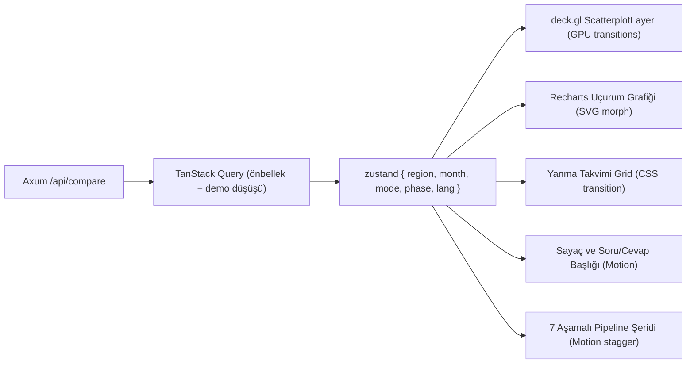
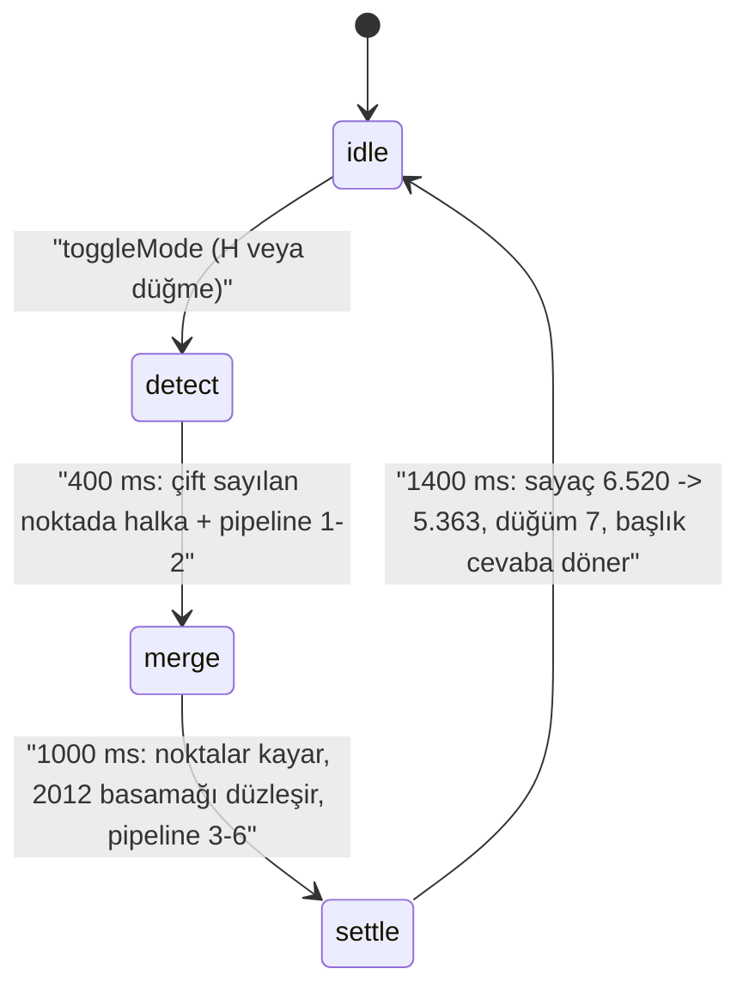

# PyroSync Frontend Teknoloji Önerisi

**Muhatap:** Serhat (Frontend — R1, R2), Görkem (Backend — G4)  
**Kapsam:** C1 UI/UX Konsept ve Uygulama Planı (Bölüm 4) teknik kararları, mimari ve sözleşme önerisi  
**Amaç:** "Uçurum bir yanılsama, tek hamlede kapanıyor" ana fikrini taşıyan Ham → Harmonize geçiş koreografisini takılmadan, SWC uyumlu ve ağ beklemeksizin çalıştıracak frontend yığınını netleştirmek.

---

## Uygulanan Karar (C1 Prototipi)

C1 kapsamında `web/src` içinde kurulan interaktif prototipte **React 19 + TypeScript (strict) + SWC**, **zustand**, **Motion** (`motion/react`) ve **CSS Modules + CSS değişkenleri** (`web/src/styles/tokens.css`) kullanılmıştır. Aşağıdaki öneride yer alan **MapLibre + deck.gl** (sonraki yükseltme yolu olarak korunur), **TanStack Query** ve **Recharts** bağımlılıkları ertelenmiş; harita, uçurum grafiği ve takvim **elle yazılmış SVG/CSS** bileşenleri olarak geliştirilmiştir. Bunun nedeni tam **çevrimdışı demo** gereksinimi (karo sunucusu veya dış ağ bağımlılığı olmadan çalışma) ve düşük **paket boyutu**dur.

Ayrıca mevcut `/api/harmonize` uç noktası ham noktaları, nokta `id` alanlarını, `mergesInto` eşlemesini, FRP aralıklarını, yıllık ham/MODIS/VIIRS serilerini, ham aylık sayımları ve aşama bazlı eleme (`per-stage removals`) sayılarını döndürmemektedir; bu nedenle prototip, `G4` kapsamındaki `/api/compare` sözleşmesi tanımlanana kadar `web/src/mocks/prototype-data.ts` üzerinde çalışır.

---

## 1. Sabit Kurallar ve SWC Uyumluluk Denetimi

Mevcut depo (`web/package.json`, `web/vite.config.ts`, `web/tsconfig.json`) temelinde değiştirilmeyecek sabit kurallar şunlardır:

- **Backend:** Rust (`axum = "0.8"`, `pyrosync-core`, `pyrosync-firms`)
- **Frontend:** React `^19.1.0` + TypeScript `^5.8.0` (`"strict": true`, `"noUnusedLocals": true`, `"noUnusedParameters": true`, `"isolatedModules": true`, `"jsx": "react-jsx"`)
- **Derleyici:** Vite `^6.3.0` + `@vitejs/plugin-react-swc` `^4.3.0` (yalnızca SWC; Babel eklentisi, özel JSX pragma'sı veya derleme zamanı makrosu isteyen hiçbir kütüphane alınmaz)
- **Açılış davranışı ve palet:** `web/src/App.tsx` şu an `useState<ViewMode>("harmonized")` ile açılmaktadır; plan gereği açılış modu `raw` olmalıdır. `web/src/components/Toggle/ViewToggle.tsx` içindeki kırmızı/yeşil (`#ef4444` / `#22c55e`) çifti renk körü güvenli palet token'larına taşınmalıdır.

### Önerilen Kütüphanelerin SWC Uyumluluk Kontrolü

| Kütüphane | Rol | SWC Uyumluluğu | Açıklama |
|---|---|---|---|
| `maplibre-gl` + `react-map-gl` (`react-map-gl/maplibre`) | Vektör harita kapsayıcısı | Uyumlu | Saf ESM/TypeScript; Babel eklentisi gerektirmez. |
| `@deck.gl/core`, `@deck.gl/layers`, `@deck.gl/geo-layers`, `@deck.gl/mapbox` | GPU nokta ve H3 katmanları | Uyumlu | WebGL2 tamponları ve standart JS/TS erişimcileri kullanır. `MapboxOverlay` ile `useControl` üzerinden bağlandığı için React 19 uzlaştırıcısıyla çakışmaz. |
| `recharts` | 2000–bugün uçurum grafiği (planlanan yeni bağımlılık) | Uyumlu | Standart React SVG bileşenleri; Babel eklentisi istemez (`web/package.json`'da kurulu değildir, planlanan yeni bağımlılıktır). React 19 eş bağımlılık (`peerDependencies` / `react-is`) uyarısı verirse sürüm sabitlemesi gerekir. |
| `d3-scale` (+ `@types/d3-scale`) | Yanma takvimi renk ölçeği | Uyumlu | DOM'dan ve JSX'ten bağımsız saf ESM matematik modülü. |
| `motion` (`motion/react`) | Düğme yayı, sayaç, başlık ve pipeline akışı | Uyumlu | Çalışma zamanı React hook'ları ve Web Animations API kullanır; derleme zamanı Babel eklentisi gerektirmez. |
| `zustand` | İstemci arayüz ve faz durumu | Uyumlu | `useSyncExternalStore` tabanlı, Babel'siz, TypeScript `strict` ile tam tipli. |
| `@tanstack/react-query` | Sunucu verisi önbelleği ve demo düşüşü | Uyumlu | Standart Context ve hook yapısı; SWC ile sorunsuz derlenir. |
| CSS Custom Properties + CSS Modules (`*.module.css`) | Tasarım token'ları, tema ve palet | Uyumlu | Vite içinde yerleşiktir; çalışma zamanı ve Babel maliyeti sıfırdır. |
| `@fontsource/inter` + yerel monospace (`tabular-nums`) | Yerel yazı tipleri | Uyumlu | Statik CSS ve WOFF2 dosyaları Vite tarafından paketlenir. |
| `pyrosync-core` WASM çıktısı (opsiyonel) | Tarayıcıda anlık yeniden hesaplama | Uyumlu | `WebAssembly.instantiateStreaming` veya Vite WASM eklentisiyle yüklenir; Babel gerektirmez. |

---

## 2. Teknoloji Yığını Karar Tablosu

| Katman | Öneri | GOREVLER.md'deki Plan / Mevcut Durum | Gerekçe | Risk / Geri Dönüş Planı |
|---|---|---|---|---|
| Harita | **MapLibre GL JS + deck.gl** (`react-map-gl/maplibre`) | GOREVLER.md'deki plan: `react-leaflet` (R2; `web/package.json`'da kurulu değil) | Tek kritik değişiklik. İmza anı binlerce noktanın aynı anda konum ve renk değiştirmesidir; `ScatterplotLayer` bunu GPU'da `transitions` ile 60 fps yapar. Leaflet birkaç bin noktada takılır. İkisi de açık kaynak. | Risk: React 19 ile `@deck.gl/react` sürüm uyuşmazlığı veya düşük GPU'lu cihaz. Geri dönüş: `MapboxOverlay` (`@deck.gl/mapbox`) kullanmak; acil durumda 500–1.000 noktalı örnekleme ile Canvas moduna düşmek. |
| Uzak yakınlık | **deck.gl `H3HexagonLayer`** | Marker cluster | Backend (G2, `h3o`) zaten H3 ızgarası kullanır. Uzaklaşınca nokta kümesi yerine aynı altıgenleri göstermek pipeline'ın 4. aşamasını görünür kılar ve Y3 ısı haritasıyla ortak altyapı olur. | Risk: H3 indeksinin henüz `/api/compare` yanıtında gelmemesi. Geri dönüş: İstemcide zoom eşiğinde `ScatterplotLayer` yarıçap/opaklık kümelemesine geçmek. |
| Altlık harita | **Koyu vektör altlık + çevrimdışı yedek ülke sınırları GeoJSON** | Tanımsız (`—`) | Docker on-premise hedefi ve K1 demo modu için internet kesilse bile harita boş kalmamalıdır. | Risk: Vektör karo sunucusuna erişim kesintisi. Geri dönüş: Paket içine gömülü düşük boyutlu Natural Earth / ülke sınırları GeoJSON katmanına otomatik düşmek. |
| Grafik | **Recharts** (planlanan yeni bağımlılık; ekibin planlanan seçimi korunur) | GOREVLER.md'deki plan: Recharts (`web/package.json`'da kurulu değil; yeni bağımlılık olarak eklenecek) | 27 yıl × 12 ay = 324 nokta; SVG çizgi dönüşümü ve `Area` ile belirsizlik bandı için yeterlidir. Ekibin ve Yusuf'un planlanan seçimiyle uyumludur. | Risk: React 19 `peerDependencies` uyarısı. Geri dönüş: Recharts güncel v2/v3 sürümüne geçmek veya düz SVG `<path>` + `d3-scale` ile 324 noktayı çizmek. |
| Takvim | **Elle yazılmış CSS Grid bileşeni + `d3-scale`** | R3'te belirtilmemiş | Recharts'ta ısı haritası türü yoktur. 324 hücre için ayrı grafik kütüphanesi gereksizdir; renk geçişi CSS `transition` ile maliyetsiz gelir. | Risk: Mobil dikey dönüşümde (`375×812`, 12 sütun × 27 satır) dokunma hedefinin küçülmesi. Geri dönüş: Hücre genişliğini 26 px sabit tutup tooltip yerine seçili ay özet çubuğu göstermek. |
| Arayüz animasyonu | **Motion** (`motion/react`) | Tanımsız (`—`) | Düğme yayı, sayaç (`6.520` → `5.363`), başlık dönüşümü ve 7 düğümlü pipeline sırası tek zaman çizelgesinden yönetilir. Basit hover efektleri düz CSS kalır. | Risk: Paket boyutu artışı. Geri dönüş: `LazyMotion` + `domAnimation` alt kümesini yüklemek (~15 KB gzip). |
| Durum yönetimi | **zustand + URL eşitlemesi** | Context veya zustand (R1) | Seçici (`selector`) abonelik ile mod değişince yalnızca ilgili bileşenler yeniden çizilir; harita örneği gereksiz yere kurulmaz. URL eşitlemesi paylaşılabilir linki (K2) sağlar. | Risk: URL ve store senkron döngüsü. Geri dönüş: Tek yönlü URL okuyucu + `replaceState` yardımcısı ile sadeleştirmek; gerekirse React Context'e dönmek. |
| Sunucu verisi | **TanStack Query** (`@tanstack/react-query`) | `web/src/hooks/useApi.ts` | Önbellek, otomatik yeniden deneme ve K1 demo verisine (`SAMPLE_RESPONSE` türevi) kontrollü düşüş hazır gelir. Bölge değişimi önbellekten anında açılır. | Risk: Ek bağımlılık. Geri dönüş: `useApi.ts` içine `Map` tabanlı basit önbellek ve `AbortController` eklemek. |
| Stil | **CSS custom properties + CSS Modules** | Inline `style` (`App.tsx`, `ViewToggle.tsx`) | Sıfır çalışma zamanı maliyeti, Vite'ta yerleşik. C2 token'ları doğrudan `tokens.css` olur; `[data-theme]` ve renk körü `[data-palette]` (K4) öznitelik seçicisiyle çalışır. | Risk: Token adlarının ekip içinde tutarsızlaşması. Geri dönüş: Ortak `tokens.css` sözlüğünü tek dosyada kilitlemek. |
| Metinler | **Tek dosya `web/src/content/copy.ts` (`{ en, tr }` nesnesi)** | Dağınık sabit EN metinler | İki dil için i18n kütüphanesi gereksiz soyutlamadır. Tipli TypeScript nesnesi eksik çeviriyi derleme hatasına çevirir. | Risk: İleride 3. dil istenmesi. Geri dönüş: Aynı anahtar şemasını koruyarak JSON sözlük yükleyicisine taşımak. |
| Yazı tipi | **Inter + tabular rakamlı mono (`@fontsource` yerel)** | `system-ui` | `tabular-nums` sayesinde sayaç `6.520` → `5.363` inerken rakamlar yatayda zıplamaz. Yerel paket çevrimdışı demoda da çalışır. | Risk: İlk yükleme font boyutu. Geri dönüş: Yalnızca `latin` + `latin-ext` (Türkçe karakterler) alt kümelerini ve 400/600 ağırlıklarını içe aktarmak. |
| Backend | **Axum `CompressionLayer`; ham + harmonize + eşleme tek yanıtta** | Ayrı sayım alanları (`/api/harmonize`) | Düğmeye basıldığında ağ beklenmemesi (Doherty eşiği `< 100 ms`) için iki modun verisi baştan birlikte gelmelidir. | Risk: 10.000 noktada JSON yükünün büyümesi. Geri dönüş: `tower-http` gzip/brotli sıkıştırmasını açmak ve nokta alanlarını kısaltmak; gerekirse koordinatları 4 ondalığa yuvarlamak. |
| Vitrin (opsiyonel) | **`pyrosync-core` → WASM derlemesi** | Tanımsız (`—`) | `pyrosync-core` saf hesaplama içerir (I/O yok). K2 ayar sürgüleri tarayıcıda anında yeniden hesaplanır. Karar Görkem'indir. | Risk: `wasm-pack` derleme karmaşıklığı ve süre kısıtı. Geri dönüş: Vitrin kapsamından çıkarıp sunucu taraflı ön tanımlı senaryo yanıtlarıyla devam etmek. |

---

## 3. Neden `react-leaflet` Yerine MapLibre + deck.gl?

### Performans ve Mimari Gerekçe

Ürünün imza anı, kullanıcı **Raw ↔ Harmonized** düğmesine bastığında (veya `H` tuşuna dokunduğunda) yaşanan **1,4 saniyelik geçiş koreografisidir**:

1. **Tek karede binlerce nokta dönüşümü:** Ham moddaki tüm tespitlerin aynı anda `rawPos` konumundan eşleştiği `targetPos` konumuna kayması, çift sayılan noktaların yarıçap ve opaklığının sönümlenmesi, ham modda şekil ve nötr gri tonlarıyla (MODIS = içi boş daire, VIIRS = dolu küçük kare) ayrılan işaretçilerin tek bir ardışık FRP renk skalasına akması gerekir.
2. **CPU vs. GPU darboğazı:** `react-leaflet` her noktayı DOM öğesi veya CPU tabanlı 2D Canvas çizimi olarak yönetir. 3.000–10.000 nokta arasında her animasyon karesinde tüm noktaların ara koordinatlarını JavaScript ile hesaplayıp yeniden boyamak ana iş parçacığını tıkar; kare hızı 60 fps'in altına düşer ve Doherty eşiği (`< 100 ms` ilk kare tepkisi) aşılır.
3. **deck.gl `ScatterplotLayer` farkı:** Ham ve harmonize veriler başlangıçta tek bir GPU tamponuna yüklenir. Mod değiştiğinde veri dizisi yeniden oluşturulmaz; yalnızca `getPosition` ve `getFillColor` erişimci fonksiyonları `mode` değerine göre farklı alanları okur. `transitions` özelliği ara değer enterpolasyonunu doğrudan WebGL2 vertex/fragment shader'larında GPU üzerinde çalıştırır.
4. **Pipeline ile görsel bütünlük:** Uzak zoom seviyelerinde `deck.gl` `H3HexagonLayer` kullanmak, backend'in 4. aşamada (`h3o`) ürettiği altıgen ızgarayı haritada doğrudan görünür kılar.

### `ScatterplotLayer` Geçiş İskeleti (TSX)

```tsx
import { ScatterplotLayer } from "@deck.gl/layers";
import type { ComparePoint, ViewMode } from "../types";

export function createFireLayer(points: ComparePoint[], mode: ViewMode, ms: number) {
  return new ScatterplotLayer<ComparePoint>({
    id: "pyrosync-fires",
    data: points,
    pickable: true,
    getPosition: (d) => (mode === "raw" ? d.rawPos : d.targetPos),
    getFillColor: (d) =>
      mode === "raw"
        ? d.rawColor
        : d.survives
          ? d.frpColor
          : [d.frpColor[0], d.frpColor[1], d.frpColor[2], 0],
    getRadius: (d) => (mode === "raw" || d.survives ? d.radius : 0),
    updateTriggers: {
      getPosition: [mode],
      getFillColor: [mode],
      getRadius: [mode],
    },
    transitions: {
      getPosition: { duration: ms },
      getFillColor: { duration: ms },
      getRadius: { duration: ms },
    },
  });
}
```

---

## 4. Mimari

### Veri Akışı Şeması



### `zustand` Store Arayüzü

Tek bir `zustand` deposu hem URL parametreleriyle (`region`, `month`, `mode`, `lang`) eşitlenir hem de beş görsel bileşeni aynı `phase` saatine bağlar:

```ts
export type RegionId = "turkiye-med" | "california" | "amazon" | "australia";
export type ViewMode = "raw" | "harmonized";
export type TransitionPhase = "idle" | "detect" | "merge" | "settle";
export type Lang = "en" | "tr";

export interface PyroSyncStore {
  region: RegionId;
  month: string | null; // Örn. "2020-08", seçili değilse null
  mode: ViewMode; // Varsayılan: "raw"
  phase: TransitionPhase;
  lang: Lang; // Varsayılan: "en"
  hasPlayedFullIntro: boolean;
  setRegion: (region: RegionId) => void;
  setMonth: (month: string | null) => void;
  toggleMode: () => void;
  setPhase: (phase: TransitionPhase) => void;
  setLang: (lang: Lang) => void;
}
```

### `useHarmonizeTransition` Faz Makinesi

İlk geçiş tam koreografiyle `1400 ms` sürer (`detect` 0–400 ms, `merge` 400–1000 ms, `settle` 1000–1400 ms). Aynı oturumdaki sonraki geçişler yormamak için `500 ms` kısa sürümü kullanır; `prefers-reduced-motion: reduce` etkinse `150 ms` düz geçiş uygulanır.



---

## 5. `/api/compare` API Sözleşme Önerisi (Görkem / G4 için PROPOSAL)

### Mevcut Durum ve Boşluk

`crates/server/src/main.rs` (satır 228–240) içindeki mevcut `GET /api/harmonize` uç noktası ile `web/src/types/index.ts` (satır 55–66) içindeki `HarmonizeResponse` TypeScript tipi yalnızca şu alanları paylaşmaktadır:

- `raw`: `{ modis_count, viirs_count, total_raw }` (nokta koordinatları yok, yalnızca 3 sayı)
- `harmonized`: `{ count, hotspots }` (`id` alanı yok)
- `calendar`: `CalendarCell[]`

Sunucu (`crates/server/src/main.rs`) bunlara ek olarak FIRMS kaynak raporunu içeren `report` nesnesini de döndürür; ancak `report` alanı `web/src/types/index.ts` içindeki `HarmonizeResponse` tipinde tanımlı değildir.

Bu yapıyla haritada hangi ham noktanın hangi harmonize noktaya kaydığını veya hangi aşamada kaç tespitin ayıklandığını göstermek mümkün değildir.

### Önerilen `GET /api/compare` Yanıt Şeması (PROPOSAL)

Aşağıdaki örnekte sayısal toplamlar `web/src/mocks/sample-data.ts` ile birebir uyumludur (`6.520` ham = MODIS `2.340` + VIIRS `4.180`, `5.363` harmonize, `1.157` çift sayım = `%17,7`). `stages` içindeki aşama bölünmesi (`dedup: 400` + `match: 757` = `1.157`) yalnızca örnek amaçlıdır; gerçek dağılım `pyrosync-core` çıktısından gelir (G4, Görkem).

```json
{
  "raw": {
    "modis_count": 2340,
    "viirs_count": 4180,
    "total_raw": 6520,
    "points": [
      {
        "id": "raw_m_0001",
        "lat": 39.9214,
        "lon": 32.8511,
        "frp": 45.2,
        "confidence": "High",
        "sensor": "ModisTerra",
        "acquired": "2020-07-15T12:30:00Z",
        "daynight": "Day"
      },
      {
        "id": "raw_v_0002",
        "lat": 39.9198,
        "lon": 32.8495,
        "frp": 41.0,
        "confidence": "High",
        "sensor": "ViirsSNPP",
        "acquired": "2020-07-15T12:31:00Z",
        "daynight": "Day"
      },
      {
        "id": "raw_v_0003",
        "lat": 37.0110,
        "lon": 35.3204,
        "frp": 28.1,
        "confidence": "Nominal",
        "sensor": "ViirsNOAA20",
        "acquired": "2020-07-15T13:15:00Z",
        "daynight": "Day"
      }
    ]
  },
  "harmonized": {
    "count": 5363,
    "hotspots": [
      {
        "id": "harm_0001",
        "lat": 39.9200,
        "lon": 32.8500,
        "frp": 45.2,
        "frp_corrected": 38.7,
        "confidence": "High",
        "source": "Matched",
        "acquired": "2020-07-15T12:30:00Z",
        "daynight": "Day"
      },
      {
        "id": "harm_0002",
        "lat": 37.0100,
        "lon": 35.3200,
        "frp": 28.1,
        "frp_corrected": 24.3,
        "confidence": "Nominal",
        "source": "ViirsOnly",
        "acquired": "2020-07-15T13:15:00Z",
        "daynight": "Day"
      }
    ]
  },
  "mapping": {
    "raw_m_0001": "harm_0001",
    "raw_v_0002": "harm_0001",
    "raw_v_0003": "harm_0002"
  },
  "stages": {
    "collect": { "in_count": 6520, "out_count": 6520, "removed": 0 },
    "dedup": { "in_count": 6520, "out_count": 6120, "removed": 400 },
    "angle": { "in_count": 6120, "out_count": 6120, "frp_delta_pct": -14.4 },
    "grid": { "in_count": 6120, "out_count": 6120, "h3_resolution": 7 },
    "match": { "in_count": 6120, "out_count": 5363, "removed": 757 },
    "fuse": { "in_count": 5363, "out_count": 5363, "removed": 0 },
    "calendar": { "months": 12, "unique_fires": 5363 }
  },
  "calendar": [
    { "year": 2020, "month": 7, "count": 890, "mean_frp": 88.1, "anomaly": 1.82 },
    { "year": 2020, "month": 8, "count": 1120, "mean_frp": 102.6, "anomaly": 2.31 }
  ]
}
```

**Sözleşme notları:**
- `mapping` nesnesi her `raw_id` değerini hedef `harmonized_id` değerine bağlar. Ön filtreleme veya kenar durumu nedeniyle hiçbir harmonize noktaya bağlanamayan ham tespitler için değer `null` döner; istemci bu noktaları `survives = false` kabul edip yerinde söndürür.
- `crates/server/Cargo.toml` içinde `tower-http` şu an yalnızca `["cors", "fs"]` özellikleriyle etkindir; `/api/compare` yanıtı birkaç bin nokta içerdiğinde aktarım boyutunu düşürmek için `"compression-gzip"` (veya `"compression-br"`) eklenip `CompressionLayer` bağlanmalıdır.

---

## 6. Performans Bütçesi ve Ekipten İstenecekler

### Performans Bütçesi

| Ölçüt | Hedef | Nasıl Sağlanır |
|---|---|---|
| Düğme ilk kare tepkisi | **< 100 ms** (Doherty eşiği) | Ham ve harmonize veri baştan birlikte yüklenir; düğme ağ isteği beklemez. |
| Harita geçiş kare hızı | **10.000 noktada 60 fps** | `deck.gl` `ScatterplotLayer` GPU `transitions`; mod değişince yalnızca erişimciler değişir. |
| Geçiş süresi kademeleri | İlk geçiş **1.400 ms**, sonraki **500 ms**, `prefers-reduced-motion` **150 ms** | `useHarmonizeTransition` + `hasPlayedFullIntro` bayrağı. |
| İlk boyama ve tembel yükleme | Orta seviye telefonda **LCP < 2,5 sn** | Harita paketi (`maplibre-gl` + `deck.gl`) ayrı chunk olarak tembel yüklenir; ilk boyama başlık ve uçurum grafiğiyle gelir. |

### Ekipten İstenecekler

- **Görkem (G4):**
  - `GET /api/compare` uç noktasını (veya geriye dönük uyumlu sürümünü) ham noktalar (`id`), harmonize noktalar (`id`), `mapping` (`raw_id -> harmonized_id | null`) ve 7 aşamalı `stages` sayılarıyla eklemek.
  - `crates/server/Cargo.toml` içinde `tower-http` sıkıştırma özelliğini açıp Axum yönlendiricisine `CompressionLayer` eklemek.
  - Opsiyonel: `pyrosync-core` crate'inin WASM'a derlenip derlenmeyeceğine karar vermek.
- **Serhat (R1, R2):**
  - Haritada `react-leaflet` yerine `MapLibre GL JS + deck.gl` (`react-map-gl/maplibre`) + `H3HexagonLayer` kurulumunu ve tembel yükleme sınırını kurmak.
  - `zustand` + URL eşitlemesi, TanStack Query, CSS Modules (`tokens.css`) ve `web/src/content/copy.ts` (`{ en, tr }`) yapısını kurmak.
  - `web/src/App.tsx` açılış modunu `"raw"` yapmak; `ViewToggle.tsx` içindeki `#ef4444` / `#22c55e` renklerini token'lara taşımak.
- **Yusuf (Y5):**
  - `web/src/mocks/sample-data.ts` dosyasını ham noktalar, `raw_id -> harmonized_id | null` eşleme alanı, `stages` dökümü ve 2012 sensör basamağını gösterecek çok yıllı takvim/seri verisiyle genişletmek (planlanan Recharts grafiği yapısıyla uyumlu şekilde).
- **Sadık (K1, K4):**
  - K1 canlı/demo modu rozet metinlerini (`Live · NASA FIRMS` / `Demo data` ve TR karşılıkları) ve demo düşüşü davranışını bağlamak.
  - K4 renk körü dostu paletleri `[data-palette]` ve tema değişkenlerini `[data-theme]` öznitelikleri üzerinden `tokens.css` ile eşleştirmek.
- **Samet (S8):**
  - Methods çekmecesi metinlerini "sakin bilim insanı" ses kurallarına göre yazmak; teknik terimleri ikinci satıra alıp "Harmonize değerler model tahminidir, yer gerçeği değildir" uyarısını tek ve net biçimde sunmak.
