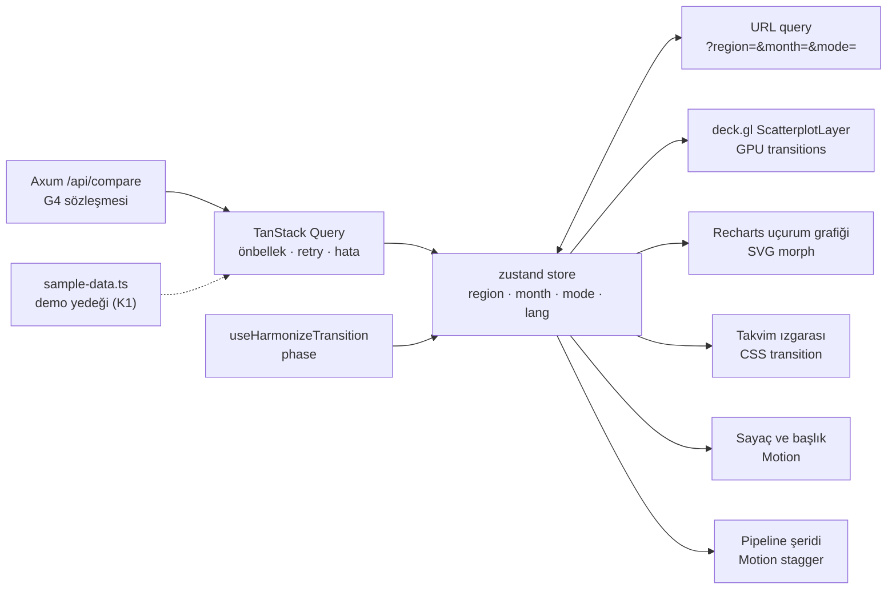
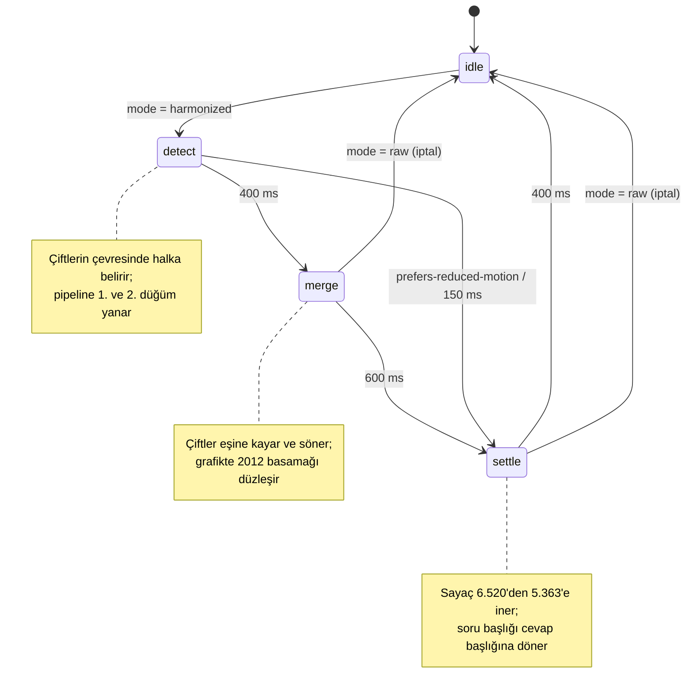

# PyroSync Frontend Teknoloji Önerisi

**Kime:** Serhat (frontend), Görkem (backend)
**Kimden:** Can (C1)
**Durum:** Öneri — ekip onayı bekliyor
**İlgili dokümanlar:** `docs/MIMARI.md`, `web/src/mocks/sample-data.ts`

Bu doküman bir uygulama kılavuzu değil, karar dokümanıdır. Amacı, C1'de tanımlanan
"uçurum bir yanılsama, tek hamlede kapanıyor" fikrinin frontend'te teknik olarak
mümkün olduğunu göstermek ve mevcut tercihlerden ayrıldığımız yerleri gerekçesiyle
önermektir. Her öneri için bir geri dönüş planı vardır; hiçbiri tek yönlü kapı değildir.

Örnek sayılar `web/src/mocks/sample-data.ts` ile aynıdır: **6.520 ham tespit**
(MODIS 2.340 + VIIRS 4.180), **5.363 harmonize**, **1.157 çift sayım**, **%17,7**.

---

## 1. Sabit kurallar

Bu dört kural pazarlığa açık değildir; aşağıdaki bütün öneriler bu kuralların içinde kalır.

| # | Kural | Bu dokumandaki anlamı |
|---|---|---|
| 1 | Backend **Rust** (Axum, Tokio) | Harmonizasyon, eşleştirme ve takvim hesabı sunucuda kalır. Tarayıcı yalnız görüntüler ve geçişi canlandırır. |
| 2 | Frontend **React 19 + TypeScript strict** | `tsconfig.json` bugünkü haliyle korunur: `strict`, `noUnusedLocals`, `noUnusedParameters`, `noFallthroughCasesInSwitch`. Yeni kod `any` ile bu kapıları delemez. |
| 3 | Derleyici **yalnız SWC** | `@vitejs/plugin-react-swc` kullanılır. Babel eklentisi isteyen hiçbir paket alınmaz. |
| 4 | **Babel eklentisi yok** | Kural, Babel dönüşümlerini hedefler. Babel olmayan Vite eklentileri (örneğin WASM yükleyici) serbesttir. |

### 1.1 SWC uyum kontrolü

Her aday kütüphane dört ölçütle denetlendi:

1. Çalışmak için bir `babel-plugin-*` gerektirmiyor mu?
2. ESM olarak dağıtılıyor mu (Vite'ın ağaç sallaması çalışsın diye)?
3. Derleme zamanında kod üreten bir macro/codegen katmanı var mı?
4. React 19 ile peer dependency çakışması var mı?

| Paket | Rol | SWC uyumu | Not |
|---|---|---|---|
| `maplibre-gl` | Harita motoru | Uygun | Önceden derlenmiş ESM, eklenti istemez. |
| `react-map-gl` (`/maplibre`) | React bağlayıcı | Uygun | Yalnız React bileşeni; derleme dönüşümü yok. |
| `deck.gl`, `@deck.gl/react` | GPU katmanları | Koşullu | Eklenti istemez; React 19 peer aralığı kurulumda doğrulanmalı (bkz. 2.1). |
| `recharts` | Uçurum grafiği | Uygun | Mevcut tercih, değişmiyor. |
| `d3-scale` | Takvim renk ölçeği | Uygun | Yalnız fonksiyon; DOM'a dokunmaz. |
| `motion` (`motion/react`) | Arayüz animasyonu | Uygun | ESM; eski `framer-motion` paketi değil. |
| `zustand` | Durum yönetimi | Uygun | Eklenti istemez, React 19 destekli. |
| `@tanstack/react-query` | Sunucu verisi | Uygun | Yalnız hook katmanı. |
| CSS Modules | Stil | Uygun | Vite'ta yerleşik; PostCSS zorunlu değil. |
| `@fontsource/*` | Yazı tipi | Uygun | Statik varlık; derleyiciye iş düşmez. |
| `wasm-pack` çıktısı | Vitrin (opsiyonel) | Koşullu | Babel değil, Vite WASM eklentisi gerekir. Karar Görkem'in. |

**Açıkça alınmayacaklar:** `styled-components` (Babel eklentisi), `linaria` (Babel
eklentisi), `@emotion/babel-plugin`, dekoratör tabanlı ORM'ler ve `*.macro` paketleri.
Bunlar kural 3'ü doğrudan çiğner; alternatifleri CSS Modules ile zaten karşılanıyor.

---

## 2. Yığın önerisi

Tablo, C1 planının 4. bölümünün tamamını taşır. "Mevcut tercih" sütunu bugünkü kod
tabanını veya R1/R2/R3'te yazılanı söyler; "—" henüz karar verilmediği anlamına gelir.

| Katman | Öneri | Mevcut tercih | Gerekçe | Risk / geri dönüş planı |
|---|---|---|---|---|
| **Harita** | **MapLibre GL JS + deck.gl** (`react-map-gl/maplibre`) | react-leaflet (R2) | İmza anı binlerce noktanın aynı anda konum ve renk değiştirmesidir. deck.gl bunu GPU'da `transitions` ile 60 fps yapar; Leaflet noktaları DOM/canvas üzerinde tek tek çizer. | En büyük paket artışı burada. Geri dönüş: harita bileşeni tek dosyada tutulur, Leaflet + statik geçişe dönüş bir günlük iş. |
| **Uzak yakınlık** | deck.gl `H3HexagonLayer` | marker cluster | Backend zaten H3 ızgarası kullanacak (G2, `h3o`). Uzaklaşınca aynı altıgenleri göstermek pipeline'ın 4. aşamasını görünür kılar ve Y3 ısı haritasıyla ortak altyapı olur. | H3 çözünürlüğü seçimi görsel olarak yanlış olabilir. Geri dönüş: `ScatterplotLayer` tek başına yeterli; altıgen katmanı ayrı bir dosyada. |
| **Altlık harita** | Koyu vektör altlık + çevrimdışı yedek olarak ülke sınırları GeoJSON | — | Docker ile on-premise hedefi ve K1 demo modu var. İnternet kesilirse harita boş kalmamalı. | Vektör stil dosyası büyür. Geri dönüş: yalnız GeoJSON arka plan + koyu zemin. |
| **Grafik** | **Recharts** (aynen kalır) | Recharts | 27 yıl × 12 ay = 324 nokta; SVG çizgi dönüşümü için yeterli. Belirsizlik bandı `Area` ile yapılır. Yusuf'un işleri değişmez. | 2012 basamağının "akması" SVG'de sınırlı. Geri dönüş: geçiş sırasında `strokeDashoffset` ile tek çizgi animasyonu. |
| **Takvim** | Elle yazılmış CSS Grid bileşeni + `d3-scale` | R3'te belirtilmemiş | Recharts'ta ısı haritası türü yok. 324 hücre için kütüphane gereksiz; renk geçişi CSS `transition` ile bedava gelir. | Erişilebilirlik (klavye, ekran okuyucu) elle yazılır. Geri dönüş: hücreler `<button>` + `aria-label`; kütüphane gerekmez. |
| **Arayüz animasyonu** | **Motion** (`motion/react`) | — | Düğme yayı, sayaç, başlık geçişi ve pipeline sırası tek zaman çizelgesinden yönetilir. Basit hover'lar düz CSS kalır. | Paket boyutu ve "her şeyi animasyona çevirme" eğilimi. Geri dönüş: yalnız `animate`/`useAnimate` kullanılır; sayaç CSS ile de yazılabilir. |
| **Durum** | **zustand** + URL eşitlemesi | Context veya zustand (R1) | Seçici ile abonelik: mod değişince yalnız ilgili bileşen çizilir, harita gereksiz yere yeniden kurulmaz. URL eşitlemesi paylaşılabilir linki (Hook "yatırım" adımı, K2 şartı) sağlar. | URL'i iki yönlü senkronlamak kolayca sonsuz döngüye girer. Geri dönüş: yazma tek yönlü (store → URL), okuma yalnız açılışta. |
| **Sunucu verisi** | **TanStack Query** | `hooks/useApi.ts` | Önbellek, yeniden deneme ve demo verisine düşme (K1) hazır gelir. Bölge değişimi önbellekten anında açılır. | Küçük uygulama için fazla soyutlama sayılabilir. Geri dönüş: mevcut `useApi` sarmalayıcısı korunur, Query yalnız önbellek için kullanılır. |
| **Stil** | **CSS custom properties + CSS Modules** | inline style | Sıfır çalışma zamanı maliyeti, Vite'ta yerleşik. C2'nin değişken adları doğrudan `tokens.css` olur. Tema `[data-theme]`, renk körü paleti `[data-palette]` ile değişir (K4). | CSS Modules sınıf adları üretir; testlerde seçici kırılabilir. Geri dönüş: testler `data-testid` ile yazılır. |
| **Metinler** | Tek dosya `web/src/content/copy.ts`, `{ en, tr }` nesnesi | — | İki dil için i18n kütüphanesi gereksiz soyutlama olur. Tipli nesne, eksik çeviriyi derleme hatasına çevirir. | Metin dosyası büyür. Geri dönüş: bölüm bazlı alt nesnelere ayırma; API aynı kalır. |
| **Yazı tipi** | Inter + tabular rakamlı mono, `@fontsource` ile yerel | system-ui | Sayaç inerken rakamlar zıplamaz. Yerel dosya, çevrimdışı demoda da çalışır. | İki aile indirme maliyeti. Geri dönüş: mono yalnız sayaçta `font-variant-numeric: tabular-nums` ile sistem yazı tipinden alınır. |
| **Backend** | Axum'a `CompressionLayer`; ham + harmonize + eşleme tek yanıtta | ayrı sayım alanları | Düğmenin ağ beklememesi için iki modun verisi baştan gelmeli. | Yanıt büyür. Geri dönüş: `include=mapping` parametresi; eşleme istenmezse eski boyut. |
| **Vitrin (opsiyonel)** | `pyrosync-core`'u **WASM**'a derlemek | — | Crate zaten saf hesaplama (I/O yok). K2 ayar sürgüleri tarayıcıda anında yeniden hesaplar; "uçtan uca Rust" hikâyesi jüri için ayırt edici olur. Karar Görkem'in. | Demo günü WASM derleme hatası riski. Geri dönüş: özellik bayrağı; kapalıyken sunucu hesabı kullanılır. |

### 2.1 Öne çıkan riskler

**deck.gl + MapLibre paket boyutu.** İki kütüphane birlikte, Leaflet'in birkaç katı
JavaScript getirir. Önlem: harita ayrı bir `lazy()` parçasıdır ve ilk boyamaya girmez.
İlk ekran başlık, sayaç ve grafikle açılır; harita bir sonraki karede yüklenir.
Geri dönüş kapısı: `FireMap.tsx` tek giriş noktasıdır, içi Leaflet ile değiştirilebilir.

**WebGL yoksa.** Kurumsal dizüstülerde ve bazı sanal makinelerde WebGL kapalı olabilir.
Önlem: açılışta `canvas.getContext("webgl2")` denetimi; yoksa harita yerine statik
önizleme ve "bu tarayıcıda hızlandırma kapalı" notu gösterilir. Sayılar ve grafik
aynı kalır, yani demo düşmez.

**React 19 peer aralığı.** deck.gl'nin React bağlayıcısı sürüm yükseltmelerinde
peer aralığını geciktirebilir. Önlem: `npm ls react` ile kurulumda doğrulama;
gerekirse `@deck.gl/react` yerine `DeckGL` örneği `useEffect` içinde elle kurulur
(resmî desteklenen kullanım). Geri dönüş: React 19 ile uyumlu sürüm sabitlenir.

**URL eşitlemesi.** İki yönlü senkron `popstate` ile birleşince döngü üretebilir.
Önlem: tek yönlü yazma (store → `history.replaceState`), okuma yalnız ilk açılışta
ve `popstate` olayında. Test: bölge değiştir, geri tuşuna bas, mod korunuyor mu.

---

## 3. Neden react-leaflet yerine MapLibre + deck.gl

Tek cümlelik gerekçe: **geçişin kendisi üründür.** 6.520 noktanın 5.363'e inmesi,
1.157 çiftin eşine doğru kayıp sönmesi ve grafiğin aynı anda düzleşmesi, jürinin
"aynı yangın tek sayıldı" sonucuna vardığı an. Bu an 60 fps akmazsa ürün fikri değil,
bir yükleme ekranı görürler.

### 3.1 İki motorun maliyeti

| Ölçüt | Leaflet (DOM/canvas 2D) | deck.gl (WebGL) |
|---|---|---|
| Nokta başına çizim | Her nokta bir DOM düğümü ya da canvas üzerinde ayrı çizim çağrısı | Tek çizim çağrısı, konumlar GPU tamponunda |
| Mod değişimi | React 6.520 öğeyi yeniden uzlaştırır; canvas'ta tümü yeniden çizilir | Veri aynı kalır, yalnız erişimci fonksiyonlar değişir |
| Animasyon | `requestAnimationFrame` içinde 6.520 konumu elle hesaplamak gerekir | `transitions` shader'da interpolasyon yapar |
| Kare bütçesi (16,6 ms) | Birkaç bin noktada ana iş parçacığı dolar | Kare başına iş yükü nokta sayısıyla neredeyse sabit |
| 1.157 çiftin kayması | Her karede 1.157 çift için konum güncellemesi + tam yeniden çizim | Aynı tampon, yeni hedef konum; geçiş ücretsiz |

Kritik nokta şu: deck.gl'de mod değişimi **veri değişimi değildir**. Ham nokta dizisi
`rawPos`, `targetPos` ve `survives` alanlarını taşır. Düğmeye basıldığında dizi
yeniden istenmez; yalnız `getPosition` ve `getFillColor` başka alanları okumaya başlar.
Nesne sürekliliği (Heer ve Robertson) tam olarak bunu gerektirir: göz, aynı nesnenin
yeni yerine gittiğini görür.

Leaflet ile aynı etkiyi kurmak mümkündür ama iki ek iş çıkar: nokta başına konum
enterpolasyonu ve her karede tam yeniden çizim. 6.520 noktada bu, 60 fps yerine
20–30 fps aralığına düşer; 1,4 saniyelik koreografi takılmaya başlar. Üstelik bu
kodu biz yazmak zorunda kalırız; deck.gl'de aynı iş bir prop.

### 3.2 Kısa TSX taslağı

```tsx
type Mode = "raw" | "harmonized";
interface RawPoint {
  id: string;
  pos: [number, number];              // [lon, lat]
  targetPos: [number, number] | null; // eşleştiği harmonize nokta
  survives: boolean;
  sensor: "MODIS" | "VIIRS";
}
const MODIS = [56, 132, 255, 230] as const;
const VIIRS = [255, 138, 76, 230] as const;
const MERGED = [235, 235, 235, 230] as const;
const FADED = [235, 235, 235, 0] as const;

export function FireLayer({ points, mode }: { points: RawPoint[]; mode: Mode }) {
  const merged = mode === "harmonized";
  return (
    <ScatterplotLayer<RawPoint>
      id="fires"
      data={points}
      pickable
      getPosition={(d) => (merged && d.targetPos ? d.targetPos : d.pos)}
      getRadius={merged ? 900 : 600}
      getFillColor={(d) =>
        merged ? (d.survives ? MERGED : FADED) : d.sensor === "MODIS" ? MODIS : VIIRS
      }
      transitions={{ getPosition: 600, getFillColor: 400, getRadius: 400 }}
      updateTriggers={{ getPosition: mode, getFillColor: mode, getRadius: mode }}
    />
  );
}
```

`transitions` süreleri koreografiyle hizalıdır: birleşme 400–1000 ms arasında
olduğu için konum geçişi 600 ms. `updateTriggers` olmadan deck.gl erişimcinin
değiştiğini anlamaz ve noktalar yerinde kalır; bu, kurulumda en sık yapılan hata.

### 3.3 Ne kaybediyoruz

Leaflet daha küçük, daha tanıdık ve ekibin bildiği bir araç. MapLibre + deck.gl
öğrenme eğrisi ve paket boyutu getiriyor. Karşılığında ürünün tek ayırt edici anı
garanti altına alınıyor. Bu takas bilinçli: C1'in bütün değeri o 1,4 saniyede.

---

## 4. Mimari

### 4.1 Veri akışı



Beş görsel bileşen aynı `phase` alanına bağlanır. Bu yüzden harita, grafik, takvim,
sayaç ve pipeline ayrı ayrı zamanlayıcı kurmaz; tek bir saatten beslenir. Ayrı
zamanlayıcılar kurulduğunda 100 ms'lik kaymalar geçişi "bozuk" gösteriyor.

### 4.2 Store şekli

```ts
export type Region = "turkiye-akdeniz" | "california" | "amazon" | "australia";
export type Mode = "raw" | "harmonized";
export type Phase = "idle" | "detect" | "merge" | "settle";
export type Lang = "en" | "tr";

export interface AppState {
  region: Region;
  month: string | null; // "2020-08"; null = tüm yıl
  mode: Mode;
  phase: Phase;
  lang: Lang;

  setRegion(region: Region): void;
  setMonth(month: string | null): void;
  setMode(mode: Mode): void;
  setPhase(phase: Phase): void;
  setLang(lang: Lang): void;
}
```

`phase` store'da tutulur çünkü beş bileşen onu seçiciyle okur. Hook onu yazar,
bileşenler yalnız okur; hiçbir bileşen `setPhase` çağırmaz. `month` tek bir ayı
filtreler, `null` ise 27 yıllık tam seriyi gösterir.

### 4.3 `useHarmonizeTransition` faz makinesi



Kurallar:

- İlk geçiş tam koreografiyle oynar (toplam 1.400 ms). Sonraki geçişler aynı makineyi
  kullanır ama süreler oransal olarak kısalır (toplam 500 ms); aynı töreni tekrar
  izletmek yorar.
- `prefers-reduced-motion` açıksa `detect` doğrudan `settle`'a geçer; süre 150 ms,
  yalnız sayaç ve başlık değişir, noktalar yer değiştirmez.
- Geçiş sırasında düğmeye tekrar basılırsa makine `idle`'a döner; yarım kalmış
  animasyonu sürdürmek sayaç ile haritanın uyumsuz kalmasına yol açar.
- Süreler `transitionend` yerine zamanlayıcıyla yönetilir; deck.gl geçişi DOM olayı
  üretmez, tek kaynak zamanlayıcı olmalı.

---

## 5. API sözleşme önerisi: `/api/compare`

**ÖNERİ — Görkem (G4) için.** Bu bir istek listesidir, mevcut davranışın tarifi değil.

Bugünkü sözleşme (özet):

```json
{
  "raw": { "modis_count": 2340, "viirs_count": 4180, "total_raw": 6520 },
  "harmonized": { "count": 5363, "hotspots": [] },
  "calendar": []
}
```

Bu yanıt üç sayı ve harmonize noktaları veriyor; ham noktalar ve hangi ham noktanın
hangi harmonize noktaya gittiği yok. Animasyonun ihtiyacı tam olarak o eşleme.
(Yanıtta ayrıca FIRMS kaynak raporu alanı var; nokta düzeyinde bilgi taşımıyor.)

Öneri: `/api/harmonize` olduğu gibi kalır, yeni bir `/api/compare` eklenir. Eski
sözleşme bozulmaz, frontend iki uçtan birini seçebilir.

```json
{
  "meta": {
    "region": "turkiye-akdeniz",
    "bbox": [25.6, 35.8, 44.8, 42.1],
    "days": 365,
    "generated_at": "2026-11-15T09:12:00Z",
    "demo": false
  },
  "raw": {
    "modis_count": 2340,
    "viirs_count": 4180,
    "total_raw": 6520,
    "points": [
      {
        "id": "m-0001",
        "sensor": "MODIS",
        "lat": 39.92,
        "lon": 32.85,
        "frp": 45.2,
        "acquired": "2020-07-15T12:30:00Z",
        "confidence": "High",
        "daynight": "Day"
      },
      {
        "id": "v-0042",
        "sensor": "VIIRS",
        "lat": 39.93,
        "lon": 32.87,
        "frp": 41.0,
        "acquired": "2020-07-15T12:33:00Z",
        "confidence": "Nominal",
        "daynight": "Day"
      }
    ]
  },
  "harmonized": {
    "count": 5363,
    "points": [
      {
        "id": "h-0001",
        "lat": 39.925,
        "lon": 32.86,
        "frp": 45.2,
        "frp_corrected": 38.7,
        "source": "Matched",
        "acquired": "2020-07-15T12:30:00Z",
        "confidence": "High",
        "daynight": "Day"
      }
    ]
  },
  "mapping": [
    { "raw_id": "m-0001", "harmonized_id": "h-0001" },
    { "raw_id": "v-0042", "harmonized_id": "h-0001" },
    { "raw_id": "v-0043", "harmonized_id": null }
  ],
  "stages": [
    { "id": "ingest",   "label": "Collect",               "count_in": 6520, "count_out": 6520, "removed": 0,    "note": "MODIS 2.340 + VIIRS 4.180" },
    { "id": "dedup",    "label": "Remove double-counts",  "count_in": 6520, "count_out": null, "removed": null, "note": "interscan |dt| < 8 s" },
    { "id": "vza",      "label": "Correct viewing angle", "count_in": null, "count_out": null, "removed": 0,    "note": "sayı değişmez, FRP düzelir" },
    { "id": "grid",     "label": "Align to one grid",     "count_in": null, "count_out": null, "removed": 0,    "note": "H3 hücresine oturtma" },
    { "id": "match",    "label": "Match across sensors",  "count_in": null, "count_out": 5363, "removed": null, "note": "2 km / 5 dk eşleşme" },
    { "id": "fuse",     "label": "Keep the best view",    "count_in": 5363, "count_out": 5363, "removed": 0,    "note": "VIIRS tercihli" },
    { "id": "calendar", "label": "Build the calendar",    "count_in": 5363, "count_out": null, "removed": 0,    "note": "çıktı 27 x 12 hücre" }
  ]
}
```

Alanların anlamı:

- **`raw.points`** — ham tespitler. `id` ön ekleri kaynağı söyler (`m-` MODIS,
  `v-` VIIRS, `h-` harmonize). `sensor` alanı ham modda renk seçimini belirler.
- **`harmonized.points`** — bugünkü `hotspots` dizisinin aynısı, artık `id` ile.
  `source` alanı `Matched`, `ModisOnly`, `ViirsOnly` değerlerini korur.
- **`mapping`** — 6.520 girdi. Çift sayılan 1.157 nokta **aynı** `harmonized_id`
  değerini taşır; harita animasyonu bu iki satırı okuyup noktaları birbirine kaydırır.
  `harmonized_id: null` ise ham nokta çıktıya girmedi demektir (filtre, düşük güven,
  ızgara dışı). Frontend bu noktayı söndürür.
- **`stages`** — düzeltme fişinin satırları. `count_in` / `count_out` `null` ise o
  aşamada sayı ölçülmedi; arayüz rozet yerine "—" gösterir. Yalnız iki değer bugün
  doğrulanmış: toplam 6.520 ve sonuç 5.363. Kalan satırlar G4 doldurana kadar boş kalır.
- **`calendar`** — değişmiyor; bugünkü `CalendarCell[]` şeması aynen kullanılır.

Boyut notu: 6.520 nokta + 6.520 eşleme satırı sıkıştırılmamış haliyle birkaç yüz
kilobayt. `CompressionLayer` ile bu, demo için sorun değil. Yine de `include=mapping`
parametresi önerilir: eşleme istenmezse yanıt küçülür, eski istemciler etkilenmez.
Eşleme yoksa frontend geçişi "ani renk değişimi" olarak oynatır; ürün çalışır, yalnız
imza anı zayıflar. Bu yüzden eşleme **opsiyonel ama öncelikli**.

---

## 6. Performans bütçesi ve ekipten istenecekler

### 6.1 Bütçe

| Ölçüt | Bütçe | Nerede ölçülür |
|---|---|---|
| Düğme tepkisi (ilk kare) | < 100 ms | Tıklama → ilk boyanmış kare; veri önceden yüklü olduğu için ağ beklemesi yok |
| Geçiş kare süresi | ≤ 16,6 ms (60 fps), 10.000 nokta | DevTools Performance, geçiş kaydı |
| Ana iş parçacığı uzun görevi | < 50 ms | Geçiş sırasında tek bir uzun görev bile takılma olarak görünür |
| İlk boyama | Başlık, sayaç ve grafik haritasız görünür | Harita `lazy()` ile ayrı parça |
| LCP (orta seviye telefon) | < 2,5 sn | Lighthouse mobil, 4G kısıtlama |
| Harita etkileşimi | Kaydırma/yakınlaştırma 60 fps | 6.520 nokta yüklüyken |
| Demo moduna düşme | Ağ hatasında < 300 ms | TanStack Query `retry: 1`, sonra yerel veri |
| Azaltılmış hareket | Geçiş 150 ms, konum animasyonu yok | `prefers-reduced-motion: reduce` |

Bütçenin tamamı tek bir ilkeye hizmet eder: **düğme hiçbir zaman ağ beklemez.**
İki modun verisi açılışta birlikte gelir; düğme yalnız görünümü değiştirir. 100 ms'yi
aşan her gecikme, nedensellik bağını koparır ve "sihir" etkisi kaybolur.

### 6.2 Ekipten istenecekler

| Kişi | İstenen | Neden / bağımlılık |
|---|---|---|
| **Görkem** (G4) | `/api/compare`: ham noktalar, `mapping` (raw_id → harmonized_id veya null), aşama sayıları, `CompressionLayer`. `/api/harmonize` olduğu gibi kalır. | Harita geçişi ve düzeltme fişi buna bağlı. Eşleme olmadan 1.157 çiftin kayması çizilemez. |
| **Serhat** (R1, R2) | react-leaflet yerine MapLibre + deck.gl; zustand; CSS Modules; `copy.ts`; açılış modunun `raw` olması. | C1'in ana fikri ham açılışa dayanıyor; bugün `App.tsx` harmonize açıyor ve merak boşluğunu baştan kapatıyor. |
| **Yusuf** (Y5) | Mock veride ham noktalar, `mapping` alanı ve 2012 basamağı. | Frontend, G4 hazır olmadan da geçişi geliştirebilmeli. Mock şeması `/api/compare` ile birebir olmalı. |
| **Sadık** (K1, K4) | Rozet metinleri; paletlerin `data-palette` ile değişmesi. | Renk körü paleti ve demo/canlı ayrımı renk tek başına anlam taşımadan çalışmalı. |
| **Samet** (S8) | Methods metinlerinin `docs/UX_YAZIM.md` ses kurallarına uyması. | Uyarı ve yöntem metinleri arayüzde aynı sesle konuşmalı. |
| **Can** (C1, C2) | `tokens.css` değişken adları, geçiş karelerinin wireframe karşılıkları, koreografi süreleri. | Serhat'ın bileşenleri isimlendirilmiş token bekliyor; süreler tek yerde tanımlanmalı. |

### 6.3 Karar özeti

Onay bekleyen üç şey var:

1. Harita motorunun MapLibre + deck.gl olması (tek kritik değişiklik).
2. `/api/compare` sözleşmesinin G4 kapsamına alınması.
3. Açılış modunun `raw` olması ve geçişin tek bir `phase` alanından sürülmesi.

Geri kalan öneriler (zustand, TanStack Query, CSS Modules, `copy.ts`) bu üç kararın
doğal sonucu; tek tek onay gerektirmiyor.
