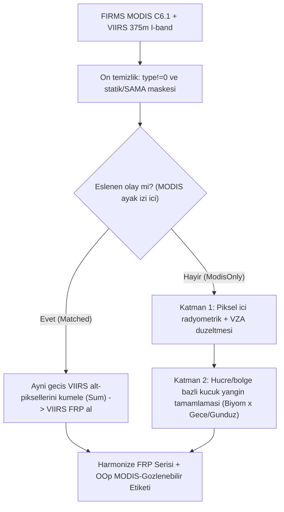

# Referans Analizi ve Harmonizasyon Karar Belgesi

Bu belge, PyroSync (NASA Space Apps 2026 — *MODIS–VIIRS sensor cliff* problemi) kapsamında incelenen 32 akademik makale ile 6 referans projenin teknik sentezini sunar. Amaç, `crates/core` harmonizasyon hattındaki açık sorunlara (**P1–P7**) literatür ve ampirik kanıtlara dayalı uygulanabilir mühendislik kararları, öncelikli bir yol haritası ve jüri sunumu için doğrulanmış etki malzemesi üretmektir.

> **Kaynaklar:** 32 makale (`academic-papers/`, yerel, gitignore'da) + 6 referans proje (`reference-projects/`). Makaleler metin içinde `[NN]` biçiminde, referans projeler proje adıyla atıflanır.

---

## Yönetici Özeti

1. **P1 — G8 katsayıları (`1.16 / 0.97 / 0.82`) yanlış VIIRS ürününe aittir ve acilen değiştirilmelidir:** `calibration.rs` içindeki Li et al. (2018) katsayıları FIRMS'teki **375 m I-band** (`VNP14IMG`) yerine **750 m M-band (`NDEAF-L2`)** ürününden ve eşzamanlı olmayan yıllık enlem toplamlarından türetilmiştir `[03, Bölüm 2, 3.3, Şek. 10b]`; oysa 375 m I-band literatüründe `1°×1°`/bölgesel toplam `ΣVIIRS/ΣMODIS` oranı Afrika'da `1.26–1.46` `[14, Bölüm 4.2, Tablo 1]`, KD Asya'da `1.22–1.32` `[02, Şek. 10]`, küresel 40.288 Aqua granülünde `1.38` (`177 vs 128 TW`) `[16, Bölüm 4.2]` ve referans projelerde `1.30–1.34` (`fire-harmony`, `flare-chronos`) olup PyroSync ölçümlerimizi (tropik `1.21–1.22`, Türkiye `1.33`, boreal `1.34–1.40`; tespit sayısı `3–6×`) doğrudan doğrular.
2. **P1 — Tek-piksel oranı (`0.38–0.77`) ile hücre-toplamı oranı (`1.21–1.40`) karıştırılmamalıdır:** 1 km MODIS ayak izi (~1.0–9.66 km²) içine birden fazla 375 m VIIRS pikseli (~0.14–0.62 km²) düştüğü için tek-piksel eşleşmede VIIRS ortalama `0.70–0.73` `[02, Şek. 10]` veya `~0.14–0.40` `[14, Şek. 4]` kalırken, ızgara toplamında MODIS'in tespit limiti (`5.7–40 MW`) altındaki yangınların `%65–83`'ünü kaçırması `[02, Özet; 14, Bölüm 4.3.1]` toplamı VIIRS lehine `1.22–1.40` ölçeğine taşır; tekil piksel kalibrasyonu ile küçük yangın tamamlaması ayrıştırılmalıdır.
3. **P2 — `vza.rs` yer tutucuları hatalı olmasının yanında ters yönde (bölme) çalışmaktadır:** Zheng et al. (2026) PDF Şekil 4'teki gerçek fit `R(θ) = 0.24*θ² + 0.02*θ + 1.19` (`R² = %98.18`) MODIS FRP'sini **çarpmak** için tanımlanmıştır `[01, Denklem 9, Şek. 4]`, oysa `vza.rs` şu an `raw_frp / ratio` ile **bölmektedir**; ayrıca `dedup.rs` sonrası MODIS ızgara toplamı VZA ile şişmek yerine daha fazla eksik kaldığından `[14, Tablo 1]` mevcut bölme hatayı büyütmektedir.
4. **P3 — Kaynaksız `uncertainty.rs` tabanı (`0.12 / 0.08 / 0.05`) gerçekçi değildir ve mekansal korelasyonu ihmal eder:** Literatürde MODIS tek-piksel alt-piksel yerleşim hatası `σ = %26.6` (`>50` pikselde `< %5`) `[12, Bölüm 5.1]`, MIR FRP standart hatası `±%30` `[05, Bölüm 3.4]` iken, `fire-harmony` ülke/kıta toplamlarında bağımsız parametrik varyans toplamanın mekansal otokorelasyon nedeniyle yalnız `~%50` kapsama verdiğini gösterip **Mondrian split conformal** aralıklarla `%92–100` kapsama elde etmiştir (`area_intervals.json`).
5. **P4 — Efor normalizasyonu (`Ω`) yüksek şiddet rejiminde sabitlenmeli ve 2000/2012/2021 kırılmaları yönetilmelidir:** Sofiev & Kouznetsov (2026) piksel alanı tabanlı analitik tespit limiti `D_p(A_p)` ve gözlem operatörü (`OOp`) `[16, 17/08, Denklem 5–7, Tablo 1–2]` sayesinde `Ω` yalnızca MODIS kenar eşiği (`≥ 40 MW`) üstünde hesaplanıp küçük yangın uçurumundan ayrılabilir; ayrıca Kasım 2000 öncesi Terra `[11, Bölüm 6]`, 15 Ekim 2012 öncesi SNPP anomalileri `[13, Bölüm 4.2]`, Aqua–SNPP arası `~%20–23` günlük döngü farkı `[16, Bölüm 5.4]` ve 2021+ yörünge sürüklenmesi (`fire-harmony`) ayrı ele alınmalıdır.
6. **P5 — Sensör içi `< 8 sn, > %30` dedup sağlamdır, ancak 1-to-1 `harmonize.rs` eşleştirmesi çoklu alt-pikseli dışarıda bırakır:** `dedup.rs` kuralı `[01, 03, 14]` ile doğrulanmıştır; buna karşın `harmonize.rs`'deki 1-to-1 tüketim `1 MODIS = N VIIRS` gerçekliğinde fazla VIIRS piksellerini `ViirsOnly` bırakmaktadır (`FireHarmonize` `%2–7` eşleşme uyarısı; `flare-chronos` geçiş-içi kümeleme çözümü).
7. **P6 & P7 — Bağımsız doğrulama ve politika/iklim anlatısı jüri değerini belirler:** Dikiş yeri + placebo adım testi (`fire-harmony`), ESA `Fire_cci` / `Sentinel-2` / `30 m Landsat` uyumu `[01, 10, 25]`, `TROPOMI CO` (`R = 0.97`) `[23]` ve `MERRA-2 OC AOD` (`-%12..22` RMSE) `[22]` ile doğrulanan seri; Çin anız yasakları (boyut kayması tuzağı) `[28, 29, 30]`, Amazon 2019–2021 iklim-insan ayrışması `[20]` ve `RAW ↔ HARMONISED` etkileşimli araçlarıyla güçlü bir ürüne dönüşür.

---

## Açık Sorunlara Göre Bulgular (P1–P7)

### P1 — 375 m VIIRS ↔ MODIS FRP Kalibrasyonu (G8), Küçük Yangın Etkisi ve Biyom Ayrımı

#### (a) Literatür ne diyor
- **750 m vs 375 m köken hatası:** `calibration.rs` içindeki `1.16` (0–30°), `0.97` (30–50°) ve `0.82` (55–70°) oranları Aqua MODIS C6 (`MYD14`) ile **NOAA 750 m M-band (`NDEAF-L2`)** arasındaki, eşzamanlılık şartı olmayan yıllık `1°×1°` / `5°` enlem bantlı `ΣFRP_VIIRS / ΣFRP_MODIS` toplamlarıdır `[03, Bölüm 2, 3.3, 4.6, Şek. 10b]`. Boreal `> 1000 MW` yangın kümelerinde 750 m M13 bandındaki CO₂/duman soğurması nedeniyle VIIRS FRP MODIS'ten `%47` daha küçük kalmıştır `[03, Özet, Tablo 2]` *(not: eski `03_ANALYSIS.md` bunu ters işaretle aktarmıştı)*.
- **375 m I-band fiziksel üstünlüğü ve küresel oran:** 375 m I-band (`VNP14IMG`), 750 m M-band'a göre gündüz `3×`, gece `25×` daha fazla piksel yakalar `[09, Bölüm 4.2.1]` ve MODIS'ten `~10×` daha küçük yangınları (`< 20 m²` vs `~100 m²`) görür `[12, Bölüm 10.2]`. Küresel 40.288 Aqua granülünde ham toplam oran `ΣVIIRS / ΣMODIS = 177 TW / 128 TW = 1.38` dir `[16, Bölüm 4.2]`.
- **İki ölçek paradoksu (Tek-piksel vs Hücre toplamı):**
  - Eşzamanlı ortak tespitlerde piksel/ortak ayak izi oranı `0.70` (orman) / `0.73` (düşük biyokütle) / `0.72` (tümü) `[02, Şek. 10]`, piksel ortalaması oranı ise nadirde `9.4 / 23.7 ≈ 0.40`, kenarda `18.6 / 130.8 ≈ 0.14` tür `[14, Şek. 4]`.
  - Buna karşın MODIS'in VIIRS piksellerinin ormanlarda `%65.2`'sini, tarım/otlakta `%82.8`'ini `[02, Bölüm 3.2]` ve `0.05°` Afrika hücrelerinin `%76`'sını (`%39` FRP) `[14, Bölüm 4.3.1]` kaçırması nedeniyle bölge/hücre toplamı `1.22–1.40` bandına tersine döner.
- **Biyom bağımlılığı ve karıştırıcı kaynaklar:**
  - *Savan/Cerrado:* Aqua MODIS peyzaj FRP'sinin `%65–71`'ini, VIIRS `~%90`'ını yakalar (beklenen oran `~1.32`) `[15, Bölüm 4–5]`; Mali savanında MODIS `500 m` yanmış alanın yaklaşık yarısını (`214.809 vs 405.253 ha`) kaçırır `[25, Bölüm 3.3]`.
  - *Tarım peyzajı:* Küçük yangınlar (`%96 < 10 ha` `[10, Tablo 3]`, `< 1 MW` `[21, s. 2]`) nedeniyle KD Asya düşük biyokütle oranı `1.32` `[02, Şek. 10]`, tarımda Vadrevu & Lasko (2018) atfıyla `2.5×` `[21, s. 6; 29, Bölüm 3.2]` bildirilmiştir.
  - *Boreal gaz meşalesi & SAMA:* Boreal Rusya'da gece tespitlerinin `%47–67`'si (MODIS) ve `%55`'i (VIIRS) gaz meşalesidir (VIIRS `5×` fazla tespit) `[06, 19, Tablo 2]`; Güney Amerika'da `SAMA` gece proton anomalisi SNPP satırlarının `%4.63`'ünü kirletir `[09, Bölüm 2.1]`, `flare-chronos`.
- **Çelişen kaynakların değerlendirmesi:**
  - Rizza et al. (2026) Amazon'da `MODIS / VIIRS = 2–4×` (Tablo 2–3'te `3.55–4.23×`) raporlamıştır `[20, Bölüm 3.7, Tablo 2–3]`. Ancak bu çalışma **hakemsizdir** ve yalnızca `VIIRS = high` (tespitlerin `~%85`'ini oluşturan `< 50 MW` ve `nominal` sınıfını atarak) + `FRP ≥ 100 MW` filtresi uygulamıştır `[20, Bölüm 2.5, 3.3]`. FIRMS `VNP14IMG`'de standart yangınların ana gövdesi `nominal` (`%89.86` `[24, Tablo 3]`) olduğu için tam FIRMS arşivimize `[02, 14, 16]` uygundur.
  - Yang et al. (2020) `[29]` içindeki `f_FRP = 5` katsayısı I-band ön-kümeleme doygunluğunun yanında toplam yanma enerjisi dönüşümünü de kapsadığından sensörler arası kalibrasyon çarpanı olarak alınmamalıdır `[29, Bölüm 2.2, 3.3]`.

| Bölge / Metrik | PyroSync Ölçümü (Aqua vs S-NPP 375 m) | Mevcut G8 (`750 m`, `[03]`) | 375 m I-band Literatürü & Referans Projeler |
|---|---|---|---|
| **Tropik** (`1°×1°` ΣVIIRS/ΣMODIS) | Brezilya/Angola: **1.21–1.22** | `1.16` | Afrika swath eğimi **1.26** (`1°` medyan **1.456–1.85**) `[14, Böl. 4.2–4.3]`; Cerrado beklentisi **~1.32** `[15]` |
| **Orta Enlem** (`1°×1°` ΣVIIRS/ΣMODIS) | Türkiye: **1.33** | `0.97` (✗) | KD Asya tüm/orman **1.22**, düşük biyokütle **1.32** `[02, Şek. 10]`; küresel **1.38** `[16]`; `flare-chronos` **1.335** |
| **Boreal** (`1°×1°` ΣVIIRS/ΣMODIS) | Rusya/Kanada: **1.34–1.40** | `0.82` (✗) | Küresel **1.38** (`177/128 TW`) `[16, Böl. 4.2]`; `fire-harmony` küresel FRP oranı **1.3** |
| **Ortak hücre-gün tespit sayısı** | **3–6×** (boreal en yüksek) | (Ω ile ayrı) | Küresel **~4×** küçük yangın `[16, Böl. 3.3.2]`; `fire-harmony` **6.1×** (gündüz `5×`, gece `31×`); `eg-firetrack` **5.56×** |
| **Tek-piksel eşleşen çift FRP** | **0.38–0.77** | VIIRS FRP seçer | Eşzamanlı tek ayak izi/piksel **0.70–0.73** `[02, Şek. 10]`; piksel ortalaması **0.14–0.40** `[14, Şek. 4]` |



#### (b) PyroSync'te şu an ne var
- `crates/core/src/calibration.rs` (`default_bands`) `1.16 / 0.97 / 0.82` oranları ve türetilmiş `ratio_sigma: 0.13 / 0.03 / 0.18` değerleriyle `harmonize.rs` (`from_modis_only_with`) içinde tekil `ModisOnly` hotspot'ların FRP'sini çarpar.
- `Matched` eşleşmelerde ise 1-to-1 en yakın tek VIIRS pikselinin FRP'si seçilir; aynı MODIS ayak izindeki ek VIIRS pikselleri `ViirsOnly` olarak kalır.

#### (c) Önerilen değişiklik
- **Aşama 1 — Acil katsayı güncellemesi (`calibration.rs`):** 750 m M-band `1.16 / 0.97 / 0.82` yerine 375 m I-band hücre-gün eşdeğerine geçin: Tropik (`0–30°`) `~1.22–1.26` `[14]`, Orta enlem (`30–55°`) `~1.33` `[02, 16]`, Boreal (`>55°`) `~1.36–1.38` `[16]`. Bu katsayının tekil yangın şiddetini değil **hücre/bölge toplam FRP'sini** kalibre ettiğini dokümante edin.
- **Aşama 2 — Ölçek-ayrık hibrit model (`calibration.rs`, `harmonize.rs`):**
  1. `Matched` olaylarda MODIS ayak izine düşen tüm aynı-geçiş VIIRS alt-piksellerinin FRP'sini **toplayın** (`[01]`, `flare-chronos`).
  2. `ModisOnly` dönem/hücrelerde tekil büyük yangın piksellerini şişirmek yerine, **ay × biyom × gece/gündüz (`ν_S`)** tablosundan (`[23, Eq. 3–6]`, `fire-harmony`) veya yerel güç-yasası (`f(FRP) ∝ FRP^(-α)`, Cerrado `α = 1.31` `[15, Şek. 6]`) ile `D_p,VIIRS`–`D_p,MODIS` arasındaki kaçırılan küçük yangın bütçesini hücre/bölge toplamına ekleyin.
  3. Ön-işlemede statik kaynak maskesi (`type != 0` + kalıcı hücre `[06, 10]`, `fire-harmony %96.3` temizleme) ve `SAMA` gece filtresi (`flare-chronos`) uygulayın.

#### (d) Güven ve riskler
- **Güven:** **Yüksek.**
- **Riskler:**
  - Tekil `ModisOnly` piksellerini `1.38` ile çarpmak büyük yangınların anlık şiddetini şişirir (hücre düzeyinde ekleme bu riski giderir).
  - Gece tespit payı `ν_S` (`Spearman = 0.57`, `fire-harmony`) ve tarım/orman ayrımı eklenmezse orta enlem ülkelerinde `±%20` sapma sürebilir.
  - Tropikte ekvatoral swath boşluğu kaybının (`%10.7–12.5` `[14, Bölüm 4.4]`) hem `calibration.rs` hem `effort.rs` içinde çift sayılmaması gerekir.

---

### P2 — MODIS VZA (Bakış Açısı) FRP Düzeltmesi

#### (a) Literatür ne diyor
- **Piksel büyümesi vs Izgara toplamı tersliği:** MODIS tarama kenarında (`55°–65°`) piksel alanı `1.0 → 9.66–9.69 km²` (`9.67×`) büyür `[01, 16]`. Küçük yangınların kenarda tespit dışı kalması nedeniyle tespit edilen piksel ortalama FRP'si `~22–28.5 MW`'tan `~90–165.7 MW`'a (`~300%`) ve minimum eşik `~4.1–5.7 MW`'tan `>31.7–42 MW`'a (`~7.4–8.2×`) yükselir `[01, Bölüm 4.1; 03, Bölüm 4.2; 14, Şek. 4; 16, Tablo 1]`.
- **Izgara toplamında VZA etkisi (`dedup` sonrası):** Bow-tie tekrarları temizlendikten sonra VZA arttıkça MODIS toplam FRP **düşer** (`[14, Tablo 1, Bölüm 5]`):
  - `0.25°` ızgara medyan oranı: `φ_med(θ) = 1.313 - 0.006*θ + 0.141*θ²` (`r² = 0.74`)
  - `1.0°` ızgara medyan oranı: `φ_med(θ) = 1.456 - 0.085*θ + 0.369*θ²` (`r² = 0.72`; nadir `%47` → kenar `%85` eksiklik)
- **Doğrudan 375 m VNP14IMG / Aqua MYD14 VZA eğrisi (`[01]` PDF s. 11 Şek. 4, Dnk. 7–9):** Footprint içi tüm 375 m VIIRS pikselleri toplanarak (`≤ 5 dk`) 1° VZA kutularında fit edilen gerçek polinom (`θ` radyan, `R² = %98.18`, `RMSE = %1.34`):
  - `R(θ) = 0.24*θ² + 0.02*θ + 1.19` ve düzeltme `FRP_MODIS_adj = R(θ) * FRP_MODIS` (**çarpma**: nadir `1.19×` → `65° ~1.52×`).
  - Yazarlar bu katsayıların doğrudan **Terra (`MOD14`)** verisine aktarılmaması gerektiğini özellikle belirtir `[01, Bölüm 5]`.
- **VIIRS 375 m davranışı:** Kart üstü 3-zonlu kümeleme (`±31.72°`: 3→1, `±44.86°`: 2→1, `56.28°`: 1→1) piksel boyutunu `0.14 → 0.62 km²` aralığında tutar `[09, Bölüm 2]`, ancak kümeleme geçiş açılarında tespit sayısında basamak süreksizlikleri üretir `[13, Şek. 5]`.

#### (b) PyroSync'te şu an ne var
- `crates/core/src/vza.rs` küresel-Dünya bisection ile `scan`'den VZA hesaplar (`vza_from_scan`), ancak yer tutucu `CORRECTION_A = 0.85, CORRECTION_B = 0.12, CORRECTION_C = 1.0` sabitlerini kullanır.
- `apply_vza_correction` işlevi `raw_frp / ratio` biçiminde **bölme** yapar (kenarda FRP'yi `~%55` küçülterek VZA eksikliğini daha da ağırlaştırır).

#### (c) Önerilen değişiklik
- **İşaret hatasını düzeltin ve G8 ile çift sayımı önleyin (`vza.rs`):** `raw_frp / ratio` bölmesini kaldırıp **çarpmaya** (`raw_frp * R_rel(θ)`) çevirin. `[01]` Şekil 4'teki `c = 1.19` terimi zaten nadir ölçek farkını içerdiğinden, `vza.rs` içinde yalnızca göreceli VZA eğrisini uygulayın:
```text
Mevcut (hatali):   FRP_out = FRP_raw / (0.85*θ² + 0.12*θ + 1.0)
Onerilen (goreli): R_rel(θ) = (0.24*θ² + 0.02*θ + 1.19) / 1.19 = 0.2017*θ² + 0.0168*θ + 1.0
                   FRP_out  = FRP_raw * R_rel(θ)   // nadir 1.00, 55 deg ~1.20, 65 deg ~1.28
```
- **Analitik piksel alanı (`vza.rs`):** `[16, Denklem 1–3]` ile `A_p = S * T` hesaplanıp `effort.rs` ve `uncertainty.rs`'e sağlanmalıdır.

#### (d) Güven ve riskler
- **Güven:** **Yüksek** (`raw_frp / ratio` bölmesinin hatalı yön olduğu kesindir).
- **Riskler:** `[01]` fiti yalnız **Aqua `MYD14`** içindir; **Terra `MOD14`** (sabah 10:30) için arşivimizdeki `≤ 20 dk` Terra–VIIRS çiftlerinden bağımsız doğrulama yapılmalıdır `[01, Bölüm 5]`.

---

### P3 — Belirsizlik Modeli (`uncertainty.rs`), Tespit Limitleri (MW) ve Atmosferik Etki

#### (a) Literatür ne diyor
- **Tek-piksel FRP belirsizliği (`σ`):** Freeborn et al. (2014a) atfıyla MODIS alt-piksel yerleşim belirsizliği normal dağılımlı **`σ = %26.6` (`0.266`)** olup, `> ~50` MODIS pikseli içeren kümelerde **`< %5`**'e iner `[12, Bölüm 5.1]`. Genel MIR FRP standart hatası `±%30` (`[05, Bölüm 3.4]`), GCOS ECV hedefi `%10` dur `[12, Bölüm 10.1]`. **VIIRS 375 m tek-piksel radyometrik `σ` değeri incelenen 32 makalenin hiçbirinde sayısal olarak verilmemiştir** (`metinde yok`).
- **Analitik piksel tespit limitleri `D_p(A_p)` (`[16, 17/08, Denklem 5–6, Tablo 1–2]`):**
  Formül: `D_p(A_p) = λ_lst * A_p + μ_lst` ve lojistik eğim `r_p(A_p) = r_0 + r_1 / (A_p - A_0)` (`A_0 ≈ 0`):

| Sensör & Dönem | `λ_lst` (MW/km²) | `μ_lst` (MW) | `r_0` (MW⁻¹) | `r_1` (km²/MW) | `c_0` | Makale metni: tipik nadir → kenar (Sonuç / Böl. 5.2; Özet'te VIIRS gece `0.5 MW`) | Denklem 5 (`D_p`, %50) nadir → kenar |
|---|---|---|---|---|---|---|---|
| **MODIS C6.1 Gündüz** (`φ < 90°`) | `4.44` | `0.52` | `0.07` | `1.26` | `0.045` | `5.7 MW → 40–42 MW` | `4.96 → 43.41 MW` (`1.0 → 9.66 km²`) |
| **MODIS C6.1 Gece** (`φ ≥ 90°`) | `4.43` | `1.01` | `0.11` | `1.06` | `0.045` | `3.7 MW → 39 MW` | `5.44 → 43.80 MW` (`1.0 → 9.66 km²`) |
| **VIIRS 375 m C2 Gündüz** (`φ < 90°`) | `6.17` | `1.44` | `0.61` | `0.21` | `0.05` | `3.7 MW` (nadir) | `2.31 → 5.27 MW` (`0.14 → 0.62 km²`) |
| **VIIRS 375 m C2 Gece** (`φ ≥ 90°`) | `1.38` | `0.35` | `2.12` | `1.02` | `0.05` | `0.7 MW` (en küçük `0.5 MW`) | `0.54 → 1.21 MW` (`0.14 → 0.62 km²`) |

  *Not (tutarsızlık):* Makalenin Sonuç/Böl. 5.2 metnindeki tipik değerler (`5.7/3.7 MW` MODIS, `3.7/0.7 MW` VIIRS, kenarda `42/39 MW`) Denklem 5 ve Tablo 1–2'den üretilemez: makalenin kendi Böl. 5.3 kontrolü `9 km² → 40.5–40.9 MW` Denklem 5 ile tutarlıdır (`4.44·9+0.52 = 40.48`, `4.43·9+1.01 = 40.88`), ancak MODIS gece `3.7 MW` için `A_p ≈ 0.61 km²` gerekir, bu da en küçük MODIS pikselinden (`1 km²`) küçüktür; VIIRS gece değeri de Özet'te `0.5`, Sonuç'ta `0.7 MW`'tır. Metin değerleri büyük olasılıkla farklı bir istatistiktir (makale FRP dağılımlarının 1. yüzdeliğini ayrıca fit eder, Böl. 5.1). `D_p` tespit sigmoidinin %50 orta noktasıdır; kod Denklem 5 + tabloları kullanır, metin değerleri yalnızca Sonuç/Özet atfıyla anılır.

  *Not (tutarsızlık):* Makalenin Sonuç/Böl. 5.2 metnindeki tipik değerler (`5.7/3.7 MW` MODIS, `3.7/0.7 MW` VIIRS, kenarda `42/39 MW`) Denklem 5 ve Tablo 1–2'den üretilemez: makalenin kendi Böl. 5.3 kontrolü `9 km² → 40.5–40.9 MW` Denklem 5 ile tutarlıdır (`4.44·9+0.52 = 40.48`, `4.43·9+1.01 = 40.88`), ancak MODIS gece `3.7 MW` için `A_p ≈ 0.61 km²` gerekir, bu da en küçük MODIS pikselinden (`1 km²`) küçüktür; VIIRS gece değeri de Özet'te `0.5`, Sonuç'ta `0.7 MW`'tır. Metin değerleri büyük olasılıkla farklı bir istatistiktir (makale FRP dağılımlarının 1. yüzdeliğini ayrıca fit eder, Böl. 5.1). `D_p` tespit sigmoidinin %50 orta noktasıdır; kod Denklem 5 + tabloları kullanır, metin değerleri yalnızca Sonuç/Özet atfıyla anılır.

  *(Ek eşikler: `[14, Şek. 4]` MODIS `4.3 → >31.7 MW`, VIIRS `1.3 → >2.9 MW`; `[02, Bölüm 4.1]` MODIS `2.5 → 17 MW`, VIIRS `0.4 MW`.)*
- **Atmosferik/bulut etkisi ve mekansal toplama hatası:**
  - MODIS C6 L2'de `τ_4 = 1` varsayılır `[11, Bölüm 3.8]`; ince duman zayıflatması `exp(-τ_4)` (`[16, Denklem 12]`), bulut örtüsü ise küreselde güçlü yangınlarda dahi MODIS `%22` (`%78` PoD), VIIRS `%12` (`%88` PoD) `[16, Bölüm 4.1]` ve bölge bazında `~%7` `[23, Eq. 2]` kayıp yaratır.
  - `fire-harmony` (`harmonize.py:320-322`), hücre bazlı parametrik varyans toplamanın mekansal otokorelasyon nedeniyle kıta/dünya serilerinde **yalnızca ~%50 kapsama** verdiğini kanıtlayıp **Mondrian split conformal** kantillerle `%92–100` kapsama elde etmiştir (`area_intervals.json`).
- **Güven sınıfı uyarısı:** VIIRS `low` sınıfı (`%11` tespit; Doğu Çin parlak çatı `%40` komisyon `[09, Bölüm 4.2]`; G. Afrika termik santral `%10.1` ICE `[10, Tablo 5]`) Suudi Arabistan'da `medyan 4.42 MW > nominal 1.89 MW` bulunmuştur `[24, Tablo 3]`.

#### (b) PyroSync'te şu an ne var
`crates/core/src/uncertainty.rs` kaynaksız `DEFAULT_MODIS_SENSOR_SIGMA = 0.12`, `DEFAULT_VIIRS_SENSOR_SIGMA = 0.08`, `DEFAULT_VZA_ERROR_COEFF = 0.05` sabitlerini kullanır; `random (sensor ⊕ vza)` ile `systematic (ratio_sigma / ratio)` bileşenlerini birleştirip `1/√n` ölçeklemesi uygular.

#### (c) Önerilen değişiklik
- **`uncertainty.rs` piksel tabanı:** `DEFAULT_MODIS_SENSOR_SIGMA` değerini `0.12` yerine **`0.266`** yapın (`[12, Bölüm 5.1]`). `DEFAULT_VIIRS_SENSOR_SIGMA` için eşzamanlı (`≤ 5 dk, > 40 MW, A_p < 0.3 km²`) çiftlerin kalıntı yayılımını ölçüp belgeleyin (geçici olarak `[05]` MIR `±%30` üst sınırı notuyla).
- **Bölgesel/ülke serisi için Mondrian Split Conformal katmanı:** Ülke/ay toplamlarında `1/√n` aşırı dar bant vermemesi için (`fire-harmony`), gözlenen vs tahmin kalıntıları `e = (y - μ)/μ` üzerinden büyüklük bölmeli ampirik `%68` / `%90` aralıkları üretin.
- **Tek-taraflı duman/bulut ve güven bayrağı:** API metaverisinde FIRMS'in `τ_4`/`β` eksikliği nedeniyle `~%7–22` aşağı yönlü atmosferik belirsizlik olduğunu belirtin; `Confidence::Low` filtrelemesini opsiyonel sunun.

#### (d) Güven ve riskler
- **Güven:** **Orta-Yüksek** (`0.266` MODIS ve Mondrian conformal yüksek güvenli; VIIRS 375 m piksel `σ` literatürde eksik).
- **Riskler:** Conformal kalibrasyon yalnızca 2012 öncesi MODIS dönemine değil `2012+` VIIRS dönemine de uygulanmalıdır (`fire-harmony` sınırı).

---

### P4 — Efor Normalizasyonu (`effort.rs`), Tespit Olasılığı ve Platform Geçişleri

#### (a) Literatür ne diyor
- **Geçiş saati ve günlük döngü asimetrisi:**
  - Terra (`~10:30`) vs Aqua (`~13:30`) farkı düzeltmesiz küreselde Terra'yı `-%34`, Aqua'yı `+%39` saptırır; Afrika'da Aqua Terra'nın **`8×`**'ine ulaşabilir `[18, Tablo 1, Bölüm 3.2.2]`.
  - Cerrado'da 1 km sensör 11:50'de peyzaj FRP'sinin `%38`'ini, 14:10'da `%71`'ini, 15:00'te `%82`'sini yakalar `[15, Bölüm 4]`.
  - Aqua (`13:00–14:00`) ile S-NPP (`12:00–13:30`) farkı küresel toplamda **`1.2×` (`~%20–23`)** dir `[16, Bölüm 5.4]`.
  - Tarım yangınları `1–2` (`~3`) saat sürer ve bölge×vejetasyona göre sabah (`01–03 UTC`), öğle (`12–16 LT`) veya akşam (`14–20 LT`) pik yapabilir `[12, Bölüm 8.3; 23, Bölüm 3.2.2; 29, Bölüm 2.2]`.
- **Tarihsel sensör anomalileri ve yörünge sürüklenmesi:**
  - *Terra MODIS:* **Kasım 2000** öncesi sorunlu/eksik `[11, Bölüm 6; 26, Bölüm 2.2.1]`; üç tam kesinti (`6–17 Ağu 2000`, `16 Haz–2 Tem 2001`, `21–29 Mar 2002`) `[18, Bölüm 4]`.
  - *SNPP VIIRS:* **3 Nisan 2012** öncesi (`Mx5.3` ~50 K nadir sapması) ve **15 Ekim 2012** öncesi (`Mx6.3` sahte tarama satırları) anomalilidir `[13, Bölüm 4.2]`.
  - *Yörünge sürüklenmesi (`orbital drift`):* Terra `10:39 → 09:15 (2026)` ve Aqua `13:33 → 15:24 (2026)` kayması `2020–2021+` kalibrasyonunda `-%2.8..-5.5` sapma üretir (`fire-harmony`, `FireHarmonize`).
- **Şerit genişliği, swath gap ve çoklu-VIIRS birleştirme:** Tek S-NPP dahi Terra+Aqua birleşiminden `~%30` fazla geçiş sağlar `[05, Tablo 4]`. `30°S–30°N` arasında MODIS ekvatoral swath boşluğu (`388.1 km`) yıllık Afrika VIIRS FRP'sinin `%10.7`'sini (aylık `%12.5`) kaçırır `[14, Bölüm 4.4]`. Çoklu-VIIRS döneminde `fire-harmony` sayımları toplamak yerine **ortalar** (`cov >= 0.5`) ve Empirik Bayes köprüleri (`SNPP 0.990`, `N21 1.046`) uygular.
- **Analitik Piksel Gözlem Operatörü (`[16, Denklem 7]`):**
```text
Ξ_pix(P_mdl) = [P_mdl / (1 - c_0)] * max(0,  1 / (1 + exp(-r_p * (P_mdl - D_p))) - c_0)
```
  Burada `D_p` ve `r_p` yalnızca FIRMS `scan × track` (`A_p`) ve `daynight` sütunlarından hesaplanır.

#### (b) PyroSync'te şu an ne var
`crates/core/src/effort.rs` `FIRST_TERRA_AQUA_MONTH = (2002, 7)` öncesi ayları dışlar (`take_pre_aqua_months`), kalan ayları `(has_modis, viirs_platforms)` anahtarıyla havuzlayıp tüm tespitler üzerinden `Ω = total / modis_observable` hesaplar (`MIN_MONTHS_PER_CONFIG = 3`). `fleet.rs` ise platformları `60 dk` (VIIRS) / `180 dk` (MODIS) ile birleştirir.

#### (c) Önerilen değişiklik
- **Şiddet-rejimli `Ω` (`effort.rs`):** `Ω`'yı yalnızca MODIS kenar eşiği üstündeki (`FRP ≥ 40 MW` `[16]`) olaylarda hesaplayarak geçiş-sayısı normalizasyonunu küçük-yangın cliff'inden ayırın (veya `modis_observable` sayımını `Ξ_pixMODIS(P_VIIRS)` olasılığıyla ağırlıklandırın).
- **Pre-Aqua kurtarımı & kesinti etiketleme (`effort.rs`, `calendar.rs`):** Remy & Kaiser (2014) `2°×2° → 12°×12°` uyarlanabilir regresyonu (`N ≥ 400`, top %10 bulut-farkı aykırı elemesi) ile 2000-11..2002-06 Terra dönemi yanlılığı `>%95` azaltılarak kurtarılabilir `[18, Özet, Tablo 4]`. Kasım 2000 öncesi Terra, 2000–2002 kesintileri, 15 Ekim 2012 öncesi SNPP ve 2021+ sürüklenme dönemi havuz/kalite bayrağı almalıdır.
- **Tropikal swath gap:** `30°S–30°N` için MODIS swath-gap ek eksikliği (`%10.7–12.5` `[14]`) arayüz/efor notu veya enlem düzeltmesi olarak eklenmelidir.

#### (d) Güven ve riskler
- **Güven:** **Yüksek.**
- **Riskler:** Ters olasılık (`1 / P_det`) ağırlığı `P_det → 0` olan `< 5 MW` tespitlerde varyans patlaması yapabileceğinden `FRP ≥ 40 MW` rejim ayrımı daha güvenlidir.

---

### P5 — Eşleştirme (`2 km`, `180 dk`) ve Interscan Dedup Kuralları

#### (a) Literatür ne diyor
- **Interscan dedup (`|Δt| ≤ 8 sn, > %30`):** Li et al. (2018) bu kuralla MODIS'te sayının `%9.8`'ini / FRP'nin `%18.3`'ünü, VIIRS 750 m'de `%5.4`'ünü / `%6.7`'sini temizleyip ortalama FRP atar `[03, Bölüm 3.1, 4.1]`; `[01]` ve `[14]` da aynı kuralı kullanır. Ancak VIIRS kart üzerinde Bölge 2'de 4, Bölge 3'te 8 dış satırı silerek fazlalığı `~%50` azaltırken `[09, Bölüm 2]`, MODIS'te kart üstü silme yoktur `[13, Bölüm 4.2]`.
- **Eşleştirme mesafesi (`2 km`) & pencere (`180 dk`):** Off-nadir Vallecitos yangınında `51.8°` MODIS vs `22.1°` VIIRS arasında **1–2 km** konum kayması görülmüştür `[13, Şek. 6]`; `2 km` olay eşleştirmesi için uygundur. Ancak **radyometrik kalibrasyon çiftleri** için literatür `|Δt| ≤ 5 dk` (en çok `20 dk`) şartı arar `[01, 02, 03, 14, 23]`.
- **1-to-1 tuzağı ve zincirleme:** `FireHarmonize` 1-to-1 eşleştirmesi canlı veride yalnız `%2–7` eşleşme üretmiştir. `flare-chronos` ise `seed-anchored` (`t - t_anchor`) `60 dk` penceresiyle zincirlemeyi önlemiştir (`deduplication.py`).

#### (b) PyroSync'te şu an ne var
`dedup.rs` (`MAX_TIME_DIFF_SECS = 8`, `MIN_OVERLAP_RATIO = 0.30`) her iki sensöre aynı kuralı uygular. `harmonize.rs` (`MATCH_RADIUS_KM = 2.0`, `MATCH_WINDOW_SECS = 10_800`) H3 res 8 üzerinde **1-to-1** en iyi VIIRS pikseliyle eşleştirip (`viirs_fleet_out[j].is_some()`) kalan alt-pikselleri `ViirsOnly` bırakır.

#### (c) Önerilen değişiklik
- **`dedup.rs`:** `|Δt| ≤ 8 sn` ve `> %30` örtüşme kuralını **koruyun**; VIIRS Bölge 2/3 silme sınırlarını (`±31.72°/44.86°`) doğrulama testine ekleyin.
- **`harmonize.rs`:** Olay füzyonunu `1 MODIS = N VIIRS` çoklu eşleştirmesine yükseltin: `2 km` (veya MODIS ayak izi) içindeki aynı-geçiş VIIRS alt-piksellerinin FRP'sini **toplayarak** tek `Matched` kaydında birleştirin (`[01]`, `flare-chronos`). Parametre kestiriminde ise yalnız `|Δt| ≤ 5–20 dk` alt-kümesini kullanın.
- **`fleet.rs` & `harmonize.rs`:** Zincirlemeyi önlemek için `seed-anchored` zaman penceresi (`flare-chronos`) kullanın.

#### (d) Güven ve riskler
- **Güven:** **Yüksek.**
- **Riskler:** `1-to-N` birleştirmede büyük yangın kümelerinin komşu ayrı yangınları yutmaması için alt-piksel ataması en yakın MODIS merkezine ve aynı VIIRS geçişine kısıtlanmalıdır.

---

### P6 — Bağımsız Doğrulama Yöntemleri

#### (a) Literatür ne diyor
FRP ürünleri 2020 itibarıyla CEOS LPV hiyerarşisinde **en düşük doğrulama aşamasındadır** `[12, Bölüm 5.1, 10.3]`. Mevcut bağımsız doğrulama yolları:
- **Dikiş yeri + Placebo testi (`fire-harmony`):** `2002-07`, `2012-01`, `2018` adımlarını (`naive 8.4× → harmonize +0.55%`) sıradan aylardaki placebo adım SD'si (`%1.2`) ile kıyaslama + `<10/yıl` vs `≥1000/yıl` hacim katmanı kontrolü.
- **Yüksek çözünürlüklü yanmış alan / termal:** `30 m Landsat` (`GABAM/LFTA <30 MW` POD/CE `[01, Böl. 4.3]`; `10` biyom `IOE/ICE/RCE` `[10, Tablo 3–5]`), `Sentinel-2 20 m dNBR` (300 m tampon, Sinüzoidal uyum `[25, Böl. 2.2]`), `ESA Fire_cci` (Lin's CCC `0.87→0.94`, `fire-harmony`), `Terra–ASTER` (`±8.55°`, 2466 sahne `[11, Böl. 5.1]`), `NIROPS` `[10]`.
- **Atmosferik & uydu-içi çapraz testler:** `TROPOMI CO` (`R = 0.97`, tekil olay `%7.81` fark `[23, Böl. 3.3.1]`), `MERRA-2 OC AOD` (`-%12..22` RMSE `[22, s. 9]`), simetrik `OOp` (`r = 0.96` `[16]`), güç-yasası kuyruğu (`r² = 0.989` `[15]`), **LOYO** (`[24]`, `eg-firetrack`), **Leave-One-Satellite-Out** (`[18]`) ve out-of-sample blok bootstrap (`flare-chronos` CI dersi).

#### (b) PyroSync'te şu an ne var
Birim/entegrasyon testleri mevcuttur; 25 yıllık dikiş yeri placebo testi, yıl-bloklu out-of-sample doğrulama ve dış uydu/atmosferik ürün kıyaslaması otomatik doğrulama raporunda henüz yoktur.

#### (c) Önerilen değişiklik
- **İç Doğrulama Paketi:** 238 ülkede `2002-07`, `2012-01`, `2018` dikiş noktalarında **Placebo Adım Testi** + **Yıl-Bloklu LOYO** (sıfırı kesmeyen out-of-sample CI şartı, `flare-chronos`).
- **Pilot Dış Doğrulama (4 Biyom — Türkiye, Brezilya, Kanada/Rusya, Hindistan):** (i) `ESA Fire_cci` / `Sentinel-2` Lin's CCC; (ii) `TROPOMI CO` & `MERRA-2 OC AOD` aylık korelasyonu; (iii) `GEO (SEVIRI/GOES)` günlük döngü çapraz kontrolü `[12]`.

#### (d) Güven ve riskler
- **Güven:** **Yüksek.**
- **Riskler:** Düşük hacimli ülkelerde (`< 100/yıl`) oranların aşırı gürültülü çıkması (`fire-harmony` `r1_checks.json` uyarısı) nedeniyle doğrulama metrikleri hacim eşiğiyle ayrılmalıdır.

---

### P7 — Ürün, Sunum ve Jüri Değeri

#### (a) Literatür ne diyor
Politika değerlendirmesinde boyut/mevsim kayması tuzağı (`PCD/PCP` `[28, 30]`), `20×20 km` 275 kent WUI maruziyeti ve **Fire-Year** `[21]`, 2019–2021 Amazon iklim-dışı anomali `[20]`, emisyon envanterlerinin `3–30×` ayrışması `[22]` ile referans projelerin `RAW ↔ HARMONISED` anahtarı (`Chronofire`), `Footprint Lens` + `Pentad/Polar Saat` (`flare-chronos`), `Guided Tour` (`FireBridge`), canlı `Orbital Drift` bandı (`FireHarmonize`) ve DBSCAN risk/olay katmanı (`eg-firetrack`) güçlü ürün bileşenleridir.

#### (b) PyroSync'te şu an ne var
`crates/core/src/calendar.rs` aylık anomali z-skoru üretir; `crates/server` API ve React frontend veriyi sunar.

#### (c) Önerilen değişiklik
- `calendar.rs`'e dairesel **PCD / PCP** (`[30, Dnk. 1–2]`), opsiyonel **Fire-Year** (`[21]`) ve **MAD-tabanlı z-skoru** (`flare-chronos`) ekleyin.
- Arayüzde `RAW ↔ HARMONISED`, `Footprint Lens`, `Methods` canlı doğrulama sayfası ve gaz meşalesi filtresi sunun. *(Jüri eşlemesi aşağıdaki Sunum bölümündedir.)*

#### (d) Güven ve riskler
- **Güven:** **Yüksek.**
- **Riskler:** Özellik şişmesinden (`FireBridge`/`Chronofire` tuzağı) kaçınıp önce P1–P4 çekirdek doğruluğu tamamlanmalıdır.

---

## Önceliklendirilmiş Yol Haritası

| # | Öneri | Modül | Kaynak | Çözdüğü sorun | Etki | Efor | Öncelik |
|---|---|---|---|---|---|---|---|
| 1 | `vza.rs` bölme hatasını (`raw_frp / ratio`) çarpmaya çevir; yer tutucu `(0.85, 0.12, 1.0)` yerine `R_rel(θ)` (`0.2017θ² + 0.0168θ + 1.0`) koy | `crates/core/src/vza.rs` | `[01, Şek. 4], [14, Tablo 1]` | P2, P1 | Y | S | **P0** |
| 2 | `calibration.rs` 750 m katsayılarını (`1.16/0.97/0.82`) 375 m I-band hücre-toplamı eşdeğerine (`~1.24 / 1.33 / 1.38`) güncelle; ölçeği belgele | `crates/core/src/calibration.rs` | `[02, 03, 14, 16]`, `fire-harmony` | P1 | Y | S | **P0** |
| 3 | `harmonize.rs` içinde `1 MODIS = N VIIRS` aynı-geçiş alt-piksel küme toplamını uygula (fazla VIIRS piksellerini `ViirsOnly` bırakma) | `crates/core/src/harmonize.rs` | `[01, 02, 14]`, `flare-chronos` | P5, P1 | Y | M | **P0** |
| 4 | Statik kaynak (`type != 0` + kalıcı hücre) ve Güney Amerika `SAMA` gece proton filtresi ekle | `crates/core/src/dedup.rs` / ön-filtre | `[06, 09, 10, 19]`, `fire-harmony`, `flare-chronos` | P1, P4, P7 | Y | S | **P1** |
| 5 | `effort.rs` `Ω` hesabını `FRP ≥ 40 MW` (MODIS kenar eşiği) veya `Ξ_pixMODIS` OOp ağırlığına taşı; `1.2×` Aqua–SNPP döngü farkını ayır | `crates/core/src/effort.rs` | `[16, 17/08, Dnk. 5–7]` | P4, P1 | Y | M | **P1** |
| 6 | `uncertainty.rs` kaynaksız `0.12` MODIS tabanını `0.266` yap; VIIRS `σ` ve `ratio_sigma`'yı `≤5 dk, >40 MW` kalıntılarından fit et | `crates/core/src/uncertainty.rs` | `[12, Böl. 5.1], [05]` | P3 | Y | S | **P1** |
| 7 | `vza.rs`'e `[16, Dnk. 1–3]` analitik `A_p = S*T` ve `D_p(A_p)` ekle; Terra `MOD14` için VZA eğrisini arşivden doğrula | `crates/core/src/vza.rs` | `[01, Böl. 5], [16, Dnk. 1–5]` | P2, P4 | Y | M | **P1** |
| 8 | `2002-07`, `2012-01`, `2018` Dikiş Yeri Placebo Testi + `LOYO` + pilot `ESA Fire_cci` / `TROPOMI CO` doğrulama paketi | `tests/` / doğrulama | `[22, 23, 25]`, `fire-harmony`, `flare-chronos` | P6 | Y | M | **P1** |
| 9 | `calibration.rs`'yi enlem bandı yerine `ay × biyom × gece/gündüz (ν_S)` + güç-yasası (`D_p` altı küçük yangın) hibritine yükselt | `crates/core/src/calibration.rs` | `[15, Şek. 6], [23, Eq. 3–6]`, `fire-harmony` | P1 | Y | L | **P1** |
| 10 | Ülke/bölge serileri için büyüklük bölmeli **Mondrian split conformal** aralık kalibrasyonu ekle | `crates/core/src/uncertainty.rs`, `calendar.rs` | `fire-harmony` (`area_intervals.json`) | P3 | Y | M | **P2** |
| 11 | `effort.rs` pre-Aqua (`2000-11..2002-06`) uyarlanabilir bölgesel regresyonla kurtar; 2012-10 öncesi SNPP & 2021+ sürüklenmeyi etiketle | `crates/core/src/effort.rs`, `fleet.rs` | `[11, 13, 18]`, `fire-harmony` | P4 | O | M | **P2** |
| 12 | `harmonize.rs` & `fleet.rs` zaman pencerelerinde `seed-anchored` (`t - t_anchor`) kuralına geç | `crates/core/src/fleet.rs`, `harmonize.rs` | `flare-chronos` | P5 | O | S | **P2** |
| 13 | Tropikal `30°S–30°N` MODIS swath-gap (`%10.7–12.5`) bayrağı ve VIIRS 3-zonlu kümeleme sınır testlerini ekle | `crates/core/src/effort.rs`, `dedup.rs` | `[09, Böl. 2], [13, Şek. 5], [14, Böl. 4.4]` | P4, P2 | O | S | **P2** |
| 14 | `calendar.rs`'e dairesel mevsimsellik (`PCD`, `PCP`), opsiyonel `Fire-Year` ve MAD-tabanlı `SFAI` z-skoru ekle | `crates/core/src/calendar.rs` | `[21, 30]`, `flare-chronos` | P7, P4 | O | S | **P2** |
| 15 | Frontend: `RAW ↔ HARMONISED` anahtarı, `Footprint Lens` (`74×` fark), otomatik `Orbital Drift` bandı ve canlı `Methods` sayfası | `frontend/`, `crates/server` | `Chronofire`, `flare-chronos`, `FireHarmonize`, `fire-harmony` | P7 | Y | M | **P2** |

---

## Referans Projelerden Alınacaklar

| Proje | Ölçek & Odak | Alınabilecek Somut Özellik / Bulgu |
|---|---|---|
| **fire-harmony** | 640.6M küresel FIRMS satırı, H3 L5 aylık sayım | **Mondrian split conformal** aralıkları (`%92–100` kapsama), **Dikiş yeri + Placebo** testi (`+0.55%` vs SD `%1.2`), Empirik Bayes VIIRS köprüsü (`SNPP 0.990, N21 1.046`), çoklu-VIIRS ortalama alma, `ν_S` (`Spearman 0.57`) gece sürücüsü, `2021+` yörünge sürüklenmesi takibi, `<10/yıl` düşük hacim koruması, canlı `Methods` sayfası. |
| **flare-chronos** | 1.61M FIRMS satırı, H3 L7/L8 FRP & epizot | Aynı-geçiş küme FRP toplamı → geçişler arası ortalama, **seed-anchored** zaman penceresi, **SAMA** gece proton filtresi (`-%4.63` gürültü), **Footprint Lens** (`74.23×` alan oranı), **Pentad + Polar Fenoloji Saati**, MAD-tabanlı `SFAI` skoru, `Zero-Math LLM Guard`. |
| **eg-firetrack** | 1.093M Borneo satırı, erken uyarı & karar destek | DBSCAN (`2 km / 3 nokta`) olay kümeleme, config-tabanlı risk & kurtarma payı kural motoru, baz çizgiyi yenemeyen modeli gizleyen **Model vs Baseline Gate**, sensör kesinti günleri (`no_detection_days`) şeffaflığı. |
| **FireHarmonize** | Hindistan NRT FastAPI + React | Canlı geçiş saati medyanından otomatik **Uydu Geçiş Saati & Yörünge Sürüklenmesi** açıklama şeridi; interaktif `radius_km / window_min` eşleşme duyarlılık önizlemesi. |
| **FireBridge** | Sentetik Kaliforniya prototipi | Yalnızca UX fikirleri: **60 sn Guided Tour**, `Viridis/Plasma` renk paleti, ay hücresi tanı modalı. |
| **Chronofire** | Kodsuz tasarım dokümanı | Merkezî **`RAW ↔ HARMONISED`** anahtarı ve saha müdahale özeti (**Responder Brief**) konsepti. |

### Arazi örtüsü / biyom katmanı (Yol Haritası #9 altyapısı)

K14 için `data/landcover/biome_0p25.rle` repoya eklendi (8 biyom grubu, 1440 × 720, 0.25°, yaklaşık 126 KB; `crates/core/src/biome.rs` içine gömülü). Kaynak: WRF/WPS `modis_landuse_20class_5m_with_lakes` (MODIS IGBP, 5 yay dakikası, 3 × 3 çoğunluk oyuyla 0.25°'ye indirgenmiş). Ham MCD12Q1 yerine seçildi: MCD12Q1 Earthdata girişi isteyen 500 m sinüzoidal HDF döşemeleridir (yıl başına yüzlerce dosya), K14 ise piksel değil takvim hücresi/bölge başına tek biyom ister. Bedeli: statik iklimleme olduğundan arazi örtüsü değişimi (ormansızlaşma) izlenmez ve 0.25° küçük parçaları gizler. Ayrıntı, sınıf eşlemesi ve yeniden üretim: `data/landcover/SOURCE.md`, `tools/build_biome_grid.py`.

### Tekrar Etmememiz Gereken Hatalar
1. **Sentetik veri ve sabit gömülü metrikler (`FireBridge`, `flare-chronos` takvim):** `FireBridge` sentetik veriye `"FIRMS archive"` basıp 4 çelişen katsayı seti tutmuştur; `flare-chronos` 26×73 takviminin 72 pentadını sentetik gürültüyle doldurmuştur. PyroSync tüm sayıları doğrudan Rust çekirdeğinden ve gerçek 25 yıllık arşivden üretmelidir (**SSOT**).
2. **375 m VIIRS'i MODIS sayımına aşağı kırpma (`FireBridge`):** `0.3185 * N_VIIRS` ile VIIRS'i MODIS düzeyine indirmek küçük yangın kazanımını yok eder.
3. **1-to-1 eşleştirme ve `frp_sum` çift sayımı (`FireHarmonize`):** 1 MODIS = 1 VIIRS eşleştirmesi yalnız `%2–7` eşleşme verir; `MODIS + VIIRS FRP` toplamak enerjiyi çift sayar.
4. **Out-of-sample kanıtsız kalibrasyon (`flare-chronos`, `eg-firetrack`):** `flare-chronos` holdout RMSE kazancı sıfırdan farksızdır (`[-5.99, +7.28] MW`) ve çıkarımda fit dışı `+0.35*(...)` terimi sızmıştır; `eg-firetrack` sabit `k = 5.56` ile LOYO'da `%24.1` yıllık hata almış ve 2012 cliff'ini çözmemiştir.
5. **Mekansal korelasyonu yok sayma & düşük hacimli sahte trend (`fire-harmony`):** Hücre varyansını bağımsız toplayınca kapsama `%50`'ye düşer; Poisson GBM `<10/yıl` birimlerde `3.24×` sahte düşüş üretir; 2012+ VIIRS belirsizliği `0` bırakılmamalıdır.

---

## Sunum ve Etki İçin Kullanılabilir Malzeme (P7)

| Jüri Kriteri | Somut Malzeme / Vaka Çalışması | Çarpıcı Sayılar & Kaynak | Görsel / UI Fikri |
|---|---|---|---|
| **Impact** | **Çin Anız Yasağı Paradoksu (2013–2018):** Yasak büyük yangınları (`>4000 kg`) bastırırken çiftçiler `<2500 kg` küçük ve kış-ilkbahar yakmalarına kaymıştır `[28, Şek. 9; 30]`. Ham FIRMS verisi 2018 NOAA-20 girişiyle yasak başarısını gizler; küresel envanterler aynı sezonda `3–30×` ayrışır `[22, Şek. 1]`. | `-%46.9` PM2.5, `4.256` kurtarılan hayat `[28]`; MODIS-tabanlı FINN/GFED `%85` eksik tahmin `[28, Tablo 3]`; EnsemFire `MERRA-2` OC AOD `-%12..22` RMSE `[22]`. | **Politika Testi Ekranı:** Çin 2010–2022 `RAW` (2012 & 2018 sıçramalı) vs `HARMONISED` grafiği + **PCD/PCP Polar Fenoloji Saati**. |
| **Validity** | **Neden Li et al. (2018) Yetmedi & Gözlem Operatörü:** 750 m M-band `0.97 / 0.82` yerine 375 m I-band küresel oranı `1.38`; Cerrado hava aracı gerçeği MODIS'in `%65–71` yakaladığını, `OOp` ve `LOYO/Placebo` testlerinin dikişi `%0.55` seviyesine indirdiğini kanıtlar. | Küresel `177 vs 128 TW` (`1.38`, `r = 0.96`) `[16]`; Cerrado `1 km %17` sayım / `%65–71` FRP `[15]`; GCOS `%10` hedef vs MODIS tek-piksel `σ = %26.6` (`>50` piksel `< %5`) `[12]`; `8.4× → +0.55%` adım (`fire-harmony`). | **Footprint Lens (`74×` alan farkı)** + **Canlı `Methods` & Doğrulama Kartı** (`2002 / 2012 / 2018` placebo skorları ve hata bantları). |
| **Relevance** | **Amazon İklim-İnsan Ayrışması (2019–2021) & WUI Halk Sağlığı:** Normal yağışa rağmen yükselen Amazon yangın anomalisi `[20]`; Hindistan'da `20×20 km` ızgarada `275` şehir (>100 bin nüfus) duman maruziyeti `[21]`. | Amazon `R ≈ 0.99`, 2019–2021 yağış normalken anomali `[20, Şek. 10–11]`; Mali savanında MODIS 500 m yanmış alanı yarı yarıya (`214k vs 405k ha`) kaçırır `[25, Şek. 9]`. | **WUI Maruziyet Katmanı** + **DBSCAN Yangın Olayı / Risk Rozeti** (`eg-firetrack`) + **Fire-Year** seçicisi. |
| **Creativity** | **Tespit-Limiti Farkındalıklı Fiziksel Çekirdek:** Sabit çarpan yerine piksel alanı `A_p`'den `D_p(A_p)` hesaplayan Rust + H3 motoru ve statik gaz meşalesi (`%47–67` MODIS/VIIRS kirliliği `[06, 19]`) temizleyici. | MODIS `5.7 → 40 MW` vs VIIRS `0.7 → 3.7 MW` `[16, Sonuç]`; statik maske `%96.3` gürültü temizliği (`fire-harmony`). | **Otomatik Yörünge Sürüklenmesi (`Orbital Drift`) Bilgi Bandı** (`FireHarmonize`) + **Gaz Meşalesi Filtre Anahtarı**. |
| **Presentation** | **60 Saniyelik Jüri Hikayesi:** Tek tuşla 25 yıllık tarihsel uçurumu açıp kapatma ve 30 m Sentinel-2 / Landsat ile doğrulanan olay görünümü. | 238 ülke, 25 yıllık gerçek kesintisiz seri (~41 GB); 10× duyarlılık (`<20 m²` vs `~100 m²` `[12]`). | **`RAW ↔ HARMONISED` Anahtarı** (`Chronofire`) + **60 sn Guided Tour** (`FireBridge`) + **Ay Tanı Modalı**. |

### 60 Saniyelik Canlı Demo Akışı (Önerilen Jüri Anlatısı)
1. **0–15 sn (`RAW ↔ HARMONISED`):** Ham seride 2012 SNPP ve 2018 NOAA-20 girişindeki yapay `3–6×` sıçramayı açıp kapatarak sorunu görselleştir (`Chronofire`).
2. **15–30 sn (`Footprint Lens` & `OOp`):** `1 km` (kenarda `9.69 km²`) MODIS ayak izinin içindeki `375 m` VIIRS piksellerini ve `5.7→40 MW` vs `0.7→3.7 MW` tespit eşiği farkını göster (`flare-chronos`, `[15, 16]`).
3. **30–45 sn (`Politika & İklim`):** Çin 2013–2018 anız yasağı (`-%46.9` PM2.5 + kış-ilkbahar kayması `[28, 30]`) veya Amazon 2019–2021 iklim-dışı artışını (`[20]`) harmonize seride kanıtla.
4. **45–60 sn (`Canlı Doğrulama`):** `Methods` sekmesinde dikiş yeri placebo testini, `±1σ` Mondrian belirsizlik bandını ve `Orbital Drift` uyarı şeridini göster (`fire-harmony`, `FireHarmonize`).

---

## Makale Envanteri (01–32)

| NN | Kısa başlık | Yıl | İlgi düzeyi | Ana katkı (tek satır) |
|---|---|---|---|---|
| 01 | FRP Correction & Spatiotemporal Fusion (`MYD14`–`VNP14IMG`) | 2026 | **Yüksek** | Şekil 4 `R(θ)=0.24θ²+0.02θ+1.19` VZA çarpma eğrisi, `≤5 dk` footprint içi toplama ve `30 m` Landsat doğrulaması. |
| 02 | Fire Detection & FRP in Northeast Asia (`MODIS` vs `VIIRS`) | 2020 | **Yüksek** | Tek-piksel/ortak (`0.70–0.73`) vs aylık toplam (`1.22–1.32`) ikiliğini ve MODIS `%65–83` omisyonunu açıklar. |
| 03 | Comparison of FRP From VIIRS and MODIS (`Li et al.`) | 2018 | **Yüksek** (Uyarı) | Mevcut G8 (`1.16/0.97/0.82`) ve `8 sn / >%30` dedup kaynağı; **750 m M-band** olduğu için 375 m'ye uymaz. |
| 04 | *[DOSYA HATASI]* UAV Spectroscopy (`Aasen et al.`) | 2018 | **Kapsam dışı** | Dosya adına karşın İHA derlemesidir (VIIRS/FRP yok); hedeflenen *Vadrevu & Lasko (2018)* eksik. |
| 05 | MODIS to VIIRS for Global Volcano Thermal Monitoring | 2022 | **Orta** | MIR VRP/FRP standart hatası (`±%30`), VIIRS `+%30` geçiş / `+%62` uyarı avantajı ve volkanik filtre notu. |
| 06 | MODIS & VIIRS Gas Flaring in Khanty-Mansiysk | 2017 | **Orta-Düşük** | Borealde gece tespitlerinin `%47–67`'sinin gaz meşalesi olduğunu ve 750 m VIIRS'in `5×` fazla yakaladığını gösterir. |
| 07 | Comprehensive Survey of Wildfire Indicators | 2026 | **Düşük-Orta** | `C6→C6.1` güncellemesi, Türkiye doğruluk aralığı (`%0.6–25.6`), alan kayması ve belirsizlik raporu gereği. |
| 08 | Observation Operator & Detection Limits (*EGUsphere*) | 2026 | **Çok Yüksek** | `[17]` ile bayt-özdeş ön-baskı; `C6.1` ve `375 m V002` için analitik `D_p(A_p)` ve `OOp` denklemleri. |
| 09 | VIIRS 375 m Active Fire Algorithm (`Schroeder et al.`) | 2014 | **Yüksek** | 3-zonlu kümeleme (`±31.72°/44.86°`), bow-tie silme (`~%50`), `367 K` I4 doygunluğu, SAMA ve `3×/25×` tespit artışı. |
| 10 | VIIRS 375 m Assessment for Direct Burned Area | 2015 | **Yüksek** | 10 biyomda `Landsat-8` doğrulaması (`%7.8–85.7` tespit), G. Afrika santral ICE `%10.1` ve `NIROPS` Rim Fire. |
| 11 | Collection 6 MODIS Active Fire Algorithm (`Giglio et al.`) | 2016 | **Yüksek** | C6 Wooster FRP (`τ_4=1`), `C1..C5` güven formülü, `2466` ASTER PoD (`%13.8`) ve Kasım 2000 öncesi Terra dışlaması. |
| 12 | Satellite Remote Sensing of Active Fires Review | 2021 | **Yüksek** | MODIS tek-piksel `σ = %26.6` (`>50` piksel `<%5`), `<20 m²` VIIRS duyarlılığı, GCOS `%10` ve CEOS doğrulama çerçevesi. |
| 13 | SNPP VIIRS Active Fire Status & First Evaluation | 2014 | **Yüksek** | 2012 SNPP `Mx5.3/Mx6.3` kırılma tarihleri, `±31°` dışı `+%70` tespit, `1–2 km` off-nadir kayma (`Vallecitos`). |
| 14 | Biomass Burning in Africa: FRP Missed by MODIS | 2020 | **Yüksek** | `VNP14IMG` Afrika oranı `1.26` (`1°` medyan `1.456–1.85`), swath-gap `%10.7–12.5` ve `1°` VZA polinomu. |
| 15 | Pixel Size & Overpass Time Undercounting (Cerrado) | 2020 | **Yüksek** | `50 m MAS` yer gerçeği: MODIS `%65–71` FRP / `%17` sayım yakalar; güç-yasası eğimi `α = 1.31` (`r² = 0.989`). |
| 16 | Observation Operator for MODIS & VIIRS FRP (*GMD*) | 2026 | **Çok Yüksek** | `[08/17]` hakemli nihai sürüm: küresel `177 vs 128 TW` (`1.38`), `D_p(A_p)` Tablo 1–2 ve `~%20–23` Aqua–SNPP döngü farkı. |
| 17 | Observation Operator & Detection Limits (*EGUsphere*) | 2026 | **Çok Yüksek** | `[08]` ile özdeş ön-baskı; `16` ile aynı denklemler/sonuçlar (yalnız Şek. 9 & SEVIRI `43 MW` netleşmesi `16`'da). |
| 18 | Daily Global FRP from 1 or 2 MODIS (`Remy & Kaiser`) | 2014 | **Yüksek** | `2°→12°` uyarlanabilir regresyon ile `2000–2002` Terra kurtarımı (`>%95` yanlılık giderimi) ve Afrika `8×` Aqua/Terra. |
| 19 | MODIS & VIIRS Intercomparison in Russia (*Preprint*) | 2017 | **Orta** | `[06]`'nın ön-baskısı; Khanty-Mansiysk gece meşale payları (`%47–67`) ve `VZA > 5°`'de `<50 m²` kaybı. |
| 20 | Amazon FRP Evaluation with MODIS & VIIRS (*Preprint*) | 2026 | **Orta** (Uyarı) | Hakemsiz; `VIIRS=high` & `≥100 MW` filtresinin oranı `MODIS>VIIRS` (`3.55–4.23×`) ters çevirdiğini gösteren uyarı; 2019–21 Amazon. |
| 21 | Decadal Biomass Fires on Indian Landmass | 2025 | **Orta** | Hindistan `6.3–7.7×` VIIRS/MODIS farkı, `<1 MW` yangınlar, **Fire-Year (Mart–Şubat)** ve `20×20 km` 275 kent WUI. |
| 22 | EnsemFire V1.0 Global Ensemble Fire Emission | 2026 | **Yüksek** | Envanterler arası `3–30×` fark, GFED bölgesel `CV` (`0.30–0.79`) ve `MERRA-2 OC AOD` (`-%12..22` RMSE) doğrulaması. |
| 23 | 3D Biomass Burning Emission Inventory for SE/E Asia | 2025 | **Yüksek** | `±5 dk` kalibrasyon + **ay × biyom** yedek tablosu, bulut kesri `Eq. 2`, dinamik Gaussian ve `TROPOMI CO` (`R=0.97`). |
| 24 | Transformer Modeling of Fire Confidence | 2026 | **Düşük** (Uyarı) | Döngüsel LLM kurgusu ve sayısal çelişkiler (kullanılmamalı); yalnız `Low` (`4.42 MW`) > `Nominal` (`1.89 MW`) ve `LOYO` metrikleri yararlı. |
| 25 | Wildfire Progression with Sentinel-2 & VIIRS (Tez) | 2026 | **Yüksek** | Çoklu VIIRS + `20 m Sentinel-2` füzyonu; savanda MODIS `500 m` `%41.1` uyum (`2×` eksik) vs orman `%86.1`. |
| 26 | Fire Drivers in Chinese Forest Ecosystems | 2017 | **Orta** | Boreal vs subtropikal sürücü ayrımı (`AUC 0.865/0.733`) ve `MOD14A1`'in Kasım 2000 başlangıcı teyidi. |
| 27 | Humidity & Agriculture Ignitions in Yunnan | 2021 | **Orta** | `5145` yer kaydında `%38.06` tarımsal tutuşma (`~1.2 km` köy eşiği), mevsimsel sürücü terslenmesi (`r = -0.99`). |
| 28 | Effects of Straw Burning Bans in China | 2021 | **Yüksek** | Yasaklarla `-%46.9` PM2.5 ve `4256` kurtarılan hayat; `>4000 → <2500 kg` küçük yangına ve kış-ilkbahara kayış. |
| 29 | Post-Harvest Biomass Burning in NE China | 2020 | **Yüksek** | Tarım `ΣVIIRS/ΣMODIS = 2.5` atfı, I-band doygunluk faktörü (`f_FRP=5`), VIIRS `%68` yakalama (`f_num=1.47`) ve 2015 vs 2018 yasak (`-%93.8`). |
| 30 | Open Straw Burning Variations in NE China | 2021 | **Orta** | **PCD** (`>0.8→<0.4`) & **PCP** (`28–36→5–8`) dairesel mevsim kayması; `[29]` ile kıyaslanınca MODIS'in `~10×+` eksikliği. |
| 31 | Late Pleistocene Fire in the Ili Basin (Loess) | 2020 | **Kapsam dışı** | 70 bin yıllık mikro-kömür paleoklimat çalışması; uydu aktif yangını, MODIS/VIIRS veya FRP içermez. |
| 32 | Land Cover Change in Twin Cities (Landsat) | 2005 | **Kapsam dışı** | 1986–2002 kentsel arazi örtüsü sınıflandırması (`%94` doğruluk); aktif yangın ve termal anomali içermez. |

---

## Doğrulanması Gereken İddialar ve Açık Boşluklar

### 1. Eksik ve Yinelenen Kaynak Dosyaları
- `[04]` dosyası yanlış MDPI ID (`rs10071091` Aasen et al. UAV) nedeniyle hedeflenen **Vadrevu & Lasko (2018), *Remote Sens.*, 10, 978** tarımsal 375 m makalesini içermez (yalnız `[21]` ve `[29]` üzerinden `2.5×` oranı dolaylı aktarılır).
- `[08]` ve `[17]` bayt-özdeş `EGUsphere 2026-89` kopyalarıdır; `[16]` bunun hakemli `GMD 2026` sürümüdür.
- `[19]` ön-baskısı `[06]`'nın aynı çalışmasıdır.
- `[18]` dosya adı `Zhang2014` olsa da yazarlar **Remy & Kaiser (2014)**'tür; `[07]` dosya adı `_2025` olsa da yayın yılı **2026**'dır.

### 2. İncelenen 32 Makalede Bulunamayan (`metinde yok`) Parametreler
- **VIIRS 375 m tek-piksel FRP `1σ` belirsizliği (`uncertainty.rs`):** MODIS için `σ = %26.6` `[12]` bulunmuşsa da, VIIRS 375 m piksel `σ` değeri (`0.08`?) hiçbir makalede tablo olarak verilmemiştir.
- **Terra `MOD14` VZA düzeltme katsayıları:** `[01]` Şekil 4 katsayıları (`0.24, 0.02, 1.19`) yalnızca Aqua `MYD14` içindir; Terra için ayrı fit gerekir.
- **FIRMS ayrık güven eşikleri ve `type` kodları:** MODIS `[0,100]` (`<30`, `30–79`, `≥80`) kesmeleri `[11]`'de, VIIRS `'h'` (`high`) sınıfının kesin algoritmik kuralı `[09]`'da, FIRMS `type ∈ {0..3}` ve `scan/track` yuvarlama tanımları kaynak makalelerde yer almamaktadır.
- **C6 ↔ C6.1 & SNPP ↔ NOAA-20/21 FRP farkları:** `[11]` C6 üzerinedir; C6.1 aktif yangın FRP farkı ile SNPP vs NOAA-20/21 (`0.990 / 1.046` sayım köprüsü dışında) FRP farkları doğrudan arşivimizden ölçülmelidir.

### 3. Kaynak İçi ve Kaynaklar Arası Çelişkiler
- **Rizza et al. (2026) `[20]` (hakemsiz):** Metinde `FRP < 100 MW` atıldığı yazarken Tablo 2–3 `0÷10` dahil tüm sınıfları basar; metin `"2–3 kat"` derken Tablo 2–3 oranı `3.55–4.23×` çıkar; `VIIRS=high` filtresi nedeniyle kalibrasyonda kullanılmamalıdır.
- **Alotaibi & Sorour (2026) `[24]`:** Döngüsel hedef (VNP14 girdilerinden VNP14 güven etiketi tahmini), ön işlemede sınıf-koşullu doldurma/Winsorisation kaynaklı target leakage şüphesi ve metin-tablo arasında ağır sayısal çelişkiler (özet `0.956–0.964` vs Tablo 11 `0.929–0.936`; `-Thermal` düşüşü `%25.9` vs Tablo 12 `%48.6–48.9`) taşır.
- **Majumdar (2025) `[21]`:** Özet (`10.794/yıl`) ile Sonuçlar (`6.022/yıl`) arasında yıllık yangın sayısı OLS eğimi tutarsızdır.
- **Li et al. (2026) `[22]`:** Methods (`Eq. 1–2` basit ortalama) ile Results s. 9 (`"bias-minimization weighting"`) arasında ağırlıklandırma çelişkisi vardır.
- **Diğer küçük yazım/sürüm farkları:** `[10]` Tablo 3 başlığı (`>0.9 ha` baskı hatası vs Bölüm 2.4 `0.09 ha`); `[16]` Bölüm 4.2 (`88 vs 106 TW`) vs Şekil 11 başlığı (`104 vs 86 TW`, `1.2×` diurnal çarpan farkı); `[19]` boylam yazım hatası (`65°W–75°W` yerine Doğu).

---

*Ayrıntılı analizler: academic-papers/analysis/A1–A7 (yerel)*
