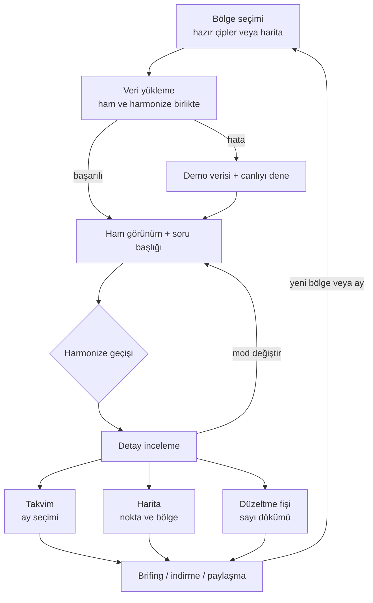
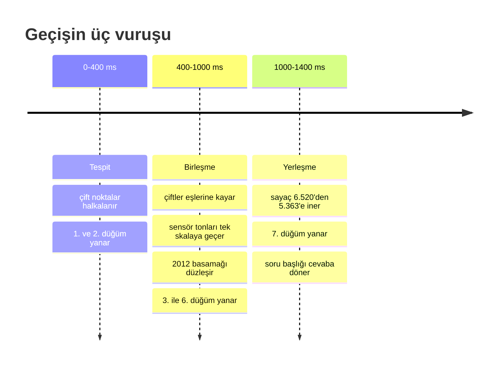

# PyroSync — Tasarım Konsepti (C1)

Bu doküman PyroSync arayüzünün ana fikrini, kullanıcı akışını, yerleşimini ve geçiş
koreografisini tanımlar. Tasarımcılar için kararların gerekçesini, geliştiriciler için
uygulanacak düzeni verir. Mikro metinler [`UX_YAZIM.md`](UX_YAZIM.md), teknoloji
seçimleri ve mimari [`FRONTEND_STACK_ONERISI.md`](FRONTEND_STACK_ONERISI.md)
dosyasındadır; bu doküman o iki konuya girmez.

Örnek sayılar `web/src/mocks/sample-data.ts` dosyasından alınır ve Türkiye–Akdeniz
bölgesinin demo verisini anlatır: 6.520 ham tespit (MODIS 2.340, VIIRS 4.180),
5.363 harmonize kayıt, 1.157 çift sayım (%17,7). Bu sayılar ürünün genel iddiası
değil, ekranda görünecek örnektir; her bölge kendi sayısını üretir.

---

## 1. Ana fikir

> **Uçurum bir yanılsama, tek hamlede kapanıyor.**

Kullanıcı uygulamayı açtığında düzgün, tutarlı bir zaman serisi görmez. Ham veriyi
görür: 2012'de tespit sayısı dik bir basamakla yükselir. Bu basamak "sensör
uçurumu"dur; yangınların değil, VIIRS'in devreye girmesinin sonucudur. Ekranın tek
sorusu bunu görünür kılar: "2012'de tespitler %{x} arttı. Yangınlar mı çoğaldı,
uydular mı?" Cevap tek bir düğmeye bağlıdır. Düğmeye basıldığında noktalar eşlerine
kayar, çift sayımlar söner, iki sensörün ayrı renkleri tek bir ölçeğe geçer ve
basamak düzleşir. Geri kalan her bileşen iki işten birini yapar: ya bu soruya merak
uyandırır ya da verilen cevabı kanıtlar. Bunun dışında kalan hiçbir öğe ana ekrana
girmez.

### Neden uygulama Ham modda açılıyor?

1. **Merak boşluğu baştan kurulur.** Harmonize modda açılan bir uygulama cevabı
   söylemiş olur; kullanıcı neden bu sayıya güvenmesi gerektiğini görmez. Ham mod
   sorunu önce gösterir, çözümü bir eyleme bırakır.
2. **Ürünün iddiası farkta yaşıyor.** PyroSync'in değeri "veri gösteren bir harita"
   değil, "aynı veriyi tutarlı hale getiren bir hat"tır. Bu fark ancak iki durum yan
   yana görülünce anlaşılır; Ham açılış farkın başlangıç kutbudur.
3. **Jüri üç dakikada sorunu görmeli.** İlk ekranın tek bir birincil eylemi olur:
   düğme. Kullanıcı ne yapacağını düşünmez, sorunun cevabını merak eder.
4. **Karşılaştırma sonradan eklenen bir sekme değildir.** Mod değişimi ürünün
   merkezindedir; bu yüzden açılış durumu da onun bir parçasıdır.

Ham modda başlık sorudur, harmonize modda cevaptır. Aynı alan iki durumda iki farklı
iş yapar; geçiş "sadece renk değişimi" değil, anlatının tamamlanmasıdır.

---

## 2. Kullanıcı akışı

Akış tek bir omurga üzerinde ilerler: bölge seç, veriyi yükle, soruyu gör, tek
hamlede cevabı al, kanıtı incele, bulguyu dışarı taşı.



Akışın üç kuralı:

- **Veri iki mod için birlikte yüklenir.** Düğme hiçbir zaman ağ beklemez; ilk kare
  100 ms içinde gelir. Yükleme ekranı yalnızca bölge değişiminde görünür.
- **Hata akışı çıkmaz sokak değildir.** Canlı veri gelmezse demo verisiyle aynı akış
  sürer; kullanıcı keşfetmeye devam eder ve "canlıyı dene" çıkışını görür.
- **Her adım geri dönebilir.** Mod, bölge ve ay seçimi URL'ye yazılır; paylaşılan
  bağlantı aynı görünümü açar.

---

## 3. Psikolojik ilkeler

Her ilke üç soruya cevap verir: ne yapacağız, nereye koyacağız, neden işe yarar.
Üçüncü madde her ilkeyi PyroSync'te somutlaştırır.

### 3.1 Merak boşluğu (Loewenstein)
- **Ne yapacağız:** Uygulama Ham modda açılır; başlık cevabı verilmemiş iki seçenekli
  bir soru sorar. `{x}` seçili bölgenin verisinden hesaplanır, sabit yazılmaz.
- **Nereye:** Komut şeridinin solu, logonun hemen altı; ilk bakış noktası.
- **Neden işe yarar:** Cevapsız soru zihinde açık kalır; düğmeye basmak cevap olur.
  PyroSync'te başlık "2012'de tespitler %{x} arttı. Yangınlar mı çoğaldı, uydular mı?"
  diye sorar, kullanıcı "ne yapmalıyım" diye düşünmez.

### 3.2 Von Restorff (ayrışma etkisi)
- **Ne yapacağız:** Ekrandaki tek doygun renkli ve tek hareketli öğe mod düğmesi olur.
  İkinci ayrışan öğe grafikteki 2012 işaretidir; arayüzün geri kalanı nötr koyu gridedir.
- **Nereye:** Düğme komut şeridinin ortasında, 2012 işareti uçurum grafiğinde.
- **Neden işe yarar:** Farklı olan hatırlanır ve göz oraya gider. İkiden fazla vurgu
  etkiyi siler. PyroSync'te harita lejantı, pipeline ve alt bilgi nötr kalır; göz tek
  eylem noktasına kilitlenir.

### 3.3 Zeigarnik etkisi
- **Ne yapacağız:** 7 aşamalı pipeline şeridi Ham modda boş durur ve "0/7 düzeltme
  uygulandı" yazar; harmonize edilince düğümler sırayla dolar.
- **Nereye:** Komut şeridinin hemen altında, tam genişlikte 36 px'lik ince şerit.
- **Neden işe yarar:** Yarım kalmış iş tamamlanmak ister. PyroSync'te boş yedi düğüm
  düğmeye basmak için sessiz bir gerekçe verir, pipeline'ı ayrıca anlatmaya gerek
  bırakmaz ve geçişten sonra "7/7"ye döner.

### 3.4 Hook modeli
- **Ne yapacağız:** Tetikleyici başlıktaki soru, eylem tek tık (klavyede `H`), değişken
  ödül her bölgede farklı sonuç, yatırım ise URL'ye yazılan görünüm ve indirilen brifing.
- **Nereye:** Soru sol üstte, eylem orta üstte, ödül sağ üstteki sayı farkında,
  yatırım sağ alttaki indirme ve brifing eylemlerinde.
- **Neden işe yarar:** Ödül bölgeye göre değiştiği için ikinci bölgeyi denemek doğal
  hale gelir. PyroSync'te Akdeniz'de %17,7 çıkan oran California'da başka bir sayıdır;
  ödül gerçek veri olduğu için bu manipülasyon değil, keşiftir.

### 3.5 Bilişsel yük (Hick, Miller)
- **Ne yapacağız:** Üç katmanlı açılım. Katman 1 soru, düğme, harita ve grafik;
  katman 2 takvim ve sensör dağılımı; katman 3 yöntem, belirsizlik ve ayarlar. Bölge
  seçimi serbest çizim yerine dört hazır çip ile başlar.
- **Nereye:** Katman 1 kaydırmadan görünür; katman 3 sağdan açılan çekmecede.
- **Neden işe yarar:** Seçenek sayısı arttıkça karar süresi uzar. PyroSync'te jüriye
  Türkiye–Akdeniz, California, Amazon ve Australia çipleri sunulur; serbest koordinat
  girişi yalnızca gelişmiş ayarlarda kalır.

### 3.6 Çapalama ve kayıp çerçevesi
- **Ne yapacağız:** Önce ham sayı gösterilir (6.520), sonra harmonize sayı (5.363);
  alt satır kaybı söyler: "1.157'si aynı yangının iki kez sayılmasıydı."
- **Nereye:** Komut şeridinin sağındaki sayı farkı bloğu.
- **Neden işe yarar:** İlk görülen sayı referans olur, fark somutlaşır. PyroSync'te
  6.520 → 5.363 gösterimi, aradaki 1.157'nin kayıp değil düzeltme olduğunu anlatır;
  "yanlış saymışsın" çerçevesi "şu kadar temizledik"ten daha akılda kalıcıdır.

### 3.7 Emek yanılsaması (Buell ve Norton)
- **Ne yapacağız:** Geçiş ve yükleme sırasında yapılan iş adım adım görünür: "Çift
  sayımlar ayıklanıyor… −1.157", "Bakış açısı düzeltiliyor…". Düz "Yükleniyor…" yok.
- **Nereye:** Pipeline şeridinde aktif düğümün altında.
- **Neden işe yarar:** İşin görünür olması sonuca güveni artırır ve jürinin "geçerlilik"
  ölçütünü besler. PyroSync'te yükleme metni "NASA FIRMS'ten 5 uydunun verisi
  isteniyor…" diyerek bekleme süresini bilgiye çevirir.

### 3.8 Nesne sürekliliği (Heer ve Robertson)
- **Ne yapacağız:** Görünümler kesilip değişmez, dönüşür. Çift sayılan noktalar
  eşlerine doğru kayıp söner; grafik çizgisi yeni biçimine akar.
- **Nereye:** Harita ve uçurum grafiği.
- **Neden işe yarar:** Göz neyin nereye gittiğini izlerse "veri değişti" değil "aynı
  yangın tek sayıldı" sonucuna varır. PyroSync'te MODIS ve VIIRS noktaları aynı
  yangında birleşirken konumlarını korur; kaybolma değil birleşme görülür.

### 3.9 Zirve–son kuralı (Kahneman)
- **Ne yapacağız:** Zirve 1,4 saniyelik geçiş koreografisidir; son, tek cümlelik bulgu
  kartı ve brifingdir.
- **Nereye:** Zirve bütün ekran; son sağ alt köşe ve brifing paneli.
- **Neden işe yarar:** Deneyim en yoğun anı ve bitişiyle hatırlanır. PyroSync'te demo
  videosunun son karesi "Türkiye–Akdeniz'de tespitlerin %17,7'si çift sayımdı" kartı olur.

### 3.10 Doherty eşiği
- **Ne yapacağız:** Düğme 100 ms içinde ilk kareyi verir; iki modun verisi baştan
  birlikte yüklenir, düğme hiçbir zaman ağ beklemez.
- **Nereye:** Veri katmanı ve mod düğmesi.
- **Neden işe yarar:** 400 ms üstü gecikme neden–sonuç bağını koparır. PyroSync'te
  bölge değişmediği sürece geçiş önbellekten anında oynar ve "sihir" etkisini korur.

### 3.11 Fitts yasası
- **Ne yapacağız:** Düğme masaüstünde 240×48 px, mobilde ekranın altına sabitlenmiş
  tam genişlikte olur.
- **Nereye:** Masaüstünde üst orta; mobilde alt, başparmak bölgesi.
- **Neden işe yarar:** Büyük ve yakın hedefe ulaşmak hızlıdır. PyroSync'te mobil düğme
  içerikle kaymaz; jüri telefonda tek elle geçiş yapabilir.

### 3.12 Kusur itirafı (pratfall)
- **Ne yapacağız:** Tek ve dürüst bir uyarı: "Harmonize değerler model tahminidir, yer
  gerçeği değildir." Her FRP değeri belirsizlik aralığıyla yazılır.
- **Nereye:** Alt şeridin solu ve Methods çekmecesi.
- **Neden işe yarar:** Sınırını söyleyen kaynak daha güvenilir bulunur; uyarı bir kez
  söylenir, her yere serpiştirilirse gürültü olur. PyroSync'te "45,2 MW (olası aralık
  38,7–51,8)" biçimi aralığı sayının yanında taşır.

### 3.13 Bilinçli olarak yapmayacaklarımız

- Konfeti, rozet, seri sayacı, seviye atlama.
- Sahte aciliyet, geri sayım, "son şans" dili.
- Kutlama animasyonu ve başarı sesi.
- Her yere serpiştirilmiş uyarı ve tooltip.
- İkiden fazla vurgu rengi veya aynı anda birden çok hareketli öğe.
- Oyunlaştırma dili: konu yangın, hedef kitle bilim insanı; bu dil "geçerlilik"
  puanını düşürür.

---

## 4. Geçiş koreografisi

Geçiş ürünün imza anıdır. Üç vuruşta oynar ve tek bir zaman çizelgesinden sürülür;
harita, grafik, takvim, sayaç, başlık ve pipeline aynı saate bağlanır.

| Zaman | Vuruş | Ne olur | Pipeline |
|---|---|---|---|
| 0–400 ms | Tespit | Çift sayılan noktaların çevresinde ince halka belirir; göz nerede çoklama olduğunu öğrenir. | 1. ve 2. düğüm yanar |
| 400–1000 ms | Birleşme | Çiftler eşlerine kayar ve söner; iki sensörün ayrı tonları tek FRP ölçeğine geçer; grafikte 2012 basamağı düzleşir. | 3.–6. düğüm sırayla yanar |
| 1000–1400 ms | Yerleşme | Sayaç 6.520'den 5.363'e iner; soru başlığı cevap başlığına döner. | 7. düğüm yanar |



### Süre kuralları

- **İlk geçiş tam koreografiyle oynar (1,4 sn).** Kullanıcı ürünü ilk kez görüyordur;
  dönüşümün tamamını bir kez izlemelidir.
- **Sonraki geçişler 500 ms'lik kısa sürümü kullanır.** Tespit vuruşu atlanır, birleşme
  ve yerleşme sıkıştırılır. Aynı töreni her seferinde izletmek keşfi yavaşlatır.
- **`prefers-reduced-motion` açıksa 150 ms'lik düz geçiş yapılır.** Noktalar kaymaz,
  görünürlük ve renk değişir; sayaç atlamadan son değere yazılır, başlık çapraz solar.
- **Kesintiye izin verilir.** Geçiş sırasında tekrar basılırsa animasyon kaldığı yerden
  tersine döner, baştan başlamaz.
- **Hareket eden tek şey veridir.** Panel çerçeveleri, düğme ve şerit yerinde kalır;
  yerleşim oynamaz, kaydırma oluşmaz. Animasyon bitince ekran yeniden çizilmez.

Koreografi boyunca erişilebilirlik korunur: mod değişimi `aria-pressed` ile bildirilir,
sayaç değişimi ekran okuyucuya tek seferde duyurulur, hareket azaltma tercihi hem
geçişte hem pipeline dolumunda uygulanır.

---

## 5. Yerleşim

### Masaüstü (referans 1366×768, ana ekran kaydırmasız)

```
┌──────────────────────────────────────────────────────────────────────────┐
│ ◉ PyroSync  [Türkiye–Akdeniz][California][Amazon][Australia]  ● Live  Methods  EN|TR │ 48
├──────────────────────────────────────────────────────────────────────────┤
│ SORU / CEVAP BAŞLIĞI      │   [ RAW ━━◐ HARMONIZED ]   │   6.520 → 5.363           │ 96
│ (sol %40)                 │   uyduların gördüğü gibi    │   1.157 çift sayım        │
├──────────────────────────────────────────────────────────────────────────┤
│ ①Topla ─②Çift sayımı ayıkla ─③Açı ─④Izgara ─⑤Eşleştir ─⑥Birleştir ─⑦Takvim  0/7    │ 36
├──────────────────────────────────────────┬───────────────────────────────┤
│                                          │ UÇURUM GRAFİĞİ 2000–bugün     │ 220
│           HARİTA  (%58)                  │ ─────────┃2012──────────      │
│                                          ├───────────────────────────────┤
│ [lejant: sol alt]      [zoom: sağ üst]   │ YANMA TAKVİMİ 27 yıl × 12 ay  │ 260
├──────────────────────────────────────────┴───────────────────────────────┤
│ ⓘ model tahmini, yer gerçeği değil          [Bu görünümü indir] [Özetle ▸] │ 44
└──────────────────────────────────────────────────────────────────────────┘
```

### Bileşen yerleşimi

| Bileşen | Nereye | Neden |
|---|---|---|
| Soru başlığı | Sol üst, logonun altı | Latin alfabesiyle okuyanlarda ilk sabitlenme sol üsttedir. İlk okunan şey ürünün adı değil sorusu olmalı. |
| Mod düğmesi | Üst orta | Z taramasının üst yatay çizgisinin ortası. Soru (sol) ile sonuç sayısı (sağ) arasında durur; "soru, eylem, sonuç" tek satırda okunur. |
| Sayı farkı | Sağ üst | Z'nin ilk durağının sonu. Düğmeye basan göz sağa kayar ve ödülü orada bulur. |
| Pipeline şeridi | Düğmenin hemen altı | Yakınlık ilkesi: düğmenin sonucu olduğu konumundan anlaşılır. İnce tutulur ki haritadan yer çalmasın. |
| Harita | Sol, alanın %58'i | En büyük görsel kütle; Z'nin çaprazı buradan geçer. Mekânsal kanıt (noktaların birleşmesi) burada izlenir. |
| Uçurum grafiği | Sağ üst panel | Sorunun kendisi burada. Başlıktaki "2012" ile aynı hizada durur; göz başlıktan aşağı inince işareti bulur. |
| Yanma takvimi | Sağ alt panel | Yarışmanın asıl çıktısı. Grafikle aynı zaman eksenini paylaşır; alt alta durunca yıllar hizalanır ve iki panel birlikte okunur. |
| Lejant | Haritanın sol altı | Haritanın en az veri taşıyan köşesi. Ham modda sensör tonlarını, harmonize modda FRP ölçeğini gösterir. |
| Çıkış eylemleri | Sağ alt | Z'nin bittiği nokta. Kullanıcı ekranı taradıktan sonra "şimdi ne yapayım" sorusunun cevabını burada bulur. |
| Uyarı | Sol alt | Görünür ama akışın dışında. Sayıların hemen yanında durmaz, böylece her bakışta dikkat çekmez. |
| Methods ve ayarlar | Sağdan açılan çekmece | Ayrı sayfa yerine çekmece: harita yerinde kalır, bağlam kaybolmaz, harita yeniden yüklenmez. |

### Düzeltme fişi (karşılaştırma paneli)

Sağ üstteki sayı farkına tıklanınca açılır. Aynı sayıların nereden geldiğini tek
bakışta gösterir; "neden 5.363?" sorusunun cevabıdır.

```
Ham tespit                              6.520
− Aynı yangının iki kez sayılması      −1.157
= Tekil yangın                          5.363
FRP, bakış açısına göre düzeltildi      ortalama −%x
```

- Fiş modal değil, sağ üstten açılan küçük bir panel; harita görünür kalır.
- Satırlar sırayla açılır; her satır pipeline'daki bir aşamaya bağlanır.
- Aşama bazında döküm, ancak karşılaştırma uç noktası aşama sayılarını döndürdüğünde
  doldurulur. O zamana kadar yalnızca toplam fark ve FRP düzeltmesi gösterilir; eksik
  satır uydurulmaz, "bu aşama için döküm yok" denir.

### Mobil (375×812, jüri telefonu)

Dikey sıra: soru başlığı, uçurum grafiği, sayı farkı, harita (40vh), takvim, pipeline
(dikey), brifing. Mod düğmesi ekranın altına sabitlenir.

- **Grafik haritadan önce gelir:** sorun tek bakışta burada görünür ve harita mobilde
  pahalı yüklenir; ilk ekranın sorunu göstermesi, haritanın hazır olmasından önemlidir.
- **Takvim döndürülür:** aylar yatayda (12 sütun × 26 px), yıllar dikeyde (27 satır).
  Böylece yatay kaydırma olmaz ve yıl ekseni okunur kalır.
- **Bölge çipleri** yatay kaydırılan tek satır olur; dördüncü çip ekran dışında başlar
  ve kaydırılabilir olduğu kenardaki kesikle belli olur.
- **Pipeline dikey yığılır:** yedi düğüm iki satıra bölünür, etiketler kısalır.
- **Düzeltme fişi tam ekran açılır:** küçük panelde sayılar okunmaz; kapatma düğmesi
  üstte, harita arkada soluk kalır. Brifing en sonda yer alır.

---

## 6. Ekran listesi

Wireframe'de çizilecek dokuz ekran ve her birinin durumları. "Demo" durumu, canlı veri
gelmediğinde gösterilen kayıtlı veri setini anlatır.

### 6.1 Ana ekran — Ham durum

Ürünün açılış ekranı. Soru başlığı, düğme, 6.520 ham sayı, ham harita ve 2012 basamağı
görünür; pipeline "0/7" durumundadır.
Durumlar: **veri** (varsayılan), **boş** (bölgede tespit yok), **yükleniyor** (bölge
değişimi), **hata** (demo verisine düşer), **demo** (rozet görünür).

### 6.2 Ana ekran — Harmonize durum

Aynı yerleşim, cevap başlığı, 5.363 tekil yangın, tek FRP ölçeği ve düzleşmiş grafik;
pipeline "7/7" durumundadır.
Durumlar: **veri**, **boş** ("bu bir sonuç, hata değil"), **demo**, **hata** (geçiş
tamamlanamazsa ham görünüm korunur ve yeniden dene sunulur).

### 6.3 Geçişin üç karesi (storyboard)

Tespit, birleşme ve yerleşme kareleri; her karede harita, grafik ve sayaç birlikte
görünür. Pipeline'ın hangi düğümünün yandığı kare üzerinde işaretlenir.
Durumlar: yalnızca üç statik kare; etkileşim yok, süre etiketleri var.

### 6.4 Harita

Nokta yoğunluğu, lejant ve zoom kontrolü. Ham modda sensör tonları ayrı, harmonize
modda tek ölçek.
Durumlar: **boş** (lejant kalır, "bu dönemde tespit yok"), **yükleniyor** (iskelet
karolar, lejant yerinde), **veri**, **hata** (harita boş kalmaz; çevrimdışı sınırlar
görünür), **demo** (rozet ve soluk kenarlık).

### 6.5 Takvim

27 yıl × 12 ay ısı ızgarası; hücre rengi normale göre sapmayı taşır.
Durumlar: **boş** (eksenler kalır, hücreler nötr), **yükleniyor** (ızgara iskeleti),
**veri**, **hata** (son başarılı veri soluk gösterilir), **demo**, ayrıca **hover**
(hücre detayı), **ay seçimi** (hücre çerçevelenir) ve **harita filtresi** (seçili ay
haritaya uygulanır).

### 6.6 Düzeltme fişi

6.520 − 1.157 = 5.363 dökümü ve FRP düzeltme satırı.
Durumlar: **veri**, **hesaplanıyor** (satırlar sırayla açılır), **eksik aşama dökümü**
(yukarıdaki not), **hata** (fiş açılmaz, sayı farkı yerinde kalır).

### 6.7 Methods çekmecesi

Beş uydunun tek kayda nasıl dönüştüğü, yedi aşama, belirsizlik ve sınırlar. Sağdan
açılır; harita yerinde kalır.
Durumlar: **statik içerik**, **demo** (demo verisiyle üretilmiş sayıların işaretlenmesi),
**yükleniyor** (içerik tembel yükleniyorsa iskelet).

### 6.8 Brifing paneli ve yazdırma görünümü

Tek cümlelik bulgu, bölge, dönem, sayı farkı ve indirme. Yazdırma görünümü aynı
içeriği kâğıt için sadeleştirir.
Durumlar: **boş** (henüz bölge seçilmemiş), **üretiliyor**, **hazır**, **yazdırma**,
**hata** (indirme başarısızsa bağlantı yeniden verilir).

### 6.9 Mobil sürümler

6.1, 6.2 ve 6.6'nın 375×812 uyarlamaları; sabit alt düğme, döndürülmüş takvim, tam
ekran fiş.
Durumlar: masaüstü karşılıklarıyla aynı; ek olarak **yatay çevirme** ve **küçük
yükseklik** (alt düğme içeriği kapatmamalı).

---

## 7. Kapsam katmanları

| Katman | İçerik |
|---|---|
| **Çekirdek** | Ham açılış, soru/cevap başlığı, mod düğmesi, sayı farkı, harita, uçurum grafiği, takvim, EN/TR |
| **Fark yaratan** | Üç vuruşlu koreografi, pipeline şeridi, düzeltme fişi, emek yanılsamalı yükleme, paylaşılabilir URL |
| **Vitrin** | Basılı tutarak Ham'a göz atma (`Space`), 40 saniyelik otomatik hikâye modu, ayarların tarayıcıda anlık yeniden hesaplanması |

Katmanlar bir öncelik sırasıdır, özellik listesi değil. Çekirdek tamamlanmadan fark
yaratan katmana geçilmez; vitrin yalnızca ilk iki katman oturduktan sonra denenir.
Demo süresi kısalırsa ilk kesilen vitrin olur.

---

## 8. C1 "bitti sayılır" kontrol listesi

`GOREVLER.md` içindeki C1 tanımına göre:

- [ ] Wireframe tüm ekiplerle paylaşıldı.
- [ ] Ekip onayı alındı.
- [ ] Ana sayfa wireframe'de var.
- [ ] Harita görünümü wireframe'de var.
- [ ] Takvim görünümü wireframe'de var.
- [ ] Karşılaştırma paneli wireframe'de var.

Görev tanımındaki diğer beklentiler:

- [ ] Ana sayfa yerleşimi tanımlı: harita, takvim ve kontrollerin yeri.
- [ ] Kullanıcı akışı tanımlı: bölge seçimi → veri yükleme → Ham/Harmonize geçişi →
  detay inceleme.
- [ ] Tüm sayfa ve panellerin wireframe'i çizildi (dokuz ekran).
- [ ] Mobil responsive davranış tanımlı (375×812 sırası ve sabit düğme).

Kabul öncesi doğrulama:

- [ ] Wireframe 1366×768'de ana ekran kaydırmasız sığıyor; 375×812'de yatay kaydırma yok.
- [ ] Mod düğmesi, `H` kısayolu, EN/TR geçişi ve dokuz ekranın tamamı denenmiş;
  konsolda hata yok.
- [ ] Dokümandaki ve wireframe'deki sayılar örnek veriyle uyumlu: 6.520, 5.363, 1.157,
  %17,7.
- [ ] Mermaid şemaları GitHub önizlemesinde çiziliyor.
- [ ] `prefers-reduced-motion` açıkken geçiş 150 ms'lik düz sürüme düşüyor.

Durum `GOREVLER.md` içinde onaya kadar "devam ediyor" olarak kalır; onaydan sonra
tamamlandı işaretlenir.

---

## İlgili dokümanlar

- [`UX_YAZIM.md`](UX_YAZIM.md) — ses kuralları ve EN/TR mikro metinler.
- [`FRONTEND_STACK_ONERISI.md`](FRONTEND_STACK_ONERISI.md) — teknoloji seçimleri,
  veri akışı ve ekipten istenecekler.
- [`MIMARI.md`](MIMARI.md) — yedi aşamalı pipeline ve sistem mimarisi.
