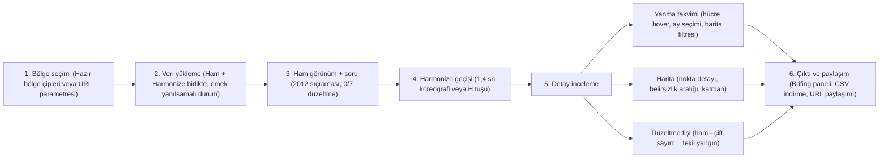
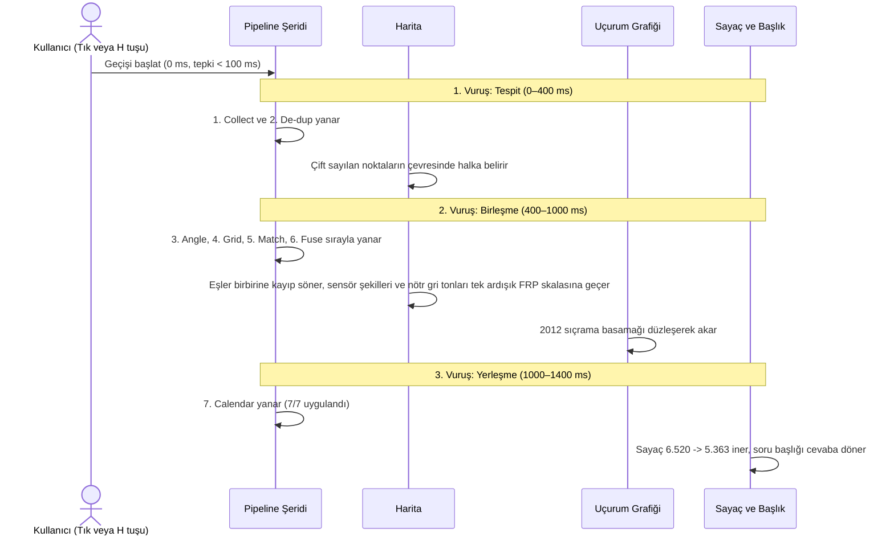

# PyroSync — UI/UX Tasarım Konsepti

Bu doküman, PyroSync ürününün (NASA Space Apps 2026 — MODIS ve VIIRS yangın tespitlerinin harmonizasyonu) tüm ekip için ortak tasarım rehberidir. Mikro metin kuralları ve EN/TR metin tablosu için [docs/UX_YAZIM.md](UX_YAZIM.md), önerilen ön yüz teknoloji yığını ve veri akışı mimarisi için [docs/FRONTEND_STACK_ONERISI.md](FRONTEND_STACK_ONERISI.md) dokümanına bakınız.

---

## 1. Ana Fikir ve Açılış Kararı

> **"Uçurum bir yanılsama, tek hamlede kapanıyor."**

PyroSync sıradan bir harita ve istatistik panosu değildir; tek bir bilimsel gerilimin etrafında kurulan etkileşimli bir kanıt aracıdır. Ürün, kullanıcıyı önce yanıltıcı resimle (Ham veri ve 2012 sonrası yapay uydu sıçraması — *sensor cliff*) karşılar, zihinde tek bir soru uyandırır ve cevabı tek bir birincil düğmeye bağlar. Ekrandaki diğer tüm bileşenler ya bu soruyu keskinleştirir ya da dönüşümün gerçekliğini kanıtlar.

### Uygulama Neden Ham (Raw) Modda Açılır?

Mevcut prototipte (`web/src/App.tsx`) arayüz doğrudan `harmonized` modunda açılmaktadır. Bu tercih, kullanıcının soruyu görmeden cevabı almasına yol açarak merak boşluğunu baştan kapatır; "sensör uçurumu" problemi görünmez hale gelir ve Raw ↔ Harmonized geçiş düğmesi etkisini yitirir.

Bu nedenle açılış modu kesin olarak **Ham (`raw`)** olmalıdır:
- İlk bakışta 2012'deki VIIRS eklenmesiyle oluşan yapay artış görünür ve başlık bunu doğrudan soruya çevirir.
- Akdeniz örneğindeki temel sayılar (`web/src/mocks/sample-data.ts`) bu gerilimi somutlaştırır: **6.520 ham tespit** (MODIS **2.340** + VIIRS **4.180**), harmonizasyon sonrası **5.363 tekil yangına** düşer; aradaki **1.157** fark (**%17,7**) aynı yangının iki kez sayılmasıdır.

Tasarımı şekillendiren diğer iki mevcut bulgu şunlardır:
1. **Renk erişilebilirliği:** `ViewToggle.tsx` bileşeni kırmızı/yeşil (`#ef4444` / `#22c55e`) çiftini kullanmaktadır. Bu çift renk körlüğünde en sorunlu kombinasyondur ve görsel erişilebilirlik hedefleriyle çelişir; ham modda sensör ayrımı şekil + nötr gri tonlarıyla (MODIS = içi boş daire, VIIRS = dolu küçük kare), tek doygun vurgu rengi ise düğme ve 2012 işaretiyle (renk körü dostu paletler eşliğinde) kurulur.
2. **Eşleme sözleşmesi:** `/api/harmonize` uç noktası şu an yalnızca ham özet sayıları (`modis_count`, `viirs_count`, `total_raw`), `harmonized` (`{ count, hotspots }`), `calendar` ve `report` nesnesini döndürmektedir; ham noktaları ve ham→harmonize eşlemesini döndürmemektedir (`crates/server/src/main.rs`). Noktaların haritada birbirine kayıp birleşmesi animasyonu için ham noktaların ve hangi ham noktanın hangi harmonize noktaya bağlandığı bilgisinin yanıt sözleşmesine eklenmesi gerekir (ayrıntılar: [docs/FRONTEND_STACK_ONERISI.md](FRONTEND_STACK_ONERISI.md)).

Arayüz dili varsayılan olarak **İngilizce (EN)** açılır ve üst çubuktan anında **Türkçe (TR)** geçişi destekler.

---

## 2. Kullanıcı Akışı

Kullanıcı akışı tek bir doğrusal keşif omurgası üzerine kuruludur: soruyu gör, tek hamlede çözümü tetikle, mekânsal ve zamansal kanıtı incele, bulguyu dışa aktar.



- **Bölge seçimi:** İlk ekranda serbest poligon çizdirmek yerine 4–5 hazır bölge çipi sunulur (`Türkiye–Akdeniz`, `California`, `Amazon`, `Australia`); seçilen bölge, ay ve mod URL'ye yazılır.
- **Veri yükleme:** İki modun verisi baştan birlikte çekilir; canlı NASA FIRMS servisine ulaşılamazsa sistem kullanıcıyı kilitlemeden kayıtlı demo verisine düşer ve bunu üst çubuktaki mod rozetiyle şeffaf biçimde bildirir.
- **Detay inceleme ve çıktı:** Harmonize geçişinden sonra kullanıcı takvimden belirli bir aya tıklayarak haritayı filtreleyebilir, sağ üst sayıya tıklayarak düzeltme fişini açabilir veya sağ alt eylemlerle görünümü CSV olarak indirip bölge brifingi alabilir.

---

## 3. Psikolojik İlkeler

Arayüzdeki her karar bilişsel ilkelere dayanır. Aşağıda her ilkenin üründeki karşılığı ve somut PyroSync örneği yer alır.

### 3.1 Merak Boşluğu (Loewenstein)
- **Ne yapacağız:** Uygulama Ham modda açılır ve başlık doğrudan bir soru sorar ("2012'de tespitler %{x} arttı. Yangınlar mı çoğaldı, uydular mı?"); `{x}` değeri seçili bölgenin verisinden hesaplanır.
- **Nereye:** Komut şeridinin solu, logonun hemen altı (ilk bakış noktası).
- **Neden işe yarar:** Cevabı verilmemiş soru zihinde açık kalır; düğmeye basmak sorunun doğrudan cevabı olur. Kullanıcı veya jüri "şimdi ne yapmalıyım" diye düşünmez.

### 3.2 Von Restorff (Ayrışma Etkisi)
- **Ne yapacağız:** Ekrandaki tek doygun renkli ve tek hareketli öğe Raw ↔ Harmonized düğmesi olur. Geri kalan arayüz nötr koyu gri tutulur; ikinci ayrışan öğe ise grafikteki 2012 dikey işaretidir.
- **Nereye:** Komut şeridinin ortası (düğme) ve uçurum grafiğindeki 2012 dikey çizgisi.
- **Neden işe yarar:** Çevresinden ayrışan öğe hatırlanır ve bakışı kendine çeker. İkiden fazla vurgu etkisi dağıtacağı için arayüzün başka hiçbir yerinde doygun vurgu rengi kullanılmaz.

### 3.3 Zeigarnik Etkisi
- **Ne yapacağız:** 7 aşamalı harmonizasyon pipeline şeridi Ham modda boş durur ve `0/7 applied` bilgisini gösterir. Harmonize edildiğinde düğümler sırayla dolar.
- **Nereye:** Komut şeridinin hemen altında, tam genişlikte 36 px yüksekliğinde şerit.
- **Neden işe yarar:** Yarım kalmış iş tamamlanma isteği doğurur. Boş duran 7 düğüm, kullanıcıya düğmeye basması için sessiz bir gerekçe verir ve pipeline mimarisini uzun metinlerle anlatma ihtiyacını ortadan kaldırır.

### 3.4 Hook Modeli
- **Ne yapacağız:** Tetikleyici başlıktaki sorudur; eylem tek tıklama veya klavyede `H` tuşudur; değişken ödül her bölgede farklı çıkan gerçek sonuçtur (Akdeniz örneğinde %17,7 fark, başka bölgede farklı oran); yatırım ise bölge, ay ve mod bilgisinin URL'ye yazılması, bulgunun link olarak paylaşılması ve brifing indirilmesidir.
- **Nereye:** Soru sol üstte, eylem orta üstte, ödül sağ üst sayı alanında, yatırım sağ altta (`Download` / `Brief me`).
- **Neden işe yarar:** Ödül bölgeden bölgeye değiştiği için ikinci bir bölgeyi denemek doğal hale gelir. Değişken ödül gerçek bilimsel veriye dayandığından manipülasyon değil keşif duygusu üretir.

### 3.5 Bilişsel Yük (Hick ve Miller)
- **Ne yapacağız:** Bilgi üç katmanda açılır. Katman 1: soru, düğme, harita ve uçurum grafiği. Katman 2: yanma takvimi ve sensör dağılımı. Katman 3: yöntem, belirsizlik açıklaması ve ayarlar. Bölge seçimi serbest çizim yerine 4–5 hazır çip ile başlar.
- **Nereye:** Katman 1 masaüstünde kaydırmasız görünür; Katman 3 sağdan açılan çekmecede (`Methods`) saklanır.
- **Neden işe yarar:** Seçenek sayısı arttıkça karar süresi uzar. Kısa süreli jüri değerlendirmesinde ilk ekran tek bir birincil eyleme odaklanmalıdır.

### 3.6 Çapalama ve Kayıp Çerçevesi
- **Ne yapacağız:** Önce ham tespit sayısı gösterilir (`6,520`), ardından harmonize sayı (`5,363`). Alt satır farkı kayıp çerçevesiyle ifade eder ("1,157 were the same fire counted twice").
- **Nereye:** Komut şeridinin sağı.
- **Neden işe yarar:** İlk görülen sayı zihinsel referans (çapa) olur; aradaki düşüş böylece somutlaşır. "Aynı yangını iki kez saymışsın" çerçevesi, soyut bir "temizledik" ifadesinden çok daha akılda kalıcıdır.

### 3.7 Emek Yanılsaması (Buell ve Norton)
- **Ne yapacağız:** Yükleme ve geçiş sırasında arkada yürütülen bilimsel işlem adım adım görünür kılınır ("Asking NASA FIRMS for 5 satellites…", aşama bazında "Removing double-counts… −400" ve "Matching across sensors… −757", tüm aşamalar tamamlandığında toplam "−1,157"); düz "Loading…" metni kullanılmaz.
- **Nereye:** Pipeline şeridinde aktif düğümün altında ve yükleme durumlarında.
- **Neden işe yarar:** Harcanan emeğin görünür olması sonuca duyulan güveni artırır; bu da teknik geçerlilik algısını doğrudan güçlendirir.

### 3.8 Nesne Sürekliliği (Heer ve Robertson)
- **Ne yapacağız:** Görünümler keskin bir biçimde kesilip değişmez, birbirine dönüşür. Çift sayılan noktalar haritada eşlerine doğru kayıp söner; grafik çizgisi ise 2012 basamağından düzleşen yeni biçimine akar.
- **Nereye:** Harita ve uçurum grafiği.
- **Neden işe yarar:** İnsan gözü nesnenin nereye gittiğini izleyebilirse "ekrandaki veri değişti" yerine "aynı yangın tek sayıldı" sonucuna varır. Projenin temel iddiasının görsel kanıtı budur.

### 3.9 Zirve–Son Kuralı (Kahneman)
- **Ne yapacağız:** Deneyimin zirvesi 1,4 saniyelik geçiş koreografisidir; sonu ise tek cümlelik bulgu kartı ve brifing özetidir ("In Mediterranean Türkiye, 17.7% of detections were double-counts.").
- **Nereye:** Zirve bütün ekranda, son ise sağ alt köşe ve brifing panelinde yaşanır.
- **Neden işe yarar:** Kullanıcı deneyimi en yoğun anı ve bitiş cümlesiyle hatırlar; sunum veya demo videosunun kapanış karesi de bu özet kartı olur.

### 3.10 Doherty Eşiği
- **Ne yapacağız:** Geçiş düğmesi 100 ms içinde ilk görsel kareyi üretir. Ham ve harmonize veriler baştan birlikte yüklenir; düğme basıldığında ağ isteği beklenmez.
- **Nereye:** Veri yükleme ve durum yönetimi katmanı.
- **Neden işe yarar:** 400 ms üzerindeki gecikme neden–sonuç bağını koparır. Basıldığı anda başlamayan bir dönüşüm, tek hamle etkisini kaybeder.

### 3.11 Fitts Yasası
- **Ne yapacağız:** Ana geçiş düğmesi masaüstünde 240×48 px boyutunda geniş bir hedef olarak konumlanır; mobilde ise ekranın altına sabitlenmiş tam genişlikte sunulur.
- **Nereye:** Masaüstünde üst orta, mobilde alt başparmak bölgesi.
- **Neden işe yarar:** Büyük ve erişimi kolay hedefe ulaşmak hızlıdır; kullanıcı telefonu tek elle kullanırken bile birincil eylemi zorlanmadan tetikleyebilir.

### 3.12 Kusur İtirafı (Pratfall Etkisi)
- **Ne yapacağız:** Tek ve dürüst bir sınır uyarısı verilir ("Harmonized values are model estimates, not ground truth.") ve her FRP değeri belirsizlik aralığıyla birlikte yazılır (örneğin `45.2 MW` için düzeltilmiş `38.7 MW` ve olası aralık gösterimi).
- **Nereye:** Alt şeridin solu ve `Methods` çekmecesi.
- **Neden işe yarar:** Kendi sınırlarını açıkça söyleyen bilimsel araç daha güvenilir bulunur. Uyarı tek bir yerde, akışı bozmadan verilir; her panele serpiştirilerek gürültü yaratılmaz.

### Bilinçli Olarak Yapmayacaklarımız
Konfeti, rozet, seri (streak) sayacı ve sahte aciliyet etiketleri kesinlikle kullanılmayacaktır. Konu orman yangınları ve hedef kitle bilim insanları ile teknik değerlendiricilerdir; oyunlaştırma öğeleri bilimsel geçerlilik (Validity) algısını zedeler.

---

## 4. Geçiş Koreografisi

Raw ↔ Harmonized geçişi ürünün imza anıdır. Tüm görsel bileşenler tek bir faz saatine (`idle`, `detect`, `merge`, `settle`) bağlı çalışır.

### Üç Vuruşlu Koreografi (İlk Geçiş: 1.400 ms)

1. **0–400 ms — "Tespit" (`detect`):** Haritada çift sayılan noktaların çevresinde ince bir halka belirir. Pipeline şeridinde 1. düğüm (`Collect`) ve 2. düğüm (`De-dup`) sırayla yanar.
2. **400–1000 ms — "Birleşme" (`merge`):** Çift sayılan noktalar eşlerine doğru kayar ve söner. Ham modda şekil ve nötr gri tonlarıyla ayrılan sensör işaretçileri (MODIS = içi boş daire, VIIRS = dolu küçük kare) birleşerek tek bir ardışık FRP renk skalasına dönüşür. Uçurum grafiğindeki 2012 basamağı düzleşerek yeni trendine akar. Pipeline'da 3.–6. düğümler (`Angle`, `Grid`, `Match`, `Fuse`) sırayla yanar.
3. **1000–1400 ms — "Yerleşme" (`settle`):** Sağ üstteki sayaç `6,520`'den `5,363`'e iner (TR görünümünde `6.520` → `5.363`), 7. düğüm (`Calendar`) yanar ve sol üstteki soru başlığı cevap başlığına döner.

### Süre ve Erişilebilirlik Kuralları
- **İlk geçiş:** 1.400 ms'lik tam koreografiyle oynar.
- **Sonraki geçişler:** Aynı töreni tekrar izleterek kullanıcıyı yormamak için 500 ms'lik kısa sürüm kullanılır.
- **Azaltılmış hareket (`prefers-reduced-motion`):** İşletim sistemi veya tarayıcı ayarı açıksa 150 ms'lik düz geçiş uygulanır; konum kayması yapılmaz.



---

## 5. Yerleşim ve Görsel Hiyerarşi

### Masaüstü Yerleşimi (Referans 1366×768, Kaydırmasız)

Masaüstü tasarımı 1366×768 jüri projektörü çözünürlüğünde hiçbir dikey kaydırma gerektirmeden tek ekrana sığar. Üstten alta yükseklik dağılımı: 48 px üst çubuk, 96 px komut şeridi, 36 px pipeline şeridi, 480 px ana içerik (sağda 220 px grafik + 260 px takvim), 44 px alt şerit.

```
┌──────────────────────────────────────────────────────────────────────────┐
│ (o) PyroSync [Türkiye-Akdeniz][California][Amazon][Australia] Live Methods EN|TR │ 48
├──────────────────────────────────────────────────────────────────────────┤
│ SORU / CEVAP BAŞLIĞI      │   [ RAW ━━◐ HARMONIZED ]   │   6,520 -> 5,363          │ 96
│ (sol %40)                 │   as satellites saw it     │   1,157 counted twice     │
├──────────────────────────────────────────────────────────────────────────┤
│ (1)Collect -(2)De-dup -(3)Angle -(4)Grid -(5)Match -(6)Fuse -(7)Calendar  0/7 applied │ 36
├──────────────────────────────────────────┬───────────────────────────────┤
│                                          │ UÇURUM GRAFİĞİ 2000–bugün     │ 220
│           HARİTA  (%58)                  │ ─────────|2012──────────      │
│                                          ├───────────────────────────────┤
│ [lejant: sol alt]      [zoom: sağ üst]   │ YANMA TAKVİMİ 27 yıl x 12 ay  │ 260
├──────────────────────────────────────────┴───────────────────────────────┤
│ (i) model estimate, not ground truth        [Download this view] [Brief me >] │ 44
└──────────────────────────────────────────────────────────────────────────┘
```

### Bileşen Yerleşim Tablosu

| Bileşen | Nereye | Neden |
|---|---|---|
| Soru başlığı | Sol üst, logonun altı | Soldan sağa okuma alışkanlığında ilk göz sabitlenmesi sol üsttedir. İlk okunan şey ürünün adı değil sorusu olmalıdır. |
| Raw ↔ Harmonized düğmesi | Üst orta | Z taramasının üst yatay çizgisinin ortasında yer alır; soru (sol) ile sonuç sayısı (sağ) arasında "soru, eylem, sonuç" okuma sırası kurar. |
| Sayı farkı | Sağ üst | Z taramasının ilk durağının sonudur. Düğmeye basan göz doğal olarak sağa kayar ve ödülü burada bulur. |
| Pipeline şeridi | Düğmenin hemen altı | Yakınlık ilkesi gereği düğmenin tetiklediği işlem olduğu konumundan anlaşılır; haritadan alan çalmamak için 36 px ince tutulur. |
| Harita | Sol, alanın %58'i | Ekrandaki en büyük görsel kütledir ve Z taramasının çaprazı buradan geçer. Noktaların birleşmesi şeklindeki mekânsal kanıt burada izlenir. |
| Uçurum grafiği | Sağ üst panel | Sorunun kendisini gösterir. Başlıktaki "2012" vurgusuyla aynı yatay hizada durur; göz başlıktan aşağı indiğinde 2012 işaretini hemen bulur. |
| Yanma takvimi | Sağ alt panel | Projenin temel çıktısıdır. Grafikle aynı 2000–bugün zaman eksenini paylaşır; alt alta durduklarında yıllar hizalanır ve iki panel birlikte okunur. |
| Lejant | Haritanın sol altı | Haritanın en az veri yoğunluğu taşıyan köşesidir. Ham modda şekil + nötr gri tonu etiketlerini (MODIS = içi boş daire, VIIRS = dolu küçük kare), Harmonize modda tek ardışık FRP skalasını gösterir. |
| Çıkış eylemleri | Sağ alt | Z taramasının bittiği noktadır. Kullanıcı incelemeyi bitirdiğinde "şimdi ne yapayım" sorusunun yanıtını (`Download` / `Brief me`) burada bulur. |
| Model uyarısı | Sol alt | Görünür ancak ana akışın dışındadır. Sayıların hemen yanında durmayarak her bakışta dikkat dağıtmaz. |
| Methods ve ayarlar | Sağdan açılan çekmece | Ayrı sayfaya gitmek yerine çekmece kullanılır; harita yerinde kalır, bağlam kaybolmaz ve harita yeniden yüklenmez. |

### Düzeltme Fişi (Karşılaştırma Paneli)

Sağ üstteki sayı farkı alanına tıklandığında açılan **"düzeltme fişi"**, ham sayıdan tekil yangın sayısına nasıl ulaşıldığını muhasebe fişi netliğinde gösterir:

```
Raw detections              6,520
− Same fire counted twice   −1,157
= Unique fires              5,363
FRP corrected for angle     −x% avg
```

Aşama bazında döküm (7 aşamanın her birinin kaç tespit elediği veya düzelttiği) ancak `/api/compare` uç noktası aşama sayılarını döndürdüğünde bu fişin altında genişletilerek doldurulur.

### Mobil Yerleşim (375×812, Jüri Telefonu)

Mobilde sıra yukarıdan aşağıya şöyledir: **soru başlığı → uçurum grafiği → sayı farkı → harita (`40vh`) → yanma takvimi → pipeline (dikey) → brifing**. Raw ↔ Harmonized düğmesi ise ekranın altına sabitlenir.
- **Grafik haritadan önce gelir:** 2012 problemi tek bakışta grafikte görünür ve harita mobil ağlarda daha geç yüklenir; böylece ilk boyama (LCP) hızlı gelir.
- **Takvim 90 derece döndürülür:** Aylar yatayda (12 sütun × 26 px), yıllar dikeyde (27 satır) dizilir. Bu sayede mobilde yatay kaydırma gerekmez.
- **Bölge çipleri** üstte yatay kaydırılan tek bir satır halinde sunulur.

---

## 6. Wireframe Ekran Listesi ve Durumları

Prototipte bulunması gereken 9 ekran ve her ekranın kapsaması gereken durumlar aşağıdadır. Bu ekranlar `web/src` içinde interaktif React prototipi olarak uygulanmıştır (çalıştırmak için `make dev-frontend`, ardından `http://localhost:5173`); eski tek dosyalı HTML wireframe kullanımdan kaldırılmıştır.

| # | Ekran | Kapsanan Durumlar ve İçerik |
|---|---|---|
| 1 | **Ana ekran — Ham durum** | Varsayılan açılış durumu: soru başlığı, `0/7 applied` boş pipeline şeridi, şekil + nötr gri tonuyla ayrılan MODIS (içi boş daire) / VIIRS (dolu küçük kare) noktaları, 2012 uçurum grafiği, `6,520` ham tespit sayacı. |
| 2 | **Ana ekran — Harmonize durum** | Dönüşüm sonrası durum: cevap başlığı, `7/7 applied` dolu pipeline, tek ardışık FRP skalalı noktalar, düzleşmiş 2012 grafiği, `5,363` sayı farkı ve `%17,7` alt satırı. |
| 3 | **Geçişin üç karesi (Storyboard)** | 1. kare (`0–400 ms` tespit halkaları), 2. kare (`400–1000 ms` nokta kayması ve grafik akışı), 3. kare (`1000–1400 ms` sayaç inişi ve başlık dönüşümü); kısa (`500 ms`) ve `reduced-motion` (`150 ms`) notları. |
| 4 | **Harita durumları** | **Veri var:** lejant ve nokta tooltip'i (ör. `38.7 MW (corrected from 45.2)`). **Yükleniyor:** emek yanılsamalı adım mesajı. **Boş:** "hata değil, sonuç" mesajı. **Hata:** API yanıt vermiyor uyarısı ve yeniden dene eylemi. **Demo modu:** kayıtlı demo verisi rozeti. |
| 5 | **Takvim durumları** | **Veri var:** 27 yıl × 12 ay ısı haritası. **Hücre hover:** tarih, sayı ve anomali (`calendarTooltip` anahtarı; ör. `Aug 2020 · 1,120 fires · well above normal for August (+2.3σ)`). **Ay seçimi:** seçili hücre vurgusu ve haritanın o aya filtrelenmesi. **Boş / yükleniyor:** iskelet ve boş dönem mesajı. |
| 6 | **Düzeltme fişi** | Sağ üstteki sayı farkına tıklanınca açılan karşılaştırma paneli: ham tespit, çift sayım düşümü, tekil yangın, açı düzeltmesi ve API sağladığında aşama bazında döküm. |
| 7 | **Methods çekmecesi** | Harita bağlamını bozmadan sağdan açılan çekmece: 5 uydunun tek kayda dönüşme özeti, 7 pipeline adımı, belirsizlik modeli, kusur itirafı ve renk körü paleti / tema ayarları. |
| 8 | **Brifing paneli ve yazdırma** | Seçili bölge için tek cümlelik sonuç özeti, paylaşılabilir URL kopyalama, CSV indirme (`pyrosync_turkiye_2020-07.csv`) ve yazdırmaya uygun sade özet görünümü. |
| 9 | **Mobil sürümler (1, 2 ve 6)** | 375×812 çerçevede Ham durum, Harmonize durum ve Düzeltme fişi: alta sabitlenen tam genişlikli düğme, grafik-önce sıralama, `40vh` harita, döndürülmüş takvim ve dikey pipeline. |

---

## 7. Kapsam Katmanları

Geliştirme sürecinde öncelik yönetimi üç katmana ayrılır:

| Katman | Kapsam |
|---|---|
| **Çekirdek** | Ham modda açılış, soru/cevap başlığı, Raw ↔ Harmonized düğmesi, sayı farkı, harita, uçurum grafiği, yanma takvimi, EN/TR dil geçişi. |
| **Fark yaratan** | Üç vuruşlu geçiş koreografisi, 7 aşamalı pipeline şeridi, düzeltme fişi, emek yanılsamalı yükleme mesajları, URL ile paylaşılabilir durum. |
| **Vitrin** | `Space` tuşuna basılı tutarak Ham görünüme anlık göz atma, 40 saniyelik otomatik hikâye modu, WASM üzerinden tarayıcıda anlık parametre ayarı. |

---

## 8. C1 "Bitti Sayılır" Kontrol Listesi (`GOREVLER.md`)

`GOREVLER.md` içindeki C1 görevinin kapanış ölçütleri doğrultusunda takip edilecek kontrol listesi (C1 durumunun tamamlandı sayılması ekip onayına bağlıdır):

- [ ] **Konsept dokümanı:** `docs/TASARIM_KONSEPT.md` tamamlandı; "Raw ↔ Harmonized toggle" ve "Sensor Cliff" kavramları tasarımın merkezine alındı.
- [ ] **Mikro metin ve teknik öneri:** `docs/UX_YAZIM.md` ve `docs/FRONTEND_STACK_ONERISI.md` tamamlandı.
- [ ] **Ana sayfa wireframe'i:** Masaüstü (1366×768) Ham ve Harmonize ana sayfa görünümleri çizildi.
- [ ] **Harita görünümü:** Tüm durumlarıyla (boş, yükleniyor, veri, hata, demo) wireframe'de yer aldı.
- [ ] **Takvim görünümü:** Hover, ay seçimi ve harita filtresi etkileşimleriyle wireframe'de yer aldı.
- [ ] **Karşılaştırma paneli:** Düzeltme fişi tasarımı ve sayılarıyla wireframe'de yer aldı.
- [ ] **Kullanıcı akışı:** Bölge seçimi → veri yükleme → Raw/Harmonized geçişi → detay inceleme → çıktı akışı doğrulandı.
- [ ] **Mobil responsive tasarım:** 375×812 mobil görünümler (1, 2 ve 6) çizildi ve yatay kaydırma olmadığı doğrulandı.
- [ ] **Ekip paylaşımı ve onay:** Wireframe ve dokümanlar tüm ekibe (Serhat, Görkem, Yusuf, Samet) paylaşıldı ve onaylandı (`C2`, `C3`, `C4` görevlerinin önü açıldı).
