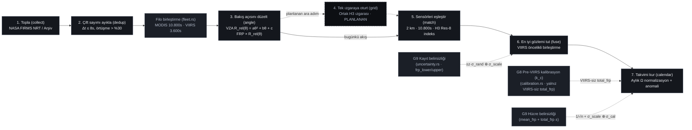

# PyroSync — Methods Sayfası ve Bilimsel Disclaimer Tasarımı (C5)

Kod ile son eşitleme: 2026-11-15 (G8/G9 yeniden tanımından sonra).

Bu doküman, `GOREVLER2.md` kapsamındaki **C5** tasarım görevini tanımlar; **R6** (`/methods` sayfası implementasyonu) ve **S8** (`docs/REFERENCES.md` bilimsel referans ve disclaimer içeriği) görevlerine devir kaynağıdır. Ses ve mikro metinler [`UX_YAZIM.md`](UX_YAZIM.md), görsel kurallar [`TASARIM_SISTEMI.md`](TASARIM_SISTEMI.md) ve [`TASARIM_KONSEPT.md`](TASARIM_KONSEPT.md) ile uyumludur.

Referans ekranlar: masaüstü `1366×768`, mobil `375×812`; varsayılan tema `dark` (`[data-theme="light"]` destekli); `prefers-reduced-motion` ve `@media print` uyumludur.

---

## 1. Mimari Karar: `/methods` Rotası ve `MethodsDrawer` İlişkisi

### Mevcut durum ve çakışma

- `GOREVLER2.md` (R6) paylaşılabilir ve derinlemesine bir `/methods` sayfası isterken, kod tabanında [`MethodsDrawer.tsx`](../web/src/components/Drawers/MethodsDrawer.tsx) (`Drawer` id `"methods"`) hâlihazırda mevcuttur.
- `MethodsDrawer`, `TASARIM_KONSEPT.md` (Bölüm 6.7) doğrultusunda harita bağlamını kaybetmeden sağdan (`--w-drawer: 420px`) açılan hızlı başvuru çekmecesidir; ancak tam parametre tablosu, VZA $\sigma_{\text{vza}}$ belirsizlik bantlı grafik, H3 k-ring açıklaması ve APA 7 referans listesi `420px` genişlikteki bir çekmeceye sığmaz ve tek başına URL üzerinden doğrudan paylaşılamaz/yazdırılamaz.

### Karar: Hibrit "Çekmece + Tam Sayfa" Ortak Bileşen Mimarisi

**`MethodsDrawer` korunur (hızlı bağlam içi özet) ve `/methods` tam sayfa rotası (paylaşılabilir & yazdırılabilir bilimsel dokümantasyon) onun üzerine kurulur.** İki yüzey aynı içerik bileşenlerini paylaşır; metin ve parametreler tek kaynaktan gelir.

| Yüzey | Rol | İçerik kapsamı | Erişim noktası |
|---|---|---|---|
| **`MethodsDrawer`** (var olan çekmece) | Haritadan kopmadan 30 saniyelik hızlı yanıt (`variant="compact"`) | Sensör uçurumu tanımı, kompakt 7 aşama accordion'u, mini VZA/H3 özet SVG'leri, kısa sınırlar notu, tema/sunum ayarları ve **"Tam yöntem sayfasını aç →"** bağlantısı | Üst çubuk `Yöntemler` (`navMethods`) düğmesi |
| **`/methods` sayfası** (R6 rotası) | Jüri ve araştırmacılar için paylaşılabilir, yazdırılabilir bilimsel referans sayfası (`variant="full"`) | Genişletilmiş Disclaimer banner'ı, 7 aşamalı akış diyagramı + parametre tablosu, etkileşimli VZA eğrisi + $\sigma_{\text{vza}}$ bandı, H3 Res-8 görseli, APA 7 referans listesi + aşama eşleme tablosu | Drawer içi bağlantı, alt şerit `disclaimerLink` (`Nasıl hesapladığımızı gör →`) veya doğrudan URL |

### Neden bu karar?

1. **Z-taraması ve harita bağlamı korunur:** Ana ekranda `Methods` düğmesine basan kullanıcı haritayı ve seçili ay filtresini kaybetmez (`TASARIM_KONSEPT.md` Bölüm 5).
2. **R6 ve S8 gereksinimleri tam karşılanır:** APA 7 referansları, config parametre tabloları ve tam VZA/H3 grafikleri `420px` dar çekmeceye sıkıştırılmadan okunabilir satır genişliğinde (`~68ch` metin, `~960px` konteyner) sunulur.
3. **Kod tekrarı olmaz:** `web/src/components/Methods/` altında paylaşılan bölüm bileşenleri hem `MethodsDrawer` hem `MethodsPage` tarafından kullanılır.

### Deep-link ve Geri Dönüş Davranışı

- **Rota yönetimi (`react-router` eklemeden):** `web/package.json` içinde yönlendirici kütüphane yoktur; mevcut URL durumu `web/src/lib/urlState.ts` üzerinden `#region=...&mode=...&month=...&lang=...` hash'i ile yönetilir. R6, hafif `window.location.pathname` denetimi (`/methods` için `MethodsPage`, diğer yollar için `App` ana görünümü) ve `popstate` dinleyicisi ile ekstra bağımlılık eklemeden çalışır.
- **Bağlam koruma:** Drawer'dan veya `BottomBar`'daki `disclaimerLink`'ten `/methods` açılırken mevcut hash (`#region=Turkey&mode=harmonized&lang=tr`) URL'de korunur ya da `sessionStorage` / `history.state` içine `returnHash` yazılır.
- **Bölüm çapaları (anchor deep-links):** `/methods#pipeline`, `/methods#vza`, `/methods#h3`, `/methods#references`, `/methods#limits` doğrudan ilgili bölüme kaydırır. (Not: Hash şu anda `urlState.ts` tarafından `#region=...` için kullanıldığından, `/methods` sayfası `section` query parametresi `/methods?section=vza` veya `location.hash` ile çakışmayan `#sec-vza` önekini tercih etmelidir; R6 devir notunda `?section=vza` önerilir.)
- **Geri navigasyon:**
  - Sayfa üstünde sabit **`← Haritaya dön`** (`methodsBackToMap`) düğmesi bulunur.
  - Uygulama içinden gelindiyse `window.history.back()` çalışır (böylece bölge, mod ve ay seçimi korunur); doğrudan linkle `/methods` açıldıysa `/{preservedHash}` (yoksa `/`) adresine yönlendirir.
  - Klavyede `Escape` ana ekranda `MethodsDrawer`'ı kapatır; `/methods` tam sayfasında gezinmeyi bozmaz.

---

## 2. 7 Aşamalı Pipeline Diyagramı

### Kod gerçeği ve aşama haritası

`web/src/hooks/useHarmonizeTransition.ts` içindeki `PIPELINE_ORDER` 7 aşama tanımlar:
`["collect", "dedup", "angle", "grid", "match", "fuse", "calendar"]` (`isPlannedStage("grid") === true`).
Buna karşın kod tabanında üç önemli detay vardır ve diyagram bunları dürüstçe gösterir:

1. **Planlanan aşama (`grid` / H3 ortak ızgara):** `PIPELINE_ORDER`'da 4. sıradadır ancak henüz birleştirme aşaması olarak uygulanmamıştır (`planned` / `planlanan`). Gerçek kodda `h3index.rs` (H3 Res-8) yalnızca `dedup`, `fleet` ve `match` adımlarında aday budama (candidate pruning) indeksi olarak çalışır.
2. **Filo birleştirme (`fleet`):** `copy.ts` (`PIPELINE_COPY.fleet`) ve `types/index.ts` içinde tanımlı olduğu hâlde `PIPELINE_ORDER`'a eklenmemiştir; ancak Rust motorunda (`harmonize.rs`, `fleet.rs`) `dedup` hemen sonrasında çalışır ve `fleet.rs` içinde her üyenin kendi VZA düzeltmesini (`vza::apply_vza_correction` — `vza::vza_factor_with` ve `raw_frp * ratio` çarpımı) de hesaplar.
3. **G8 Kalibrasyon (`calibration.rs`) ve G9 Belirsizlik (`uncertainty.rs`) nerede oturur?**
   - **G8 (`calibration::calibration_for`):** Artık 6. aşama (`fuse`) içinde tespit bazında uygulanmaz (`HarmonizedHotspot` üzerinde `calibration_ratio` alanı yoktur). **7. aşama (`calendar`)** içinde `build_calendar_with` (`calendar.rs`) dalında, **yalnızca** VIIRS tespiti bulunmayan (VIIRS öncesi, `!bucket.has_viirs && calibration.enabled`) aylık kovaların **`total_frp`** değerine enlem bandına göre ölçülen bütünlük faktörü $k_c(\text{lat}) = \Sigma\text{VIIRS} / \Sigma(\text{MODIS} \times R_{\text{rel}}(\theta))$ ile çarpım olarak uygulanır. **K14:** varsayılan `calibration.mode = biome` ile faktör kayıt başına `completeness_for` zincirinden gelir (ay × biyom × gündüz/gece ölçüm tablosu → güç yasası `f(P) ∝ P^-α` küçük yangın bütçesi → enlem bandı); ölçüm tablosu şimdilik boştur, güç yasası yalnız savan içindir (`α = 1.31`; güç yasası modeli `k = E_V[∫ f(P)·P·p_V dP] / E_M[∫ f(P)·P·p_M dP]` (ölçülen ΣVIIRS / ΣMODIS ile aynı tanım); `p` Sofiev & Kouznetsov (2026) Denklem 5-7 gözlem işlecidir (lojistik, `D_p = λA + μ`, `r_p = r0 + r1/A`, `c0` tabanı), MODIS alanı tarama açısı boyunca (±55°, 1 km² - ~9.7 km²) ortalanır, VIIRS nadir 0.375² km² alınır; sayısal ve deterministiktir, `(biyom, gündüz/gece)` başına bir kez hesaplanıp önbelleğe alınır; savan için gündüz ~1.03, gece ~1.04, ölçülen bantların (1.11-1.28) altındadır, bkz. `crates/core/CLAUDE.md`), `mode = lat_band` eski davranıştır. `mean_frp` yerel piksel ölçeğinde kalır; 2012 geçişinde sürekli piksel-eşdeğer seri için `frp_per_detection_eq = total_frp / count_normalized` üretilir.
   - **G9 (`uncertainty.rs`):** İki noktada çalışır:
     1. **6. aşama (`fuse`)** içinde her `HarmonizedHotspot` için (`frp_uncertainty_for_obs` → `frp_lower`, `frp_upper`). Rastgele hata $\sqrt{\sigma_{\text{sensor}}^2 + \sigma_{\text{vza}}^2}$ olup $1/\sqrt{n_{\text{obs}}}$ ile küçülür (`Matched` kayıtlarda VIIRS FRP kullanıldığı için yalnızca VIIRS filo gözlem sayısı `v.n_obs` geçer). Sistematik ölçek belirsizliği `modis_scale_sigma` (`0.10`) yalnızca `ModisOnly` kayıtlarına eklenir (`Matched` ve `ViirsOnly` için `0.0`).
     2. **7. aşama (`calendar`)** içinde `build_calendar_with` sırasıyla `mean_frp_uncertainty` (`mean_frp_lower`, `mean_frp_upper`) ve `total_frp_uncertainty` (`total_frp_lower`, `total_frp_upper`) hesaplar. VIIRS bulunmayan aylarda $k_c$ kalibrasyon belirsizliği (`cal_sigma = ratio_sigma / ratio`) `modis_scale_sigma` ile karesel toplanarak (`scale_sigma.hypot(cal_sigma)`) yalnızca `total_frp` belirsizliğine girer (`mean_frp` belirsizliğine girmez).
   - Ayrıca **Çaba Normalizasyonu ($\Omega$, `effort.rs`)** 7. aşama (`calendar`) içinde `monthly_omegas` ile hesaplanır; `count_normalized` ve popülasyon z-skoru `anomaly` buradan çıkar.

### Mermaid Akış Diyagramı



### Masaüstü Wireframe (`1366×768`)

```text
+--------------------------------------------------------------------------------------------------+
| <- Haritaya don   |  PyroSync / Yontemler          [Pipeline][VZA][H3][Referanslar][Sinirlar]     |
+--------------------------------------------------------------------------------------------------+
| (!) Harmonize degerler model tahminidir, yer gercegi degildir. [...]               [Daralt ^]    |
+--------------------------------------------------------------------------------------------------+
| YONTEM VE VERI AKISI                                                                             |
| Bes uydudan (MODIS Terra/Aqua, VIIRS S-NPP/NOAA-20/21) tek tutarli yangin takvimine.            |
|                                                                                                  |
|  (1) Topla ---> (2) Cift sayim ---> [Filo*] ---> (3) Aci (VZA) - - -> [4. Izgara (planlanan)]    |
|   FIRMS           Dedup 8s/%30      fleet.rs      R_rel(theta)  |             :                  |
|                                                                 v             v                  |
|  (7) Takvim <--- (6) En iyi gozlem <-------------------------- (5) Eslestir (2 km, 180 dk)      |
|   |  Aylik +       |  VIIRS oncelikli                            TimedH3Index (Res-8 budama)     |
|   |  Omega + z     +--[G9 Kayit belirsizligi]                                                    |
|   +--[G8 k_c (VIIRS-siz total_frp)] + [G9 Hucre belirsizligi]                                    |
|                                                                                                  |
| * Not: Filo birlestirme (fleet.rs) backend'de adim 2 ve 3 ile birlikte calisir;                  |
|   4. adim (ortak H3 hucre birlestirme) henuz uygulanmamistir (planlanan).                        |
+--------------------------------------------------------------------------------------------------+
```

### Mobil Wireframe (`375×812`, dikey akış)

```text
+---------------------------------------+
| <- Haritaya don     Yontemler   EN|TR |
+---------------------------------------+
| (!) Model tahminidir, yer gercegi     |
|     degildir.           [Ayrintilar v]|
+---------------------------------------+
| 7 ASAMALI PIPELINE                    |
|                                       |
|  (1) Topla · FIRMS                    |
|   |                                   |
|  (2) Cift sayimi ayikla · Dedup       |
|   |  + Filo birlestirme (fleet.rs)    |
|   |                                   |
|  (3) Bakis acisini duzelt · VZA       |
|   |                                   |
|  [4] Tek izgaraya oturt · H3          |
|   :  [planlanan - henuz uygulanmadi]  |
|   v                                   |
|  (5) Sensorleri eslestir              |
|   |  TimedH3Index (Res-8) + 2km/180dk |
|   |                                   |
|  (6) En iyi gozlemi tut · Fusion      |
|   |  + G9 Kayit belirsizligi          |
|   v                                   |
|  (7) Takvimi kur · Aylik              |
|      + Omega + G8 k_c (VIIRS-siz)     |
|      + G9 Hucre belirsizligi          |
+---------------------------------------+
```

---

## 3. Aşama Bazlı Parametre Tablosu ve Accordion Spesifikasyonu

### Parametre ve Veri Akışı Tablosu

Tüm parametre adları ve varsayılan değerler `crates/core/src/config.rs`, `pyrosync.example.toml`, `crates/server/src/pipeline_config.rs` ve ilgili çekirdek modüllerden birebir alınmıştır.

| # | Aşama (`PIPELINE_ORDER`) | Ne yapılıyor | Neden | Parametre (config anahtarı + varsayılan) | Girdi → Çıktı | Referans |
|---|---|---|---|---|---|---|
| **1** | **Topla** (`collect`) | NASA FIRMS NRT API (`MODIS_NRT`, `VIIRS_SNPP_NRT`, `VIIRS_NOAA20_NRT`, `VIIRS_NOAA21_NRT`) veya yerel ülke arşiv CSV'lerinden (`modis`, `viirs-snpp`, `viirs-jpss1`) yalnızca bitki örtüsü yangınlarını (`FireType::VegetationFire`, `type == 0`) alır. | Farklı kaynak ve tarih aralıklarındaki tüm MODIS/VIIRS ham tespitlerini tek şemada toplamak, volkan/endüstriyel kaynakları ayırmak. | `FIRMS_API_KEY` (NRT); `ARCHIVE_CACHE_DIR` (`.cache/firms-archive`); `ARCHIVE_MAX_REGION_MB = 512`; `AREA_CACHE_NRT_TTL_SECS = 600` (arşiv `/api/calendar` TTL `21600s`) | FIRMS CSV satırları → `Vec<Hotspot>` (MODIS + VIIRS) | NASA FIRMS arşivi / NRT (`S8 tamamlayacak`) |
| **2** | **Çift sayımı ayıkla** (`dedup`) | Aynı sensör içinde `|Δt| ≤ 8s` ve piksel ayak izi örtüşmesi `> 0.30` olan ardışık tarama çakışmalarını gruplar (`dedup.rs`). En yüksek güvenli kaydı tutar, grubun ortalama FRP'sini atar. *(Ardından `fleet.rs` aynı sensör ailesinin kardeş uydularını birleştirir.)* | Tek uydu ardışık tarama şeritlerinde (bowtie/overlap) aynı yangını iki kez sayabilir. | `dedup.max_time_diff_secs = 8` (`PYROSYNC_DEDUP_MAX_TIME_DIFF_SECS`); `dedup.min_overlap_ratio = 0.30` (`PYROSYNC_DEDUP_MIN_OVERLAP_RATIO`). *Filo:* `fleet.viirs_window_secs = 3600`, `fleet.modis_window_secs = 10800`, `fleet.radius_km = 2.0` | `Vec<Hotspot>` → tekilleştirilmiş `Vec<Hotspot>` → `Vec<FleetObservation>` | Li et al. (2018) (`dedup.rs` satır 14); filo pencereleri için `S8 tamamlayacak` |
| **3** | **Bakış açısını düzelt** (`angle`) | Yalnız MODIS kayıtları için (VIIRS şerit boyunca kararlı kabul edilip `None` kalır), açık `vza` yoksa `scan` genişliğinden küresel Dünya geometrisiyle VZA kestirir (`1.0 km` nadir, `4.833 km` @ `55°` tarama açısı → `~65.4°` VZA); `R_rel(θ) = max(1.0, a·θ² + b·θ + c)` ile **`frp * R_rel(θ)`** uygular (`vza.rs`). *(Filo birleştirmede üye başına da hesaplanır; Terra ayrı fit bulunmadığından geometrik vekil olarak aynı eğriyi kullanır.)* | Tarama kenarına doğru genişleyen MODIS pikselindeki aynı tarama açısı bozulmasını kaldırarak ham FRP'yi VIIRS ayak izi ölçeği eşdeğerine taşımak; nadir sabiti (`1.19`) `7.` aşamadaki $k_c$ faktöründen ayrı tutularak çift sayım önlenir. | `vza.a = 0.2017` (`PYROSYNC_VZA_A`); `vza.b = 0.0168` (`PYROSYNC_VZA_B`); `vza.c = 1.0` (`PYROSYNC_VZA_C`) | `Hotspot.frp` + `vza`/`scan` → `vza_factor: Option<f64>` ve `R_rel(θ)` ile çarpılmış FRP | Zheng et al. (2026) Eq. 9 & Fig. 4 (`1.19` ile normalize; `vza.rs`; tam künye `S8 tamamlayacak`) |
| **4** | **Tek ızgaraya oturt** (`grid`) **[planlanan]** | **Henüz uygulanmadı (`isPlannedStage("grid") === true`).** Eşleştirme öncesinde tüm tespitlerin ortak bir H3 altıgen ızgarasında hücre bazlı birleştirilmesi planlanmaktadır. *Bugün kodda H3 (Res-8) yalnızca 2., filo ve 5. aşamada aday arama indeksi olarak çalışır.* | Farklı piksel çözünürlüklerindeki (`1 km` MODIS vs `375 m` VIIRS) tespitleri ortak mekânsal hücrede hizalamak. | Bugünkü indeks sabiti (`h3index.rs`): `INDEX_RESOLUTION = Resolution::Eight`, `MIN_CELL_WIDTH_KM = 0.64`, `COVERAGE_MARGIN = 1.15`, `RING_SLACK = 2` | `Vec<FleetObservation>` (koordinatlar değişmeden `TimedH3Index` ile indekslenir) | `S8 tamamlayacak` |
| **5** | **Sensörleri eşleştir** (`match`) | Her MODIS filo gözlemi için `TimedH3Index` (H3 Res-8, `k = k_ring_for_radius(radius_km)`, varsayılan `2.0 km` için `k = 5`) ile aday VIIRS filo gözlemleri bulunur; `haversine_km ≤ 2.0 km` ve `|Δt| ≤ 10.800s` (180 dk) içindeki en yüksek `0.6·spatial + 0.4·temporal` skorlu eşleşmemiş VIIRS seçilir (`harmonize.rs`). | G2 ölçümündeki 4 canlı NRT bölgesinde aynı konumdaki MODIS/VIIRS çiftleri en az 34 dk (medyan ~158 dk) aralıklıdır. 2000–2025 FIRMS ülke arşivinde yakın eşzamanlı Aqua / S-NPP çiftleri (|Δt| ≤ 20 dk; ekvator geçişleri ~13:30) boldur; `simultaneous_matched` alt kümesi (|Δt| ≤ `matching.simultaneous_window_secs`, varsayılan 1200 sn) radyometrik karşılaştırmalar için ayrılır; bütünlük çarpanı `k_c` aynı türden Aqua/S-NPP 1° hücre-gün çiftlerinden ayrıca ölçülmüştür. Terra (~10:30) VIIRS ile çakışmaz, S-NPP / NOAA-20 ~50 dk aralıklıdır; 180 dk pencere aynı yangını eşleştirmek için hâlâ gereklidir. VZA eğrisi (Zheng et al. 2026) ve geçici VIIRS σ = 0.08 yeniden uydurulmaz; arşiv çiftleriyle tanısal kontrol kodda yapılmamıştır. | `matching.radius_km = 2.0` (üst sınır `MAX_MATCH_RADIUS_KM = 10.0`, `PYROSYNC_MATCH_RADIUS_KM`); `matching.window_secs = 10800` (`PYROSYNC_MATCH_WINDOW_SECS`) | `modis_fleet` + `viirs_fleet` → eşleşmiş çiftler (`Matched`) ve tekil kalanlar (`ModisOnly`, `ViirsOnly`) | `S8 tamamlayacak` |
| **6** | **En iyi gözlemi tut** (`fuse`) | Eşleşen çiftlerde VIIRS (`375 m`) konumu ve FRP'si tercih edilir, iki kaydın yüksek güven seviyesi alınır (`harmonize.rs`). **G9:** Tüm kayıtlara analitik `frp_lower`/`frp_upper` hesaplanır (`uncertainty.rs`); `Matched` kayıtlarda rastgele hata yalnızca VIIRS filo gözlem sayısı (`v.n_obs`) ile ölçeklenir, sistematik ölçek belirsizliği (`modis_scale_sigma`) yalnızca `ModisOnly` kayıtlarına eklenir (tespit bazında kalibrasyon çarpanı uygulanmaz). | İki sensör aynı yangını gördüğünde daha yüksek çözünürlüklü sensörü tutmak; kalan MODIS-only noktaların model ve geometrik vekil belirsizliğini raporlamak. | **G9 (`uncertainty`):** `modis_sensor_sigma = 0.266`, `viirs_sensor_sigma = 0.08`, `vza_error_coeff = 0.05`, `modis_scale_sigma = 0.10`, `z = 1.0` *(yalnızca TOML/JSON config; `PYROSYNC_*` env yok)* | `Matched` / `ModisOnly` / `ViirsOnly` → `Vec<HarmonizedHotspot>` | VIIRS önceliği ve Terra §5 vekil tartışması: Zheng et al. (2026); `erf`: Abramowitz & Stegun (7.1.26) (`S8 tamamlayacak`) |
| **7** | **Takvimi kur** (`calendar`) | Harmonize tespitler UTC `(year, month)` kovalarına toplanır (`calendar.rs`). `effort.rs` her platform konfigürasyonu için MODIS'e göre çaba faktörü $\Omega$ hesaplar (`MIN_MONTHS_PER_CONFIG = 3`; seri `(2002, 7)`+ içeriyorsa öncesi Terra-only aylar hariç tutulur). **G8:** Yalnız VIIRS tespiti bulunmayan (pre-VIIRS) aylarda `total_frp` üzerine enlem bandı bütünlük çarpanı $k_c(\text{lat})$ uygulanır (`mean_frp` yerel piksel ölçeğinde kalır; sürekli seri için `frp_per_detection_eq = total_frp / count_normalized` üretilir). **G9:** `mean_frp_uncertainty` ve `total_frp_uncertainty` hücre güven aralıklarını üretir (`cal_sigma` yalnızca VIIRS-siz `total_frp` belirsizliğine girer). En az 3 yıl olan aylarda popülasyon z-skoru (`anomaly`) hesaplanır. | 2012 (S-NPP), 2018 (NOAA-20) ve 2023 (NOAA-21) uydu eklemelerinin yarattığı yapay tespit sıçramasını ("sensör uçurumu") ve VIIRS öncesi aylık toplam FRP eksikliğini normalize edip gerçek yangın anomalisini ortaya çıkarmak. | **G8 (`calibration`):** `enabled = true`, bantlar `\|lat\|`: `[0–30°]: 1.11 (σ=0.08)`, `[30–50°]: 1.18 (σ=0.15)`, `[55–70°]: 1.28 (σ=0.11)` (`50–55°` doğrusal interpolasyon, `>70°` sabit; TOML/JSON config). **Takvim & G9:** `MIN_MONTHS_PER_CONFIG = 3`; `FIRST_TERRA_AQUA_MONTH = (2002, 7)`; anomali `>= 3` hücre ve `std > 0`; G9 `uncertainty` parametreleri | `Vec<HarmonizedHotspot>` → `Vec<CalendarCell>` (`count`, `effort_omega`, `count_normalized`, `mean_frp`, `mean_frp_lower/upper`, `total_frp`, `total_frp_lower/upper`, `frp_per_detection_eq`, `anomaly`) | Ölçülen $k_c$ bütünlük oranları: Li et al. (2020) ve Sofiev & Kouznetsov (2026) (`calibration.rs`; tam künye `S8 tamamlayacak`) |

### Aşama 7 notu: Terra-only dönem (K8 kararı ve K12 tahmini)

K8 kararı değişmez: `2002-07` öncesi Terra-only aylarda `count_normalized`, `effort_omega` ve `anomaly` `None` kalır, çünkü $\Omega$ MODIS referans kanalının kendi içindeki filo değişimini ölçemez. K12 bu aylar için ayrı ve açıkça etiketli bir **tahmin** ekler (`count_recovered`, `count_recovered_lower`, `count_recovered_upper`; `pre_aqua.rs`). Yöntem, Remy & Kaiser (2014, ACP 14, 13291) çalışmasının **uyarlamasıdır**: makale, iki uydulu FRP'yi Terra-only FRP üzerine uyarlanabilir bölgelerde (2°×2° → 12°×12°, N ≥ 400) regresyonla kurtarır ve en uç %10 bulut-farkı aykırı değerlerini çıkarır. FIRMS'te bulut verisi yoktur; bu yüzden (1) bölge büyütme yerine **takvim ayı havuzu** zamanda genişler (aynı ay → ±1 → ±2 → tüm aylar, havuzda toplam Terra-görünür tespit ≥ 400 olana dek), (2) bulut-farkı filtresi yerine havuzdaki **medyandan en uzak %10 ay oranı** çıkarılır, (3) regresyon yerine `k = Σ MODIS_toplam / Σ Terra_görünür` kullanılır; bant, kalan ay oranlarının 10./90. yüzdeliğidir. Kalibrasyon dönemi `2002-07..2020-12`'dir (Aqua başlangıcı ile `2021+` yörünge sürüklenmesi arası). Sonuç, MODIS-gözlenebilir (Terra+Aqua eşdeğeri) tespit sayısını kestirir: MODIS-yalnız taban dönem sayısıyla karşılaştırılabilir, filo-normalize `count_normalized` ile değildir. `2000-11` öncesi aylar tahmin almaz. Doğrulama: `crates/firms-client/examples/pre_aqua_recovery_check.rs` (hold-out ayları için Aqua yokmuş gibi `k × terra_görünür` ile gerçek `modis_toplam` karşılaştırılır).

### Accordion Etkileşim Spesifikasyonu

Mevcut `MethodsDrawer.tsx` içindeki accordion kalıbı korunur ve `/methods` sayfasında her aşama satırının içinde genişletilmiş **parametre + girdi/çıktı + referans** alt bloğu desteklenir.

| Durum / Tetikleyici | Görsel davranış (token) | DOM / ARIA / Klavye |
|---|---|---|
| **Kapalı (varsayılan)** | Yüzey `--color-surface`, kenar `--border-width solid var(--color-border-subtle)`, yarıçap `--radius-md`; planlanan (`grid`) satırında kenar `dashed` ve arka plan `transparent`, `planlanan` etiketi `--color-text-muted` | `<button type="button" aria-expanded="false" aria-controls="step-panel-{key}" id="step-trigger-{key}">`, ok işareti `rotate(45deg)` |
| **Hover** | Arka plan `--color-hover`, geçiş `--dur-ui` (`150ms`) + `--ease-standard` | `cursor: pointer`, tam satır tıklanabilir (`min-height >= 36px`, dokunmatik `@media (pointer: coarse)` için `>= 44px`) |
| **Açık** | Satır kenarı `--color-border`; ok işareti `rotate(-135deg)`; gövde metni + kompakt modda tek cümle (`methodsStep*`), tam sayfada 2–3 cümle + parametre ve `Girdi → Çıktı` satırı | `aria-expanded="true"`; panel `<div id="step-panel-{key}" role="region" aria-labelledby="step-trigger-{key}">` |
| **Odak (`:focus-visible`)** | `2px solid var(--color-focus)`, `outline-offset: 2px`, `border-radius: var(--radius-sm)` | `Tab` / `Shift+Tab` sırayla tetikleyicileri gezer |
| **Klavye kısayolları** | Odak değiştiğinde odak halkası görünür kalır | `Enter` / `Space` seçili aşamayı açar/kapatır; `ArrowDown` / `ArrowUp` bir sonraki/önceki aşama başlığına odak taşır; `Home` / `End` ilk/son başlığa gider; tam sayfada üst araç çubuğunda **"Tümünü aç / Tümünü kapat"** düğmesi bulunur |
| **Hareket azaltma & Yazdırma** | `prefers-reduced-motion: reduce` altında animasyon süresi `0ms`; `@media print` altında tüm aşamalar açık basılır | `useReducedMotion()` (`motion/react`) yükseklik animasyonunu kapatır |

---

## 4. VZA Düzeltme Grafiği Spesifikasyonu

### Koddaki Matematiksel Model (`crates/core/src/vza.rs` + `uncertainty.rs`)

- **Düzeltme faktörü (`vza.rs`):**
  $$R_{\text{rel}}(\theta) = \max\Bigl(1.0,\; a\,\theta_{\text{rad}}^2 + b\,\theta_{\text{rad}} + c\Bigr), \quad \theta_{\text{rad}} = \theta_{\text{deg}} \cdot \frac{\pi}{180}$$
  Varsayılan katsayılar (`VzaConfig::default()`): **`a = 0.2017`**, **`b = 0.0168`**, **`c = 1.0`** *(Zheng et al., 2026 Eq. 9 & Fig. 4'teki $R(\theta) = 0.24\theta^2 + 0.02\theta + 1.19$ eğrisinin nadir sabiti $1.19$ ile bölünerek normalize edilmiş biçimidir; nadir ofseti 7. aşamadaki $k_c$ bütünlük faktöründe ölçüldüğü için çift sayım önlenir. Terra için ayrı fit bulunmadığından geometrik vekil olarak aynı eğri kullanılır)*.
- **FRP düzeltmesi (`apply_vza_correction`):**
  $$\text{FRP}_{\text{corrected}} = \text{FRP}_{\text{raw}} \times R_{\text{rel}}(\theta)$$
- **VZA ve ölçek belirsizliği (`uncertainty.rs`):**
  $$\sigma_{\text{vza}}(\theta) = k_{\text{vza}} \cdot \max\bigl(R_{\text{rel}}(\theta) - 1.0,\; 0.0\bigr), \quad k_{\text{vza}} = 0.05 \text{ (`vza_error_coeff`)}$$
  $$\sigma_{\text{rand, MODIS}}(\theta) = \sqrt{\sigma_{\text{modis}}^2 + \sigma_{\text{vza}}(\theta)^2}, \quad \sigma_{\text{modis}} = 0.266 \text{ (`modis_sensor_sigma`)}$$
  `ModisOnly` kayıtları ve aylık `total_frp` ayrıca sistematik **`modis_scale_sigma = 0.10`** taşır (Zheng $R(\theta)$ ölçek/biçim belirsizliği + Terra geometrik vekil belirsizliği). Varsayılan güven çarpanı **`z = 1.0`** (`~68.27%` iki taraflı normal güven aralığı).

> [!NOTE]
> `vza.rs` (satır 7, 257–272) ayrıca FIRMS verisinde açık `vza` kolonu olmadığında `scan` piksel genişliğinden küresel Dünya geometrisiyle VZA türetir: nadirde `1.0 km` (`0°`), maksimum MODIS tarama açısı `θ_s = 55°` değerinde `~4.833 km` ve yaklaşık **`65.4°` VZA**. Grafik `0°–65.4°` aralığını kapsar.

### Grafik Türü, Eksenler ve Görünüm Modu

- **Grafik türü:** Özel duyarlı SVG eğri + güven bandı grafiği (veya Recharts `ComposedChart`, `viewBox="0 0 640 280"` masaüstü / `"0 0 340 220"` mobil; harici ağır bağımlılık eklemeden `MethodsDrawer` SVG altyapısını genişletir).
- **X ekseni:** Görüş Zenit Açısı $\theta$ (`0°` – `65°`, ana kılavuz çizgileri `0°, 10°, 20°, 30°, 40°, 50°, 60°`).
- **Y ekseni:** Sekmeli veya çift gösterimli iki metrik (varsayılan: **Düzeltme Çarpanı `R_rel(θ)`** `[1.00 – 1.35]`, geçiş seçeneği: **Göreli FRP Artışı `(R_rel(θ) - 1) × %100`** `[%0 – %35]`). Varsayılan görünümde `R_rel(θ)` eğrisi nadirdeki `1.0` referans çizgisinden tarama kenarına doğru yukarı kıvrılarak ham MODIS piksel FRP'sinin VIIRS ayak izi ölçeğine kaç kat büyütülerek taşındığını gösterir; `MethodsDrawer`'daki mini şema ile yön tutarlılığı korunur.

### Örnek Değerler Tablosu (Varsayılan `a = 0.2017, b = 0.0168, c = 1.0, k_vza = 0.05, z = 1.0`)

| $\theta$ (`°`) | $\theta_{\text{rad}}$ | Düzeltme çarpanı $R_{\text{rel}}(\theta)$ | FRP düzeltme farkı ($R_{\text{rel}} - 1$) | $\sigma_{\text{vza}}$ (göreli 1σ) | Toplam MODIS $\sigma_{\text{rand}}$ |
|---|---|---|---|---|---|
| `0°` *(nadir)* | `0.0000` | `1.000` | `%0,0` | `0.0000` (`%0,00`) | `0.2660` (`%26,6`) |
| `10°` | `0.1745` | `1.009` | `+%0,9` | `0.0005` (`%0,05`) | `0.2660` (`%26,6`) |
| `20°` | `0.3491` | `1.030` | `+%3,0` | `0.0015` (`%0,15`) | `0.2660` (`%26,6`) |
| `30°` | `0.5236` | `1.064` | `+%6,4` | `0.0032` (`%0,32`) | `0.2660` (`%26,6`) |
| `40°` | `0.6981` | `1.110` | `+%11,0` | `0.0055` (`%0,55`) | `0.2661` (`%26,6`) |
| `50°` | `0.8727` | `1.168` | `+%16,8` | `0.0084` (`%0,84`) | `0.2661` (`%26,6`) |
| `55°` *(tarama açısı sınırı)* | `0.9599` | `1.202` | `+%20,2` | `0.0101` (`%1,01`) | `0.2662` (`%26,6`) |
| `60°` | `1.0472` | `1.239` | `+%23,9` | `0.0119` (`%1,19`) | `0.2663` (`%26,6`) |
| `~65.4°` *(tarama kenarı VZA)* | `1.1414` | `1.282` | `+%28,2` | `0.0141` (`%1,41`) | `0.2664` (`%26,6`) |

*(Bilgi notu: Küresel Dünya'da `55°` uydu tarama açısı tam geometriyle `65.48°` (`~65.4°`) yer VZA'sına karşılık gelir; `65.48°` noktasında `R_rel ≈ 1.283` (`+%28,3`), `σ_vza ≈ %1,41` olur. Tekil `ModisOnly` kayıtlarda bu rastgele bileşene ek olarak sistematik `modis_scale_sigma = 0.10` (`%10,0`) uygulanır. Not: `uncertainty.rs` satır 18 yorumundaki `"factor ≈ 1.32"` ifadesi mevcut polinomun `65.4°` değerinden (`1.282`) bir miktar yüksektir.)*

### ASCII Grafik Taslağı ve Anotasyonlar

```text
  Duzeltme carpani R_rel(theta) ve VZA belirsizlik bandi (+/- sigma_vza)
  [Gorunum: R_rel(theta) carpani | FRP artisi +%]      [x] sigma_vza bandini goster

  1.35 |                                                              :  <-- Tarama kenari
  1.28 |                                                         . ' /:      (~65.4 deg VZA, R_rel~1.282)
  1.20 |                                                . ' ' /  ' '  :  R_rel(theta) +/- sigma_vza
  1.10 |                                 _ . - - ' ' /   . '          :  (acilan belirsizlik bandi)
  1.00 |=======+======+======+======+======+======+======+=======+====+=
       0      10     20     30     40     50     55     60         65.4  theta (deg)
       ^                                          ^                 ^
     Nadir                                  Tarama acisi        Maks. VZA
  R_rel=1.000, sigma_vza=%0                55 deg (R_rel=1.202) (~1.282)
```

### Etkileşim, Renk Token'ları ve $\sigma_{\text{vza}}$ Bandı

- **Anotasyonlar:**
  - `0°` dikey referans çizgisi: `"Nadir (0°) · düzeltme yok (R_rel = 1,00)"`
  - `55°` / `65.4°` bölgesi: `"Tarama kenarı · en yüksek VZA ölçeklemesi (~1,282×) ve belirsizlik"`
  - Grafik altı dürüst not: `"R_rel(θ) eğrisi Zheng et al. (2026) Denk. 9'dan nadir=1,0 olacak şekilde normalize edilmiştir; sensör gürültüsü, VZA hata katsayısı ve MODIS ölçek belirsizliği (0,10) model varsayımlarıdır. Terra ayrı fit bulunmadığından aynı eğriyi vekil olarak kullanır."`
- **Hover / Klavye Readout:** Grafik üzerinde fare hareketinde (veya odaklanabilir `<input type="range" min="0" max="65" step="5">` açı seçicisinde) dikey kılavuz çizgisi çizilir ve `--color-surface-raised` tooltip'inde tek bakışta:
  `θ = 40° · R_rel(θ) = 1.110 (+%11,0) · ±σ_vza = ±%0,55 (MODIS σ_rand = ±%26,6, +σ_scale = ±%10,0)`
- **Renkler (`tokens.css` doygunluk bütçesine tam uyum):**
  - `--color-accent` bu grafikte **KULLANILMAZ** (`TASARIM_SISTEMI.md` Bölüm 8: `--color-accent` yalnızca Raw/Harmonized geçişi ve 2012 işaretçisine ayrılmıştır).
  - Birincil eğri (`R(θ)` veya `1/R(θ)`): `--color-text` (`2px` düz çizgi)
  - Referans birim çizgisi (`1.0`): `--color-text-muted` (`1.5px` kesikli `4 3`)
  - Eksenler ve kılavuzlar: `--color-border-strong` ve `--color-border-subtle`
  - Metin ve rakamlar: `--color-text-secondary` / `--color-text-muted`, `--font-mono`, `tabular-nums`
  - **$\sigma_{\text{vza}}$ belirsizlik bandı katmanı:** Eğri etrafında `R_rel(θ) · (1 ± z · σ_vza(θ))` (veya yüzde artış görünümünde `((R_rel(θ) · (1 ± z · σ_vza(θ))) - 1) × 100`) kapalı poligonu (`<path>`) olarak çizilir; dolgu rengi `--color-border-strong` üzerinde düşük opaklık (`0.22` dark / `0.16` light — yeni token önerisi `--color-uncertainty-band` Bölüm 9'da tanımlıdır) ve sınır çizgileri `1px` kesikli `--color-text-muted` (veya [`TASARIM_BELIRSIZLIK_RENK.md`](TASARIM_BELIRSIZLIK_RENK.md) içinde tanımlanan eşlikçi `--color-uncertainty-band-stroke` token'ı) ile gösterilir. İsteğe bağlı kutucukla `±σ_rand` (sensör gürültüsü dahil) dış bandı da karşılaştırılabilir.

---

## 5. H3 Grid Açıklama Görseli

### Koddaki Gerçek Değerler (`crates/core/src/h3index.rs`)

- **Kullanılan çözünürlük:** **H3 Resolution 8** (`INDEX_RESOLUTION = Resolution::Eight`).
- **Hücre ölçüleri (`h3index.rs` satır 7–15):**
  - Ortalama hücre alanı: **`~0.737 km²`**
  - Kenar uzunluğu: **`~0.461 km`**
  - Merkezler arası mesafe: **`~0.80 km`**
  - İç yarıçap (apothem — merkezden kenar ortasına): **`0.40 km`** (`APOTHEM_KM`)
- **Neden bu çözünürlük?** `~0.80 km` merkez aralığı ve `~0.737 km²` alan, MODIS'in nadirdeki `1 km` piksel ayak iziyle doğrudan örtüşür (`h3index.rs` satır 8).
- **K-ring arama hesabı (`k_ring_for_radius`):**
  $$k = \max\left(1,\; \left\lceil \frac{\frac{r_{\text{km}} \cdot 1.25}{0.40} - 1.0}{2.0} \right\rceil \right)$$
  Varsayılan `matching.radius_km = 2.0 km` için `k = 3` (`SEARCH_K_RING = 3`, garanti kapsama en az `(2·3 + 1) × 0.40 = 2.8 km`). `dedup.rs` ve `fleet.rs` hücre-kenar etkileri için `+1` ek halka (`k + 1`) kullanır.

### Altıgen İllüstrasyon Spesifikasyonu

```text
  H3 Cozunurluk 8 (~0.737 km^2, ~0.80 km merkez araligi) ve k-ring aday aramasi

              / \     / \
            /     \ /     \
           | k = 2 | k = 2 |         ( ) MODIS tespiti (1 km piksel, ici bos daire)
          / \     / \     / \        [#] VIIRS tespiti (375 m piksel, dolu kare)
        /     \ /     \ /     \
       | k = 2 | k = 1 | k = 2 |     Merkez hucre (k = 0) icindeki veya komsu
        \     / \     / \     /      k-ring (varsayilan 2 km icin k = 3) halkadaki
          \ / ( ) \ / [#] \ /        adaylar haversine_km <= 2.0 ile dogrulanir.
           |  k=0  |  k=1  |
          / \     / \     / \        BUGUN KODDA (h3index.rs):
        /     \ /     \ /     \      Yalniz aday budama indeksi (koordinatlar degismez).
       | k = 2 | k = 1 | k = 2 |
        \     / \     / \     /      PLANLANAN ASAMA 4 (grid):
          \ /     \ /     \ /        Tum tespitleri ortak H3 hucresinde birlestirme.
            \     / \     /
              \ /     \ /
```

### Görsel ve Teknik Kurallar

- **Neden kare ızgara yerine altıgen (H3)?**
  1. **Eşit komşuluk mesafesi:** Altıgende 6 komşunun tamamının merkez uzaklığı eşittir (`~0.80 km`); kare ızgarada kenar ve köşegen komşular `1 : √2` oranında farklılaşır.
  2. **Dairesel arama yarıçapına yakınlık:** `2.0 km` haversine arama dairesi, k-ring altıgen diskiyle kare pencereye göre daha az gereksiz köşe adayı üretir.
  3. **Küresel tutarlılık:** İkozahedron projeksiyonu sayesinde kutuplara yakın enlemlerde derece tabanlı (`lat/lon`) kare ızgaralar gibi aşırı daralma/çarpılma yapmaz.
- **Şekil ayrımı (`TASARIM_SISTEMI.md`):** Altıgen diyagramda MODIS noktası **içi boş daire** (`--color-sensor-modis`), VIIRS noktası **dolu kare** (`--color-sensor-viirs`) olarak çizilir; eşleştirme yayı `--color-border-strong` ile gösterilir.
- **Dürüst durum etiketi:**
  - Görselin başlığında ve açıklamasında iki durum açıkça ayrılır:
    - **Uygulanan altyapı (`TimedH3Index`, `h3index.rs`):** `dedup.rs`, `fleet.rs` ve `harmonize.rs` içinde zaman dilimli CSR yapısıyla hızlı aday arama (`O(1)` kova erişimi).
    - **Planlanan aşama 4 (`grid`):** Çizim çerçevesi kesikli (`border-style: dashed`) kalır ve `planlanan` / `planned` rozeti taşır; ortak H3 hücre agregasyonunun henüz aktif olmadığı dürüstçe yazılır.

---

## 6. Bilimsel Referans Listesi Formatı

### APA 7 Şablonu ve Metin İçi Atıf Kuralı

- **Metin içi atıf biçimi:**
  - Parantez içi: `(Yazar, Yıl)` veya iki yazar için `(Yazar1 & Yazar2, Yıl)` / üç ve üzeri yazar için `(İlk Yazar vd., Yıl)` (TR) / `(First Author et al., Year)` (EN).
  - Cümle içinde: `Li vd. (2018) ...` / `Li et al. (2018) ...`
- **APA 7 kaynakça şablonu:**
  - Makale: `Soyadı, A. A., Soyadı, B. B., & Soyadı, C. C. (Yıl). Makale başlığı. Dergi Adı, Cilt(Sayı), Sayfa–Sayfa. https://doi.org/xxxxx`
  - Veri seti / Ürün: `Kurum/Yazar. (Yıl). Veri seti adı [Veri seti]. Sağlayıcı. URL`

### Referans ↔ Aşama Eşleme Tablosu Formatı (Sadece Repoda Geçenler Doldurulmuştur)

Aşağıdaki sütun şeması `/methods?section=references` ve `docs/REFERENCES.md` (S8) için ortak sözleşmedir. Repoda doğrudan doğrulanamayan hiçbir yazar, yıl, dergi veya DOI uydurulmamıştır.

| ID | APA 7 Künye | DOI / URL | İlişkili Aşama(lar) | Koddaki / Dokümandaki Dayanak | Durum |
|---|---|---|---|---|---|
| `REF-01` | Li, F., ... *(tam yazar listesi ve sayfa: S8 tamamlayacak)* (2018). Comparison of Fire Radiative Power Estimates From VIIRS and MODIS Observations. *Journal of Geophysical Research: Atmospheres*, ... | `https://doi.org/10.1029/2017JD027823` | `2. Dedup` (`dedup.rs`) | `dedup.rs`: tek sensör ardışık tarama çakışması ayıklama penceresi ve piksel örtüşme eşiği | Kısmi — tam APA künye `S8 tamamlayacak` |
| `REF-02` | Zheng et al. (2026). *(Tam başlık, yazar adları, dergi ve DOI: S8 tamamlayacak)* | `S8 tamamlayacak` | `3. Açı (VZA)` (`vza.rs`), `6. En iyi gözlemi tut` (`harmonize.rs`, `uncertainty.rs`) | `vza.rs`: Eq. 9 & Fig. 4 (`R(θ) = 0.24·θ² + 0.02·θ + 1.19` eğrisinin `1.19` ile normalize edilerek `0.2017·θ² + 0.0168·θ + 1.0` elde edilmesi, `R² ≥ 98.18%`), §5 (Terra ayrı fit yokluğu → `modis_scale_sigma`); `harmonize.rs` (eşleşmelerde VIIRS FRP önceliği) | Kısmi — tam APA künye `S8 tamamlayacak` |
| `REF-03` | Abramowitz, M., & Stegun, I. A. *(Baskı, yıl, yayınevi ve bölüm 7.1.26 tam künyesi: S8 tamamlayacak)* | `S8 tamamlayacak` | `6–7. Belirsizlik` (`uncertainty.rs`) | `uncertainty.rs`: `erf_approx` rasyonel hata fonksiyonu yaklaşımı (7.1.26, `≤ 1.5e-7`) | Kısmi — tam APA künye `S8 tamamlayacak` |
| `REF-04` | Li et al. (2020). *(Tam yazar listesi, başlık, dergi ve DOI: S8 tamamlayacak)* | `S8 tamamlayacak` | `7. Takvim` — G8 Kalibrasyon (`calibration.rs`, `calendar.rs`) | `calibration.rs`: Afrika'da MODIS'in VIIRS'e göre ~%26 düşük ölçüm bulgusu; `calibration_grid_check.rs` üzerinden ölçülen `k_c` bütünlük aralığı ile tutarlı | Kısmi — tam APA künye `S8 tamamlayacak` |
| `REF-05` | Sofiev, M., & Kouznetsov, R. (2026). *(Tam başlık, dergi ve DOI: S8 tamamlayacak)* | `S8 tamamlayacak` | `7. Takvim` — G8 Kalibrasyon (`calibration.rs`, `calendar.rs`) | `calibration.rs`: küresel ölçekte ~%38 MODIS düşük ölçüm bulgusu; VIIRS bulunmayan (pre-VIIRS) aylarda `total_frp` üzerine uygulanan `[1.11, 1.18, 1.28]` bantlarıyla tutarlı | Kısmi — tam APA künye `S8 tamamlayacak` |
| `REF-04` | NASA FIRMS *(Veri ürünü tam APA künyesi — MODIS Collection 6.1 ve VIIRS S-NPP / NOAA-20 / NOAA-21: S8 tamamlayacak)* | `https://firms.modaps.eosdis.nasa.gov` | `1. Topla` (`firms-client`, `archive.rs`) | `copy.ts` (`methodsSourceCitation`), `archive.rs` satır 11, `client.rs` satır 19 | Kısmi — tam APA künye `S8 tamamlayacak` |
| `REF-05+` | H3 altıgen ızgara (`h3o`), MODIS/VIIRS aktif yangın algoritmaları, çaba normalizasyonu ($\Omega$) ve anomali z-skoru referansları | `S8 tamamlayacak` | `4. Izgara`, `5. Eşleştir`, `7. Takvim` | Repoda doğrudan akademik atıf geçmiyor; tümü S8 tarafından doğrulanıp eklenecek | `S8 tamamlayacak` |

### S8 ve R6 Devir Notları

- **S8'e (`docs/REFERENCES.md`) devir:**
  1. Yukarıdaki `REF-01`..`REF-04` künyelerinin eksik alanlarını ve `REF-05+` satırlarını tam APA 7 biçiminde doldur.
  2. Her 7 pipeline aşaması (artı filo birleştirme, G8 kalibrasyon, G9 belirsizlik ve $\Omega$ çaba normalizasyonu) için `UX_YAZIM.md` "sakin bilim insanı" sesinde 2–3 cümlelik EN/TR teknik açıklama yaz.
  3. Mevcut `copy.ts` içindeki `methodsTitle` ("three satellites") / `methodsSensors` ("Suomi NPP") metinleriyle kodun desteklediği 5 platform (`Terra, Aqua, S-NPP, NOAA-20, NOAA-21` — arşivde ilk 4'ü, NRT'de 5'i) arasındaki tutarsızlığı düzelten EN/TR önerileri `docs/REFERENCES.md` içinde netleştir.
- **R6'ya (`/methods`) devir:** Referans listesini numaralı APA 7 listesi (`<ol>`) + aşama filtreli/eşlemeli tablo olarak kurgula; içerik gelene kadar `copy.ts` veri seti kaynağını koruyup yer tutucu boş satır basma (`S8` PR'ı ile JSON/TS veri dizisi bağlanabilir).

---

## 7. Disclaimer Banner Tasarımı

### Metin (EN / TR)

Ses kuralı (`UX_YAZIM.md` Bölüm 4): alarm dili, ünlem (`!`), emoji ve "warning/danger" korku sözcükleri yasaktır. İfade tek ve dürüst kalır; mevcut `copy.ts` (`disclaimer`, `disclaimerLink`) ve `crates/server/src/main.rs` içindeki `UNCERTAINTY_NOTE` ile birebir hizalanır:

| Anahtar | EN | TR | Kullanım |
|---|---|---|---|
| `disclaimer` *(mevcut)* | Harmonized values are model estimates, not ground truth. | Harmonize değerler model tahminidir, yer gerçeği değildir. | Ana ekran `BottomBar` tek satır |
| `disclaimerLink` *(mevcut, `BottomBar.tsx`'te bağlanmalı)* | See how we calculate them → | Nasıl hesapladığımızı gör → | `BottomBar` içinden `/methods?section=limits` bağlantısı |
| `methodsDisclaimerTitle` *(yeni)* | Model estimates and assumptions | Model tahminleri ve varsayımlar | `/methods` üst banner başlığı |
| `methodsDisclaimerBody` *(yeni — `UNCERTAINTY_NOTE` karşılığı)* | For MODIS detections, VZA scales raw FRP to MODIS footprint equivalents; VIIRS-era calendar total_frp adds empirically measured pre-VIIRS completeness (k_c) when no VIIRS detections are present in a cell. mean_frp remains native-pixel and is discontinuous at sensor transitions. Default sensor-noise, VZA error, and MODIS scale uncertainty parameters are assumptions, not published values. | MODIS tespitlerinde VZA düzeltmesi ham FRP'yi MODIS ayak izi eşdeğerine ölçekler; VIIRS olmayan (VIIRS öncesi) takvim hücrelerinde `total_frp` üzerine ölçülmüş bütünlük çarpanı (`k_c`) eklenir. `mean_frp` yerel piksel ölçeğinde kalır ve sensör geçişlerinde süreksizdir. Varsayılan sensör gürültüsü, VZA hata katsayısı ve MODIS ölçek belirsizliği parametreleri yayımlanmış değerler değil, varsayımlardır. | `/methods` banner gövdesi ve `Limits` bölümü |
| `methodsDisclaimerDemo` *(yeni)* | Showing saved demo data. Harmonized values remain model estimates, not ground truth. | Kayıtlı demo verisi gösteriliyor. Harmonize değerler yine de model tahminidir, yer gerçeği değildir. | Demo / fallback modu açıkken |
| `methodsDisclaimerShow` / `methodsDisclaimerHide` *(yeni)* | Show assumptions / Hide assumptions | Varsayımları göster / Varsayımları gizle | `/methods` banner daraltma düğmesi |

### Yerleşim Seçenekleri Karşılaştırması ve Seçilen Çözüm

| Seçenek | Artıları | Eksileri | Karar |
|---|---|---|---|
| **1. Üst Header şeridi** | İlk bakışta en tepede görünür. | `48px` header'ı büyütür; `1366×768` kaydırmasız ana ekran bütçesini bozar; Von Restorff etkisini (soru + mod düğmesi) dağıtır. | **Elendi** |
| **2. KPI / Sayı farkı altı** | Rakamların hemen yanında durur. | `TASARIM_KONSEPT.md` Bölüm 3.12 ve `BottomBar.tsx` kuralına ("sayıların hemen yanında durmaz") aykırıdır; görsel gürültü yaratır. | **Elendi** |
| **3. Harita altlığı (map footer)** | Harita noktalarıyla aynı paneldedir. | Harita yüksekliğini azaltır; harita boş/hata veya WebGL kapalı durumda gizlenebilir. | **Elendi** |
| **4. `BottomBar` solu + `/methods` üst banner'ı (Seçilen)** | Ana ekranda Z-taramasının çıkışında (`--h-bottom: 48px`) sade tek satır olarak yer çalmaz; `/methods` sayfasında ise başlığın hemen altında tam `UNCERTAINTY_NOTE` kapsamıyla okunur. | İki konumda iki farklı yoğunlukta bakım gerektirir (`copy.ts` aynı kök cümleyi paylaşır). | **Seçildi** |

### Durumlar, Kapatma/Kalıcılık ve Kontrast

- **Durumlar:**
  1. **`default` (Açık):**
     - *Ana ekran `BottomBar`:* Tek satır `disclaimer` + yanında `disclaimerLink` linki (`/methods?section=limits`). Kapatılamaz/gizlenemez; sunum modunda (`html[data-presentation]`) `AppShell.module.css` zaten `.bottom` alanını gizler.
     - *`/methods` üst banner'ı:* Tam genişlikte kutu (`--color-surface-sunken`, `3px` sol vurgu çizgisi `--color-border-strong`, `1px` dış kenarlık `--color-border-subtle`, `--radius-md`), başlık + `methodsDisclaimerBody` + sağda `Varsayımları gizle` düğmesi.
  2. **`collapsed` (Daraltılmış — yalnızca `/methods` sayfasında):**
     - Tek satıra (`~40px`) iner: `"Harmonize değerler model tahminidir, yer gerçeği değildir."` + `"Varsayımları göster"` düğmesi.
     - Kalıcılık: `localStorage` anahtarı `pyrosync.methodsDisclaimerCollapsed` (`"1"` / `"0"`). Sayfa yenilendiğinde kullanıcının daraltma tercihi korunur.
  3. **`demo-mode` (Demo / Fallback aktifken, K1):**
     - Sol kenar rozet noktası `--color-status-demo` (`8px` daire) + `"● Demo verisi"` etiketi ile `methodsDisclaimerDemo` metni gösterilir.
     - Demo modunda `/methods` banner'ı otomatik olarak açık (`default`) konumda başlar (bilimsel dürüstlük ve jüri şeffaflığı için).
     - `TASARIM_SISTEMI.md` Bölüm 8 gereği `--color-status-demo` **yalnızca rozet noktasında** kullanılır; arka plan dolgusu olarak kullanılmaz.
- **Kontrast token'ları:**
  - Zemin: `--color-surface-sunken` (veya `--color-surface`), metin: `--color-text` / `--color-text-secondary` (tüm temalarda `--color-bg` ve `--color-surface` üzerinde `>= 4.5:1` WCAG AA kontrastı), kenarlık: `--color-border` / `--color-border-strong`.
- **Neden "belirgin ama rahatsız edici değil"?**
  - Kırmızı/turuncu alarm kutusu yoktur; `--color-accent` bile kullanılmaz (oyunlaştırma ve sahte aciliyet yok).
  - Harita, grafik veya KPI sayılarının üstünü örtmez; ana ekranda okuma akışının bittiği `BottomBar`'da, yöntem sayfasında ise akışın girişinde tek parça halinde durur.

---

## 8. Tüm Durumlar, Responsive, Tema ve Yazdırma

| Durum / Bağlam | Davranış | Görünüm / Metin |
|---|---|---|
| **Statik içerik** *(varsayılan)* | 7 aşama, VZA formülü, H3 diyagramı ve referans şeması istemci paketinden anında render edilir; ağ çağrısı beklenmez. | Tüm diyagramlar ve varsayılan config değerleri (`config.rs` sabitleri) hemen görünür. |
| **Demo / Fallback modu** *(K1 veya canlı API yok)* | Canlı `GET /api/config` ulaşılabilir değilse veya uygulama demo modundaysa sayfa çalışmaya devam eder. | Disclaimer banner `demo-mode` varyantına geçer (`--color-status-demo` nokta + `badgeDemo`); parametre tablosunun üstünde `"Varsayılan yapılandırma gösteriliyor"` notu görünür. |
| **Yükleniyor** | `GET /api/config` (etkin sunucu eşikleri) veya seçili bölge arşiv kapsamı (`coverage`) tembel yükleniyorsa yalnızca o dinamik rozetler iskelet satır gösterir. | Statik akış diyagramı, VZA ve H3 görselleri kilitlenmez; metin/parametre alanlarında düz "Loading…" yazılmaz (`UX_YAZIM.md` kuralı). |
| **Hata** | `GET /api/config` hata verirse sayfa boş ekran veya hata modalı göstermez; derlenmiş varsayılan parametrelere düşer. | Parametre tablosunun üstünde sakin nötr satır: `"Etkin sunucu ayarları alınamadı; kod varsayılanları gösteriliyor."` + `[Tekrar dene]` (`retryAction`). |

### Responsive ve Erişilebilirlik Notları

- **Masaüstü (`1366×768`):**
  - Üst çubuk (`--h-header: 48px`): solda `← Haritaya dön` + `PyroSync · Yöntemler`, sağda `LangSwitch` + `Tema` + `Yazdır`.
  - İçerik ızgarası: `max-width: 1040px` ortalanmış, gövde metni `68ch` ile sınırlı; VZA ve H3 grafikleri yan yana 2 sütun (`grid-template-columns: repeat(2, minmax(0, 1fr))`), altında tam genişlikli parametre ve referans tabloları.
  - Dikey sayfa kaydırması serbesttir (ana dashboard'un aksine `/methods` bir okuma/referans sayfasıdır).
- **Mobil (`375×812`):**
  - Tek sütun dikey düzen (`padding: var(--space-2)`), sıfır yatay kaydırma.
  - Pipeline diyagramı dikey yığılır (`375px` wireframe).
  - VZA ve H3 grafikleri alt alta tam genişliğe geçer (`viewBox` ölçeklemesi); parametre ve referans tabloları dar ekranda `<dl>` kart düzenine dönüşür (yatay taşan `<table>` yok).
  - Dokunmatik hedefler `@media (pointer: coarse)` altında `min-height: 44px`.
- **Dark / Light tema:** Tüm renkler `tokens.css` CSS değişkenleridir; bileşen CSS Modüllerinde sabit `#hex`/`rgb` bulunmaz.
- **`prefers-reduced-motion: reduce`:** Accordion açılma/kapanma süresi `0ms`, UI hover geçişleri `--dur-reduced` (`150ms`), sayfa içi çapa kaydırması `auto`.
- **Yazdırma (`@media print`):**
  - Üst navigasyon çubuğu, tema anahtarı, VZA hover imleci ve daraltma düğmesi gizlenir.
  - Tüm pipeline accordion panelleri açık (`display: block`) basılır; disclaimer her zaman tam metinle görünür.
  - Arka plan `#fff`, metin `#000` (`global.css` + `Drawer.module.css` kuralı); her kart, SVG ve tablo satırında `break-inside: avoid` uygulanır.

---

## 9. Kontrol Listesi ve Devir Notları

### C5 "Bitti sayılır" Kontrol Listesi (`GOREVLER2.md`)

| Kriter | Tasarımdaki yeri | Durum |
|---|---|---|
| Wireframe'de Methods sayfası var (masaüstü + mobil) | Bölüm 1 (karar), Bölüm 2 (1366×768 ve 375×812 wireframe'ler), Bölüm 8 | ✅ |
| 7 aşamalı pipeline diyagramı okunabilir ve `PIPELINE_ORDER` ile uyumlu | Bölüm 2 (Mermaid + ASCII), Bölüm 3 (parametre tablosu) | ✅ |
| Her aşama için ne yapılıyor / neden / parametre / girdi→çıktı / referans tanımlı | Bölüm 3 (tüm değerler `config.rs`, `vza.rs`, `calibration.rs`, `uncertainty.rs`, `h3index.rs`'ten doğrulanmış) | ✅ |
| VZA düzeltme formülü görseli ($\theta \to$ FRP düzeltmesi + $\sigma_{\text{vza}}$ bandı + örnek tablo) | Bölüm 4 | ✅ |
| H3 grid açıklaması (altıgen görseli + Res-8 ölçüleri + planlanan vs uygulanan) | Bölüm 5 | ✅ |
| Bilimsel referans listesi formatı (APA 7 + eşleme tablosu + dürüst eksik işareti) | Bölüm 6 | ✅ |
| Disclaimer yerleşimi belirgin ama rahatsız edici değil (EN/TR, durumlar, kontrast) | Bölüm 7 | ✅ |

### R6 Devir Listesi (Serhat — Implementasyon)

#### 1. Önerilen Bileşen Ağacı ve Prop Şekilleri (`web/src/components/Methods/`)

- **`MethodsPage.tsx`** *(rota `/methods`, `App` kökünde pathname kontrolü)*:
  - Prop yok; `useRegionData()`, `useAppStore()`, `useCopy()` ve isteğe bağlı `fetchConfig()` (`GET /api/config`) kullanır.
- **`DisclaimerBanner.tsx`**:
  - Props: `{ variant: "inline" | "banner"; demo?: boolean; collapsible?: boolean }` (`BottomBar` içinde `"inline"`, `/methods` üstünde `"banner"`).
- **`MethodsPipeline.tsx`**:
  - Props: `{ stages: readonly PipelineStageKey[]; mode: "compact" | "full"; activeConfig?: PipelineConfig; showDiagram?: boolean }`.
  - Accordion durumu: `openSteps: Partial<Record<PipelineStageKey, boolean>>`, `expandAll` / `collapseAll` (yalnız `"full"`).
- **`VzaCurveFigure.tsx`**:
  - Props: `{ coeffs?: { a: number; b: number; c: number }; vzaErrorCoeff?: number; modisSigma?: number; z?: number; mode: "compact" | "full" }`.
- **`H3GridFigure.tsx`**:
  - Props: `{ resolution?: number; matchRadiusKm?: number; kRing?: number; mode: "compact" | "full" }`.
- **`MethodsReferences.tsx`**:
  - Props: `{ citations: readonly ReferenceEntry[]; lang: Lang }` (S8 `docs/REFERENCES.md` hazır olunca gerçek listeyle beslenir).
- **Mevcut `MethodsDrawer.tsx` güncellemesi:** İçerideki tekrar eden adımları `MethodsPipeline`, `VzaCurveFigure` (`mode="compact"`) ve `H3GridFigure` (`mode="compact"`) ile paylaşacak şekilde sadeleştirilir; altına **"Tam yöntem sayfasını aç →"** bağlantısı eklenir.

#### 2. `web/src/content/copy.ts` İçin Eklenecek Anahtarlar (EN / TR)

| Anahtar | EN | TR |
|---|---|---|
| `methodsFullPageLink` | Open full methods page → | Tam yöntem sayfasını aç → |
| `methodsBackToMap` | ← Back to map | ← Haritaya dön |
| `methodsNavPipeline` | Pipeline | Akış |
| `methodsNavVza` | Viewing angle | Bakış açısı |
| `methodsNavH3` | Spatial grid | Mekânsal ızgara |
| `methodsNavReferences` | References | Referanslar |
| `methodsNavLimits` | Limits | Sınırlar |
| `methodsDisclaimerTitle` | Model estimates and assumptions | Model tahminleri ve varsayımlar |
| `methodsDisclaimerBody` | For MODIS detections, VZA scales raw FRP to MODIS footprint equivalents; VIIRS-era calendar total_frp adds empirically measured pre-VIIRS completeness (k_c) when no VIIRS detections are present in a cell. mean_frp remains native-pixel and is discontinuous at sensor transitions. Default sensor-noise, VZA error, and MODIS scale uncertainty parameters are assumptions, not published values. | MODIS tespitlerinde VZA düzeltmesi ham FRP'yi MODIS ayak izi eşdeğerine ölçekler; VIIRS olmayan (VIIRS öncesi) takvim hücrelerinde `total_frp` üzerine ölçülmüş bütünlük çarpanı (`k_c`) eklenir. `mean_frp` yerel piksel ölçeğinde kalır ve sensör geçişlerinde süreksizdir. Varsayılan sensör gürültüsü, VZA hata katsayısı ve MODIS ölçek belirsizliği parametreleri yayımlanmış değerler değil, varsayımlardır. |
| `methodsDisclaimerDemo` | Showing saved demo data. Harmonized values remain model estimates, not ground truth. | Kayıtlı demo verisi gösteriliyor. Harmonize değerler yine de model tahminidir, yer gerçeği değildir. |
| `methodsDisclaimerShow` | Show assumptions | Varsayımları göster |
| `methodsDisclaimerHide` | Hide assumptions | Varsayımları gizle |
| `methodsConfigFallback` | Live server thresholds unavailable; showing default parameters. | Canlı sunucu eşikleri alınamadı; varsayılan parametreler gösteriliyor. |
| `methodsExpandAll` | Expand all steps | Tüm adımları aç |
| `methodsCollapseAll` | Collapse all steps | Tüm adımları kapat |
| `methodsPrint` | Print methods | Yöntemleri yazdır |

*(Not: Mevcut `copy.ts` içindeki `disclaimerLink` anahtarı `BottomBar.tsx` içine eklenmeli ve `/methods?section=limits` hedefine bağlanmalıdır. Ayrıca `web/src/types/index.ts` içindeki `HarmonizedHotspot` ve `CalendarCell` tipleri backend `models.rs` ile hizalanarak `HarmonizedHotspot` üzerinde `frpLower`, `frpUpper`, `CalendarCell` üzerinde `meanFrpLower`, `meanFrpUpper`, `totalFrp`, `totalFrpLower`, `totalFrpUpper`, `frpPerDetectionEq` alanlarını içermelidir; `HarmonizedHotspot` üzerinde artık `calibrationRatio` alanı yoktur.)*

#### 3. Yeni Token Önerileri (`web/src/styles/tokens.css`)

Mevcut `tokens.css` içindeki hiçbir token zorunlu olarak eksik değildir; yalnızca VZA $\sigma_{\text{vza}}$ belirsizlik bandının tema duyarlı opaklığını sabit `rgba(...)` yazmadan yönetmek için tek bir semantik token önerilir:

| Token | Dark (önerilen) | Light (önerilen) | Kullanım |
|---|---|---|---|
| `--color-uncertainty-band` | `rgb(148 156 171 / 0.22)` | `rgb(82 91 107 / 0.16)` | VZA ve zaman serisi güven aralığı gölgeli alan dolgusu (`--color-accent` kullanmadan nötr bilimsel bant) |
