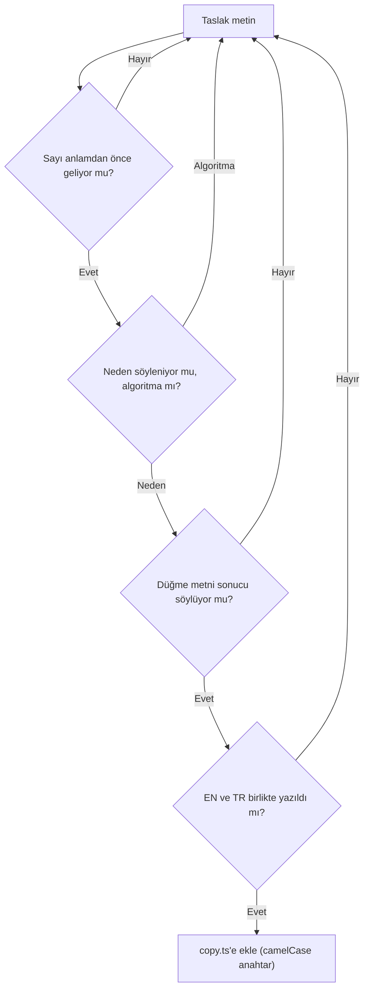

# PyroSync — UX Yazım Rehberi

Bu doküman, PyroSync arayüzündeki her yazının **tek kaynağıdır**. Wireframe (`docs/wireframes/index.html`), frontend metin dosyası (`web/src/content/copy.ts`) ve Methods metinleri bu rehberdeki sesi ve tabloları izler.

- **Varsayılan dil EN'dir; TR eksiksizdir.** Her metin `{ en, tr }` çifti olarak yazılır (bkz. bölüm 5).
- **Örnek sayılar** `web/src/mocks/sample-data.ts` dosyasından gelir:

| Büyüklük | Değer |
|---|---|
| Ham tespit | 6.520 (MODIS 2.340 + VIIRS 4.180) |
| Harmonize nokta | 5.363 |
| Çift sayım | 1.157 |
| Çift sayım oranı | %17,7 (EN: 17.7%) |

Dinamik sayılar bölgeye göre değişir; tablodaki sabit sayılar yalnızca Türkiye–Akdeniz örneğidir.

---

## 1. Ses: "sakin bilim insanı"

Kesin, yalın, sayıyla konuşan; abartısız ve alarmsız bir ses. Konu yangın, hedef kitle bilim insanı ve jüri: pazarlama dili, oyunlaştırma ve sahte aciliyet yok. Ünlem yok, emoji yok, büyük harfle bağırma yok.

### Dört kural

| # | Kural | Yapma | Yap |
|---|---|---|---|
| 1 | **Önce sayı, sonra anlam.** | "Birçok mükerrer kayıt temizlendi." | "6,520 detections → 5,363 unique fires. 1,157 were the same fire counted twice (17.7%)." |
| 2 | **Algoritmayı değil nedeni söyle.** Teknik ad ikinci satırda ya da tooltip'te durur. | "Interscan duplicates removed (H3 res 8, VZA filter)." | "1,157 were the same fire counted twice." — düğümün altında küçük yazıyla: "Remove double-counts" |
| 3 | **Soru sor, cevabı düğmeye bırak.** Ham modda başlık soru, Harmonize modda cevaptır. | "Harmonization complete. 1,157 duplicates removed." (cevabı baştan veren başlık) | Ham: "Detections jumped {x}% in 2012. More fires, or more satellites?" → düğme → Harmonize: "Same fires. One consistent record, 2000 to today." |
| 4 | **Düğme metni sonucu söyler.** | "Export", "OK", "Run", "Submit" | "Download this view (CSV)", "Brief me on this region", "Press H to harmonize" |

### Yeni metin eklerken kontrol akışı



---

## 2. Mikro metinler (EN/TR)

Anahtarlar `web/src/content/copy.ts` içinde camelCase'tir. Planın metin tablosundaki her satır eksiksiz aktarılmıştır; dokuz ekranın gerektirdiği eksik metinler **(yeni)** olarak eklenmiştir. `{x}` gibi süslü parantezli yer tutucular render sırasında bölge/veriye göre doldurulur (bkz. bölüm 3).

### 2.1 Komut şeridi (üst çubuk, başlık, düğme, sayaç, düzeltme fişi)

| Anahtar | EN | TR | Neden |
|---|---|---|---|
| `headlineRaw` | Detections jumped {x}% in 2012. More fires, or more satellites? | 2012'de tespitler %{x} arttı. Yangınlar mı çoğaldı, uydular mı? | Merak boşluğu. İki seçenekli soru, cevabı tahmin ettirir. |
| `headlineHarmonized` | Same fires. One consistent record, 2000 to today. | Aynı yangınlar. 2000'den bugüne tek, tutarlı kayıt. | Sorunun cevabı. Kısa iki cümle, sunumda okunabilir. |
| `toggleRaw` | Raw · *as the satellites saw it* | Ham · *uyduların gördüğü* | Alt etiket, teknik kelimeyi bilmeyen jüriye farkı anlatır. |
| `toggleHarmonized` | Harmonized · *as the fires burned* | Harmonize · *gerçekte yanan* | Alt etiket, teknik kelimeyi bilmeyen jüriye farkı anlatır. |
| `toggleHint` | Press H to harmonize | Harmonize etmek için H'ye bas | Sunumda fareyle uğraşmadan geçiş. |
| `counterMain` | 6,520 detections → 5,363 unique fires | 6.520 tespit → 5.363 tekil yangın | "Detection" ile "fire" ayrımı, projenin iddiasını tek satırda verir. |
| `counterSub` | 1,157 were the same fire counted twice (17.7%) | 1.157'si aynı yangının iki kez sayılmasıydı (%17,7) | Kayıp çerçevesi; "Duplicates Removed" etiketinin yerini alır. |
| `regionTurkey` (yeni) | Mediterranean Türkiye | Türkiye–Akdeniz | Bölge çipinin etiketi; EN'de "In Mediterranean Türkiye, 17.7%…" bulgu cümlesiyle aynı ad kullanılır. |
| `regionCalifornia` (yeni) | California | California | Bölge çipi; değişken ödülün ikinci durağı. |
| `regionAmazon` (yeni) | Amazon | Amazon | Bölge çipi. |
| `regionAustralia` (yeni) | Australia | Avustralya | Bölge çipi. |
| `badgeLive` | ● Live · NASA FIRMS | ● Canlı · NASA FIRMS | Emoji yerine renkli nokta ve metin; renk tek başına anlam taşımaz. |
| `badgeDemo` | ● Demo data | ● Demo verisi | Demo sırasında panik yaratmaz, durumu adıyla söyler. |
| `methodsLink` (yeni) | Methods | Yöntem | Üst çubuktaki çekmece bağlantısı; kısa kalır, başlık çekmecede açıklanır. |
| `fixCardRaw` (yeni) | Raw detections | Ham tespitler | Düzeltme fişinin ilk satırı; çıpalama buradan başlar. |
| `fixCardDuplicates` (yeni) | − Same fire counted twice | − Aynı yangın iki kez sayıldı | Farkın nedeni, algoritma adı değil. |
| `fixCardUnique` (yeni) | = Unique fires | = Tekil yangın | Fişin sonucu; `counterMain` ile aynı sözcükler. |
| `fixCardAngle` (yeni) | FRP corrected for angle | Bakış açısı için düzeltilmiş FRP | Dördüncü satır; değeri aşama sayıları geldikçe doldurulur (−x% avg). |

### 2.2 Pipeline (7 aşama şeridi)

Aşama adları fiille başlayan yalın adlardır; teknik ad (Dedup, VZA, H3) altında küçük yazılır. Her düğümün "emek" cümlesi, geçiş koreografisinde o düğüm yandığında düğümün altında görünür; `effortCollect` aynı zamanda genel yükleme metnidir.

| Anahtar | EN | TR | Neden |
|---|---|---|---|
| `pipelineCollect` | Collect | Topla | Fiille başlayan yalın ad. |
| `pipelineDedup` | Remove double-counts | Çift sayımı ayıkla | "Dedup" yerine nedeni söyler. |
| `pipelineAngle` | Correct viewing angle | Bakış açısını düzelt | "VZA" jargonunu gizler. |
| `pipelineGrid` | Align to one grid | Tek ızgaraya oturt | H3 ızgarasını görünür kılar. |
| `pipelineMatch` | Match across sensors | Sensörleri eşleştir | MODIS–VIIRS eşleşmesinin ne olduğunu söyler. |
| `pipelineFuse` | Keep the best view | En iyi gözlemi tut | Birleştirme kuralını günlük dille verir. |
| `pipelineCalendar` | Build the calendar | Takvimi kur | Yarışmanın asıl çıktısına bağlar. |
| `pipelineProgress` | 0/7 applied | 0/7 düzeltme uygulandı | Zeigarnik etkisi: boş şerit, düğmeye basmak için sessiz gerekçe. |
| `effortCollect` | Asking NASA FIRMS for 5 satellites… | NASA FIRMS'ten 5 uydunun verisi isteniyor… | Emek yanılsaması; bekleme süresi bilgiye döner. Düz "Loading…" kullanılmaz. |
| `effortDedup` | Removing double-counts… −1,157 | Çift sayımlar ayıklanıyor… −1.157 | İşin ve etkisinin adım adım görünmesi güveni artırır. |
| `effortAngle` | Correcting viewing angle… | Bakış açısı düzeltiliyor… | Emek yanılsaması; düzeltmenin yapıldığını kanıtlar. |
| `effortGrid` (yeni) | Aligning detections to one grid… | Tespitler tek ızgaraya oturtuluyor… | 4. aşamanın çıkarımı sayıyla değil işle görünür. |
| `effortMatch` (yeni) | Matching MODIS and VIIRS observations… | MODIS ve VIIRS gözlemleri eşleştiriliyor… | Eşleşmenin hangi sensörler arasında olduğu söylenir. |
| `effortFuse` (yeni) | Keeping the best view of each fire… | Her yangının en iyi gözlemi tutuluyor… | "Fuse" jargonu yerine kuralı söyler. |
| `effortCalendar` (yeni) | Building the 27-year calendar… | 27 yıllık takvim kuruluyor… | Son düğümün çıktısı yarışmanın asıl çıktısıdır. |

### 2.3 Harita

| Anahtar | EN | TR | Neden |
|---|---|---|---|
| `mapTooltip` | 38.7 MW (corrected from 45.2) · MODIS + VIIRS · high confidence · 15 Jul 2020 12:30 UTC | 38,7 MW (45,2'den düzeltildi) · MODIS + VIIRS · yüksek güven · 15 Tem 2020 12:30 UTC | Düzeltmenin etkisi tek noktada görünür. |
| `frpRange` | 45.2 MW (likely 38.7–51.8) | 45,2 MW (olası aralık 38,7–51,8) | "±" yerine konuşma dili; aralık her zaman sayının yanında. |
| `legendModis` (yeni) | MODIS | MODIS | Ham mod lejantı; sensör rengini adıyla eşler. |
| `legendViirs` (yeni) | VIIRS | VIIRS | Ham mod lejantı. |
| `legendFrp` (yeni) | FRP (MW) | FRP (MW) | Harmonize mod lejantı; FRP'nin açıklaması Methods'ta ve `frpRange` ile birlikte okunur. |

### 2.4 Takvim (ve uçurum grafiği paneli)

| Anahtar | EN | TR | Neden |
|---|---|---|---|
| `chartTitle` (yeni) | The sensor cliff, 2000–today | Sensör uçurumu, 2000–bugün | Sağ üst panelin başlığı; soru başlığındaki "2012" ile aynı hizada durur. Terimin ilk kullanımı burada bir kez tanımlanır (bkz. bölüm 3.6). |
| `calendarTitle` (yeni) | Burn calendar · 27 years × 12 months | Yanma takvimi · 27 yıl × 12 ay | Yarışmanın asıl çıktısının panel başlığı. |
| `calendarTooltip` | Aug 2020 · 1,120 fires · well above normal for August (+2.3σ) | Ağu 2020 · 1.120 yangın · ağustos normalinin çok üstünde (+2,3σ) | Önce düz anlam, sonra istatistik. |
| `calendarEmpty` (yeni) | No fires detected in this month. That is a result, not an error. | Bu ayda yangın tespit edilmedi. Bu bir hata değil, bir sonuç. | Takvimin boş hücresinin "bozuk" sanılmasını önler. |

### 2.5 Durumlar (boş, hata, demo)

| Anahtar | EN | TR | Neden |
|---|---|---|---|
| `stateEmpty` | No fires detected here in this period. That is a result, not an error. | Bu dönemde burada yangın tespit edilmedi. Bu bir hata değil, bir sonuç. | Boş ekranın "bozuk" sanılmasını önler. |
| `stateError` | NASA FIRMS is not answering. Showing saved demo data so you can keep exploring. | NASA FIRMS yanıt vermiyor. Keşfe devam edebilmen için kayıtlı demo verisi gösteriliyor. | Ne olduğunu, ne yaptığımızı ve çıkışı söyler. Demo sırasında panik yaratmaz. |
| `retryLive` (yeni) | Retry live | Canlıyı dene | `stateError` içindeki çıkış düğmesi; ayrı anahtar olarak da kullanılır. |

### 2.6 Alt şerit (uyarı)

| Anahtar | EN | TR | Neden |
|---|---|---|---|
| `disclaimer` | Harmonized values are model estimates, not ground truth. See how we calculate them → | Harmonize değerler model tahminidir, yer gerçeği değildir. Nasıl hesapladığımızı gör → | Dürüstlük artı çıkış yolu. Tek ve dürüst uyarı; bir kez söylenir, her yere serpiştirilmez. |

### 2.7 Methods (çekmece)

| Anahtar | EN | TR | Neden |
|---|---|---|---|
| `methodsTitle` | How five satellites become one record | Beş uydu nasıl tek kayda dönüşür | "About" ya da "Methodology" yerine merak uyandıran bir cümle. |
| `close` (yeni) | Close | Kapat | Methods çekmecesinin, düzeltme fişinin ve brifing panelinin ortak kapatma denetimi; harita yerinde kalır, bağlam kaybolmaz. |

### 2.8 Brifing / Dışa aktarma

| Anahtar | EN | TR | Neden |
|---|---|---|---|
| `downloadView` | Download this view (CSV) · `pyrosync_turkiye_2020-07.csv` | Bu görünümü indir (CSV) | Dosya adı önceden görünür; sürpriz olmaz. Dosya adı iki dilde de aynıdır ve `pyrosync_{bölge}_{yıl-ay}.csv` kalıbından üretilir. |
| `briefMe` | Brief me on this region | Bu bölgeyi özetle | Kullanıcının ağzından yazılmış eylem. |
| `briefLoading` (yeni) | Reading the record for {region}… | {region} için kayıt okunuyor… | Brifing paneli de emek yanılsamasını izler; düz "Loading…" kullanılmaz. |

---

## 3. Biçim kuralları

### 3.1 Sayılar

Sayılar `Intl.NumberFormat` ile dile göre yazılır; bileşenlerde sayı asla elle biçimlendirilmez:

```ts
new Intl.NumberFormat("en-US").format(6520);   // "6,520"
new Intl.NumberFormat("tr-TR").format(6520);   // "6.520"
```

- Sayaç ve fiş metinleri EN/TR biçimlerini taşıdığı için `copy.ts` içinde dil çifti başına ayrı yazılır (EN `6,520`, TR `6.520`).
- `tabular-nums` rakam özelliği açık yazı tipiyle kullanılır; sayaç inerken rakamlar zıplamaz.

### 3.2 Yüzde

EN'de yüzde işareti sayının arkasında, TR'de önündedir:

```ts
new Intl.NumberFormat("en-US", { style: "percent", maximumFractionDigits: 1 }).format(0.177); // "17.7%"
new Intl.NumberFormat("tr-TR", { style: "percent", maximumFractionDigits: 1 }).format(0.177); // "%17,7"
```

Oranlar tek ondalıkla yazılır: `17.7%` / `%17,7`.

### 3.3 Tarih ve saat

Saatler **her zaman UTC** dir. Ay adları `month: "short"` ile üretilir (EN `Aug`, TR `Ağu`):

```ts
new Intl.DateTimeFormat("tr-TR", {
  day: "numeric", month: "short", year: "numeric",
  hour: "2-digit", minute: "2-digit", hour12: false,
  timeZone: "UTC", timeZoneName: "short",
}).format(new Date("2020-07-15T12:30:00Z"));
// "15 Tem 2020, 12:30 UTC"  —  EN: "15 Jul 2020, 12:30 UTC"
```

Yerel saat dilimine dönüş yoktur: FIRMS alım zamanı ve takvim hücreleri UTC yazılır.

### 3.4 Birimler

- Birim her zaman sayının yanında durur ve araya kırılmaz boşluk girer: `38.7 MW` / `38,7 MW`.
- Anomali işareti sigma ile yazılır: `+2.3σ` / `+2,3σ`.
- FRP aralığı `frpRange` biçimindedir: `45.2 MW (likely 38.7–51.8)` / `45,2 MW (olası aralık 38,7–51,8)`.

### 3.5 Yer tutucular

- Yer tutucular süslü parantezle yazılır: `{x}` (artış yüzdesi), `{count}`, `{region}`.
- Cümleler kodda birleştirilmez (string concatenation yasak): TR sözcük sırası EN'den farklı olduğu için her dil kendi tam cümlesini taşır.
- Yer tutucuya giren sayılar bölüm 3.1–3.4 kurallarıyla biçimlendirilir.

### 3.6 "Sensor cliff" / "sensör uçurumu" tanım kuralı

- Terim **bir kez tanımlanır**, sonra terim olarak kullanılır.
- Tanım cümlesi: EN *"a jump caused by new satellites, not new fires"*; TR *"yeni yangınlardan değil, yeni uydulardan gelen sıçrama"*.
- Tanımın yeri: uçurum grafiğinde 2012 işaretinin tooltip'i ve Methods çekmecesinin ilk paragrafı.
- Tanımdan önce ham modda soru başlığı terimi hiç kullanmaz; soru cevabını kendi içinde vermez.

---

## 4. Yasak kelimeler

| Yasak | Neden | Yerine |
|---|---|---|
| "Loading…" | Emek yanılsamasını yok eder; boş bekleme. | Aşama bazlı emek cümlesi: "Asking NASA FIRMS for 5 satellites…" |
| "Duplicates Removed" | Etiket, kaybı ve nedenini gizler; algoritmayı anlatır. | "1,157 were the same fire counted twice (17.7%)" |
| "Error occurred", "An error has occurred" | Ne olduğunu ve çıkışı söylemez. | "NASA FIRMS is not answering. Showing saved demo data so you can keep exploring." |
| "Failed to fetch", "Network error" | Teknik jargon; kullanıcıyı suçlar. | Aynı hata cümlesi + [Retry live] |
| "Warning!", "Danger", "Critical", "Failure" | Alarmlı dil; sakin bilim insanı sesine aykırı. | Tek dürüst uyarı: "Harmonized values are model estimates, not ground truth." |
| "Please wait", "Hang on", "Almost there" | Boş dolgu; yapılan işi göstermez. | Düğümün emek cümlesi (`effort*`) |
| "Oops", "Whoops", "Uh-oh" | Konu yangın verisi; şakayı kaldırmaz. | Sakin hata cümlesi (`stateError`) |
| "Simply", "Just click", "Easy" | Kullanıcıyı küçümser. | "Press H to harmonize" |
| "Revolutionary", "Cutting-edge", "Seamless", "Powerful" | Pazarlama dili; sayı söylemeyen sıfat. | Sayı + anlam: "6,520 detections → 5,363 unique fires" |
| "100% accurate", "Ground truth" (iddia olarak) | Yanlış taahhüt. | "model estimates, not ground truth" |
| "Dirty data", "Cleaning the data" | Veriyi "kirli" diye etiketler; kaynağı (NASA FIRMS) suçlar. | "the same fire counted twice" |
| Ünlem, BAŞ HARFLERLE BAĞIRMA, emoji | Ses kurallarına aykırı; durum rozetlerinde renkli nokta + metin kullanılır. | Düz cümle; "● Live · NASA FIRMS" |

Teknik kısaltmalar (Dedup, VZA, H3, FRP) yasak değildir ama kural 2 gereği yalnızca ikinci satırda, küçük yazıyla ya da tooltip'te durur.

---

## 5. `copy.ts` şekli

`web/src/content/copy.ts` tek dosyadır; i18n kütüphanesi kullanılmaz. EN anahtar listesi tipin kaynağıdır; TR bu tipe yazılır, böylece eksik ya da yanlış anahtar **derleme hatası** olur. (Bu dosya bu rehber kapsamında ayrıca yazılır; aşağıdaki örnek yalnızca şekli gösterir.)

```ts
// web/src/content/copy.ts
type Lang = "en" | "tr";

// EN, anahtarların tek gerçek kaynağıdır.
const en = {
  headlineRaw: "Detections jumped {x}% in 2012. More fires, or more satellites?",
  counterSub: "1,157 were the same fire counted twice (17.7%)",
  retryLive: "Retry live",
} as const;

type Copy = typeof en;

// Copy tipine yazıldığı için eksik ya da fazladan anahtar derlemeyi kırar.
const tr: Copy = {
  headlineRaw: "2012'de tespitler %{x} arttı. Yangınlar mı çoğaldı, uydular mı?",
  counterSub: "1.157'si aynı yangının iki kez sayılmasıydı (%17,7)",
  retryLive: "Canlıyı dene",
};

export const copy: Record<Lang, Copy> = { en, tr };
export type { Lang, Copy };
```

---

## Doğrulama

- [ ] Tablodaki her anahtar için EN ve TR birlikte yazılmıştır; `copy.ts` derlenince eksik çeviri hatası verir.
- [ ] Dokuz ekran (Ham, Harmonize, geçiş kareleri, harita durumları, takvim, düzeltme fişi, Methods, brifing, mobil) gerekli her anahtara sahiptir.
- [ ] Sabit sayılar `web/src/mocks/sample-data.ts` ile eşleşir: 6.520, 2.340, 4.180, 5.363, 1.157, %17,7.
- [ ] Yasak kelimeler listesindeki ifadeler hiçbir metinde geçmez.
- [ ] "Sensor cliff" / "sensör uçurumu" yalnızca bir kez tanımlanmıştır.
