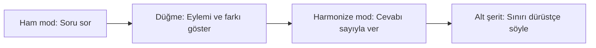

# PyroSync — UX Yazım Rehberi

Bu belge, PyroSync arayüzündeki tüm metinlerin ses tonunu, yazım kurallarını, EN/TR mikro metin tablosunu ve biçim standartlarını tanımlar. Uygulamanın varsayılan dili İngilizce (`en`), ikinci dili Türkçedir (`tr`). Tüm örnek sayılar [sample-data.ts](../web/src/mocks/sample-data.ts) dosyasındaki referans veriye dayanır: `6,520` ham tespit (`2,340` MODIS + `4,180` VIIRS), `5,363` tekil (harmonize) yangın, `1,157` çift sayım (`%17,7`).

---

## 1. Ses Tonu ve Dört Yazım Kuralı

**Ses:** *"Sakin bilim insanı"*. Kesin, yalın, sayıyla konuşan; abartısız ve alarmsız. Amaç, uydu verisindeki 2012 sıçramasını bir felaket hikâyesi olarak değil, ölçülebilir ve açıklanabilir bir gözlem problemi olarak sunmaktır.



### Dört Temel Kural

#### Kural 1: Önce sayı, sonra anlam
Kullanıcı ilk bakışta somut ölçüyü görür, ardından o sayının neden önemli olduğunu okur. Sayı referans noktası oluşturur, ikinci satır farkı açıklar.

- **Doğru:** `"6,520 detections → 5,363 unique fires"` ve altında `"1,157 were the same fire counted twice (17.7%)"` (`"6.520 tespit → 5.363 tekil yangın"` / `"1.157'si aynı yangının iki kez sayılmasıydı (%17,7)"`)
- **Yanlış:** `"Duplicate fire detections have been cleaned from the dataset (17.7% reduction: 6,520 to 5,363)."`

#### Kural 2: Algoritmayı değil nedeni söyle
Ana yüzeyde yöntem adı değil, fiziksel ya da gözlemsel neden yazılır. `Interscan duplicate`, `VZA`, `H3` gibi teknik terimler ikincil satırda, tooltip'te veya Methods çekmecesinde yer alır.

- **Doğru:** `"1,157 were the same fire counted twice"` (`"1.157'si aynı yangının iki kez sayılmasıydı"`) · alt etikette `Dedup`
- **Yanlış:** `"1,157 interscan duplicates removed via spatio-temporal clustering"`

#### Kural 3: Soru sor, cevabı düğmeye bırak
Ham modda başlık cevapsız bir soru sorarak merak boşluğu açar; Harmonize modda ise düğmeye basmanın doğrudan karşılığı olan net cevabı verir.

- **Doğru (Ham):** `"Detections jumped {x}% in 2012. More fires, or more satellites?"` -> **Doğru (Harmonize):** `"Same fires. One consistent record, 2000 to today."`
- **Yanlış (Ham):** `"MODIS and VIIRS Raw Fire Hotspots (2000–Present)"` -> **Yanlış (Harmonize):** `"Harmonized Fire Hotspots Dashboard"`

#### Kural 4: Düğme metni sonucu söyler
Eylem etiketleri kullanıcının teknik işlemini değil, tıklama sonunda eline geçecek somut çıktıyı adlandırır.

- **Doğru:** `"Download this view (CSV)"` (`"Bu görünümü indir (CSV)"`) ve `"Brief me on this region"` (`"Bu bölgeyi özetle"`)
- **Yanlış:** `"Export"` ve `"Generate Report"`

---

## 2. EN / TR Mikro Metin Tablosu

Tablo, planın 3. bölümündeki tüm metinleri korur. 9 wireframe ekranının gerektirdiği ek etiketler `(yeni)` işaretiyle belirtilmiştir. `Anahtar` sütunu `web/src/content/copy.ts` içindeki `camelCase` alan adlarını gösterir.

### Komut şeridi (Üst çubuk, başlıklar, düğme, sayı farkı ve düzeltme fişi)

| Anahtar | EN | TR | Neden |
|---|---|---|---|
| `headlineRaw` | Detections jumped {x}% in 2012. More fires, or more satellites? | 2012'de tespitler %{x} arttı. Yangınlar mı çoğaldı, uydular mı? | Merak boşluğu. İki seçenekli soru, cevabı tahmin ettirir. |
| `headlineHarmonized` | Same fires. One consistent record, 2000 to today. | Aynı yangınlar. 2000'den bugüne tek, tutarlı kayıt. | Sorunun cevabı. Kısa iki cümle, sunumda okunabilir. |
| `toggleRaw` | Raw · as the satellites saw it | Ham · uyduların gördüğü | Alt etiket, teknik kelimeyi bilmeyen kullanıcıya farkı anlatır. |
| `toggleHarmonized` | Harmonized · as the fires burned | Harmonize · gerçekte yanan | İki mod arasındaki gözlem–gerçeklik ayrımını verir. |
| `toggleHint` | Press H to harmonize | Harmonize etmek için H'ye bas | Sunumda fareyle uğraşmadan geçiş sağlar. |
| `toggleHintRaw` *(yeni)* | Press H to view raw | Ham veriyi görmek için H'ye bas | Harmonize moddayken geri dönüş kısayolunu bildirir. |
| `countSummary` | 6,520 detections → 5,363 unique fires | 6.520 tespit → 5.363 tekil yangın | "Detection" ile "fire" ayrımı, projenin iddiasını tek satırda verir. |
| `countSubline` | 1,157 were the same fire counted twice (17.7%) | 1.157'si aynı yangının iki kez sayılmasıydı (%17,7) | Kayıp çerçevesi; "Duplicates Removed" etiketinin yerini alır. |
| `regionTurkiye` *(yeni)* | Mediterranean Türkiye | Türkiye–Akdeniz | Hazır bölge çipi; odak bölge adını verir. |
| `regionCalifornia` *(yeni)* | California | Kaliforniya | Hazır bölge çipi; ikinci karşılaştırma bölgesi. |
| `regionAmazon` *(yeni)* | Amazon | Amazon | Hazır bölge çipi; tropik orman bölgesi. |
| `regionAustralia` *(yeni)* | Australia | Avustralya | Hazır bölge çipi; güney yarımküre bölgesi. |
| `navMethods` *(yeni)* | Methods | Yöntemler | Sağdan açılan yöntem çekmecesini tetikler. |
| `receiptRaw` *(yeni)* | Raw detections | Ham tespitler | Düzeltme fişi (ekran 6) başlangıç satırı. |
| `receiptDedup` *(yeni)* | − Same fire counted twice | − Aynı yangının iki kez sayılması | Düzeltme fişinde çıkarılan çift sayım satırı. |
| `receiptUnique` *(yeni)* | = Unique fires | = Tekil yangınlar | Düzeltme fişi net sonucu. |
| `receiptAngle` *(yeni)* | FRP corrected for angle | Bakış açısına göre düzeltilmiş FRP | Düzeltme fişinde ortalama açı düzeltme satırı (`−x% avg`). |

### Pipeline şeridi

| Anahtar | EN | TR | Neden |
|---|---|---|---|
| `pipelineSteps` | Collect · Remove double-counts · Correct viewing angle · Align to one grid · Match across sensors · Keep the best view · Build the calendar | Topla · Çift sayımı ayıkla · Bakış açısını düzelt · Tek ızgaraya oturt · Sensörleri eşleştir · En iyi gözlemi tut · Takvimi kur | Fiille başlayan yalın adlar. Teknik ad (`Dedup`, `VZA`, `H3`) altında küçük yazılır. |
| `pipelineCountIdle` *(yeni)* | 0/7 applied | 0/7 düzeltme uygulandı | Ham modda boş duran 7 düğümle Zeigarnik etkisini kurar. |
| `pipelineCountDone` *(yeni)* | 7/7 applied | 7/7 uygulandı | Geçiş tamamlandığında pipeline bütünlüğünü doğrular. |
| `pipelineProgressDedup` *(yeni)* | Removing double-counts… −400 | Çift sayım ayıklanıyor… −400 | De-dup aşamasında elenen miktarı görünür kılar (emek yanılsaması). Not: `−400 / −757` aşama bölünmesi, `/api/compare` uç noktası eklenene kadar (görev G4, Görkem) temsili yer tutucudur; `/api/compare` henüz yoktur, sunucuda şu an yalnızca `/api/health`, `/api/harmonize` ve `/api/availability` vardır. |
| `pipelineProgressAngle` *(yeni)* | Correcting viewing angle… | Bakış açısı düzeltiliyor… | VZA düzeltme adımını sade dille açıklar. |
| `pipelineProgressMatch` *(yeni)* | Matching across sensors… −757 | Sensörler eşleştiriliyor… −757 | Sensörler arası eşleştirme aşamasında elenen miktarı görünür kılar (`−757`, `/api/compare` eklenene kadar G4 için temsili yer tutucudur). |
| `pipelineProgressTotal` *(yeni)* | All stages complete · −1,157 total | Tüm aşamalar tamamlandı · toplam −1.157 | Tüm aşamalar tamamlandıktan sonra gösterilen toplam elenen tespit sayısı (`1.157` toplamı gerçektir; `400 + 757` dağılımı `/api/compare` eklenene kadar temsili yer tutucudur). |

### Harita

| Anahtar | EN | TR | Neden |
|---|---|---|---|
| `mapTooltip` | 38.7 MW (corrected from 45.2) · MODIS + VIIRS · high confidence · 15 Jul 2020 12:30 UTC | 38,7 MW (45,2'den düzeltildi) · MODIS + VIIRS · yüksek güven · 15 Tem 2020 12:30 UTC | Düzeltmenin etkisi tek noktada görünür. |
| `uncertaintyFormat` | 45.2 MW (likely 38.7–51.8) | 45,2 MW (olası aralık 38,7–51,8) | `"±"` yerine konuşma dili; aralık her zaman sayının yanında. |
| `mapLegendModis` *(yeni)* | MODIS (2000–today) | MODIS (2000–bugün) | Ham modda şekil + nötr gri tonuyla (içi boş daire) MODIS katmanını lejantta etiketler; tek doygun renk düğme ve 2012 işaretidir. |
| `mapLegendViirs` *(yeni)* | VIIRS (2012–today) | VIIRS (2012–bugün) | Ham modda şekil + nötr gri tonuyla (dolu küçük kare) VIIRS katmanını lejantta etiketler. |
| `mapLegendFrp` *(yeni)* | Fire Radiative Power (MW) | Yangın Işınım Gücü (MW) | Harmonize modda tek ardışık FRP renk skalasını tanımlar. |
| `mapMonthFilter` *(yeni)* | Filtered: {month} · Clear | Filtre: {month} · Temizle | Takvimden seçilen ayın haritayı süzdüğünü gösterir (ekran 5). |
| `mapZoomIn` *(yeni)* | Zoom in | Yakınlaştır | Harita yakınlaştırma düğmesi erişilebilirlik etiketi. |
| `mapZoomOut` *(yeni)* | Zoom out | Uzaklaştır | Harita uzaklaştırma düğmesi erişilebilirlik etiketi. |

### Takvim ve Uçurum Grafiği

| Anahtar | EN | TR | Neden |
|---|---|---|---|
| `calendarTooltip` | Aug 2020 · 1,120 fires · well above normal for August (+2.3σ) | Ağu 2020 · 1.120 yangın · ağustos normalinin çok üstünde (+2,3σ) | Önce düz anlam, sonra istatistik. |
| `calendarTitle` *(yeni)* | Burn calendar · 27 years × 12 months | Yanma takvimi · 27 yıl × 12 ay | Sağ alt panelin kapsamını tek bakışta verir. |
| `calendarEmptyCell` *(yeni)* | {month} · 0 fires detected | {month} · 0 yangın tespit edildi | Boş takvim hücresinde hatasız, nötr gözlem bildirir (ekran 5). |
| `cliffChartTitle` *(yeni)* | Detections over time · 2000 to today | Yıllara göre tespitler · 2000'den bugüne | Sağ üst panelin zaman eksenini tanımlar. |
| `cliffMarker2012` *(yeni)* | 2012 · VIIRS added | 2012 · VIIRS eklendi | Grafikteki dikey işaretin nedenini tek etikette açıklar. |

### Durumlar (Yükleme, Boş, Hata, Rozetler ve Ortak Eylemler)

| Anahtar | EN | TR | Neden |
|---|---|---|---|
| `loadingFirms` | Asking NASA FIRMS for 5 satellites… | NASA FIRMS'ten 5 uydunun verisi isteniyor… | Emek yanılsaması; bekleme süresi bilgiye döner. |
| `emptyState` | No fires detected here in this period. That is a result, not an error. | Bu dönemde burada yangın tespit edilmedi. Bu bir hata değil, bir sonuç. | Boş ekranın "bozuk" sanılmasını önler. |
| `errorDemoFallback` | NASA FIRMS is not answering. Showing saved demo data so you can keep exploring. [Retry live] | NASA FIRMS yanıt vermiyor. Keşfe devam edebilmen için kayıtlı demo verisi gösteriliyor. [Canlıyı dene] | Ne olduğunu, ne yaptığımızı ve çıkışı söyler. Demo sırasında panik yaratmaz; `[Retry live]` / `[Canlıyı dene]` ayrı `retryLive` düğme anahtarını gösterir. |
| `retryLive` | Retry live | Canlıyı dene | Hata durumunda canlı kaynağa geri dönüş eylemi (`errorDemoFallback` ile birlikte ayrı düğme anahtarı olarak kullanılır). |
| `modeBadgeLive` | ● Live · NASA FIRMS | ● Canlı · NASA FIRMS | Emoji yerine renkli nokta ve metin; renk tek başına anlam taşımaz. |
| `modeBadgeDemo` | ● Demo data | ● Demo verisi | Çevrimdışı veya yedek veri modunu açıkça işaretler. |
| `closeAction` *(yeni)* | Close | Kapat | Çekmece, düzeltme fişi ve brifing paneli kapatma etiketi. |

### Alt şerit

| Anahtar | EN | TR | Neden |
|---|---|---|---|
| `disclaimer` | Harmonized values are model estimates, not ground truth. See how we calculate them → | Harmonize değerler model tahminidir, yer gerçeği değildir. Nasıl hesapladığımızı gör → | Dürüstlük artı çıkış yolu. |
| `exportCsv` | Download this view (CSV) · `pyrosync_turkiye_2020-07.csv` | Bu görünümü indir (CSV) | Dosya adı önceden görünür; sürpriz olmaz. |
| `briefMe` | Brief me on this region | Bu bölgeyi özetle | Kullanıcının ağzından yazılmış eylem. |

### Methods Çekmecesi

| Anahtar | EN | TR | Neden |
|---|---|---|---|
| `methodsTitle` | How five satellites become one record | Beş uydu nasıl tek kayda dönüşür | "About" ya da "Methodology" yerine merak uyandıran bir cümle. |
| `methodsCliffDef` *(yeni)* | Sensor cliff: a jump caused by new satellites, not new fires. | Sensör uçurumu: yeni yangınlardan değil, yeni uydulardan kaynaklanan sıçrama. | Terimi ilk geçtiği yerde bir kez tanımlar. |
| `methodsSensors` *(yeni)* | Satellites: MODIS (Terra, Aqua) and VIIRS (Suomi NPP, NOAA-20, NOAA-21) | Uydular: MODIS (Terra, Aqua) ve VIIRS (Suomi NPP, NOAA-20, NOAA-21) | "5 uydu" ifadesinin kaynağını açıklar. |

### Brifing ve Dışa Aktarma

| Anahtar | EN | TR | Neden |
|---|---|---|---|
| `briefingFinding` *(yeni)* | In Mediterranean Türkiye, 17.7% of detections were double-counts. | Akdeniz Türkiye'de tespitlerin %17,7'si çift sayımdı. | Zirve–son kuralı gereği kapanışta tek cümlelik akılda kalıcı bulgu. |
| `briefingTitle` *(yeni)* | Regional briefing | Bölge brifingi | Brifing paneli ve yazdırma görünümü başlığı (ekran 8). |
| `briefingPrint` *(yeni)* | Print this briefing | Bu brifingi yazdır | Yazdırma eyleminde sonucu söyler. |
| `briefingCopyLink` *(yeni)* | Copy link to this view | Bu görünümün bağlantısını kopyala | URL durum paylaşımını (bölge, ay, mod) doğrudan sunar. |
| `briefingLinkCopied` *(yeni)* | Link copied | Bağlantı kopyalandı | Kısa ve sakin onay geri bildirimi. |

---

## 3. Biçim Kuralları

### Sayılar ve Yüzdeler (`Intl.NumberFormat`)
Tüm sayılar `tabular-nums` (`font-variant-numeric: tabular-nums`) ile gösterilir; böylece sayaç animasyonu sırasında rakam genişliği değişip metni titretmez.

```ts
// EN biçimi (varsayılan)
new Intl.NumberFormat("en-US").format(6520); // "6,520"
new Intl.NumberFormat("en-US", { maximumFractionDigits: 1 }).format(38.7); // "38.7"
new Intl.NumberFormat("en-US", { style: "percent", minimumFractionDigits: 1 }).format(0.177); // "17.7%"

// TR biçimi
new Intl.NumberFormat("tr-TR").format(6520); // "6.520"
new Intl.NumberFormat("tr-TR", { maximumFractionDigits: 1 }).format(38.7); // "38,7"
new Intl.NumberFormat("tr-TR", { style: "percent", minimumFractionDigits: 1 }).format(0.177); // "%17,7"
```

### Tarih ve Saat (Her Zaman UTC)
Yerel saat dilimine çevirme yapılmaz; tüm zaman damgaları `timeZone: "UTC"` ile üretilir ve sonuna açıkça `UTC` eklenir.

```ts
const d = new Date("2020-07-15T12:30:00Z");

function formatUtcTimestamp(date: Date, locale: "en-GB" | "tr-TR"): string {
  const parts = new Intl.DateTimeFormat(locale, {
    day: "2-digit",
    month: "short",
    year: "numeric",
    hour: "2-digit",
    minute: "2-digit",
    hourCycle: "h23",
    timeZone: "UTC",
  }).formatToParts(date);
  const p = Object.fromEntries(parts.map(({ type, value }) => [type, value]));
  return `${p.day} ${p.month} ${p.year} ${p.hour}:${p.minute} UTC`;
}

formatUtcTimestamp(d, "en-GB"); // "15 Jul 2020 12:30 UTC"
formatUtcTimestamp(d, "tr-TR"); // "15 Tem 2020 12:30 UTC"
```

### Birimler ve Aralıklar
- **Birim sayının hemen yanında durur:** `38.7 MW`, `45.2 MW` (arada tek boşluk).
- **Belirsizlik aralığı sayının yanında verilir:** `45.2 MW (likely 38.7–51.8)` / `45,2 MW (olası aralık 38,7–51,8)`. `±` sembolü tek başına kullanılmaz.
- **Anomali ölçüsü:** Kısa sigma gösterimi kullanılır (`+2.3σ` / `+2,3σ`), önce düz anlam yazılır.

### "Sensor cliff / Sensör uçurumu" Tanım Kuralı
Bu terim ilk geçtiği yerde (Methods çekmecesinde veya giriş açıklamasında) **yalnızca bir kez** tanımlanır:
- **EN:** `"a jump caused by new satellites, not new fires"`
- **TR:** `"yeni yangınlardan değil, yeni uydulardan kaynaklanan sıçrama"`

İlk tanımdan sonra arayüzde ve dokümanlarda doğrudan **sensor cliff** / **sensör uçurumu** terimi kullanılır; tanım her bileşende tekrarlanmaz.

---

## 4. Yasak Kelimeler Listesi

| Yasak ifade | Neden yasak | Yerine kullanılacak (EN / TR) |
|---|---|---|
| `Loading…` / `Yükleniyor…` | Beklemeyi pasif ve belirsiz gösterir, emek yanılsamasını kaçırır. | `Asking NASA FIRMS for 5 satellites…` / `NASA FIRMS'ten 5 uydunun verisi isteniyor…` |
| `Duplicates Removed` / `Tekrarlar Silindi` | Kayıp çerçevesini ve gözlem nedenini gizler. | `1,157 were the same fire counted twice (17.7%)` / `1.157'si aynı yangının iki kez sayılmasıydı (%17,7)` |
| `Interscan duplicate` (ana ekranda) | Jargon; teknik olmayan izleyiciyi dışlar. | `the same fire counted twice` / `aynı yangının iki kez sayılması` (teknik ad yalnız ikincil etikette) |
| `Error occurred` / `Something went wrong` / `Hata oluştu` | Nedenini ve kullanıcının ne yapabileceğini söylemez. | `NASA FIRMS is not answering. Showing saved demo data so you can keep exploring. [Retry live]` / `NASA FIRMS yanıt vermiyor. Keşfe devam edebilmen için kayıtlı demo verisi gösteriliyor. [Canlıyı dene]` (`errorDemoFallback` mesajı + ayrı `retryLive` düğme anahtarı) |
| `No data` / `Veri yok` | Boş dönemin bozuk ekran gibi algılanmasına yol açar. | `No fires detected here in this period. That is a result, not an error.` / `Bu dönemde burada yangın tespit edilmedi. Bu bir hata değil, bir sonuç.` |
| `Export` / `Dışa aktar` | Çıktı biçimini ve kapsamını gizler. | `Download this view (CSV)` / `Bu görünümü indir (CSV)` |
| `About` / `Methodology` | Merak uyandırmaz, pasif menü adıdır. | `How five satellites become one record` / `Beş uydu nasıl tek kayda dönüşür` |
| `Catastrophic` / `Crisis` / `Exploding` / `Felaket` / `Patlama` | Alarmist dil bilimsel güvenilirliği düşürür. | `well above normal for August (+2.3σ)` / `ağustos normalinin çok üstünde (+2,3σ)` |
| Tek başına `±` (`45.2 ± 6.5 MW`) | Günlük konuşma dilinde aralığı gizler. | `45.2 MW (likely 38.7–51.8)` / `45,2 MW (olası aralık 38,7–51,8)` |
| `Ground truth` / `Exact count` (harmonize sonuç için) | Model tahminini kesin gerçek gibi sunar. | `Harmonized values are model estimates, not ground truth.` / `Harmonize değerler model tahminidir, yer gerçeği değildir.` |

---

## 5. `web/src/content/copy.ts` Yapısı (Örnek Şema)

`en` ve `tr` nesneleri aynı `CopyDictionary` tipini paylaşır; herhangi bir dilde eksik bırakılan anahtar TypeScript derleme hatası verir.

```ts
export type Locale = "en" | "tr";

export interface CopyDictionary {
  headlineRaw: string;
  toggleHarmonized: string;
  emptyState: string;
}

export const copy: Record<Locale, CopyDictionary> = {
  en: {
    headlineRaw: "Detections jumped {x}% in 2012. More fires, or more satellites?",
    toggleHarmonized: "Harmonized · as the fires burned",
    emptyState: "No fires detected here in this period. That is a result, not an error.",
  },
  tr: {
    headlineRaw: "2012'de tespitler %{x} arttı. Yangınlar mı çoğaldı, uydular mı?",
    toggleHarmonized: "Harmonize · gerçekte yanan",
    emptyState: "Bu dönemde burada yangın tespit edilmedi. Bu bir hata değil, bir sonuç.",
  },
};
```
