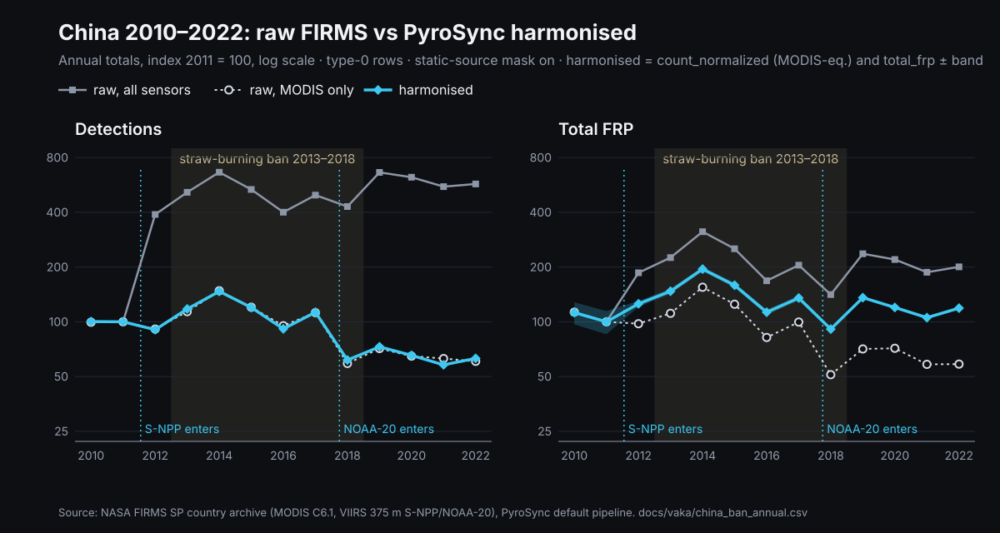
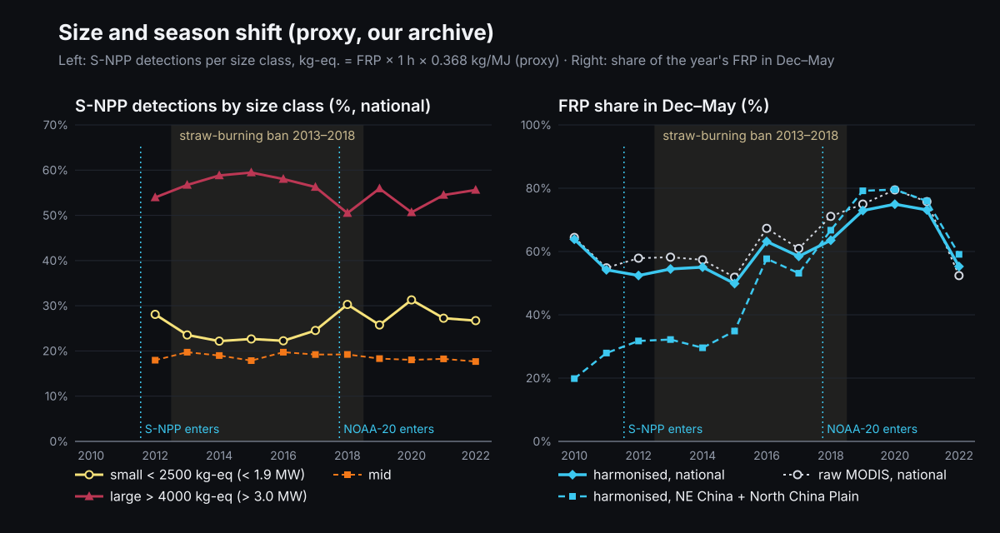

# Vaka Çalışması — Çin Anız Yakma Yasağı Paradoksu (2013–2018)

> **Görev:** C11 · **Veri:** yerel FIRMS ülke arşivi (`.cache/firms-archive`, SP, `type 0`), Çin 2010–2022
> **Üretici:** `crates/firms-client/examples/china_ban_case.rs` · **Çıktılar:** `docs/vaka/`
>
> Bu belgedeki sayılar iki ayrı türdendir ve karıştırılmamalıdır:
> **(Ölçüm)** = kendi arşivimizden bu program ile hesaplanan değer; **(Literatür)** = makaleden aktarılan değer.





---

## 1. Soru

Çin 2013'ten itibaren il il açık anız yakmayı yasakladı; denetim 2015–2018 arasında sıkılaştı. Literatür yasağın büyük yakmaları (`>4000 kg`) azaltıp küçük (`<2500 kg`) ve kış–ilkbahar yakmalarını artırdığını (`[28, Şek. 9; 30]`) ve MODIS tabanlı envanterlerin (FINN/GFED) bu yüzden yanmayı `~%85` eksik tahmin ettiğini (`[28, Tablo 3]`) bildirir. Bizim sorumuz: **ham FIRMS serisi yasağın etkisini gizliyor mu, harmonize seri gösteriyor mu, ve boyut/mevsim kayması kendi arşivimizde görünüyor mu?**

## 2. Yöntem

### 2.1 Veri ve pipeline
- **Girdi:** `modis/`, `viirs-snpp/`, `viirs-jpss1/` altında `*_YYYY_China.csv`, 2010–2022; yalnız `type 0` (bitki örtüsü yangını) satırları — `/api/series` ve `/api/calendar` ile aynı filtre.
- **Pipeline:** `PipelineConfig::default()` (C9 statik kaynak maskesi **açık**, SAMA kapalı). Her takvim yılı tek parti olarak `harmonize_with_links_config` ile işlenir; maske yıl bazında kurulduğu için `/api/series` ile aynı hücre-yıllarını eler.
- **Sensör girişleri (arşivden):** S-NPP Çin'deki ilk satırı `2012-01-20`, NOAA-20 `2018-04-01`.

### 2.2 Uygulamadaki alanlarla eşleşme
| Bu çalışmadaki sütun | Uygulamadaki karşılığı |
|---|---|
| `raw_*_count`, `raw_total_count` | `/api/series` `years[].raw_modis/raw_viirs/raw_total` (S-NPP ve NOAA-20 ayrıca verilir) |
| `harmonized_count`, `matched`, `modis_only`, `viirs_only`, `static_masked` | `/api/series` `years[]` alanları (yıllık harmonize, yıllık maske) |
| `count_normalized`, `effort_omega`, `total_frp`, `total_frp_lower/upper`, `frp_per_detection_eq`, `anomaly` | `/api/calendar?country=China&from=2010&to=2022` hücreleri (`build_calendar_with`, varsayılan belirsizlik ve `k_c` kalibrasyonu) |

Ω (gözlem eforu) tüm seri içinde **platform yapılandırması başına** havuzlanır. Bellek için takvim üç dönemde kurulur (`2010-01..2011-12` yalnız MODIS, `2012-01..2018-03` MODIS+S-NPP, `2018-04..2022-12` MODIS+S-NPP+NOAA-20); her dönem tek yapılandırma içerdiğinden (program bunu denetler) Ω tek bir 2010–2022 `/api/calendar` çağrısıyla aynıdır. Tek fark: yıl sınırını (31 Ara / 1 Oca) aşan eşleşmeler birleştirilmez — ihmal edilebilir.

**(Ölçüm) Ω:** ulusal `1.000 / 4.025 / 7.246`, kuşak `1.000 / 4.108 / 7.316`.

### 2.3 Bölgeler
- **Ulusal:** Çin ülke arşiv dosyasının tamamı.
- **Tarım kuşağı (NE China + North China Plain):** iki bbox birleşimi, girdi satırlarına harmonizasyondan **önce** uygulanır (`/api/calendar` bbox davranışı):
  - KD Çin: `119–135°D, 40–54°K` (Heilongjiang, Jilin, Liaoning, doğu İç Moğolistan)
  - Kuzey Çin Ovası: `113–122°D, 32–40°K` (Hebei, Pekin/Tianjin, Shandong, 113°D doğusundaki Henan, kuzey Anhui/Jiangsu)

### 2.4 Boyut sınıfı vekili (proxy)
FIRMS biyokütle vermez, tespit başına FRP verir. İki vekil kullanıldı; ikisi de **gerçek yangın boyutu değildir**:
1. **kg-eşdeğeri:** `M ≈ FRP × τ × 0.368 kg/MJ` (Wooster 2005 yanma katsayısı), `τ = 1 saat` (pikselin gözlenen FRP ile bir saat yandığı varsayımı). Literatür eşikleri `2500 kg → 1.89 MW`, `4000 kg → 3.02 MW` eder. `τ` keyfi bir ölçek seçimidir; eşikler `τ` ile ters orantılı kayar.
2. **Yasak öncesi tersiller:** her sensörün kendi yasak öncesi FRP dağılımının `%33 / %67` kantilleri (MODIS 2010–2012: `8.2 / 16.0 MW`; S-NPP 2012: `2.21 / 4.79 MW`; kuşakta `7.7/14.9` ve `2.15/4.47 MW`).

Sınıflar **harmonize seri üzerinde değil, tek sensörlü ham akışlarda** sayılır (MODIS Terra+Aqua 2010–2022, S-NPP 2012–2022): harmonize seride piksel karışımı 2012 ve 2018'de değiştiği için tespit başına FRP sensör geçişinde süreksizdir (`mean_frp` uyarısıyla aynı neden).

### 2.5 Mevsim kayması
- **Kış–ilkbahar payı:** yılın FRP'sinin Ocak–Mayıs + Aralık aylarına düşen payı (takvim yılı içinde). Harmonize `total_frp` ve tek sensörlü ham MODIS FRP için ayrı hesaplanır.
- **PCD / PCP** `[30]`: 12 aylık toplam vektör olarak (`θ_m = 2π(m−0.5)/12`) toplanır; `PCD = |Σ r·e^{iθ}| / Σ r` (0 = yıla yayılmış, 1 = tek aya yığılmış), `PCP` = ortalama açı, kesirli ay olarak. Çift tepeli (ilkbahar + sonbahar) yıllarda PCP iki tepe arasına düşer; bu yüzden ana metrik kış–ilkbahar payıdır.

## 3. Sonuçlar (Ölçüm)

### 3.1 Yıllık seri — ulusal

| Yıl | Ham sayım (tüm) | Ham MODIS | Harmonize sayım (`/api/series`) | `count_normalized` | Ham FRP (GW) | Harmonize `total_frp` (GW) [alt–üst] | Statik maske (satır) | Ara–May FRP payı |
|---|---|---|---|---|---|---|---|---|
| 2010 | 97,587 | 97,587 | 87,652 | 87,652 | 2.08 | 2.05 [1.76–2.34] | 205 | 63.9% |
| 2011 | 98,093 | 98,093 | 87,388 | 87,388 | 1.84 | 1.82 [1.56–2.09] | 174 | 54.2% |
| 2012 | 381,950 | 89,460 | 318,056 | 79,014 | 3.43 | 2.29 [2.20–2.38] | 1,657 | 52.4% |
| 2013 | 505,473 | 111,602 | 413,778 | 102,794 | 4.16 | 2.69 [2.60–2.78] | 4,181 | 54.5% |
| 2014 | 651,813 | 145,349 | 516,748 | 128,375 | 5.77 | 3.56 [3.45–3.66] | 9,363 | 55.1% |
| 2015 | 523,643 | 117,951 | 421,559 | 104,727 | 4.65 | 2.90 [2.81–2.99] | 5,334 | 49.9% |
| 2016 | 392,954 | 93,356 | 321,629 | 79,902 | 3.10 | 2.06 [1.99–2.13] | 5,305 | 63.1% |
| 2017 | 487,775 | 110,183 | 397,110 | 98,653 | 3.78 | 2.47 [2.39–2.55] | 7,944 | 58.5% |
| 2018 | 421,959 | 57,869 | 323,412 | 53,861 | 2.60 | 1.66 [1.62–1.70] | 11,402 | 63.6% |
| 2019 | 650,054 | 69,924 | 461,602 | 63,709 | 4.37 | 2.48 [2.44–2.52] | 9,997 | 72.9% |
| 2020 | 611,503 | 63,556 | 413,792 | 57,110 | 4.06 | 2.19 [2.15–2.23] | 17,870 | 74.9% |
| 2021 | 543,151 | 61,583 | 367,136 | 50,671 | 3.45 | 1.92 [1.89–1.96] | 26,411 | 73.1% |
| 2022 | 561,330 | 59,465 | 398,752 | 55,034 | 3.70 | 2.17 [2.13–2.21] | 16,514 | 55.2% |

FRP sütunları tespit başına FRP'nin (MW) yıllık toplamıdır (GW = 10⁶ MW·tespit). `total_frp` sınırları aylık sınırların doğrusal toplamıdır (tam korelasyon varsayımı, muhafazakâr). Kuşak tablosu `docs/vaka/china_ban_annual.csv` içindedir.

### 3.2 Ham vs harmonize değişim (%)

| Aralık | Ham sayım | Ham FRP | **`count_normalized`** | Harmonize `total_frp` | Ham MODIS sayım | Ham S-NPP sayım (tek sensör) |
|---|---|---|---|---|---|---|
| **Ulusal** | | | | | | |
| 2011→2012 (S-NPP girişi) | **+289.4** | +86.0 | **−9.6** | +25.5 | −8.8 | — |
| 2017→2018 (NOAA-20 girişi) | −13.5 | −31.1 | **−45.4** | −32.6 | −47.5 | −40.7 |
| **2012→2018 (yasak)** | **+10.5** | −24.1 | **−31.8** | −27.4 | −35.3 | −23.5 |
| 2014 (zirve)→2018 | −35.3 | −54.9 | −58.0 | −53.2 | −60.2 | −55.8 |
| 2011→2022 | +472.2 | +100.6 | −37.0 | +18.8 | −39.4 | — |
| **Kuşak (KD Çin + KÇO)** | | | | | | |
| 2011→2012 | +272.8 | +80.2 | −12.2 | +24.8 | −14.0 | — |
| 2017→2018 | −37.7 | −51.8 | −61.0 | −53.3 | −59.9 | −58.6 |
| **2012→2018** | **+8.8** | −20.7 | **−34.9** | −29.1 | −31.8 | −27.1 |
| 2014→2018 | −45.8 | −58.6 | −65.5 | −58.8 | −64.5 | −64.2 |
| 2011→2022 | +503.6 | +143.3 | −35.7 | +33.9 | −39.2 | — |

**Okuma:**
- Ham sayım 2012→2018'de **artış** gösterir (ulusal `+%10.5`): ham seriye bakan biri yasağın işe yaramadığı sonucuna varır. Bunun nedeni, 2012'deki S-NPP girişinin (`+%289`) ve 2018'deki NOAA-20 girişinin (Nisan'dan itibaren) seviyeyi sensör sayısıyla şişirmesidir; NOAA-20 2017→2018 düşüşünü `−%45`'ten `−%13.5`'e indirir.
- Harmonize `count_normalized` aynı aralıkta **`−%31.8`** (kuşakta `−%34.9`) düşer ve S-NPP girişinde sıçramaz (`−%9.6`, ham MODIS `−%8.8` ile uyumlu).
- **Bağımsız kontrol:** sensör değiştirmeyen tek bir VIIRS akışı (yalnız S-NPP, 2012–2022) da 2012→2018 düşüşünü verir (`−%23.5` sayım, `−%35.1` FRP). 2012 S-NPP 20 Ocak'ta başladığı için bu düşüş biraz eksik tahmindir. Yani düşüş harmonizasyonun yarattığı bir şey değildir; ham toplam bunu gizler.
- `count_normalized` Ω tanımı gereği MODIS-eşdeğeri birimdedir; eğilimi ham MODIS'e yakın olması tasarım gereğidir (bağımsız kanıt değil, süreklilik garantisidir).

### 3.3 Mevsim kayması — görünür ve güçlü

Aylık FRP dağılımı (harmonize `total_frp`, dönem toplamının yüzdesi):

| Bölge / dönem | Oca | Şub | Mar | Nis | May | **Haz** | Tem | Ağu | Eyl | **Eki** | Kas | Ara |
|---|---|---|---|---|---|---|---|---|---|---|---|---|
| Kuşak 2010–2012 | 0.6 | 2.5 | 6.1 | 12.9 | 4.6 | **34.8** | 3.3 | 2.6 | 3.4 | **20.8** | 7.7 | 0.6 |
| Kuşak 2013–2018 | 1.1 | 3.1 | 14.0 | 18.4 | 5.0 | **11.2** | 2.9 | 2.4 | 3.4 | **22.3** | 14.8 | 1.4 |
| Kuşak 2019–2022 | 3.1 | 12.9 | 14.8 | **35.1** | 6.3 | **4.3** | 2.9 | 1.9 | 1.8 | 9.9 | 5.5 | 1.5 |
| Ulusal 2010–2012 | 3.6 | 14.4 | 14.2 | 13.9 | 6.4 | 17.0 | 3.0 | 3.1 | 2.9 | 11.4 | 6.0 | 4.2 |
| Ulusal 2019–2022 | 6.0 | 11.8 | 14.4 | 23.8 | 6.9 | 4.4 | 4.7 | 4.1 | 3.4 | 8.6 | 5.7 | 6.3 |

| Ara–May FRP payı (dönem ort.) | 2010–2012 | 2013–2018 | 2019–2022 |
|---|---|---|---|
| Kuşak, harmonize | 26.5% | 45.7% | **73.4%** |
| Kuşak, ham MODIS | 27.4% | 47.9% | 72.3% |
| Ulusal, harmonize | 56.8% | 57.4% | 69.1% |
| Ulusal, ham MODIS | 59.1% | 61.1% | 70.7% |
| PCD kuşak (harmonize) | 0.348 | 0.212 | 0.492 |

- Kuzey Çin Ovası'nın Haziran buğday anızı yakması kuşak FRP'sinin `%34.8`'inden `%4.3`'üne iner; Ekim–Kasım sonbahar yakması yasak döneminde sürer, 2019 sonrası yarıya iner; Nisan payı `%12.9 → %35.1` olur. Bu, literatürdeki kış–ilkbahar kaymasının (`[28, 30]`) kendi arşivimizdeki karşılığıdır.
- PCD yasak döneminde düşer (`0.35 → 0.21`, yakma yıla yayılır), 2019 sonrası ilkbahara yığılarak yükselir (`0.49`). `[30]`'un KD Çin için bildirdiği `>0.8 → <0.4` düşüşü (Literatür; pentad çözünürlüğü) ile yön olarak uyumludur, mutlak değerler aylık çözünürlük nedeniyle kıyaslanamaz.
- **Dürüst not:** mevsim kayması bir yıl-içi oran olduğu için ham MODIS'te de aynı şekilde görünür; bu bulgu harmonizasyona ihtiyaç duymaz. Harmonizasyonun katkısı **seviye ve eğilimdedir** (3.2).

### 3.4 Boyut kayması — verimizde sağlam biçimde görünmüyor

| Akış ve sınıf (ulusal) | 2012 | 2013–2018 | 2019–2022 |
|---|---|---|---|
| S-NPP kg-vekili, küçük (<1.89 MW) payı | 28.1% | 23.7% | 27.8% |
| S-NPP kg-vekili, büyük (>3.02 MW) payı | 54.0% | 57.2% | 54.2% |
| S-NPP tersil, küçük / büyük | 33.2 / 33.3% | 29.0 / 34.3% | 32.9 / 32.6% |
| MODIS tersil (taban 2010–2012), küçük / büyük | 31.9 / 33.0% | 34.8 / 29.5% | 35.4 / 29.1% |
| MODIS kg-vekili, küçük payı | 0.0% | 0.0% | 0.1% |

- **S-NPP** (küçük yangınları görebilen tek tutarlı akış) yasak döneminde küçük sınıfa kayma **göstermez**; tersine küçük pay düşer, büyük pay artar. Kuşakta da aynı (küçük tersil `%33.3 → %24.8 → %27.7`).
- **MODIS** tersillerinde zayıf ve literatürle aynı yönlü bir kayma var (2012 → 2019–2022: küçük `+3.5`, büyük `−3.9` puan), ancak kuşakta 2019 sonrası geri döner.
- MODIS kg-vekilinde neredeyse hiç "küçük" tespit yoktur: `1.89 MW` MODIS tespit eşiğinin (`~5.7–40 MW` `[02, 14]`) altındadır. Bu, literatürdeki "MODIS küçük yakmaları göremez" argümanının doğrudan bir göstergesidir ama kendi başına boyut kayması kanıtı değildir.
- **Dolaylı işaret:** aynı yıl içinde `ΣFRP(S-NPP) / ΣFRP(MODIS)` oranı ulusal ölçekte `1.02` (2013) → `1.12` (2018) → `1.14` (2019) → `1.22` (2022) yükselir; MODIS'in yakaladığı pay giderek azalır. Bu, MODIS tabanlı envanterlerin yasak sonrası daha çok eksik saymasıyla (`[28, Tablo 3]`, Literatür) uyumludur, ama Terra/Aqua yörünge kayması (2020+) ve mevsimsel geçiş zamanı farkı da aynı yönde etki eder; ayrıştırılamaz.

**Sonuç:** Boyut paradoksunu (`>4000 kg` azalır, `<2500 kg` artar) FRP vekilimizle **doğrulayamıyoruz**. Bunu sunumda iddia etmiyoruz.

### 3.5 Beklenmeyen bulgu — `total_frp`'de kalan sensör basamağı
Harmonize `total_frp` Ω ile normalize edilmez; filo büyüdükçe daha fazla küçük yangın gözlemi toplanır. `total_frp / ham MODIS FRP` oranı 2011→2012'de `0.99 → 1.27` (`+%28`), 2017→2018'de `1.34 → 1.76` (`+%31`) sıçrar; aynı 2018 geçişinde sensör değiştirmeyen S-NPP/MODIS oranı yalnız `+%6` değişir. Yani NOAA-20 girişinin `total_frp` üzerindeki etkisinin büyük kısmı **harmonizasyondan sonra da kalır** (ham FRP oranı `+%34`). Sunumda manşet metrik `count_normalized` olmalı; `total_frp` 2012→2018 düşüşünü (`−%27.4`) yine de doğru yönde gösterir ama sensör geçişlerine karşı tam sürekli değildir. Bu durum G-serisi (Ω'nın FRP'ye uygulanması / `frp_per_detection_eq`) için ayrı bir iş kalemi olarak değerlendirilmelidir.

Ayrıca statik maskenin attığı satırlar 2010'daki `205`'ten 2021'de `26,411`'e çıkar: VIIRS yoğunluğu arttıkça daha fazla H3 hücresi yıl içinde ≥10 aya ulaşır. Bu satırların ne kadarının gerçek tarım yakması olduğu (ör. yıl boyu yakılan atık alanları) ayrıca incelenmeli; ulusal 2021 ham sayımının `~%4.9`'u.

## 4. Sınırlar
- **Vekil:** tespit başına FRP ≠ yakma başına biyokütle. `τ = 1 sa` keyfidir; bir piksel birden çok tarlayı veya bir tarlanın bir kısmını içerebilir. FRE, gün içi tek bir anlık gözlemden çıkarılamaz.
- **Bulut / duman / geçiş saati:** yasak sonrası yakmaların bir kısmı gece veya bulutlu kış–ilkbahar günlerine kaydı (literatür "gizli yakma" bildirir); her iki sensör de bunları kaçırabilir. Kış payındaki artış bu yüzden alt sınırdır.
- **Statik maske:** yıl içinde ≥10 ay aktif H3 r7 hücreleri elenir; tarım yakması nadiren bu eşiğe ulaşır ama yoğun VIIRS yıllarında elenen satırlar artar (3.5).
- **Ω** her yapılandırma için tüm seri üzerinden tek sabittir; yörünge kayması (Terra/Aqua 2020+) ve yıllık değişen tespit verimi Ω'ya yansımaz.
- **2012 S-NPP** 20 Ocak'ta başlar ve Ekim 2012'ye kadar algoritma güncellemeleri içerir (`[13]`); S-NPP tabanlı 2012 tabanı hafif yanlıdır.
- **Bölge:** kuşak bbox'ları yaklaşık il sınırlarıdır; doğu İç Moğolistan'daki otlak yangınlarını da içerir.
- **Literatür sayıları** (`−%46.9` PM2.5, `4,256` hayat, FINN/GFED `~%85` eksik tahmin) bu çalışmada yeniden üretilmedi; yalnız bağlam olarak aktarılır.

## 5. Sunum metni (60 sn demo, 30–45 sn adımı)

**Türkçe (~100 kelime):**
> Çin 2013'te anız yakmayı yasakladı. Ham uydu verisine bakarsanız yasak işe yaramamış: 2012'den 2018'e tespit sayısı yüzde 10 artıyor. Ama bu artış yangınlardan değil, uydulardan geliyor. 2012'de S-NPP, 2018'de NOAA-20 devreye girdi ve her biri seriye bir basamak ekledi. PyroSync'in harmonize serisi aynı dönemde yüzde 32 düşüş gösteriyor; tek başına izlenen S-NPP de yüzde 24 düşüşle bunu doğruluyor. Yasak yakmayı bitirmedi, takvimini değiştirdi: Kuzeydoğu Çin ve Kuzey Çin Ovası'nda yılın yanmasının Aralık–Mayıs payı yüzde 27'den 73'e çıktı, Haziran buğday anızı yakması yüzde 35'ten 4'e indi. Literatür bu dönemde PM2.5'te yüzde 46,9 düşüş ve 4.256 kurtarılan hayat bildiriyor.

**English (~105 words):**
> China banned open straw burning in 2013. In the raw satellite record the ban failed: detections rise ten percent from 2012 to 2018. But that rise comes from satellites, not fires: S-NPP joined in 2012 and NOAA-20 in 2018, each adding a step. PyroSync's harmonised series shows a 32 percent drop, and S-NPP alone confirms it with 24 percent. The ban did not end burning; it moved it. In Northeast China and the North China Plain, the December-to-May share of fire energy rose from 27 to 73 percent, and June wheat-straw burning fell from 35 to 4 percent. The literature reports 46.9 percent less PM2.5 and 4,256 lives saved.

## 6. Yeniden üretim

```bash
cargo run --release -p pyrosync-firms --example china_ban_case            # çıktı: docs/vaka/
cargo run --release -p pyrosync-firms --example china_ban_case -- /tmp/x  # başka dizin
```

`ARCHIVE_CACHE_DIR` verilmezse `.cache/firms-archive` okunur (salt okunur, ~41 GB arşivin Çin dosyaları ~1.1 GB). Süre: sıcak disk önbelleğiyle ~130 sn (ulusal + kuşak), soğuk ~220 sn; çalışma sırasında ~0.4 GB bellek gözlendi (her seferde tek dönem bellekte tutulur).

| Dosya | İçerik |
|---|---|
| `vaka/china_ban_monthly.csv` | Bölge × yıl × ay: sensör başına ham sayım/FRP, harmonize sayım, Ω, `count_normalized`, `total_frp` ± sınırlar, `frp_per_detection_eq`, anomali |
| `vaka/china_ban_annual.csv` | Bölge × yıl: ham + `/api/series` alanları, takvim toplamları, mevsim payı, PCD/PCP, boyut sınıfı sayıları |
| `vaka/china_ban_summary.json` | Bu belgedeki değişim yüzdeleri, Ω, dönem ortalamaları, boyut eşikleri |
| `vaka/china_ban_series.svg` | Ham vs harmonize yıllık sayım ve FRP (2011 = 100, log), yasak dönemi ve sensör girişleri işaretli |
| `vaka/china_ban_shift.svg` | S-NPP boyut sınıfı payları ve Ara–May FRP payı (ulusal + kuşak) |

**Kaynaklar:** `[02, 13, 14, 28, 30]` — numaralar `docs/REFERANS_ANALIZI.md` makale envanterine aittir. Wooster, M. J. et al. (2005), *J. Geophys. Res.* 110, D24311 (0.368 kg/MJ yanma katsayısı).
