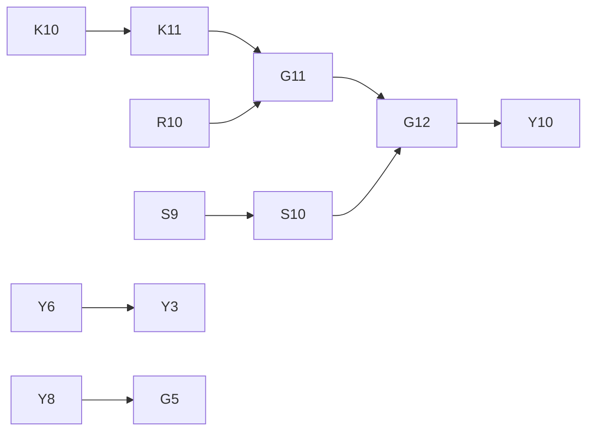

# Yusuf görevleri — inceleme ve uygulama rehberi

**İnceleme tarihi:** 15 Kasım 2026  
**İlk inceleme:** `8846819` · **Görev güncellemesi:** `872ccbd` (15 Kasım 2026)  
**Güncel durum:** Kullanıcı onayıyla Y5 mock paketi ve Y2/Y4'ün ilk bileşenleri uygulandı; doğrulama bekliyor. Güncel görev kapsamı Y1–Y10'dur. İlk teslim bölüm 15'te, yeni görevlerin ayrıntılı planı bölüm 16'dadır. Önceki öneriler güncel görev bağımlılıklarıyla birlikte okunmalıdır. Görev listesindeki durumlar değiştirilmedi.

Bu belge Yusuf'un görevlerini mevcut kodla karşılaştırır, veri sözleşmesindeki boşlukları ve uygulanacak sırayı açıklar. İlk aşamada inceleme ve dokümantasyon yapılmış, ardından kullanıcı onayıyla mock ve ilk bileşenler hazırlanmıştır. Bu güncellemede yalnız dokümantasyon değiştirilmiştir. Belgenin hazırlanması, aşağıdaki önerilerin uygulanmış veya ekipçe kararlaştırılmış olduğu anlamına gelmez.

## 1. Proje ne yapıyor?

PyroSync, MODIS ve VIIRS yangın/termal anomali tespitlerini Rust üzerinde işler; tekrarları azaltır, sensör ailelerini eşleştirir, FRP düzeltmesi ve aylık takvim üretir. React arayüzü ham ve harmonize sonuçları karşılaştırır. Bir tespit veya harmonize kayıt, bağımsız bir yangın olayının kesin sayısı değildir.

Mevcut hesaplama akışı:

```mermaid
flowchart LR
    F["FIRMS CSV / yerel ülke arşivi"] --> P["firms-client: ayrıştırma"]
    P --> D["core: interscan tekrar temizliği"]
    D --> L["MODIS ve VIIRS filo birleştirme"]
    L --> H["H3 ile aday bulma ve sensör eşleştirme"]
    H --> U["VIIRS öncelikli füzyon / MODIS VZA"]
    U --> C["Takvim / efor / belirsizlik"]
    U --> A["Axum API"]
    C --> A
    A --> S["services/api.ts: wire → UI"]
    S --> K["veri hook'ları / ortak durum"]
    K --> V["Grafik / harita / takvim / sayaç"]
```



`core` saf hesaplama katmanıdır; bilimsel harmonizasyon tarayıcıda yeniden yazılmamalıdır. Görsel gruplama, eksen hesabı ve tooltip hazırlığı frontend'de yapılabilir.

Güncel kaynak kodunda varsayılan sensörler arası eşleştirme 2 km / 180 dakikadır; MODIS filo penceresi 180, VIIRS filo penceresi 60 dakikadır. Etkin ayarlar `PipelineConfig` ve `/api/config` üzerinden gelir. Eski belgelerdeki 5 dakikalık örnekler güncel sözleşme değildir. `Matched`, eşzamanlı radyometrik kalibrasyon çifti anlamına gelmez. Kaynak: [harmonize.rs](../crates/core/src/harmonize.rs), [örnek yapılandırma](../pyrosync.example.toml).

## 2. Yusuf'un kesin görev kapsamı

Tek atama kaynağı [GOREVLER.md, Yusuf bölümü](../GOREVLER.md#yusufun-görevleri). `872ccbd` sürümünde Yusuf'un kapsamı 10 göreve çıkarıldı. `GOREVLER2.md` kaldırıldı; görevler tek dosyada birleştirildi. Bu rehber uygulama açıklamasıdır, ikinci bir görev listesi değildir; resmî durumlar yalnız `GOREVLER.md` üzerinde tutulur.

| Görev | İstenen çıktı | Görev listesindeki bağımlılık | İncelenen kodda durum |
|---|---|---|---|
| Y5 | 500–1000 hotspot; 2000–2025 aylık takvim; istatistik JSON; `index.ts` | Yok | 800 noktalı mock paketi üretildi; typecheck/2012 görsel kabulü ve tam Y5 şeması henüz doğrulanmadı. |
| Y1 | Aylık FRP grafiği, ham sensörler/harmonize seri, zoom, tooltip, legend | R1, Y5, S4 | `CliffChart` var fakat yıllık **tespit sayısı** çiziyor. Y1 tamamlanmış değil. |
| Y2 | Sensör sayım bar grafiği, eşleşme scatter'ı, kaynak donut'ı; en az iki tip | R1, Y5, S4 | `SensorComparison` bar/donut ilk sürümü yazıldı; test, gerçek bağlantı ve scatter bekliyor. |
| Y3 | Coğrafi grid yoğunluğu veya FRP toplamı, aylık slider, iki mod | R1, Y5, Y6 | Nokta haritası ve dairesel takvim var; bunlar coğrafi yoğunluk katmanı değil. |
| Y4 | En az dört özet kart; sayı, tekrar oranı, aktif sensör, ortalama FRP, güncelleme | R1, Y5 | `StatsCards` dört kart ilk sürümü yazıldı; test, ana ekran bağlantısı ve trend oku bekliyor. |

| Y6 | PCD/PCP, Mart–Şubat Fire-Year, MAD-SFAI, API çıktısı | Yok | Henüz uygulanmadı; Y3'ü açar. |
| Y7 | DBSCAN (2 km / en az 3 nokta), kesinti meta verisi | Yok | Henüz uygulanmadı; zaman/kapsam sözleşmesi gerekir. |
| Y9 | Hücre tanı modalı ve medyan geçiş saatinden drift şeridi | Yok (resmî) | Henüz uygulanmadı; R9/Y7 ve etkin kalibrasyon alanlarıyla teknik entegrasyon gerekir. |
| Y10 | Dört biyomda CCC ve omisyon/komisyon pilot raporu | G12 | Bekliyor; sentetik mock bu görevin kanıtı değildir. |
| Y8 | Amazon 2019–2021 + Hindistan WUI grafikleri ve sunum metinleri | Yok | Henüz uygulanmadı; kendi arşivi ve yardımcı veri kaynakları gerekir, G5'i açar. |

Görev listesinin durum işaretleri uygulamanın güncel halini tek başına kanıtlamaz. Örneğin R1–R5 için çalışan kod bulunuyor; başka görevlerde de listede bekliyor görünen parçaların bileşenleri mevcut. Bu belge hiçbir görevi kendiliğinden kapatmaz.

## 3. Mevcut frontend'e nasıl oturmalı?

| Kaynak | Yusuf için anlamı |
|---|---|
| [App.tsx](../web/src/App.tsx), [AppShell](../web/src/components/Layout/AppShell.tsx) | Slot tabanlı ana ekran; mevcut harita, grafik ve takvim korunarak yeni görünümün yeri belirlenmeli. |
| [CliffChart](../web/src/components/Charts/CliffChart.tsx) | Elle SVG, ResizeObserver, yıl seçimi, ortak geçiş. FRP grafiği için davranış örneği; FRP veri kaynağı değil. |
| [BurnCalendar](../web/src/components/Calendar/BurnCalendar.tsx) | Dairesel ay takvimi; Y3 ile karıştırılmamalı. |
| [HotspotMap](../web/src/components/Map/HotspotMap.tsx), [useMapModel](../web/src/components/Map/useMapModel.ts) | Three.js küre ve düz harita fallback'i; yeni katman iki yüzeyin davranışını gözetmeli. |
| [useRegionData](../web/src/hooks/useRegionData.ts) | Bölge, seri ve nokta cache'i; iptal ve eski istek koruması. |
| [useNrtData](../web/src/hooks/useNrtData.ts) | Bbox + son günler için ayrı canlı veri akışı. Arşiv dönemiyle aynı veri değildir. |
| [useAppStore](../web/src/store/useAppStore.ts) | `region`, `selectedMonth`, `calendarYear`, `mode`, `targetMode`, dil/tema. |
| [useHarmonizeTransition](../web/src/hooks/useHarmonizeTransition.ts) | Grafik geometrisi `geometryHarmonized`, sonuç metinleri `revealAnswer` ile eşlenir. |
| [copy.ts](../web/src/content/copy.ts), [format.ts](../web/src/lib/format.ts) | EN/TR metinler, UTC tarih, MW, sayı ve yüzde biçimi. |
| [tokens.css](../web/src/styles/tokens.css), [scales.ts](../web/src/lib/scales.ts) | CSS Modules, ortak renk/ölçü token'ları; FRP ve anomali farklı ölçekler. |

**Teknoloji uyuşmazlığı:** Y1 ve eski tasarım önerileri Recharts diyor. Ancak [web/CLAUDE.md](../web/CLAUDE.md) grafiklerin elle SVG olduğunu ve yeni grafik kütüphanesinin ekip kararı gerektirdiğini söylüyor; [package.json](../web/package.json) içinde Recharts yok. Öneri, mevcut SVG yaklaşımını sürdürmek ve Y1'in teknoloji maddesini ekipçe netleştirmek. Bu inceleme kapsamında paket eklenmedi.

MapLibre/deck.gl, TanStack Query ve eski `sample-data.ts` anlatımları mevcut uygulama tarifi olarak kullanılmamalı. Bugünkü harita Three.js + düz harita, veri cache'i ise özel hook'lardır. Yeni bir harita motoru kurmak Y3'ün ön şartı değildir.

## 4. Verinin gerçekten sundukları

Kaynaklar: [API adapter'ları](../web/src/services/api.ts), [frontend tipleri](../web/src/types/index.ts), [arşiv endpoint'leri](../crates/server/src/archive_api.rs), [diğer endpoint'ler](../crates/server/src/main.rs).

| Endpoint | Kullanım / mevcut alanlar | Yusuf için sınır |
|---|---|---|
| `/api/regions` | İndirilen ülke arşivlerinin bölgeleri/kapsaması | Türkiye–Akdeniz ve California gibi alt bölgeler hazır ülke kimliği sayılmamalı. |
| `/api/series?region=Turkey` | `years`, `months`, `cliff`, `coverage`, `filters`; aylık ham MODIS/VIIRS sayıları | Aylık FRP yok. `harmonized` kayıt sayısıdır; Ω-normalize sayım değildir. |
| `/api/points?region=Turkey&year=2023&month=8` | `raw`, `harmonized`, `stages`, `bbox`, `truncated`, `limit`, sunucuda `sample_every` | Varsayılan 4000, üst sınır 20000 ham satır; örnekleme olabilir. `stages` tam kümenin sayılarıdır. |
| `/api/calendar?country=Turkey&from=2000&to=2025` | Core takvim: FRP, normalize sayım, efor, belirsizlik, kapsam/uyarılar | `country` arşiv dosyasındaki ülke adıdır; parametre adı `/series` içindeki `region` ile farklıdır. Ham sensörlerin ayrı aylık FRP ortalamalarını vermez. |
| `/api/harmonize` | Bbox + gün/tarih aralığı; harmonize noktalar, takvim, isteğe bağlı ham noktalar | Tarihsel `/series` yerine kendiliğinden kullanılamaz; filtre ve dönem eşitliği gerekir. |
| `/api/compare` | Ham/harmonize sayılar ve FRP toplamları, kaynak sınıfları | Eski öneri belgesindeki `mapping` nesnesini döndüren endpoint değildir. |
| `/api/stats` | Platform kırılımı, harmonize FRP özeti, dönem ve kaynak raporu | Güncelleme zamanı sağlamaz; `last_detection` son gözlemdir. |

### 4.1 Uygulamadan önce bilinmesi gereken sözleşme sorunları

1. **FRP alan kaybı:** Backend `CalendarCell` içinde `total_frp`, `frp_per_detection_eq`, `mean_frp_lower/upper`, `total_frp_lower/upper` bulunuyor. Frontend `WireCalendarCell`, `CalendarCell` ve `adaptCalendarCell` bu alanları taşımıyor. Benzer şekilde nokta belirsizlik alanları UI tiplerine aktarılmıyor. Y1/K3 entegrasyonu için tip ve adapter genişletmesi gerekir.
2. **Sensör enum uyuşmazlığı:** Rust `Sensor` varsayılan Serde ile `ModisTerra`, `ModisAqua`, `ViirsSNPP`, `ViirsNOAA20`, `ViirsNOAA21` üretir. `adaptSensor` ise `MODIS_Terra`, `VIIRS_SNPP` gibi başka değerler bekliyor; tanımadığı değeri SNPP'ye düşürüyor. Bu statik incelemede görülen bir hata adayıdır; gerçek wire fixture testiyle doğrulanıp Y2/Y4 canlı bağlantısından önce düzeltilmeli. Mock, yanlış adapter'a uysun diye sunucunun üretmediği enum değerleri taşımamalı.
3. **Örnekleme bilgisi:** `/points` yanıtının `sample_every` alanı frontend'e aktarılmıyor. `truncated=true` iken noktaların uzunluğu, FRP ortalaması veya hücre sayısı tam bölgenin istatistiği değildir. Bir katsayıyla çarpmak örneklemenin yanlılığını otomatik düzeltmez.
4. **Yıllık/aylık fark:** `year_stats_with` her ayı ayrı, yıllık veriyi bütün yıl olarak harmonize eder. Ay sınırını aşan eşleşmeler nedeniyle aylık harmonize sayıların toplamı yıllık harmonize sayıya eşit olmak zorunda değildir. Testler yanlış eşitlik dayatmamalı.
5. **Arşiv filtresi:** `/series` ve `/points` ülke arşivi akışında `fire_type=0` ve bütün güven sınıfları kullanılır. NRT'nin veri kapsamı farklıdır. Aynı kart grubunda bunlar tek dönemmiş gibi birleştirilmemeli.
6. **Cache sürümü:** `/series` şeması veya hesaplaması değişirse [derived_cache.rs](../crates/server/src/derived_cache.rs) içindeki `DERIVED_SCHEMA_VERSION` ve türetilmiş cache geçerliliği ele alınmalı.

### 4.2 Bilimsel anlam: doğru etiket ve doğru payda

- `raw_total`: Girişteki tespit sayısı.
- `/series.harmonized`: Tekilleştirme/füzyon sonrası kayıt sayısı. Ω-normalizasyonu içerdiği varsayılmaz.
- Core `CalendarCell.count`: **Harmonize giriş dizisinin** aylık kayıt sayısı; ham MODIS+VIIRS toplamı değil.
- `count_normalized`: Efor katsayısına göre MODIS-eşdeğer sayım. `null` değeri sıfır değildir.
- `mean_frp`: Harmonize kayıtların düzeltilmiş FRP ortalaması; piksel boyutu farkından ötürü sensör geçişinde süreksiz olabilir.
- `mean_frp_raw`: Aynı harmonize kayıtların düzeltme öncesi FRP ortalaması. Bütün ham giriş tespitlerinin ortalaması değildir.
- `total_frp`: Aylık düzeltilmiş FRP toplamı; yapılandırma açıksa VIIRS içermeyen aylarda tamlık düzeltmesi uygulanır. Enerji (MWh) veya yanmış alan değildir.
- `frp_per_detection_eq`: `total_frp / count_normalized`; yerel piksel FRP ortalamasıyla aynı metrik değildir.

Bu ayrımlar [calendar.rs](../crates/core/src/calendar.rs) ve [models.rs](../crates/core/src/models.rs) hesaplarından gelir. Y1'de “harmonizasyon FRP uçurumunu mutlaka yok eder” kabulü bu kodla garanti edilemez. Görsel olarak çizgiyi düzleştirmek bilimsel doğrulama değildir.

2002-07 öncesi Terra-only aylar, sonraki dönemle birlikte hesaplandığında normalize değer/anomali alamayabilir. Kapsama dışı ay, gözlenmiş sıfır tespitli ay ve hesaplanamayan anomali ayrı gösterilmelidir. Core takvim yalnız tespit içeren aylardan hücre üretirken arşiv `/series` kapsanan sıfır aylarını da ekler; iki endpoint'in eksik hücre davranışı aynıdır denemez.

## 5. Y5 — önce veri sözleşmesi ve fixture

**Çıktı:** `web/src/mocks/hotspots.json`, `calendar.json`, `stats.json`, `index.ts`; ek olarak kısa bir fixture açıklaması önerilir. Bu dosyalar henüz oluşturulmadı.

Önerilen üretim adımları:

1. Önce hedef katmanı seç: API testi için sunucunun snake_case wire biçimi; bileşen için mevcut camelCase UI tipleri. Bunları tek dosyada karıştırma. JSON → tipli doğrulama/adapter → component zinciri kur.
2. Seed'i sabit, tekrar üretilebilir bir senaryo hazırla. 500–1000 ham nokta; kimlikler, `acquired` UTC, koordinatlar, güven, sensör ve `harmonizedId` ilişkileri tutarlı olsun. Ham tipte alan adı `date` değil `acquired`.
3. `Matched`, `ModisOnly`, `ViirsOnly`, interscan ile atılmış `null` bağlantı ve çok gözlemli kayıt örnekleri bulunsun. Aynı ham kaydı birden fazla çıktıya bağlama.
4. 2000–2025 dahil **26 × 12 = 312** aylık slot hazırla. Kapsama dışı slotlar eksik veri olarak işaretlensin. 2012 öncesi VIIRS yok; 2012 geçişi ve seçilen bölgeye uygun mevsimsellik açık olsun. Avustralya için kuzey yarımküre yaz şablonunu kopyalama.
5. 500–1000 noktalık harita örneğini 26 yıllık tam serinin bütün ham verisi gibi sunma. Ya takvim aynı ana sentetik veri setinden üretilsin ve harita bunun açıkça belirtilmiş alt kümesi olsun, ya iki fixture farklı kapsamlarını metadata'da taşısın.
6. FRP 1–500 MW aralığı Y5 senaryosunun sınırıdır; gerçek NASA verisine genel bir üst/alt sınır olarak uygulanmaz. Sıfır, eksik ve uç değerler ayrı sınır fixture'larında yer alsın.
7. Sentetik veri açıkça `synthetic`/demo olarak tanımlansın. Gerçek CSV'den üretilen örnek için kaynak, bölge, dönem, filtre, üretim sürümü ve sabit üretim zamanı kaydedilsin.

Önerilen metadata (mevcut API alanları değil): `schemaVersion`, `sourceKind`, `region`, `period`, `generatedAt`, `seed`, `pipelineVersion`, `sampled`. Otomatik canlı/demo fallback'i Y5'in değil **K1'in** sorumluluğudur; hata gelince gizlice mock döndürme.

Kontroller: `rawModis + rawViirs = rawTotal`; aynı kapsam için `ModisOnly + ViirsOnly + Matched = harmonizedCount`; bütün bağlantılar geçerli; ortalama/toplamlar doğru paydadan; sıfır paydada yüzde yok; tarih/sensör kombinasyonları tutarlı. JSON import'unda `as` ile zorla tip verme gerçek doğrulama sayılmaz; enum değerlerini de denetle.

## 6. Y1 — FRP zaman serisi

**Önce karar verilmesi gereken:** Görev “iki çizgi” derken ham MODIS ve VIIRS'i ayrı istiyor; bunlar harmonize seriyle birlikte üç seri eder. Öneri: iki mod, ham modda iki sensör çizgisi, harmonize modda bir sonuç çizgisi ve gerekirse ham referans. Bu yorum uygulama öncesi görev sahibince netleştirilmeli.

1. Mevcut yıllık sayım `CliffChart`'ını FRP diye yeniden etiketleme. Ayrı `FrpTimeSeries` görünümü veya grafik panelinde metrik seçimi tasarla; yerleşim için Can/Serhat ile slotu belirle.
2. X ekseni UTC ay, Y ekseni açık metrik adı + MW olsun. Kapsama sonunu veriden al; 2025 arşivini “bugüne kadar” diye uzatma.
3. Backend'den aynı bölge/dönem/filtre için ham MODIS FRP toplamı ve sayısı, ham VIIRS FRP toplamı ve sayısı, harmonize ortalama/toplam ve kapsam iste. `/series` genişletmesi önerilir; bu yeni sözleşmedir, mevcut alan sayılmaz.
4. Ayrı ham ortalamaları `rawModisFrpSum/rawModisCount` ve `rawViirsFrpSum/rawViirsCount` ile üret; sıfır sayıda `null`. Birleşik ham ortalama istenirse sensör ortalamalarının aritmetik ortalamasını alma; toplam FRP / toplam tespit kullan.
5. `mean_frp` ile eşdeğer `frp_per_detection_eq` ayrı isim ve açıklama taşısın. Eşdeğer metrik seçilirse görev kapsamındaki değişiklik kayda geçirilsin. Normalizasyonu JavaScript'te yeniden uydurma.
6. Zoom: başlangıç/bitiş ayı seçimi ve sıfırlama; tooltip: ay, sensör/metrik, değer, birim, kapsama. Eksik verilerde çizgi kopmalı; sıfıra düşürme veya boşluğun üzerinden kesintisiz çizme.
7. K3 için lower/upper alanlarını taşımaya uygun yapı bırak; bulunmayan güven aralığını `±%10` gibi sabitleme.

**Kabul:** Mock ile üç serinin sayısal doğruluğu, legend, tooltip ve zoom çalışır; null/kapsama boşlukları görünür; geçiş ortak saatle eşlenir; gerçek veriyle sonuç veri ne diyorsa onu gösterir. “2012 sıçraması yok oldu” iddiası ancak uygun metrikte ayrıca ölçülür. Y1'in bilimsel kabul maddesi Görkem/Samet ile netleşmeden başarı ilan edilmez.

## 7. Y2 — sensör karşılaştırmaları

**İlk teslim önerisi: bar + donut.** Görevdeki en az iki grafik şartını, mevcut veriyle en açık biçimde bunlar karşılar. Scatter ayrı bir aşamadır; bütün görev ayrıntıları isteniyorsa ertelenen scatter açıkça kaydedilir.

- **Bar:** `/series.months` üzerinden seçilen yıldaki aylık `rawModis`, `rawViirs`. Bu grafik ham sensör tespitlerini karşılaştırır; harmonize kayıtları zorla iki sensöre bölmez. İki modda aynı ham karşılaştırmanın gösterildiği etiketten anlaşılmalı.
- **Donut:** `/series.years` içindeki `modisOnly`, `viirsOnly`, `matched` üzerinden seçili yıl veya açıkça tanımlanmış bütün dönem. Payda harmonize kayıt sayısıdır. Aylık donut istenirse sunucudan aylık kaynak kırılımı gerekir; yıllık oranları aylıkmış gibi gösterme.
- **Scatter:** Harmonize noktadaki `frp` ile `frpCorrected`, MODIS/VIIRS çifti değildir. `/points.raw[].harmonizedId` ile gruplama mümkündür fakat bir grupta filo nedeniyle birden çok ham kayıt bulunabilir. Rastgele MODIS/VIIRS seçme veya tüm Kartezyen çiftleri bağımsız gözlem sayma. Tercih: backend'in açık çift/grup sözleşmesi üretmesi; X MODIS, Y VIIRS, her ikisi MW, zaman farkı ve temsilci/toplama kuralı görünür.

180 dakikalık olay eşleştirmesi eşzamanlı sensör doğrulaması olarak sunulmamalı. Örneklenmiş scatter'da örnekleme etiketi gerekir. Gerçek çift sözleşmesi olmadan scatter yalnız açıkça sentetik fixture üzerinde geliştirilir.

**Kabul:** En az iki grafik, doğru payda, sıfır toplamda boş durum, sensör/füzyon sınıfları için metin + şekil ayrımı, seçili kapsamın görünmesi, enum adapter testi. Harmonize kaynak oranları Raw açılışında `revealAnswer` kuralını delmemeli.

## 8. Y3 — coğrafi yoğunluk haritası

**Güncel ön koşul:** Özet tablo ve bağımlılık grafiğinde Y6 → Y3 var. Y3'ün ayrıntı başlığındaki `Bekler: R1, Y5` satırı Y6'yı henüz taşımıyor. Bu rehber daha kısıtlayıcı olan R1 + Y5 + Y6 sırasını esas alır; resmî görev metni bu güncellemede değiştirilmedi.

Y3, mevcut R3 dairesel takvimin yerine geçmez. Önerilen ilk sürüm mevcut harita panelinde ayrı yoğunluk görünümü; grid tipi olarak görevde izin verilen kare grid kullanılabilir. H3 hexbin seçilirse çözünürlük ve hücre alanı sözleşmesi ayrıca belirlenir.

1. Bölge ve ayı ortak store'dan al; slider değişiminde `selectMonth({year, month})` kullan. Bağımsız ikinci ay durumu kurma.
2. Hücre sınırları aynı bölge/dönem karşılaştırmasında sabit olsun. Ekran pikseline göre yeniden bölünen grid'i coğrafi yoğunlukmuş gibi sunma.
3. İlk metrik açıkça **hücre başına tespit sayısı** olsun. `tespit/km²` denilecekse gerçek hücre alanı hesaplanmalı; enlem-boylam kareleri eşit alan sayılmaz.
4. FRP seçeneğinde ham kayıtlar için `frp`, harmonize kayıtlar için `frpCorrected` toplanır. Bu toplam, core takvimdeki tamlık düzeltmeli `total_frp` ile her koşulda aynı değildir; etiket ayrımı gerekir.
5. Aynı karşılaştırmada Raw/Harmonized ve aylar aynı skala/eşiklerle çizilsin. Her kareyi kendi maksimumuna normalize etmek gerçek değişimi gizler. Nokta FRP eşiklerini hücre toplamlarına doğrudan kopyalama.
6. `truncated=true` için tam bölge yoğunluğu gösterme. Mock'ta bütün nokta kümesiyle geliştirme yapılabilir; gerçek veri için örnekleme öncesinde backend hücre agregasyonu önerilir. Alternatif yalnız “örneklenen noktaların dağılımı” etiketiyle sınırlı görünümdür.
7. Legend; metrik, birim, hücre boyutu, dönem ve örnekleme durumunu açıklasın. Mobil, WebGL olmayan düz harita, klavyeyle slider, hızlı ay değiştirmede eski isteğin sonucu ve bölge değişimi sınansın.

Mevcut `useYearPlayback` yıllar içindir; aylık oynatma hazır kabul edilmez. İlk teslimde manuel aylık slider yeterlidir. Oynatma eklenirse yıl oynatmasıyla aynı anda çalışmama ve kullanıcı tercihiyle başlama kuralı gerekir.

**Kabul:** Coğrafi grid, aylık slider, anlamlı ve sabit karşılaştırma skalası, iki mod, tam/örnek veri ayrımı; takvimle seçili ay tutarlılığı.

## 9. Y4 — istatistik kartları

Önce kart grubunun kapsamını seç: **seçili ay**, **seçili yıl** veya **tüm arşiv**. Öneri: analitik kartlar seçili ayı, mevcut üst sayaç kendi açıkça yazılı arşiv kapsamını korusun. Bütün arşiv sayımı ile son iki günlük NRT FRP'sini aynı özetmiş gibi yan yana koyma.

| Kart | Hesap / kaynak | Dikkat |
|---|---|---|
| Tespit / harmonize kayıt | Aynı kapsamın tam sunucu sayıları | Örneklenmiş nokta dizisinin uzunluğunu kullanma. |
| Elenen kayıt oranı | `(rawTotal - harmonizedTotal) / rawTotal` | Toplam azalma; yalnız interscan oranı denecekse `interscanRemoved/rawTotal`. Sıfır payda `—`. |
| Aktif platform sayısı | O dönemde veri katkısı bulunan platformlar | MODIS/VIIRS iki aile, Terra/Aqua/SNPP/NOAA farklı platformlar. Arşivde sabit 5 yazma. |
| Ortalama FRP | Hamda tüm ham FRP toplamı/ham sayı; harmonized'da düzeltilmiş toplam/harmonize sayı | `meanFrpRaw` bu ham paydanın yerine geçmez. Eksik arşiv alanları için backend agregasyonu gerekir. |
| Veri zamanı | Kaynak üretim zamanı varsa o; yoksa ayrı etiketli istemci alma zamanı | `last_detection` yalnız “son gözlem” diye gösterilir. Render sırasında `now` üretme. |

Görev en az dört kart istiyor; son güncelleme ayrı metadata satırı olabilir. Aktif platform sayısı veya veri zamanı mod değişince mutlaka değişmez; yalnız anlamı değişen sayılar geçiş yapmalı.

Trend oku için karşılaştırılan dönem ve metrik açık olmalı. Öneri: tam kapsanan ayın bir önceki yıl aynı ayına göre değişimi; eksik karşılaştırma veya sıfır tabanda ok/yüzde üretme. Sparkline aynı metrikten ve aynı veri kaynağından gelsin; dekoratif rastgele seri kullanma. Arşivde FRP/aktif platform alanları yokken hayali değer yerine eksik veri durumu göster.

`CountDelta`/`Receipt` aynı sayıları zaten gösterdiğinden paralel hesaplama kurma. Ortak veri seçicisi/hesap yardımcısı önerilir. Raw modda harmonize cevap ve elenen oran, mevcut `revealAnswer` davranışına uyar.

**Kabul:** En az dört kart, aynı kapsam, doğru oran/birim/yuvarlama, sıfır ve eksik veri davranışı; modda anlamlı değişim; tarih etiketinin gerçeği söylemesi; gerçek zaman serisi varsa trend/sparkline.

## 10. Uygulama sırası ve ekipten gerekenler

| Sıra | İş | Tamamlanma kapısı |
|---|---|---|
| 0 | Bu belgedeki teknoloji, FRP metriği, kapsam ve yerleşim kararları | Y1'in ölçümü ve veri sözleşmesi belirsiz kalmamalı. |
| 1 | Y5 fixture ve tip doğrulama | Deterministik veri; kapsama, enum ve toplam kontrolleri. |
| 2 | Y4 kartlar ve Y2 bar/donut için mock geliştirme | Ana ekranı bozmayan yerleşim; ortak state/çeviri/geçiş. |
| 3 | Y1 FRP çizimi | Mock görünümü ayrı; gerçek bağlantı için S4 ve FRP API alanları. |
| 4 | Y3 grid + ay seçimi | Önce Y6; tam mock ile doğrulama, gerçek yoğunluk için tam agregasyon. |
| 5 | Gerçek veri, scatter ve bütünleşik kabul | S4, enum/adapter düzeltmeleri, aynı kapsam ve test kanıtı. |

Bu tablo ilk paketin sırasıdır; bütün Y1–Y10 sırası bölüm 16'dadır. Görev listesindeki Y1/Y2 için S4, Y3 için Y6 bağımlılığı korunur. S4 beklenirken yapılabilecek mock prototipi gerçek veriyle görev kapanışı değildir.

- **Görkem:** Aylık ham/harmonize FRP agregatları; aylık kaynak/platform sayıları; gerekirse grid ve eşleşme çiftleri; `/series` ile Ω takviminin farkının korunması; cache sürümü.
- **Samet:** S4'ün üç bölgeli, aynı dönem ve filtreli CSV + harmonize JSON teslimi; kaynak/üretim bilgisi; gerçek veri regresyon kontrolleri. 2020–2025 veri 2012 öncesini göstermediğinden cliff doğrulaması için ayrıca geçişi kapsayan arşiv gerekir.
- **Serhat:** Panel/slot entegrasyonu, API tipleri/adapter'ları, ortak store ve URL davranışı.
- **Can:** Y1 metrik seçimi, Y2 görünümü, Y3 legend, Y4 yerleşimi; mevcut tasarım belgelerindeki çelişkilerin çözümü.
- **Sadık:** K1 demo seçimi; K3 belirsizlik bandı; K4 ortak erişilebilir palet. Yusuf bunları bağımsız ikinci sistem olarak kurmamalı.

Önerilen yeni dosyalar: `mocks/*`, `components/Charts/FrpTimeSeries.tsx`, `SensorComparison.tsx`, `components/Stats/StatsCards.tsx`, `components/Map/DensityLayer.tsx` ve bunların CSS Modules dosyaları. Bunlar plan adlarıdır; henüz dosya oluşturulmadı. Paylaşılan hesaplar ihtiyaç oldukça `lib/` altında tutulur.

## 11. Doğrulama planı

Bu incelemede uygulama çalıştırılmadı, bağımlılık kurulmadı, test/build çalıştırılmadı, veri indirilmedi. Aşağıdakiler sonraki uygulama aşamasının komutlarıdır.

Frontend bağımlılıkları kurulduktan sonra `web/` dizininde:

```sh
npm run typecheck
npm test
npm run build
```

`npm run build` yalnız Vite build'idir; typecheck'in yerine geçmez. `make test` backend testlerini ve frontend build'ini çağırır, frontend `npm test` veya `typecheck` komutunu çağırmaz. Test altyapısı `node:test`/assert ve esbuild üzerinden çalışır; yeni framework ön şart değildir. Kaynak: [package.json](../web/package.json), [Makefile](../Makefile), [charts-link.test.ts](../web/tests/charts-link.test.ts).

Backend sözleşmesi değişirse kök dizinde:

```sh
cargo test -p pyrosync-core
cargo test -p pyrosync-server
cargo test --workspace
```

Anlamlı test senaryoları:

- Rust wire enum'ları frontend'de doğru sensöre dönüşüyor; bilinmeyen sensör sessizce SNPP olmuyor.
- Ağırlıklı FRP ortalaması, yüzde paydası, null/zero ayrımı ve UTC ay sınırı doğru.
- Sampled `/points` verisi tam bölge kart/yoğunluk hesabında kullanılmıyor.
- Gerçek ay/yıl harmonizasyon farkına yanlış eşitlik dayatılmıyor.
- Ay/bölge değişiminde eski sonuç yeni seçimi ezmiyor; `selectedMonth` bütün görünümlerde aynı.
- Raw görünüm, tooltip ve erişilebilir metinlerde erken harmonize sonuç göstermiyor.
- 375 px mobil ve 1366×768 masaüstünde okunabilirlik; klavye, dokunma, EN/TR, dark/light, reduced-motion, boş/hata/yükleniyor durumları.

Görev kapatma kanıtı: kullanılan fixture sürümü, komut sonuçları, doğrulanan metrik/kapsam, bilinen eksikler ve gerçek veri örneği. Dokümandaki tarihsel test sayılarını bu oturumda yeniden geçmiş gibi raporlama.

## 12. Okunan kaynaklar ve erişim sınırları

### Yerel inceleme

Görev belgeleri, README, kök ve modül `CLAUDE.md` dosyaları; `docs/` altındaki mimari, UI/UX konsepti, tasarım konsepti/sistemi, frontend önerisi, UX yazım ve referans analizi incelendi. Yusuf'un veri akışı için frontend tipleri/adapter'ları, store, veri hook'ları, grafik/takvim/harita girişleri, sayaç/fiş, format/ölçek yardımcıları ve ilgili testler okundu. Backend'de endpoint şemaları, seri/nokta agregasyonu, örnekleme, modeller, harmonizasyon, takvim, efor/VZA ile ilgili bölümler ve yapılandırma/cache sözleşmesi incelendi. Bu bir bütün depo satır satır kod denetimi veya bütün bilimsel sonuçların yeniden üretimi değildir.

Özellikle karşılaştırılması gereken eski bilgiler:

| Belge iddiası | Bu checkout'taki karşılığı |
|---|---|
| `docs/MIMARI.md`: 5 dk eşleştirme, sınırlı endpoint listesi | Kodda 180 dk ve ek arşiv/istatistik endpoint'leri var. |
| Tasarım/README: `web/src/mocks/sample-data.ts` vb. | `web/src/mocks/` bulunmuyor. Eski örnek sayılar kullanılabilir veri seti değil. |
| Frontend önerisi: Recharts, deck.gl, TanStack Query | Paketler kurulu değil; mevcut SVG/Three.js/özel cache yapısı farklı. |
| Tasarım: 27 yıllık takvim | Y5'in 2000–2025 aralığı 26 yıl; mevcut arşiv matrisi 2025'te bitiyor. |
| Referans analizi: VZA bölme ve eski kalibrasyon katsayıları | Kodda çarpma ve hücre toplamında yeni tamlık yaklaşımı var; analizdeki “şu an” ifadeleri tarihsel. |
| README: paketlenmiş `data/derived` | Güncelleme sonrası `data/derived/series` mevcut; FRP, olay, kesinti veya Y6 metrikleri içerdiği varsayılmaz. |

Yerel örneklerin içerik envanteri:

| Dosya (`data/sample/`) | Satır | Gözlem tarih aralığı |
|---|---:|---|
| `modis_nrt.csv` | 532 | 2026-11-13 — 2026-11-14 |
| `viirs_noaa20_nrt.csv` | 1477 | 2026-11-13 — 2026-11-14 |
| `viirs_snpp_nrt.csv` | 982 | 2026-11-01 — 2026-11-02 |
| `modis_sp.csv` | 48 | 2023-08-01 — 2023-08-03 |
| `viirs_snpp_sp.csv` | 358 | 2023-08-01 — 2023-08-03 |

NRT örneklerinin dönemleri aynı değil; doğrudan eşleşme/scatter verisi sayılmazlar. Bu beş CSV, S4'ün üç bölge/çok yıl/harmonize JSON şartını karşılamıyor. `tools/fetch-sample.sh` son iki günü indirir; çok yıllı S4 pipeline'ı değildir ve bu incelemede çalıştırılmadı.

İlk incelemede `STRATEGY.md`, `CHALLENGE_INFO.md`, `academic-papers/`, `reference-projects/`, `docs/API.md`, `docs/REFERENCES.md`, `.cache/firms-archive`, `data/derived` bulunmamıştı. Güncellemeden sonra `docs/API.md`, `SETUP.md`, CI dosyası ve `data/derived/series` mevcut; önceki eksiklik kaydı bunlar için artık geçerli değildir. S3 ve S6 görevleri resmî listede tamamlanmış; test sonuçları bu oturumda yeniden üretilmemiştir. Yeni API referansının son doğrulama sürümü `8846819` olarak kayıtlıdır; uygulama ayrıntılarında kaynak kodla birlikte okunmalıdır. Dolayısıyla referans analizinde sözü edilen 32 makalenin ve altı projenin asılları burada okunmuş sayılmaz. Arşiv matrisi ve checksum manifestinin bulunması arşiv verisinin indirildiğini kanıtlamaz. Tam arşiv indirmesi Y5 için zorunlu değildir; README yaklaşık 9 GB indirme / 41 GB disk bildiriyor.

### Dış kaynak doğrulaması

15 Kasım 2026 tarihinde açılan resmî kaynaklar:

- [NASA FIRMS MODIS alan açıklamaları](https://firms.modaps.eosdis.nasa.gov/content/descriptions/FIRMS_MODIS_Firehotspots.html): FRP MW cinsindedir; acquisition time UTC'dir; MODIS güven alanı 0–100 değerler taşır. Nokta piksel merkezidir; kesin olay konumu/sayısı olarak yorumlanmaz.
- [NASA FIRMS VIIRS alan açıklamaları](https://firms.modaps.eosdis.nasa.gov/content/descriptions/FIRMS_VIIRS_Firehotspots.html): 375 m ürün, `l/n/h` güven değerleri ve FRP anlamı. Bu, firms-client CLAUDE dosyasındaki ters güven-formatı anlatımının uygulanmaması gerektiğini destekler; parser ve örnek sütunlar esas alınmalı.
- [NASA FIRMS Area API](https://firms.modaps.eosdis.nasa.gov/api/area): bbox sırası `west,south,east,north`, istek başına gün aralığı 1–5, ürün erişimi için availability kontrolü. Yıllarca veriyi tek bir `days` parametresiyle isteme yaklaşımı doğru değildir.

Ürün erişim başlangıçları ve bitişleri arşiv, NRT ve platforma göre değişebilir. Projedeki 2012/2018/2023 anlatısını bütün ürünlerin kesin kapsaması olarak kodlama; yerel arşiv `coverage` ve canlı `/api/availability` sonuçlarını kullan.

## 13. Başlama kararı

Projenin Yusuf görevlerine ilişkin ana mimarisi ve mevcut kodun sunduğu veriler, uygulanabilir bir plan hazırlayacak düzeyde anlaşıldı. Buna karşılık Y1'in bilimsel metriği, yeni panellerin yerleşimi, gerçek veri agregasyonları ve S4 teslimi henüz kesinleşmiş değil. Bunlar açık karar/bağımlılık olarak yukarıda listelendi; varsayımla kapatılmadı.

Bu aşamanın teslimi yalnız bu belgedir. Uygulama başlatılmadı; kod, bağımlılıklar, yapılandırma ve görev işaretleri değiştirilmedi. Sonraki geliştirmede önce Y5 sözleşmesi, ardından ilgili karar ve bağımlılıkları çözülmüş görevler ele alınmalıdır.

## 14. Backend beklemeden yapılacak paket — kullanıcı onayı öncesi öneri

**15 Kasım 2026, ikinci inceleme:** Kullanıcı mock üretiminden önce kendisine sorulmasını ve testlerin sonraya bırakılmasını istedi. Bu bölüm hazırlanırken mock veya uygulama kodu oluşturulmadı. Aşağıdaki paket onaya sunulan somut kapsamdır.

### 14.1 Şimdi yapılabilir olanlar

| İş | Backend olmadan hazırlanabilir çıktı | Sonraya kalan |
|---|---|---|
| Y5 | Deterministik JSON, tipli export, veri kaynağı/kapsam açıklaması | Test ve typecheck kanıtı; gerçek veri doğrulaması |
| Y2 | Props ile beslenen aylık sensör bar grafiği + kaynak donut'ı | S4 gerçek veri bağlantısı; scatter çift sözleşmesi |
| Y4 | Props ile beslenen dört kart: sayı, elenen oran, platform, FRP; veri zamanı satırı | Arşiv API agregatları ve gerçek güncelleme metadata'sı |
| Y1 | Aylık FRP çizimi, tooltip/legend/zoom için sentetik prototip | Bilimsel metrik kararı ve gerçek FRP serisi |
| Y3 | Tam sentetik noktalardan coğrafi kare grid ve ay slider'ı | Büyük gerçek veri için örnekleme öncesi agregasyon |

Önerilen ilk uygulama kapsamı **Y5 → Y2 bar/donut → Y4 kartlar**. Y1 ve Y3 yapılabilir, ancak ilk paketin zorunlu parçası değildir. Testlerin ertelenmesi veri sözleşmesi boşluklarını ortadan kaldırmaz; tamamlanan kod parçaları “uygulandı, doğrulama bekliyor” olarak kaydedilir. Y1–Y5 görevleri test ve bağımlılıkları bitmeden tamamlandı işaretlenmez.

### 14.2 Mock formatı: ilk paket için net seçim

**Katman:** HTTP cevabı taklidi yerine frontend bileşen verisi. JSON anahtarları mevcut UI tipleri gibi **camelCase** olacak. Yeni bileşenler veriyi props ile alacak; mock'u component içinde import etmeyecek. Bir geliştirme önizlemesi mock'u bu props'lara bağlayacak. Ana uygulamanın mevcut canlı/arşiv veri akışı mock'a çevrilmeyecek; otomatik fallback K1 kapsamında kalacak.

`tsconfig.json` zaten `resolveJsonModule: true` kullanıyor. JSON import desteği var; tek başına bu ayar JSON içeriğinin enum'lara ve bütün sözleşmeye uyduğunu kanıtlamaz. `index.ts` açık alan/enum dönüştürmesiyle tipli export yapmalı; bütün nesneyi `as SomeType` ile zorlamamalı.

| Dosya | Önerilen yapı | Mevcut tipe bağlantı |
|---|---|---|
| `metadata.json` | `schemaVersion`, `sourceKind: "synthetic"`, sabit `seed`, `generatedAt`, bölge ve kapsam açıklamaları | Yeni, yalnız fixture metadata'sı; API'ye aitmiş gibi gösterilmez. |
| `hotspots.json` | `region`, `year`, `month: null`, `truncated: false`, `limit`, `raw`, `harmonized`, `stages`, `bbox` | `PointsResponse`; 2021 yılına dağıtılmış 800 ham nokta. |
| `calendar.json` | `region`, `filters`, `years`, `months`, `cliff`, `coverage` | `SeriesResponse`; 2000–2025 için 312 aylık slotun kapsama davranışı. |
| `stats.json` | `scope`, ham/harmonize sayılar ve FRP toplamları, kaynak/platform kırılımı, sabit veri zamanı | Yeni `MockStatsSnapshot`; `/api/stats` cevabı olduğu iddia edilmez. |
| `index.ts` | Tipli veri export'ları ve kontrollü JSON dönüştürmesi | `PointsResponse`, `SeriesResponse`, `Sensor`, `Confidence`, `DayNight`, `HotspotSource` kullanılır. |
| `README.md` | Üretim yöntemi, kapsam, sınırlamalar, yeniden üretim yolu | Sentetik veri gerçek NASA ölçümü olarak sunulmaz. |

Yeni `MockStatsSnapshot` yalnız mock sınırında tutulur; kartlar genel bir görüntüleme modeli alır. Sonradan gerçek API adapter'ı aynı modeli üretebilir. `calendar.json` dosya adı görevden gelir, içeriği mevcut arşiv seri modeli olur: `CalendarApiResponse` veya core `CalendarCell` ile aynı şey değildir.

**800 nokta ile 26 yıllık seri ilişkisi:** Noktalar Türkiye için 2021 yılının tam sentetik detay kümesidir. 2021 aylık sayıları, kaynak dağılımı ve kartlar bu noktalar/bağlantılardan üretilir. Diğer yıllar seed ile üretilen sentetik özet seridir; o yıllara ait ayrıntılı noktalar bulunduğu iddia edilmez. 2021 dışındaki nokta detayları kullanılamaz olarak gösterilir. 2021 noktalarını seçilen başka yıla yeniden etiketlemek yasaktır.

2021 detay senaryosunda ay sınırını aşan eşleşme üretilmeyerek aylık/yıllık fixture toplamları tutarlı tutulabilir. Bu fixture kolaylığı gerçek backend için genel eşitlik kuralı değildir. Aylık kartlar seçilen ayın detayından türetilir; bütün yıl snapshot'ı aylıkmış gibi kullanılmaz.

### 14.3 Alan örnekleri

Aşağıdaki yalnız **bir ham noktanın biçim örneğidir**; dosya veya üretilmiş veri seti değildir:

```json
{
  "id": "tr-2021-raw-0001",
  "lat": 36.9,
  "lon": 30.7,
  "sensor": "MODIS",
  "frp": 42.5,
  "confidence": "High",
  "acquired": "2021-08-01T10:00:00Z",
  "daynight": "Day",
  "harmonizedId": "tr-2021-harm-0001"
}
```

- Ham harita `sensor` alanı aileyi belirtir: `MODIS | VIIRS`. Platform gerekiyorsa nokta kimliğine bağlı ayrı fixture platform tablosu (`ModisTerra | ModisAqua | ViirsSNPP | ViirsNOAA20`) tutulur; `RawPoint`'in mevcut aile alanı değiştirilmez. Aktif platform sayısı bu tablodan hesaplanabilir.
- Harmonize nokta aynı kimlik/kapsam düzenini izler; ek alanları `frpCorrected`, `source`, `vzaFactor`, `nObs`, `platforms` olur. `source`: `ModisOnly | ViirsOnly | Matched`.
- `harmonizedId: null` bu senaryoda interscan temizliğiyle çıkarılmış kaydı ifade eder; eksik çıktı kimliğiyle karıştırılmaz.
- `SeriesResponse.months` satırı: `year`, `month`, `rawModis`, `rawViirs`, `rawTotal`, `harmonized`, `anomalyRaw`, `anomalyHarmonized`. Aylar 1–12; zaman UTC; sayılar sayı tipinde; eksikler `null`, asla `"—"` string'i değil.
- Kapsama dışı aylar wire-benzeri seri dizisinde gözlenmiş sıfır gibi üretilmez. 312 slotluk UI takvimi mevcut `MonthCell.hasData` yaklaşımıyla tamamlanır. Fixture metadata'sı hangi ayların kapsandığını belirtir.
- FRP zaman serisi ilk paketin dışında. Y1'e geçildiğinde ayrı, açıkça öneri niteliğinde bir `FrpMonthlyPoint` modeli gerekir; mevcut `SeriesMonth` içinde FRP varmış gibi davranılmaz.

### 14.4 Üretimde korunacak sayısal kurallar

- Aynı kapsam için `rawModis + rawViirs = rawTotal`.
- Fixture bağlantıları için `rawTotal - interscanRemoved - fleetMerged - matchedPairs = harmonizedCount`.
- `modisOnly + viirsOnly + matched = harmonizedCount`.
- Ham FRP ortalaması bütün ham kayıtların toplamı / ham sayı; harmonize ortalama düzeltilmiş toplam / harmonize sayı.
- Kart görüntüleme modelindeki elenen oran **0–1 oranıdır**; yüzde biçimlendirme bunu yapar. Mevcut API'nin `removedPct` gibi 0–100 alanlarıyla karıştırılmaz.
- Her rastgele seçim aynı seed ile aynı çıktıyı vermeli; render sırasında rastgelelik veya güncel zaman üretimi yapılmamalı.
- Sentetik harmonize bağlantı ve değerler bir görsel geliştirme senaryosudur; Rust pipeline'ının hesapladığı bilimsel çıktı olarak etiketlenmez. Gerçek pipeline fixture'ı daha sonra ayrı kaynak bilgisiyle eklenir.

### 14.5 Kullanıcı onayına sunulan iş

Türkiye için 800 ham noktalı 2021 detay senaryosu, 2000–2025 sentetik özet seri, bunlarla tutarlı istatistikler ve tipli export hazırlanması; ardından mevcut SVG/CSS Modules yaklaşımıyla Y2 bar/donut ve Y4 kartlarının açık demo etiketli geliştirme önizlemesinde uygulanması önerilir. Yeni grafik kütüphanesi gerekmiyor.

Test, typecheck/build ve tarayıcı doğrulaması kullanıcı isteğiyle sonraki aşamaya bırakılır. İleride çalıştırılacak kontroller bölüm 11'de tutulur; bu pakette başarıyla çalıştırıldıkları söylenmez. Üretime başlamanın beklemesinin nedeni kullanıcının açıkça “mock veriyi bana sorup başla” demesidir.

## 15. Onay sonrası ilk uygulama teslimi

Kullanıcı “başlayalım verdiğin sırayla” diyerek 14. bölümdeki paketi onayladı.

- **Y5:** [Üretici](../web/scripts/generate-mocks.mjs) ve [mock paketi](../web/src/mocks/README.md) eklendi. Üretici çalıştırılarak 800 ham / 500 harmonize sentetik nokta, platform tablosu, aylık/yıllık seri ve tutarlı 2021 istatistik JSON'ları yazıldı. `index.ts` mevcut UI tiplerine açık enum dönüşümleriyle export sağlar.
- **Y2 kısmi:** [SensorComparison](../web/src/components/Charts/SensorComparison.tsx) aylık ham MODIS/VIIRS bar grafiği ve harmonize kaynak donut'ı içerir. Sayısal tablolar eklenmiştir. Scatter ve gerçek API bağlantısı yapılmadı.
- **Y4 kısmi:** [StatsCards](../web/src/components/Stats/StatsCards.tsx) sayı, elenen oran, platform sayısı ve ortalama FRP için dört kart; 2021 aylık mini grafikler; sabit fixture üretim zamanı içerir. Uygun karşılaştırma verisi bulunmadığından trend okları eklenmedi.
- **Entegrasyon:** Ayrı Vite geliştirme girişi [mock.html](../web/mock.html) oluşturuldu. EN/TR, tema, ay seçimi ve ortak Raw/Harmonized saati kullanılır. Varsayılan uygulama akışı değiştirilmedi. Ana ekran yerleşimi/gerçek API bağlantısı sonraki aşamadır.

**Doğrulama:** Test, typecheck, build ve tarayıcı doğrulaması kullanıcı isteğiyle çalıştırılmadı. Üreticinin tamamlanması frontend'in derlendiğinin veya çizildiğinin kanıtı değildir. Görevler tamamlandı işaretlenmedi.

**Tarihsel Git erişim kaydı (artık çözülmüş):** İlk uygulama aşamasında `git pull --ff-only` denendi. İlk deneme korumalı `.git/FETCH_HEAD` nedeniyle, izinli deneme ise GitHub HTTPS kimlik doğrulaması (`could not read Username`) nedeniyle tamamlanamadı. O aşamada yeni uzak görevler okunamadı. Kullanıcı daha sonra güncellemeyi aldı; `872ccbd` görevleri okunup bölüm 16 ile bu teslimle karşılaştırıldı. Yerel değişiklikler korunmuştur; commit/push yapılmamıştır.

## 16. Yeni görevler için güncel uygulama planı (`872ccbd`)

Görev dosyasındaki Yusuf sırası **Y5, Y6, Y7, Y1, Y2, Y3, Y4, Y9, Y10, Y8**. Resmî özet Yusuf için 10 açık görev gösteriyor. Yereldeki mock ve bileşen taslakları, bunların kabul koşullarının sağlandığı anlamına gelmez. Kullanıcının testleri erteleme tercihi devam ediyor; test zorunlu kabul maddeleri kaldırılmıyor, doğrulama borcu olarak tutuluyor.

### 16.1 Önceki teslimin yeni kapsamla farkı

- **Y5:** Veri üretildi ancak görevdeki `calendar.json` açıklaması `mean_frp` de istiyor. Mevcut dosya sayım odaklı `SeriesResponse` biçiminde ve FRP içermiyor. Y5 kapanmadan bu fark açık bir FRP takvim fixture'ı/sözleşmesiyle giderilmeli; yalnız dosya adının doğru olması yeterli değil. 2012 sıçraması ve TypeScript import'u henüz çalıştırılarak doğrulanmadı.
- **Y2/Y4:** Önceden yazılan bileşenler korunur; önizleme düzeyinde kısmi uygulamadır. Yeni görevler nedeniyle otomatik tamamlandı sayılmaz veya yeniden baştan yazılmaz.
- **Y3:** Y6 bitmeden görev kapatılmaz. Prototip için geometrik grid hazırlanabilse bile resmî ön koşul beklenir.
- **Y1:** Görevde native-pixel FRP ortalaması istenirken yeni **R9**, `mean_frp`'nin manşetten indirilmesini ve `total_frp`/`frp_per_detection_eq` kullanılmasını açıkça istiyor. Y1 metriği R9 ve G11 süreklilik ölçümüyle uzlaştırılmalı; “harmonize çizgi mutlaka düzleşir” kabulü sentetik çizgiyle kanıtlanmamalı.

### 16.2 Y6 — takvim analitiği

**Resmî çıktı:** `calendar.rs` içinde PCD/PCP, opsiyonel Mart–Şubat Fire-Year ve MAD-tabanlı SFAI; birim testleri ve API çıktısı. **Ön koşul yok; Y3'ü açar.**

Önerilen uygulama adımları:

1. Önce `[30, Denklem 1–2]`, `[21]` ve `flare-chronos` algoritmasının asılları bulunup tanımlar doğrulanmalı. Mevcut referans analizi yönlendiricidir; bu güncellemede asıl makaleler yeniden okunmuş değildir. PCD/PCP ve SFAI formülü tahminle uygulanmamalı.
2. Girdi metriği açık seçilmeli: ham sayı, harmonize kayıt veya normalize sayım birbirinin yerine geçmez. Yıl kapsamı ve kullanılan metrik sonuç metadata'sında taşınmalı.
3. Takvim yılı ve Fire-Year etiketleme kuralı tanımlanmalı: örneğin “2021 Fire-Year = Mart 2021–Şubat 2022” bir öneridir, uygulanmış sözleşme değildir. Ay fazının referansı, PCP'nin ay/tarih dönüşümü ve mevsimlik sınır davranışı kaynak tanımıyla birlikte belirlenmeli.
4. Sıfır toplam, eşit aylık dağılım, iki tepe, eksik ay, yetersiz geçmiş ve sıfır MAD durumlarında `null`/kalite bayrağı davranışı kararlaştırılmalı. Eksik ayı sıfırla doldurmak mevsimsellik sonucunu değiştirir.
5. Saf Rust hesap fonksiyonları `core` içinde; yıl/gruplama seçimi ve JSON sözleşmesi `server` içinde kalmalı. `models.rs` alanları, `lib.rs` export'ları, API referansı ve gerekiyorsa derived cache sürümü birlikte ele alınmalı.

**Önerilen sözleşme, henüz mevcut değil:** yıl/gruplama/metrik bilgisiyle yıllık `pcd`/`pcp`; ay bazında `sfai`; kapsam/hesaplanamama nedeni. Alan adları ve birimleri kodlamadan önce sabitlenmeli. `/series` ile `/calendar` farklı üretim yolları olduğundan birine alan eklemek diğerini otomatik güncellemez.

**Sonraki test aşaması:** Tek tepe, Aralık–Ocak sınırı, Fire-Year sınırı, sabit seri, sıfır MAD, eksik kapsam, eski API alanlarının korunması. Core public fonksiyonlarının test zorunluluğu geçerlidir.

### 16.3 Y7 — DBSCAN olayları ve kesinti şeffaflığı

**Resmî çıktı:** 2 km / en az 3 nokta DBSCAN kümelemesi ve API'de `no_detection_days`; testlerle doğrulama. **Ön koşul yok.**

- Girdi tam veri olmalı; `/points` örneği üzerinden bölgenin olay sayısı hesaplanmamalı. Ham ve harmonize sonuçlar karşılaştırılacaksa iki kümenin kapsamı/filtreleri aynı olmalı.
- Görev uzamsal eşiği veriyor ama **zaman penceresini vermiyor**. Farklı yıllardaki aynı konumu tek yangın olayı yapmamak için gün/geçiş/zaman penceresi ve kümeleme girdisinin ham mı harmonize mi olduğu önce tanımlanmalı. Haversine mesafesi, sınırdaki nokta ataması, gürültü kayıtları ve kararlı olay kimlikleri sözleşmede yer almalı.
- `no_detection_days` tek başına kesintinin kanıtı değildir. Başarılı kapsama + sıfır tespit, kaynağın alınamaması, doğrulanmış uydu kesintisi ve bilinmeyen kapsama ayrı nedenlerle raporlanmalı. Sadece CSV'de kayıt yok diye “sensör kesintisi” yazılmamalı.
- **K12** tarihsel kesinti/erken dönem etiketlerini de kapsıyor. Yusuf günlük API ayrımını ve olayları, Sadık tarihsel efor/kurtarma metadata'sını ortak şemaya bağlamalı; iki ayrı çelişen kesinti takvimi tutulmamalı.

**Önerilen sözleşme, henüz mevcut değil:** olay kimliği, üye sayısı, başlangıç/bitiş UTC, bbox/merkez ve gürültü durumu; günlük sensör/kapsama/neden kayıtları. Mevcut `warnings` ve `report.uncovered` yardımcı olabilir ama günlük gözlem kapsamının yerine geçtiği varsayılmaz.

**Sonraki test aşaması:** 2 km sınırı, iki/üç nokta eşiği, uzamsal zincir, farklı günlerde aynı konum, örnekleme, gerçek sıfır/eksik veri ayrımı ve JSON entegrasyonu.

### 16.4 Y9 — hücre tanı modalı ve orbital drift

**Resmî çıktı:** Ay hücresine tıklayınca sensör kırılımı, Ω, k_c, FRP belirsizlik aralığı ve kesinti/anomali bayrakları; gözlenen geçiş saati medyanlarından beslenen drift şeridi. **Resmî ön koşul yok.** Teknik veri ihtiyaçları şunlardır:

1. R9'un takvim alanları/adapter'ları ve K3 belirsizlik görünümüyle aynı sözleşme kullanılmalı. Mevcut `SeriesMonth` Ω/k_c/FRP bandı taşımadığı için sadece takvim hücresine erişmek yeterli değil.
2. k_c etkin yapılandırma, enlem ve ayın VIIRS varlığıyla ilişkilidir. Bir ülkenin tek sabit katsayısıymış gibi gösterilmemeli. K14 ile biyom tablosuna geçilince yöntem metadata'sı güncellenebilir olmalı.
3. `BurnCalendar` tıklaması bugün ay seçimi/harita filtresi yapıyor. Modal eklenirken bu davranış korunmalı; kapatma, odağın hücreye dönmesi, klavye ve mobil düzen planlanmalı.
4. Drift, platform ve dönem bazında gerçek geçiş saatlerinden hesaplanmalı; ham harita noktaları yalnız `MODIS/VIIRS` ailesi taşıdığı için Terra/Aqua medyanını bunlardan ayırmak mümkün değil. Örnekleme öncesi platform ve gözlem zamanına erişen backend özetine ihtiyaç var.
5. UTC saat ile yerel güneş saati seçimi, gece/gündüz geçişlerinin ayrılması, saat çemberinde medyan ve enlem/bölge etkisi kararlaştırılmalı. Görevdeki `10:39 → 09:15`, `13:33 → 15:24` ve yüzde sapmalar ölçülmüş kendi veri sonucu gibi sabit yazılmamalı.

Mock üzerinde modal tasarlanabilir; bulunmayan Ω/k_c/bant/kesinti/drift alanları sentetik olarak açıkça işaretlenmeli veya kullanılamıyor gösterilmeli. Mevcut Y5 paketi bu alanları sağlamıyor.

### 16.5 Y10 — yanmış alan dış doğrulama pilotu

**Resmî ön koşul: G12.** G12 de G11 ve S10'u; G11 ise R10 ve K11'i bekliyor. Zincir:



Hazırlık olarak dört biyomun (Türkiye, Brezilya, Kanada/Rusya, Hindistan) alan, tarih ve veri ürünü matrisi çıkarılabilir. Ancak pilotun kapanışı G12 sonrasıdır.

- ESA Fire_cci / Sentinel-2 / Landsat ürün sürümü, çözünürlük, kapsama, bulut/kalite maskesi ve erişim kaynağı kayıt altına alınmalı. Görevdeki 20 m dNBR + 300 m tampon seçimi için `[25]` yöntemi doğrulanmalı.
- Aktif yangın FRP'si güç, yanmış alan ise alan ölçer. Lin's CCC uygulanacak iki vektörün ortak değişkeni, uzamsal/zamansal birimi ve dönüşümü açıkça belirlenmeden FRP ile hektar doğrudan uyum katsayısına sokulmamalı.
- Omisyon/komisyon için referans ve tahmin maskeleri, pozitif sınıf, paydalar ve tampon etkisi tanımlanmalı. Ham ve harmonize sonuçlar aynı referans ve kapsamla ölçülmeli.
- `0.87 → 0.94` referans proje bulgusudur; kabul hedefi veya bizim ölçümümüz değildir. Rapor kendi ölçümünü, örnek sayısını, kapsamını ve sınırlamalarını taşımalı.

Teslim: Dört biyomda yeniden üretilebilir veri işleme kaydı, CCC/IOE/ICE sonuçları ve pilot raporu. Mevcut sentetik fixture bilimsel doğrulama verisi sayılamaz.

### 16.6 Y8 — Amazon ve Hindistan vakaları

**Resmî ön koşul yok; G5'i açar.** Listede son sırada yer alsa da sunumu beslediği için veri/kaynak hazırlığı erken başlayabilir.

- **Amazon 2019–2021:** Brezilya ülke toplamı Amazon havzası yerine geçmez; çalışma sınırı, gerçek FIRMS alt kümesi ve yağış serisinin aynı kapsamı tanımlanmalı. Tam güven sınıfı kapsamı korunmalı; `[20]`'nin yalnız `VIIRS=high` yaklaşımı kopyalanmamalı. “Normal yağışa rağmen artış” sonuç başlığı veriyle gösterilmeli; yalnız grafik birlikte değişiyor diye insan kaynaklı nedensellik kesinleştirilmemeli.
- **Hindistan WUI:** 20×20 km grid için metrik/eşit alan yaklaşımı, şehir sınırları/nüfus kaynağı ve referans yılı gerekir. `275 şehir`, `6.3–7.7×` sensör farkı literatür bağlamıdır; kendi veri sayısı/oranı ayrıca ölçülmeli. Sadece yakın yangın yoğunluğundan gerçek duman maruziyeti veya sağlık etkisi sonucu çıkarılmamalı; atmosfer/taşınım verisi yoksa gösterilen proxy açıkça adlandırılmalı.
- Her vaka için veri sürümü, sınır, tarih, kapsama/eksik gün, kullanılan metrik ve ham/harmonize farkı içeren grafik + kısa sunum metni hazırlanmalı. Paketlenmiş `/series` sayım özetleri ön araştırmaya yardımcı olur; FRP, yağış veya şehir maruziyeti verisini sağlamaz.

### 16.7 Güncellenen çalışma sırası ve koordinasyon

1. Y5'te FRP fixture/sözleşme farkını kaydet ve tamamlamaya hazırla; mevcut JSON ve Y2/Y4 taslaklarını koru. Testler sonraya kaldığından Y5'i kapatma.
2. **Y6** için kaynak ve API sözleşmesini hazırlayıp takvim analitiğini ele al; Y3'ün yeni ön koşulu budur.
3. **Y7** için olayın zaman kapsamı ve kesinti nedeni şemasını belirle; K12 ile sınırı netleştir.
4. S4 hazır olduğunda **Y1/Y2** gerçek veri entegrasyonu; R9 ile FRP metriği ve R10 ile eşleşme grupları uyumu. Mevcut bar/donut bu aşamada yeniden kullanılabilir.
5. Y6 sonrasında **Y3**; ardından **Y4** ana ekran entegrasyonu/kapsam ve trend tamamlaması.
6. **Y9** hücre/drift verisi hazır oldukça; **Y10** ancak G12 sonrasında. **Y8** kaynak/veri hazırlığını paralel bir iş akışı olarak erken planla; uygulama için alt ajan başlatıldığı anlamına gelmez.

Yeni dosya paylaşımı: Y6 `calendar.rs`/`models.rs` alanlarında K12 ve R9 ile, Y7 sunucu metadata'sında K12 ile, Y9 takvim/adapter alanlarında R9/K3 ile çakışabilir. Repo kuralı gereği aynı dosyada eşzamanlı değişiklik yerine sınırı belirlenmiş sırayla çalışma gerekir.

**Bu güncellemenin sınırı:** Yeni görevler ve ilgili API/kurulum belgeleri okundu; uygulama rehberi güncellendi. Y6–Y10 kodu, yeni mock alanları veya yeni testler eklenmedi. `GOREVLER.md` görev metinleri ve kutuları değiştirilmedi. Yeni bilimsel algoritmalar için kaynak doğrulaması ve kabul testleri sonraki uygulama aşamasının parçasıdır.
