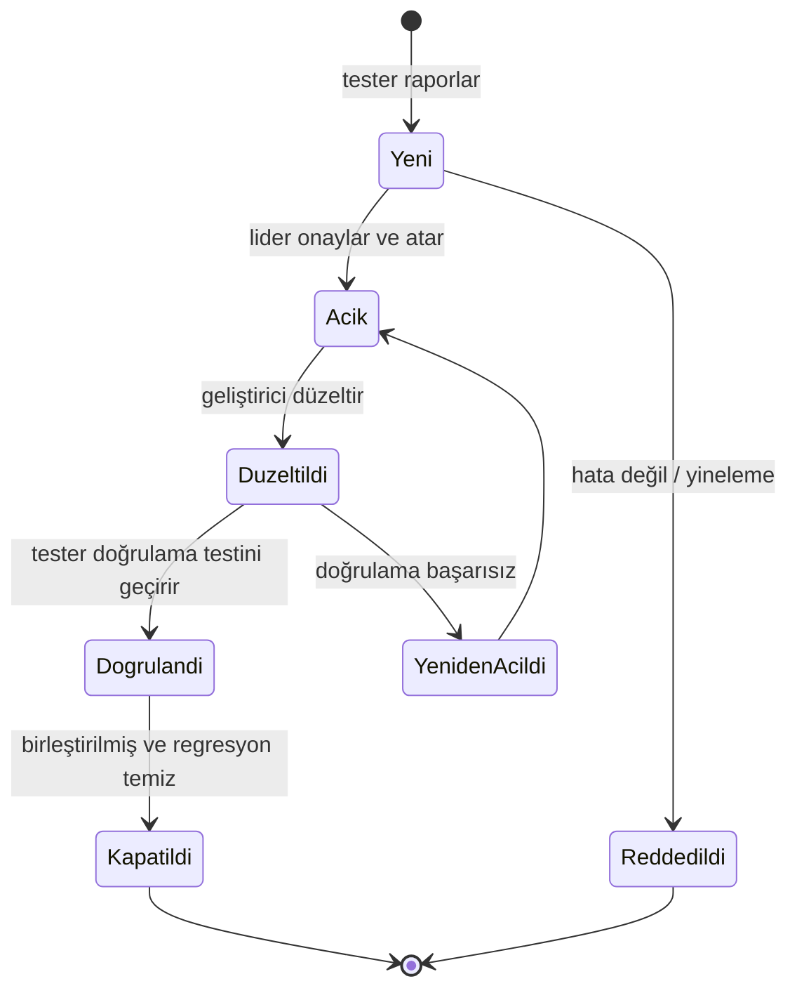

# PyroSync Ana Test Planı (Master Test Plan)

Şablon: IEEE 829 test planı bölümleri (BIL 002, Hafta 2, Tablo 5) ve ISTQB CTFL v4.0 terimleri.

## 1. Test planı tanımlayıcısı

| Alan | Değer |
|------|-------|
| Kimlik | PYRO-MTP-001 |
| Sürüm | 1.1 |
| Tarih | 2026-11-15 |
| Kapsanan commit | birleşmiş `main` (2026-11-15; S5, S6, S9, S11 ve firms-client testleri dahil) |
| Sahibi | Samet (test sorumlusu, görev S1-S8) |
| İlgili belgeler | [TEST_TASARIMI.md](TEST_TASARIMI.md) (PYRO-TT-001), [IZLENEBILIRLIK.md](IZLENEBILIRLIK.md), `docs/API.md`, `GOREVLER.md` |

## 2. Giriş

PyroSync, NASA FIRMS MODIS ve VIIRS yangın tespitlerini tek bir yanma takvimine harmonize eder (kopya temizleme, görüş açısı düzeltmesi, sensör eşleştirme, gözlem eforu normalizasyonu, belirsizlik aralıkları). Çıktı bilimsel bir iddiadır: "2000'den bugüne sensör geçişlerinden bağımsız, karşılaştırılabilir bir seri". Bu yüzden test, "yazılım belirtime uyuyor mu" (doğrulama, verification) ile "belirtim bilimsel olarak doğru ve kullanıcı için yararlı mı" (geçerleme, validation) sorularını ayrı ele alır.

**Amaç.** (1) API sözleşmesinin ve harmonizasyon kurallarının otomatik testlerle gerileme açısından korunması; (2) test edilmemiş alanların açıkça listelenmesi; (3) bilimsel geçerlemenin planlanması.

**"Hata yok" yanılgısı (somut örnek).** Geçen testler hatasızlığı kanıtlamaz. Geçerleme çalışmasının yapıldığı anda (2026-11-15) `cargo test --workspace --locked` 600 test geçiriyordu (0 başarısız, 2 yoksayılan), web 32 test geçiyordu, clippy temizdi, satır kapsamı %94,7'ydi. Buna rağmen geçerleme çalışması iki ciddi hata buldu ve bunların hiçbirini otomatik test yakalamadı: **BUG-9** (`/api/series` anomalisi Ω ile normalize edilmiyor; 2012 MODIS→VIIRS geçişi 138 bölgenin 138'inde ortalama z'yi +1,45σ kaydırıyor ve Ağustos 2007 Yunanistan yangını z 0,52 ile kayboluyor, oysa yalnız-MODIS z'si 3,63) ve **BUG-10** (Terra-only aylar anomali alıyor: 3884 satırın 3818'i). Testler `anomalies()` işlevinin iç tutarlılığını sınıyordu; "anomali sensör geçişinden bağımsız olmalı" belirtimi hiçbir testte yoktu. Kapsam yüksekti çünkü kod çalıştırılıyordu, doğru olup olmadığı sorulmuyordu. Her iki hata aynı gün düzeltildi (BUG-10: `c27c3bc`, BUG-9: `49381eb`) ve belirtimi yazan gerileme testleri eklendi; `49381eb` itibarıyla 728 Rust testi, 59 web testi ve %95,5 satır kapsamı var. Bu belge ayrıca API'nin arşiv uç noktalarında HTTP düzeyinde girdi doğrulamasının neredeyse hiç sınanmadığını ve BUG-8 gibi zamana bağlı bir hatanın yalnız bir `#[ignore]` testle sabitlendiğini kaydeder; hepsi [IZLENEBILIRLIK.md](IZLENEBILIRLIK.md) sonunda risk sırasıyla listelidir. Ayrıntı: [TEST_TASARIMI.md](TEST_TASARIMI.md) §9.4.

## 3. Test öğeleri

| Öğe | Konum | Sürüm/commit | Not |
|-----|-------|--------------|-----|
| `pyrosync-core` | `crates/core` | birleşmiş `main` | Saf hesaplama: dedup, fleet, h3index, vza, calibration, uncertainty, harmonize, effort, calendar, export, config |
| `pyrosync-firms` | `crates/firms-client` | aynı | FIRMS HTTP istemcisi, CSV ayrıştırma, hız sınırı, alan önbelleği, yerel arşiv okuma, `archive_seed` aracı |
| `pyrosync-server` | `crates/server` | aynı | Axum API (12 uç nokta; `sensitivity` S11 ile eklendi), yanıt önbelleği, türetilmiş seri önbelleği, CLI (`precompute`) |
| Web arayüzü | `web` | aynı | React 19, TypeScript strict, SWC |
| Dağıtım | `Dockerfile`, `Makefile`, `tools/*.sh` | aynı | Yalnız yapı ve veri doğrulama betikleri; dağıtım testi kapsam dışı (§5) |
| Veri | `data/archive-set.json`, `data/archive-manifest.sha256`, `data/derived/**` | aynı | Paketli türetilmiş seriler |

## 4. Test edilecek özellikler

| # | Özellik | Kaynak gereksinim | Seviye | Öncelik |
|---|---------|-------------------|--------|---------|
| F1 | HTTP girdi doğrulaması (bbox, `days`, `start/end`, `format`, `country`, yıl, `month`, `limit`) | `docs/API.md` | birim, entegrasyon | Y |
| F2 | HTTP durum kodu eşlemesi ve JSON hata gövdesi (400/404/413/500/502/503/504) | `docs/API.md` Hata kodları, G4 | entegrasyon | Y |
| F3 | Harmonizasyon: tip süzgeci, interscan dedup, VIIRS/MODIS filo birleştirme, MODIS-VIIRS eşleştirme, füzyon | G2, `crates/core/CLAUDE.md` | birim | Y |
| F4 | VZA düzeltmesi ve `k_c` kalibrasyonu (yalnız VIIRS'siz hücrenin toplam FRP'sine) | G8, `crates/core/CLAUDE.md` | birim | Y |
| F5 | Gözlem eforu Ω, anomali z-skoru, Terra-only dönem dışlaması | G3, `docs/API.md` CalendarCell | birim | Y |
| F6 | Belirsizlik aralıkları (`frp_lower ≤ frp_corrected ≤ frp_upper`, VZA ile genişleme) | G9 | birim | O |
| F7 | Dışa aktarım (CSV, GeoJSON) | G10 | birim, entegrasyon | O |
| F8 | Yapılandırma yükleme ve doğrulama (varsayılan, TOML, env) | G7 | birim | O |
| F9 | FIRMS istemcisi: ayrıştırma, yeniden deneme, hız sınırı, alan önbelleği, availability | G1, `crates/firms-client/CLAUDE.md` | birim, entegrasyon | Y |
| F10 | Yanıt önbelleği ve türetilmiş seri önbelleği | `docs/API.md` X-Cache | birim | O |
| F11 | Arşiv uç noktaları (`regions`, `series`, `points`): boyut sınırı, örnekleme, zaman aşımı | G4, BUG-7 | birim | Y |
| F12 | API anahtarı sızdırmama | `docs/API.md` Genel bilgiler | birim, entegrasyon | Y |
| F13 | Frontend: coğrafya, küre, takvim hesapları, durum deposu, performans eşikleri | R1-R5 | birim (betik) | O |
| F14 | Bilimsel geçerlilik (sensör geçişi sürekliliği, bilinen yangın olayları, parametre ölçümü) | G3 doğrulama sınırları; S7, S9 | geçerleme (TEST_TASARIMI §9) | Y |
| F15 | Statik inceleme (kod ve belge gözden geçirme) | W-modeli (Hafta 2) | statik | O |
| F16 | `/api/sensitivity` (eşleştirme yarıçapı ve pencere duyarlılık önizlemesi) ve VIIRS tarama bölgesi yardımcıları (`viirs_zone`) | S11 | birim, entegrasyon | O |

## 5. Test edilmeyecek özellikler (ve gerekçe)

| Özellik | Gerekçe |
|---------|---------|
| Gerçek FIRMS servisine canlı bağlantı | Kota harcar (10 dakikada 5000 işlem), kararsız; yerine wiremock tabanlı sahte FIRMS kullanılır. Canlı doğrulama G2/G3 raporlarında elle yapıldı, otomatik değil |
| Tarayıcıda uçtan uca (E2E) akışlar, erişilebilirlik, çapraz tarayıcı | Araç kurulu değil; yapılmadı. Risk kabul edilmiş değil, ertelenmiş (R-10) |
| Yük ve dayanıklılık testi (eşzamanlı istek, uzun süre) | Plan dışı; yalnız `bench.test.ts` tek istemcili işlem süresi ölçer |
| Güvenlik taraması (`cargo audit`, `npm audit`), sızma testi | Henüz kurulmadı (R-06); CI'ya eklenmesi önerilir |
| Docker imajı ve on-premise dağıtım | `G6` kapsamı; bu planda yok |
| Kullanıcı kabul testi (jüri/son kullanıcı) | Sunum ve demo senaryosu `G5` kapsamında |
| Üçüncü taraf kütüphaneler (`h3o`, `axum`, `reqwest`) | Kendi test paketleri var; yalnızca entegrasyon noktaları sınanır |
| `docs/MIMARI.md` ile uyum | Belge eski (yalnız 5 çekirdek modülü listeliyor); statik incelemede belge hatası olarak kaydedilir (§15) |

## 6. Test yaklaşımı

### 6.1 Seviyeler (V-modeli, Hafta 2)

| Seviye | Ne sınanır | Nasıl | Mevcut durum (2026-11-15) |
|--------|------------|-------|---------------------------|
| Birim | `core` işlevleri; `firms-client` ayrıştırma/limiter/önbellek; `server` doğrulama ve önbellek yardımcıları; `web/src/lib` | `cargo test`, `node --test` | core 360 (1 yoksayılan), firms-client 143 (1 yoksayılan: BUG-8) + 9 (`archive_seed` ikilisi), server 211; web 59 |
| Entegrasyon | `server` yönlendirici + gerçek `FirmsClient` + wiremock; çevrimdışı arşiv ile `calendar`; `sensitivity` | `crates/server/src/integration_tests.rs` (rstest tabloları dahil) | Var |
| Sistem | Çalışan sunucu + arayüz, uçtan uca | Elle `curl` (S3 doğrulaması) | Otomatik yok |
| Kabul | Jüri senaryosu, Türkiye/Akdeniz vaka çalışması (S7) | Elle | Planlandı, §11 |

Test piramidi (Hafta 2 §4.3) gözetilir: taban geniş (birim ≈ 728 Rust testinin büyük çoğunluğu), orta dar (entegrasyon: wiremock ve rstest tabloları), tepe boş. Tepenin boşluğu bilinçli bir eksiklik olarak kayıtlıdır: "ters piramit" riski yoktur ama E2E güvencesi de yoktur.

### 6.2 Test türleri

| Tür | Uygulama |
|-----|----------|
| Fonksiyonel (kara kutu) | EP, 3 değerli BVA, karar tablosu, durum geçişi: [TEST_TASARIMI.md](TEST_TASARIMI.md) |
| Fonksiyonel olmayan | Performans: `bench.test.ts` (`buildScene` 100 bin nokta < 2000 ms, yerel ≈ 600 ms; `drawMap` < 500 ms, yerel ≈ 33 ms). `bench_harmonize` örneği elle. Yük, güvenlik, kullanılabilirlik: yok |
| Yapısal (beyaz kutu) | Satır/bölge/fonksiyon kapsamı `cargo llvm-cov`. Dal (branch) kapsamı ölçülmüyor (nightly gerekir). Ders eşiği %80 dal kapsamı; bu projede kapı **satır** kapsamıdır (CI'da %90'a yükseltildi) ve fark bilinçli bir uzlaşmadır (§9) |
| Değişiklikle ilgili | Doğrulama (confirmation) testi: hata düzeltilince aynı vaka tekrar koşulur (BUG-2, BUG-7). Gerileme (regression): tüm paket her push'ta (CI) |
| Statik | Clippy `-D warnings` (otomatik), tasarım/kod gözden geçirme (elle, kayıt yok; §10) |
| Özellik tabanlı/karşılaştırma | `timed_*_is_bit_identical_to_reference_across_seeds_and_configs` ve `sliding_window_matches_brute_force_on_synthetic_dataset`: optimize uygulama ile saf referans uygulamanın eşitliği (metamorfik/oracle) |

### 6.3 Test tasarım teknikleri ve gerekçe

| Teknik | Nerede | Neden |
|--------|--------|-------|
| EP + BVA | API parametreleri, çekirdek eşikleri | Sayısal aralık ve eşik hataları (off-by-one: `≤` / `<`) bu projede gerçekleşti (BUG-4) |
| Karar tablosu | `k_c` uygulama koşulu, eşleştirme sonucu, durum kodu eşlemesi | Birden çok koşulun birleşimi farklı çıktı üretiyor |
| Durum geçişi | Yanıt önbelleği, availability tablosu, yeniden deneme/hız sınırı, seri kaynağı | Zamana ve geçmişe bağlı davranış; BUG-8 bu sınıftan |
| Deneyime dayalı | Sentetik uç değerler (NaN, ±∞, boş girdi, sıfır gözlem) | Sayısal kodda yaygın hata sınıfı |
| Beyaz kutu | Satır kapsamı raporunda en düşük dosyalar için hedefli test | §9 |

### 6.4 Test verisi ve F.I.R.S.T.

Sentetik veri: elle hesaplanmış küçük kümeler (ör. 4 tespit → 3, FRP 200 → 160 MW). Arşiv verisi: `seed_archive` ile geçici dizinde küçük CSV. Gerçek veri: yalnız geçerleme (§11).

| İlke | Durum |
|------|-------|
| Fast | Birim paketi saniyeler; `firms-client` yeniden deneme testleri `start_paused` ile sanal zamanla koşar |
| Independent | Geçici dizinler ve ephemeral port; sahte sunucu testi başına |
| Repeatable | **Kısmen düzeltildi (9b0ed86):** saate bağlı olmayan entegrasyon testleri sabit bir gün kullanır. **Açık sınırlama:** `FirmsClient::fetch_all` ve `fetch_recent` `Utc::now()` okur (`crates/firms-client/src/client.rs`); bu yoldan geçen testler gerçek "bugün"ü taklit etmek zorunda ve gün sınırında (UTC 00:00) kararsızlaşabilir. Kalıcı çözüm enjekte edilebilir `today` parametresidir; bu bir backend değişikliğidir (Görkem) ve iyileştirme olarak açıktır. BUG-8'in uçtan uca testi de buna bağlı |
| Self-validating | Evet (assert) |
| Timely | Testler kodla birlikte yazıldı (S1, S2 sonradan, S6 sonradan) |

## 7. Öğe geçti/kaldı ölçütleri

| Düzey | Geçti | Kaldı |
|-------|-------|-------|
| Test vakası | Beklenen ve gerçek sonuç aynı | Farklı; hata raporu açılır |
| Derleme sürümü | Çıkış ölçütleri (§9) sağlandı | Açık Kritik veya Yüksek hata var |
| Bilimsel geçerleme (§11) | Her kabul ölçütü sağlandı veya sapma nedeniyle açıklandı | Ölçüt sağlanmadı ve açıklama yok |

Vaka sonuç durumları (Hafta 2 Tablo 6): BAŞARILI, BAŞARISIZ, ENGELLENDİ, ATLANMALI.

## 8. Askıya alma ve yeniden başlatma ölçütleri

| Askıya alma koşulu | Yeniden başlatma |
|--------------------|------------------|
| Derleme veya `cargo check` hatası | Derleme düzelir |
| Test ortamı kullanılamıyor (Docker imajı, bağımlılık indirilemiyor) | Ortam geri gelir; sonuçlar yeniden koşulur |
| Sahte FIRMS düzeneği kırık (tüm entegrasyon testleri aynı nedenle düşüyor) | Düzenek düzelir |
| Aynı kök nedenli ≥ 10 vaka düşüyor | Kök neden hata raporu ile kapanır |
| Açık Kritik hata (ör. BUG-7 türü servis dışı bırakma) | Düzeltme ve doğrulama testi |
| Kota: FIRMS işlem limitinin aşılması (canlı geçerleme sırasında) | Pencere sıfırlanır (10 dk) |

## 9. Giriş ve çıkış ölçütleri

**Giriş (test başlamadan önce).** Kod `main`'e birleşmiş ve derleniyor; ilgili gereksinim `GOREVLER.md` veya `docs/API.md`'de yazılı; sahte FIRMS düzeneği çalışıyor; test verisi hazır.

**Çıkış (sürüm veya görev kapanışı).**

| # | Ölçüt | Mevcut durum (2026-11-15) |
|---|-------|---------------------------|
| C1 | `cargo test --workspace --locked` tümü geçiyor | 728 geçti, 0 başarısız, 2 yoksayıldı (core 360, firms-client 143 + 9 + 5, server 211) |
| C2 | `cargo clippy --workspace --all-targets -- -D warnings` temiz | Temiz |
| C3 | **Satır kapsamı ≥ %90** (CI kapısı: `cargo llvm-cov --fail-under-lines 90`; S5'te %80'den yükseltildi) | %95,5 (bölge %95,9, fonksiyon %95,3) |
| C4 | Açık Kritik hata yok; açık Yüksek hata için yazılı karar var | Açık Yüksek: BUG-8 (BUG-9 düzeltildi, `49381eb`) |
| C5 | `web`: `npm ci`, `typecheck`, `test`, `build` geçiyor | `npm test` 32 geçti; CI'da tanımlı |
| C6 | Her `REQ` en az bir vaka ile izlenebilir; `EKSİK` satırları risk sırasıyla bildirilmiş | [IZLENEBILIRLIK.md](IZLENEBILIRLIK.md) |
| C7 | Sürüm notunda bilinen sınırlamalar ve geçerleme durumu belirtilmiş | §11 tamamlanana dek "geçerleme yapılmadı" yazılır |

CI (`.github/workflows/ci.yml`, işler `rust`, `coverage`, `web`; Rust araç zinciri 1.100'e sabit, iş zaman aşımları var, kapsam kapısı %90) tanımlıdır. **GitHub'da yeşil çalıştığı doğrulanmadı** (depo özel; Actions sonucuna erişilemedi). C1-C5 değerleri Docker dev imajında yerel ölçümdür, CI kanıtı değildir (S5 açık).

**Kapsam eşiği hakkında not.** Ders notları (Hafta 6) tipik hedef olarak %80 **dal** kapsamını verir. Dal kapsamı ölçülemediği için kapı satır kapsamıdır. Satır kapsamı dalları garanti etmez (SC en zayıf ölçüt, SC ⊆ BC) ve ortalama zayıf dosyaları gizler. 2026-11-15 öncesi ölçümde en düşük dosyalar şunlardı (firms-client'a 6400ff4 ile 70 test eklendi; dosya bazlı değerler **yeniden ölçülmedi**, genel değer %95,5):

| Dosya | Satır kapsamı |
|-------|---------------|
| `crates/firms-client/src/source.rs` | %55,6 |
| `crates/firms-client/src/bin/archive_seed.rs` | %60,5 |
| `crates/firms-client/src/client.rs` | %74,7 |
| `crates/firms-client/src/archive.rs` | %75,2 |

Bu dosyalar FIRMS'e giden yoldur (yeniden deneme, 429, ağ hatası: TC-ST-036..039). 6400ff4 bu vakaları kapattı; dosya bazında yeni kapsam ölçümü ve `nightly` ile aylık dal kapsamı ölçümü (CI dışı) hâlâ yapılmadı. Genel kapsam yüksekliği BUG-9 ve BUG-10 gibi belirtim hatalarını yakalamaz (§2).

## 10. Test teslimatları

| Teslimat | Konum | Durum |
|----------|-------|-------|
| Ana test planı | `docs/test/TEST_PLANI.md` | Bu belge |
| Test tasarımı ve vakalar | `docs/test/TEST_TASARIMI.md` | Var (276 otomatik vaka + 30 geçerleme vakası) |
| İzlenebilirlik matrisi | `docs/test/IZLENEBILIRLIK.md` | Var |
| Otomatik test kodu | `crates/*/src/**`, `web/tests/*.test.ts` | Var |
| CI iş akışı | `.github/workflows/ci.yml` | Var, yeşil doğrulanmadı |
| Kapsam raporu | CI `lcov` artefaktı, `cargo llvm-cov report` | Var (CI'da) |
| Hata raporları | Şimdilik yerel taslak (`hata-raporlari.md`, repoda değil); kalıcı yer: GitHub Issues önerilir | Kısmi |
| Test ilerleme raporu | Haftalık, §16 metrikleriyle | Planlandı |
| Test tamamlama raporu (Test Summary Report) | Sürüm sonunda; hedeflere ulaşım, kapsanmayan alanlar, açık hatalar, kabul edilen risk | Planlandı |
| Statik inceleme kaydı | Kod ve belge gözden geçirme notları | **Yok**; yapılan incelemeler kayıtsızdı |
| Geçerleme raporu | `docs/test/GECERLEME.md` (öneri) | Planlandı, §11 |

## 11. Geçerleme (Validation) planı

Otomatik testler "kod belirtime uyuyor" der. Geçerleme "çıktı gerçek dünyada olanla uyuşuyor mu" sorar. Vakalar, ölçülen değerler ve sonuçlar [TEST_TASARIMI.md](TEST_TASARIMI.md) §9'dadır (`TC-VAL-001..045`). İlk geçerleme turu 2026-11-15'te `/api/series` dosyaları (238 bölge) üzerinde yapıldı; `/api/calendar` (FRP, Ω, `k_c`, aralıklar) üzerindeki geçerleme **yapılmadı**.

| Konu | Vakalar | Sonuç özeti | Durum |
|------|---------|-------------|-------|
| Bilinen olaylar (Kanada 2023, Portekiz 2017, Avustralya 2019-20, ABD 2020, Türkiye 2021, Rusya 2021, Bolivya 2024 ...) | TC-VAL-001..015 | 15 vakanın 10'u geçti (1'i negatif kontrol); 5'i kaldı: Yunanistan 2007-08 (z 0,52; yalnız-MODIS z 3,63), Türkiye 2021-08 (z 1,44), ABD 2020-08, Brezilya 2019/2020, Bolivya 2019 | Tamamlandı (seri yolu) |
| 2012 MODIS→VIIRS sürekliliği (sayılar, anomali kayması) | TC-VAL-020, 021 | Karışık: yıllık sayı sıçraması sürüyor (medyan 4,68×; yıllık `harmonized` toplamları normalize edilmiyor, tasarım sınırı). Anomali kayması **düzeldi**: 8 bölgede medyan −0,13σ (önce +1,45σ, 138 bölge; BUG-9, `49381eb`) | Tamamlandı; 138 bölgede yeniden ölçüm paket yenilenince |
| 2012 sürekliliği FRP tabanlı alanlar (`frp_per_detection_eq`, `mean_frp`, `total_frp`, `count_normalized`) | TC-VAL-022 | Seri dosyalarında yok; `/api/calendar` ile ölçülmeli | **Yapılmadı** |
| 2018 ve 2023 geçişleri | TC-VAL-023 | 2023 hiç ölçülmedi (arşivde NOAA-21 yok) | **Yapılmadı** |
| Terra-only dönem anomali kuralı | TC-VAL-024 | **Geçti** (BUG-10 düzeltildi, `c27c3bc`): 8 bölgede 2002-07 öncesi 160 ayın 0'ında anomali var (önce 3818/3884 satır) | Tamamlandı |
| Bütünlük, mevsimsellik, arşiv SHA-256 (10095/10095) | TC-VAL-025..028 | Geçti | Tamamlandı |
| Model parametreleri: MODIS σ 0,266 (yayımlanmış), VIIRS σ 0,08 (**geçici varsayım**, S-NPP / NOAA-20 arasında ≤ 5 dk içinde 0 eşzamanlı çift), `k_c` hold-out, aralık kapsama oranı | TC-VAL-040..043 | VIIRS σ ölçülemedi; kapsama oranı yapılmadı | Kısmi |
| İç doğrulama paketi (G12: placebo, LOYO, model-baseline kapısı) | TC-VAL-044 | Referans ölçüm kayıtlı; bu çalışmada doğrulanmadı | Kısmi |
| Methods sayfası ve jüri demosu | TC-VAL-045, G5 | Bekliyor | Yapılmadı |

Kabul ölçütleri `TEST_TASARIMI.md` §9'da yazılıdır ("görünür": `z ≥ 2,0` ve takvim ayında sıra ≤ 3; süreklilik: kayma < 0,5σ bölgelerin ≥ %95'inde). Ölçütler sonuç görüldükten sonra yazıldığı için olay listesi bağımsız olarak yeniden koşulmalıdır.

Yöntem: geçerleme kontrolleri deneysel analizdir; her kontrol için betik (doğrulama klasöründe `a.py`..`d.py`, `crates/firms-client/examples/*`) ve çıktı belgelenir; sonuç "geçti/kaldı" ve ölçülen sayı ile kaydedilir. Başarısız bir kontrol hata raporu olarak açılır. Kabul ölçütü sonuç görüldükten sonra değiştirilmez.

## 12. Test ortamı

| Öğe | Değer |
|-----|-------|
| Geliştirme/test ortamı | Docker dev imajı (Rust 2024 sürümü, `cargo`, `llvm-cov`); herkes aynı imajla koşar |
| CI | GitHub Actions, `ubuntu-latest`; işler `rust`, `coverage`, `web` |
| Rust | edition 2024, workspace resolver 2, `--locked` |
| Node | 20 (`npm ci`) |
| Sahte FIRMS | `wiremock`; gerçek anahtar gerekmez |
| Arşiv verisi | Birim/entegrasyon: geçici dizin. Geçerleme: tam yerel arşiv (`make data`, yaklaşık 41 GB açılmış) |
| Hizmet kimlik bilgileri | `FIRMS_API_KEY` ortam değişkeni; repoya yazılmaz |
| Saat | Gerçek saat (F.I.R.S.T. ihlali, §6.4) |

## 13. Roller ve sorumluluklar

| Rol | Kişi | Sorumluluk |
|-----|------|------------|
| Test sorumlusu | Samet | Plan, tasarım, test kodu (S1, S2, S6), kapsam raporu, hata raporlama, doğrulama testi, geçerleme (S7) |
| Backend lideri | Görkem | Hata düzeltme (G*), çekirdek ve sunucu; BUG-4/8 kararları |
| Frontend | Serhat (R*), Sadık (K*), Yusuf (Y*) | Arayüz testleri ve düzeltmeleri; `api.ts` sözleşme testi |
| Tasarım | Can (C*) | Methods sayfası içeriği (S8 girdisi) |

Bağımsızlık: kodu yazan düzeltmeyi yapar, tester doğrulama testini koşar (BUG-2 ve BUG-7 böyle kapandı). Samet aynı zamanda test kodunun yazarıdır; bu nedenle kendi testlerini gözden geçirecek ikinci kişi yoktur (R-09).

## 14. Riskler ve azaltma

### 14.1 Ürün riskleri

| ID | Risk | Olasılık | Etki | Azaltma | Durum |
|----|------|----------|------|---------|-------|
| R-01 | Bilimsel yanlış: sensör geçişinde sürekli değil, jüriye yanlış sonuç gösterilir | **Gerçekleşti** (seri yolunda), sonra giderildi | Çok yüksek | BUG-9, BUG-10 düzeltmesi; TC-API-220..223; TC-VAL-020..024; `docs/API.md` serisi bölümünde uyarı | Giderildi (BUG-9, BUG-10); 138 bölgede yeniden ölçüm paket yenilenince |
| R-02 | BUG-8: uzun çalışan sunucuda en yeni günler "kapsanmıyor" | Yüksek (demo günlerce açık kalırsa) | Yüksek | TTL ile yenileme; `#[ignore]` testi (`availability_reflects_newer_firms_data_on_a_later_call`) düzeltmeyle etkinleştirilir; enjekte edilebilir `today` | Açık |
| R-03 | FIRMS yolunda test edilmemiş hata dalları (429, retry tükenmesi, ağ hatası) | Orta | Yüksek | TC-ST-036..039 (6400ff4 ile kapandı); dosya bazında kapsam yeniden ölçülecek | Büyük ölçüde azaldı |
| R-04 | Arşiv uç noktalarında doğrulanmamış girdi (`month`, `limit` üst sınırı, `year`) | Orta | Orta | TC-API-200..213 | Açık |
| R-05 | Sayı tabanlı anomali ve boş ayların baseline'a girmemesi (BUG-3, BUG-6) bilimsel yanlış okutur | Yüksek | Orta | Karar; mevcut davranışı sabitleyen test; belgede uyarı | Açık (belgeli sınırlama) |
| R-06 | Bağımlılık zafiyeti (Rust, npm) | Düşük-orta | Orta | `cargo audit`, `npm audit` CI işi | Yok |
| R-07 | Eşik sınırlarında sessiz kayma (`≤` ve `<`; BUG-4) | Orta | Düşük-orta | TC-CORE-004/008/014/016/019/026 | Açık |
| R-08 | Frontend sözleşme dönüşümü (`api.ts`) testsiz; API değişince arayüz sessizce bozulur | Orta | Orta | TC-WEB-005, sözleşme testi (OpenAPI yok, S3 kapsam dışı) | Açık |
| R-14 | Paketli türetilmiş seri (`data/derived`) bayat: önbellek şeması 2→3 çıktı (`DERIVED_SCHEMA_VERSION = 3`), paket `schema_version: 2`. Sunucu paketi yok sayıp yeniden hesaplıyor; büyük bölgelerde istekler zaman aşımına (504) düşebiliyor | Yüksek (şu an gerçekleşti) | Orta-yüksek | Yapılandırma ya da şema değişince paketi yeniden üret (`make precompute`). Gerileme önerisi: paketin `schema_version` ve `config_hash` değerini koddakiyle karşılaştıran test ya da CI adımı (TC-API-224) | Açık |
| R-15 | Doğrulanmamış model parametreleri: VIIRS σ 0,08 geçici varsayım (ölçülemedi), aralıkların kapsama oranı bilinmiyor | Yüksek | Orta | Yayımlanmış değer bulunana kadar `docs/API.md` uyarısı; TC-VAL-040, 043 | Açık |

### 14.2 Proje riskleri

| ID | Risk | Azaltma |
|----|------|---------|
| R-09 | Tek test sorumlusu; test yazarı = gözden geçirici | Görkem ile çapraz inceleme; plan ve vaka belgeleri herkese açık |
| R-10 | Zaman baskısı (yarışma teslimi): E2E ve geçerleme ertelenir | Risk sırası (IZLENEBILIRLIK) ile en yüksek riskten başla; ertelenenler açıkça "yapılmadı" yazılır |
| R-11 | Yerel Rust yapısının kırılgan olması (herkesin makinesi aynı değil) | Docker dev imajı ve CI tek doğruluk kaynağı |
| R-12 | CRLF/satır sonu sorunları Windows'ta betikleri bozuyor (BUG-1) | `.gitattributes` kuralları; CI Linux'ta koşar ama sorun Windows geliştiricide |
| R-13 | Büyük arşiv (41 GB) herkesin makinesinde yok; geçerleme tekrarlanamaz | Paketli türetilmiş seriler (`data/derived`); geçerleme betikleri ve çıktıları kayıt altına alınır |

## 15. Hata yönetimi

**Yaşam döngüsü** (Hafta 2 Tablo 8, bu proje için sadeleştirilmiş):

**Önem (severity)** sistemin etkisi, **öncelik (priority)** düzeltme sırası:

| Önem | Tanım | Örnek |
|------|-------|-------|
| Kritik | Servis dışı veya veri yanlış ve fark edilmiyor | BUG-7 (tek GET ile kilitlenme) |
| Yüksek | Ana özellik yanlış veya bilimsel sonuç yanlış yönlendiriyor | BUG-8 |
| Orta | Özellik kısmen çalışıyor, geçici çözüm var | BUG-1, BUG-3 |
| Düşük | Kozmetik, belge | BUG-2 (düz metin 400), BUG-4 |

Hata raporu alanları (Hafta 2 Tablo 7): kimlik, başlık, önem, öncelik, yeniden üretim adımları, beklenen, gerçekleşen, ortam (işletim sistemi, commit, Docker imajı), kanıt (log, yanıt gövdesi).

**Bilinen hatalar (2026-11-15).**

| Kimlik | Özet | Önem | Durum | Not |
|--------|------|------|-------|-----|
| BUG-1 | `*.sh` ve `archive-manifest.sha256` Windows'ta CRLF'ye dönüşüyor, `make verify-data` kırılıyor | Orta | **Düzeltildi** (takım arkadaşı) | `.gitattributes` artık `*.sh text eol=lf` ve manifest için `eol=lf` içeriyor; `verify-data` CRLF'li manifesti de işliyor. Doğrulama testi (onay) bu turda yeniden koşulmadı; 10095/10095 SHA-256 doğrulaması başarılı |
| BUG-2 | Eksik/hatalı sorgu parametresinde 400 gövdesi düz metin | Düşük | **Düzeltildi ve doğrulama testi geçti** | `query_deserialization_errors_return_json_400` (kanıt). Bayat yorum: `integration_tests.rs` hâlâ "plain text (BUG-2)" diyor |
| BUG-3 | Takvim anomali tabanı yangınsız ayları saymıyor | Orta | Açık, belgeli sınırlama | `docs/API.md` Bilinen sorunlar |
| BUG-4 | Dedup 8 sn sınırı: çekirdek CLAUDE.md "Δt<8s", kod `≤ 8` | Düşük | Açık (karar bekliyor) | Test `≤ 8`'i sabitliyor (`eight_seconds_apart_is_inside_time_window`) |
| BUG-5 | Ortak arşivin büyük payı Rusya (iyileştirme) | Düşük | Değişti | Arşiv seti genişledi, tarihsel veri isteğe bağlı |
| BUG-6 | Sayı tabanlı anomali 2021 megayangınlarını ulusal ölçekte göstermiyor | Orta | Açık (iyileştirme) | TC-VAL-001 |
| BUG-7 | `/api/points` `limit` küçükken sonsuz döngü | Kritik | **Düzeltildi ve doğrulama testi geçti** | `points_rejects_zero_limit_and_handles_limit_one_with_merged_hotspot`, `sample_links_*` |
| BUG-8 | Availability tablosu süreç başına bir kez (OnceCell) | Yüksek | **Açık** | `OnceCell<Availability>` hâlâ var; `availability_reflects_newer_firms_data_on_a_later_call` (`#[ignore]`) `--ignored` ile koşulunca panik ediyor (doğrulandı) |
| BUG-9 | `/api/series` anomalisi Ω ile normalize edilmiyor; 2012 geçişi z'yi +1,45σ kaydırıyor (138/138 bölge), Yunanistan 2007-08 z 0,52 (yalnız-MODIS 3,63) | Yüksek | **Düzeltildi** (`49381eb`) | `anomaly_harmonized` artık Ω ile normalize (`effort_anomalies`); `anomaly_raw` bilerek ham kaldı. Eski bulgu: o gün 600 yeşil test bunu yakalamamıştı (§2) |
| BUG-10 | `/api/series` Terra-only aylara (2002-07 öncesi) anomali veriyor ve bunları baz çizgisine katıyor; `/api/calendar` kuralı uygulanmıyor (3818/3884 satır) | Orta | **Düzeltildi** (`c27c3bc`) | Testler: `series_anomalies_skip_terra_only_months_when_series_spans_terra_aqua`, `series_anomaly_baseline_ignores_terra_only_month` |

## 16. Raporlanacak metrikler (Hafta 2 Tablo 9)

| Metrik | Formül | Mevcut | Hedef |
|--------|--------|--------|-------|
| Geçiş oranı | Geçen / Yürütülen × 100 | Rust 728/728 (2 yoksayılan hariç), web 59/59 = %100 | %100 (kararlı yapı) |
| Test kapsama oranı (vaka) | Otomatik vakası olan / Tasarlanan × 100 | 219 / 276 = %79,3 (tam), + 11 kısmi | ≥ %90 kritik yollar için |
| Satır kapsamı | `cargo llvm-cov` | %95,5 (bölge %95,9, fonksiyon %95,3) | ≥ %90 kapı (CI); dosya bazında ≥ %80 |
| Dal kapsamı | nightly `--branch` | Ölçülmüyor | Ölçüm başlat; ≥ %80 |
| Hata yoğunluğu | Hata / KLOC | Hesaplanmadı (KLOC sayımı yok; 10 hata kaydı) | Rapor et |
| Hata tespit verimliliği (DDE) | Testte bulunan / (Testte + sonra bulunan) × 100 | **Hesaplanamaz**: sürüm sonrası (saha) hata verisi yok, payda bilinmiyor | Sürüm sonrası hatalar toplanınca |
| Açık hata (önem kırılımı) | Sayım | Yüksek 1 (BUG-8), Orta 2 (BUG-3, BUG-6), Düşük 1 (BUG-4); bayat paket (R-14) henüz BUG numarası almadı | Kritik 0 |
| MTTR | Toplam düzeltme süresi / hata | Kayıt yok | Tarihleri kaydet |
| `EKSİK` vaka sayısı (risk sırası) | IZLENEBILIRLIK | 48 otomatik vaka `EKSİK`; geçerlemede 8 vaka kaldı (TC-VAL-002, 005, 011, 013, 015, 020, 021, 024) | Azalan trend |

## 17. Takvim

| Hafta | İş |
|-------|----|
| 1 | CI yeşil doğrulaması (depo özel; Actions sonucu görülmeli); bayat paket için gerileme testleri (TC-API-222..224; BUG-9/10 için TC-API-220 ve 221 yazıldı); enjekte edilebilir `today` ve BUG-8 testinin etkinleştirilmesi |
| 2 | Arşiv uç noktaları HTTP doğrulama vakaları (TC-API-200..213); eşik sınır vakaları (TC-CORE-004..026) |
| 3 | `/api/calendar` üzerinde TC-VAL-022 ve 2018/2023 geçişleri (TC-VAL-023); `api.ts` sözleşme testi |
| 4 | Dal kapsamı ölçümü (nightly); `cargo audit`/`npm audit`; test tamamlama raporu |
