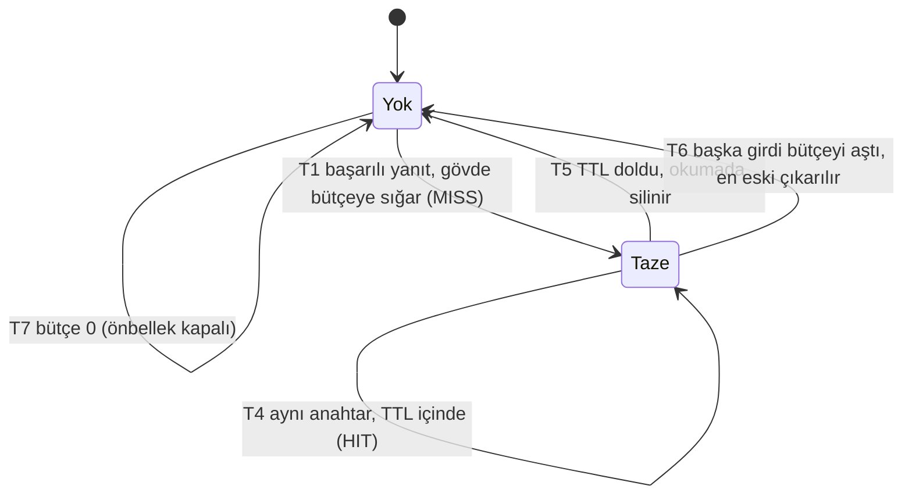
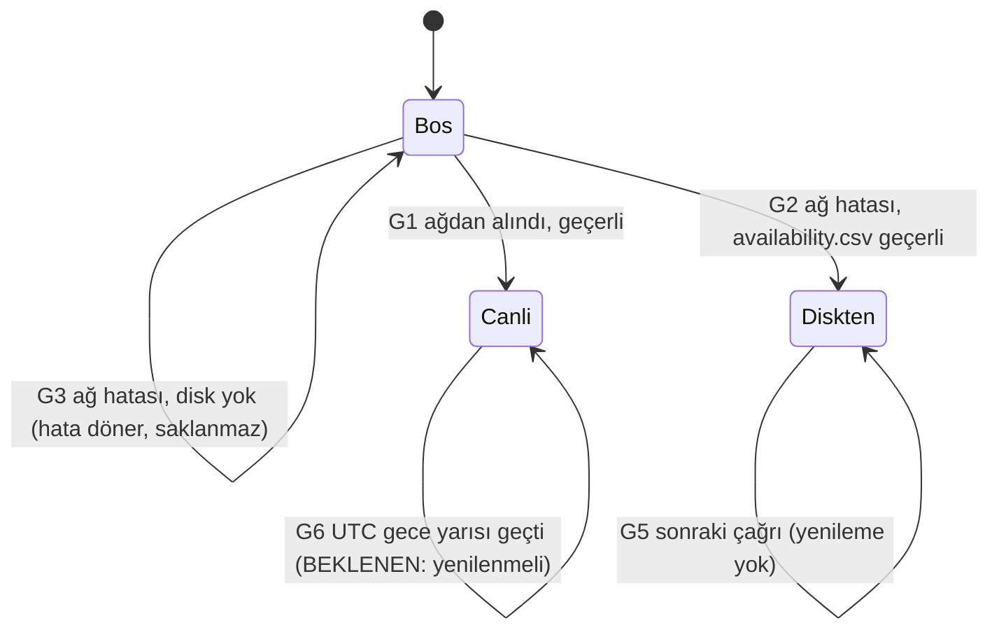
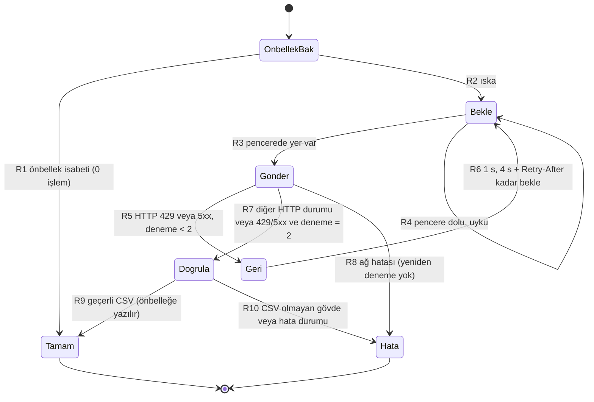

# PyroSync Test Tasarımı

| Alan | Değer |
|------|-------|
| Belge kimliği | PYRO-TT-001 (IEEE 829 test tasarım/vaka belirtimi) |
| Üst belge | [TEST_PLANI.md](TEST_PLANI.md) |
| İzlenebilirlik | [IZLENEBILIRLIK.md](IZLENEBILIRLIK.md) |
| Durum tarihi | 2026-11-15 (birleşmiş `main`; Rust 728 geçti, 0 başarısız, 2 yoksayıldı; web 59 geçti) |
| Teknikler | EP (zayıf), 3 değerli BVA, karar tablosu, durum geçişi (0-geçiş ve 1-geçiş), beyaz kutu kapsamı, geçerleme (§9) |

Bu belge test koşullarını ve vakalarını tasarlar. Her satırın son sütunu o koşulu gerçekten sınayan mevcut otomatik testi adlandırır. Böyle bir test yoksa `EKSİK` yazılır. `EKSİK` bir hata değil, test edilmemiş bir koşuldur; "var olan testler geçiyor" cümlesi bu satırlar hakkında hiçbir şey söylemez.

## 0. Kurallar

**Test adı gösterimi.** Yol `crate::modül::test_fn`. rstest vakası köşeli parantezle: `[vaka_adı]`.

| Kısaltma | Dosya |
|----------|-------|
| `core::X` | `crates/core/src/X.rs` |
| `fc::X` | `crates/firms-client/src/X.rs` |
| `srv::main` | `crates/server/src/main.rs` (`mod tests`) |
| `srv::archive_api` | `crates/server/src/archive_api.rs` (`mod tests`) |
| `srv::it` | `crates/server/src/integration_tests.rs` (wiremock tabanlı sahte FIRMS) |
| `web:X` | `web/tests/X.test.ts`. Dosyalar `check(...)` kullanan betiklerdir; tek tek test fonksiyonu adı yoktur, bu yüzden dosya adı verilir |

**Vaka kimlikleri.** `TC-API-###` HTTP sözleşmesi, `TC-CORE-###` harmonizasyon motoru, `TC-FC-###` FIRMS istemcisi, `TC-WEB-###` frontend, `TC-DT-###` karar tablosu kuralı, `TC-ST-###` durum geçişi, `TC-VAL-###` bilimsel geçerleme (§9, TEST_PLANI §11). `TC-VAL` vakaları otomatik test değil, betikle ve elle yürütülen geçerleme vakalarıdır; sayımda ayrı tutulur.

**Vaka alanları (IEEE 829).** Kimlik, ön koşul, girdi, beklenen sonuç, izlenebilirlik (REQ), öncelik. Tablolarda ön koşul tablo başlığında ortak verilir. Tüm API vakaları için ön koşul: sunucu `FIRMS_API_KEY` ve sahte FIRMS ile ayakta (`srv::it`), aksi belirtilmedikçe `days=1` ve bbox `26,36,45,42`. Öncelik: Y (yüksek), O (orta), D (düşük); risk = etki × olasılık.

**EP/BVA seçimi.** Sayısal parametrede önce geçerli ve geçersiz bölümler, sonra 3 değerli BVA (min-1, min, min+1, max-1, max, max+1) uygulanır. Ondalıklı alanlarda "komşu" için 0.0001 kullanılmıştır. Zayıf EP: her bölümden bir temsilci. Güçlü EP (geçersiz bölüm kombinasyonları) yalnızca bbox için §1.1 son satırlarında işaretlenmiştir.

## 1. EP/BVA: HTTP API

### 1.1 Bbox (`harmonize`, `compare`, `stats`, `export`; REQ-API-001)

Kural (`docs/API.md` Bounding box): `west,east ∈ [-180,180]`, `south,north ∈ [-90,90]`, `west ≤ east`, `south ≤ north`. Kodda `validate_bbox` (`crates/server/src/main.rs`). Beklenen: geçerli ise 200, değilse 400 ve FIRMS'e istek gitmez.

| TC | Girdi | Sınıf | Beklenen | Otomatik test |
|----|-------|-------|----------|---------------|
| TC-API-001 | `north=90` | BVA üst, geçerli | 200 | `srv::it::harmonize_query_validation[north_at_pole]` |
| TC-API-002 | `north=90.0001` | BVA üst+1, geçersiz | 400 | `srv::it::harmonize_query_validation[north_past_pole]` |
| TC-API-003 | `south=-90` | BVA alt, geçerli | 200 | `srv::it::harmonize_query_validation[south_at_pole]` |
| TC-API-004 | `south=-90.0001` | BVA alt-1, geçersiz | 400 | `srv::it::harmonize_query_validation[south_past_pole]` |
| TC-API-005 | `west=-180` | BVA alt, geçerli | 200 | `srv::it::harmonize_query_validation[west_at_antimeridian]` |
| TC-API-006 | `west=-180.0001` | BVA alt-1, geçersiz | 400 | `srv::it::harmonize_query_validation[west_past_antimeridian]` |
| TC-API-007 | `east=180` | BVA üst, geçerli | 200 | `srv::it::harmonize_query_validation[east_at_antimeridian]` |
| TC-API-008 | `east=180.0001` | BVA üst+1, geçersiz | 400 | `srv::it::harmonize_query_validation[east_past_antimeridian]` |
| TC-API-009 | `west=east=30` | sıra sınırı, geçerli | 200 | `srv::it::harmonize_query_validation[west_equals_east]` |
| TC-API-010 | `west=46, east=45` | sıra ihlali (antimeridyen geçişi desteklenmez) | 400 | `srv::it::harmonize_query_validation[west_greater_than_east]` |
| TC-API-011 | `south=43, north=42` | sıra ihlali | 400 | `srv::it::harmonize_query_validation[south_greater_than_north]` |
| TC-API-012 | `west=NaN` | sayısal olmayan | 400 | `srv::it::harmonize_query_validation[west_not_a_number]` |
| TC-API-013 | `south` yok | zorunlu alan eksik | 400, gövde JSON (BUG-2 düzeltmesi) | `srv::it::harmonize_query_validation[south_missing]` yalnız durum kodunu denetler; JSON gövde için `srv::main::query_deserialization_errors_return_json_400` (tür hatası ve eksik `country` ile) |
| TC-API-014 | `south=north=40` | sıra sınırı, geçerli | 200 | EKSİK |
| TC-API-015 | `west=Infinity` | sayısal olmayan | 400 | EKSİK (NaN denendi, ±Infinity denenmedi) |
| TC-API-016 | `west=-181, south=-91` | güçlü EP: iki geçersiz alan birlikte | 400, ilk hata mesajı | EKSİK |
| TC-API-017 | bbox 26,36,45,42 | orta değer | 200, `harmonized.count > 0` | `srv::it::harmonize_query_validation[days_min]` |

Not: `compare`, `stats`, `export` aynı `parse_bbox` işlevini kullanır ama bbox sınırları yalnızca `harmonize` üzerinden HTTP düzeyinde sınanır. Diğer üçü için tek vaka: `srv::main::handlers_enforce_validation_before_firms_client` (compare, ters bbox) ve `srv::main::export_validates_before_firms_client` (export, ters bbox).

### 1.2 `days` (REQ-API-002)

Kural: tam sayı 1..=5, verilmezse 1. Kodda `u8::try_from(days)` ve `DayRange::new`.

| TC | Girdi | Sınıf | Beklenen | Otomatik test |
|----|-------|-------|----------|---------------|
| TC-API-020 | `days=0` | BVA min-1 | 400 | `srv::it::harmonize_query_validation[days_zero]` |
| TC-API-021 | `days=1` | BVA min | 200 | `srv::it::harmonize_query_validation[days_min]` |
| TC-API-022 | `days=2` | BVA min+1 | 200 | EKSİK |
| TC-API-023 | `days=4` | BVA max-1 | 200 | EKSİK |
| TC-API-024 | `days=5` | BVA max | 200 | `srv::it::harmonize_query_validation[days_max]` |
| TC-API-025 | `days=6` | BVA max+1 | 400 | `srv::it::harmonize_query_validation[days_six]` |
| TC-API-026 | `days=4294967296` | taşma (u32 üstü) | 400 | `srv::it::harmonize_query_validation[days_overflows_u32]` |
| TC-API-027 | `days=-1` | negatif | 400 | `srv::it::harmonize_query_validation[days_negative]` |
| TC-API-028 | `days=abc` | sayısal olmayan | 400 | `srv::it::harmonize_query_validation[days_not_a_number]` |
| TC-API-029 | zaman parametresi yok | varsayılan | 200, 1 gün | `srv::it::harmonize_query_validation[no_time_params_default_to_one_day]` |
| TC-API-030 | `days=2.5`, `days=` | ondalık, boş | 400 | EKSİK |

### 1.3 `start`/`end` ve `days` ile kombinasyon (REQ-API-002)

Kural: `days` XOR (`start` VE `end`); biçim `YYYY-MM-DD`; `end ≥ start`.

| TC | Girdi | Sınıf | Beklenen | Otomatik test |
|----|-------|-------|----------|---------------|
| TC-API-040 | `days=1&start=D` | çakışan biçim | 400 | `srv::it::harmonize_query_validation[days_with_start]` |
| TC-API-041 | `days=1&end=D` | çakışan biçim | 400 | `srv::it::harmonize_query_validation[days_with_end]` |
| TC-API-042 | yalnız `start` | eksik çift | 400 | `srv::it::harmonize_query_validation[start_without_end]` |
| TC-API-043 | yalnız `end` | eksik çift | 400 | `srv::it::harmonize_query_validation[end_without_start]` |
| TC-API-044 | `start=2026/01/01` | biçim hatası | 400 | `srv::it::harmonize_query_validation[start_bad_format]` |
| TC-API-045 | `end=2026-13-01` | geçersiz ay | 400 | `srv::it::harmonize_query_validation[end_bad_format]` |
| TC-API-046 | `end = start - 1 gün` | BVA (end < start) | 400 | `srv::it::harmonize_query_validation[end_before_start]` |
| TC-API-047 | `end = start` | BVA (eşit) | 200 | `srv::it::harmonize_query_validation[single_day_range]` |
| TC-API-048 | `end = start + 1 gün` | BVA (min+1) | 200 | EKSİK |
| TC-API-049 | `start=2026-02-30` (takvimde olmayan gün) | biçim geçerli, değer geçersiz | 400 | EKSİK |
| TC-API-050 | `start` gelecekte | belirtimde tanımsız | belirtim yok; önce karar gerekir | EKSİK (belirtim boşluğu) |
| TC-API-051 | aralık hiçbir kaynakta yok | geçerli ama kapsam dışı | 200, boş sonuç, `report.uncovered` dolu, `warnings` dolu | `srv::it::range_outside_availability_is_reported_as_uncovered` |
| TC-API-052 | aralık > 5 gün | pencere bölme | kaynak başına ≤ 5 günlük pencereler, maliyet = gün sayısı | `fc::client::splits_multi_week_range_into_max_five_day_windows_and_cost` |

### 1.4 `format` (export; REQ-API-009)

| TC | Girdi | Sınıf | Beklenen | Otomatik test |
|----|-------|-------|----------|---------------|
| TC-API-060 | yok | varsayılan | CSV | `srv::main::export_format_parser_accepts_known_values_and_rejects_others` |
| TC-API-061 | `csv` | geçerli | CSV | aynı test |
| TC-API-062 | `geojson`, `GeoJSON` | geçerli, büyük/küçük harf | GeoJSON | aynı test |
| TC-API-063 | `xml` | geçersiz | 400 | aynı test; `srv::main::export_validates_before_firms_client` |
| TC-API-064 | geçersiz `format` + geçersiz bbox | öncelik (format önce doğrulanır) | 400, format mesajı | EKSİK (sıra denetlenmiyor) |
| TC-API-065 | CSV gövdesi | başlık ve satır sonu | `Content-Type: text/csv`, `Content-Disposition: attachment`, CRLF | `srv::main::export_serves_cached_hit_as_csv_download` (üstbilgi); CRLF için EKSİK |
| TC-API-066 | GeoJSON gövdesi | `application/geo+json`, FeatureCollection | 200 | EKSİK (HTTP düzeyinde yalnız CSV denendi; üretim işlevi `core::export` birim testleriyle kapsanıyor, bkz. TC-CORE-080) |

### 1.5 `/api/calendar` (REQ-API-010)

Ön koşul: yerel arşiv geçici dizinde (`seed_archive`), FIRMS anahtarı gerekmez.

| TC | Girdi | Sınıf | Beklenen | Otomatik test |
|----|-------|-------|----------|---------------|
| TC-API-100 | `country=""` | BVA uzunluk 0 | 400 | `srv::main::calendar_rejects_invalid_country_characters` |
| TC-API-101 | `country=a` (1 karakter) | BVA uzunluk 1 | 200 veya 404 (arşive bağlı), 400 değil | EKSİK |
| TC-API-102 | 64 karakter | BVA üst | kabul | `srv::main::calendar_rejects_country_longer_than_64_chars_without_echoing_value` |
| TC-API-103 | 65 karakter | BVA üst+1 | 400, değer yanıtta yansıtılmaz | aynı test |
| TC-API-104 | `../etc`, `Turkey;ls`, `Turkey/2020`, boşluk, `Türkiye` | geçersiz karakter sınıfı | 400 | `srv::main::calendar_rejects_invalid_country_characters` |
| TC-API-105 | `Turkey`, `Russian_Federation`, `Bosnia-Herzegovina`, `Country1` | geçerli karakter sınıfı | kabul | aynı test |
| TC-API-106 | `from > to` | sıra ihlali | 400 | `srv::main::calendar_rejects_from_greater_than_to` |
| TC-API-107 | `from = to` | BVA eşit | 200 | EKSİK |
| TC-API-108 | `from=1995, to=2030` | arşiv dışı, kırpılır | `effective 2000..2025`, uyarı | `srv::main::calendar_clamps_out_of_range_years_to_archive_coverage` |
| TC-API-109 | `from=1999` (min-1), `from=2000` (min) ayrı ayrı | BVA arşiv alt sınırı | 1999 kırpılır, 2000 kırpılmaz | Kısmi: 1995 ve 1990 denendi; 1999/2000 çifti EKSİK |
| TC-API-110 | bbox 4 parçanın 1-3'ü | eksik küme | 400 | `srv::main::calendar_requires_all_four_bbox_params_together_or_none` |
| TC-API-111 | bbox 0 parça / 4 parça | geçerli küme | 200 | aynı test; `srv::it::calendar_bbox_keeps_only_points_inside` |
| TC-API-112 | `country` yok, `from=abc` | deserialize hatası | 400 JSON | `srv::main::query_deserialization_errors_return_json_400` |
| TC-API-113 | arşivde hiç dosya yok | kaynak yok | 404 ve `make data` ipucu | `srv::main::calendar_with_empty_archive_returns_404_with_make_data_hint` |
| TC-API-114 | arşiv dizini yapılandırılmamış | altyapı yok | 500 | `srv::it::calendar_without_archive_directory_returns_500` |
| TC-API-115 | bir ülke-yıl dosyası eksik | kısmi hata | 200, `fetch.failures` dolu, `effort.reliable=false`, uyarı | `srv::it::calendar_reports_missing_archive_year_but_still_answers` |
| TC-API-116 | `REQUEST_TIMEOUT_SECS` aşıldı | zaman aşımı | 504 | EKSİK (504 yalnız harmonize ve `archive_api` için var) |

### 1.6 `/api/regions`, `/api/series`, `/api/points` (REQ-API-011, REQ-API-012)

Kural: `docs/API.md` series/points. `limit` varsayılan 4000, en çok 20000, en az 1; `month` 1..=12.

| TC | Girdi | Sınıf | Beklenen | Otomatik test |
|----|-------|-------|----------|---------------|
| TC-API-200 | `series` `region` yok | zorunlu alan | 400 | EKSİK |
| TC-API-201 | `series` bilinmeyen bölge | geçersiz id | 404 | EKSİK (HTTP/işleyici düzeyinde doğrulanmadı) |
| TC-API-202 | `series` bölge boyutu sınırı aşıyor | 413 | 413, `Region too large` | `srv::archive_api::size_guard_rejects_oversized_region_before_parsing` |
| TC-API-203 | `points` `year` yok / `year=abc` | zorunlu / tür | 400 | EKSİK |
| TC-API-204 | `points` o yıl dosya yok | kaynak yok | 404 `the archive has no X file for Y` | EKSİK |
| TC-API-205 | `points` `month=0` | BVA min-1 | 400 | EKSİK |
| TC-API-206 | `month=1`, `month=12` | BVA min, max | 200 | EKSİK |
| TC-API-207 | `month=13` | BVA max+1 | 400 | EKSİK |
| TC-API-208 | `month=abc` | tür | 400 | EKSİK |
| TC-API-209 | `limit=0` | BVA min-1 | 400, `'limit' must be at least 1` | `srv::archive_api::points_rejects_zero_limit_and_handles_limit_one_with_merged_hotspot` |
| TC-API-210 | `limit=1` | BVA min | 200, sonlanır (BUG-7 gerileme) | aynı test |
| TC-API-211 | `limit` yok | varsayılan 4000 | 200 | EKSİK |
| TC-API-212 | `limit=20000` / `20001` | BVA max / max+1 | 20001 → 20000'e kırpılır | EKSİK (`MAX_POINTS_LIMIT` denenmedi) |
| TC-API-213 | `limit=abc` | tür | 400 | EKSİK |
| TC-API-214 | örnekleme: `limit` < ham satır | örnekleme | bağlı satırlar birlikte kalır, `truncated=true`, sınır içinde | `srv::archive_api::sample_links_keeps_linked_rows_together_and_fits_limit`, `sample_links_keeps_everything_under_limit` |
| TC-API-215 | örnekleme sonlanması | kenar | `limit=1`, tek çıktı limiti aşar, büyük girdi | `srv::archive_api::sample_links_terminates_when_first_output_exceeds_limit_or_limit_is_one`, `sample_links_large_input_completes_quickly`, `sample_links_handles_empty_and_all_none_inputs` |
| TC-API-216 | yıl sınırı yıl bazında | 413 mantığı | bölge toplamı aşsa da yıl sığıyorsa 200 | `srv::archive_api::points_admits_by_requested_year_not_total_region_size` |
| TC-API-217 | `regions` arşiv dizini okunamaz | altyapı | 503 JSON | `srv::main::router_returns_json_404_for_unknown_api_and_serves_cors_headers` |
| TC-API-218 | `ARCHIVE_REQUEST_TIMEOUT_SECS` aşıldı | zaman aşımı | 504 | `srv::archive_api::request_timeout_returns_504_and_logs_warning` |
| TC-API-219 | `regions` NOAA-20 dosyaları, `too_large`/`precomputed` bayrakları | işlev | doğru bayraklar | `srv::archive_api::noaa20_files_are_indexed_in_regions_series_and_points`, `regions_reports_precomputed_and_clears_too_large_until_invalidated`, `regions_marks_bundled_oversized_region_available` |

### 1.7 `/api/sensitivity` (S11; REQ-API-019)

Kural (`docs/API.md`): `radius_km` virgülle ayrılmış liste, her değer `0 < r ≤ 10`, en çok 5; `window_min` her değer `0..=1440`, en çok 5; bbox ve zaman penceresi `harmonize` ile aynı. Yanıt `matched` değeri yarıçap veya pencere büyüdükçe azalmaz. Kod: `crates/server/src/sensitivity.rs`. Ön koşul: sahte FIRMS (geçersiz girdi vakaları FIRMS'siz uygulamada da koşar, yani doğrulama anahtar denetiminden önce).

| TC | Girdi | Sınıf | Beklenen | Otomatik test |
|----|-------|-------|----------|---------------|
| TC-API-300 | `radius_km=0` | BVA min (dışarıda) | 400 | `srv::it::sensitivity_rejects_bad_radius[radius_zero]` |
| TC-API-301 | `radius_km=0.001` | BVA min+ | 200 | `srv::it::sensitivity_accepts_boundary_values[radius_just_above_zero]` |
| TC-API-302 | `radius_km=10` | BVA max | 200 | `srv::it::sensitivity_accepts_boundary_values[radius_at_max]` |
| TC-API-303 | `radius_km=10.001` | BVA max+ | 400 | `srv::it::sensitivity_rejects_bad_radius[radius_above_max]` |
| TC-API-304 | `radius_km=-1`, `NaN`, `abc`, `1,10.5` (listede bir kötü değer) | geçersiz bölüm | 400 | `srv::it::sensitivity_rejects_bad_radius[radius_negative]`, `[radius_nan]`, `[radius_text]`, `[radius_one_bad_in_list]` |
| TC-API-305 | `window_min=0` | BVA min | 200 | `srv::it::sensitivity_accepts_boundary_values[window_zero]` |
| TC-API-306 | `window_min=1440` | BVA max | 200 | `srv::it::sensitivity_accepts_boundary_values[window_at_max]` |
| TC-API-307 | `window_min=1441`, `-5` | BVA max+, negatif | 400 | `srv::it::sensitivity_rejects_oversized_grid_or_bad_window[window_above_max]`, `[window_negative]` |
| TC-API-308 | 6 farklı yarıçap veya 6 farklı pencere | BVA liste uzunluğu 5+1 | 400 | `srv::it::sensitivity_rejects_oversized_grid_or_bad_window[radius_six_values]`, `[window_six_values]` |
| TC-API-309 | 5 değer (tam sınır) | BVA liste uzunluğu 5 | 200 | EKSİK (yalnız 6 değer reddi denendi) |
| TC-API-310 | `radius_km` veya `window_min` yok; bbox parçası eksik | zorunlu alan | 400 | `srv::it::sensitivity_rejects_missing_parameter[no_window]`, `[no_radius]`, `[no_bbox_part]` |
| TC-API-311 | Monotonluk: yarıçap veya pencere artınca `matched` azalmaz | invaryant | `matched(r1,w1) ≤ matched(r2,w2)` | `srv::it::sensitivity_matched_never_decreases_with_radius_or_window` |
| TC-API-312 | Anahtar yok, geçerli parametre | altyapı | 503 | EKSİK |
| TC-API-313 | Yinelenen değerler (`2,2,1`) atılır ve sıralanır | kural | `radius_km=[1,2]` | EKSİK |
| TC-API-314 | `sensitivity` yanıtı `harmonize` ile aynı eşikte aynı `matched` sayısını verir (tutarlılık) | metamorfik | varsayılan (2 km, 180 dk) hücresi = `harmonize` sonucu | EKSİK |

## 2. EP/BVA: çekirdek eşikleri

Eşikler `PipelineConfig` varsayılanları (`docs/API.md` GET /api/config). Test verisi sentetiktir; gerçek yangın verisiyle geçerleme için bkz. TEST_PLANI §11.

| TC | Eşik ve girdi | Sınıf | Beklenen | Otomatik test |
|----|---------------|-------|----------|---------------|
| TC-CORE-001 | Dedup Δt = 7 s (örtüşen, aynı sensör) | BVA max-1 | tekilleşir | `core::dedup::seven_seconds_apart_is_inside_time_window` |
| TC-CORE-002 | Δt = 8 s | BVA max (kod ≤ 8; BUG-4 belge çelişkisi) | tekilleşir | `core::dedup::eight_seconds_apart_is_inside_time_window` |
| TC-CORE-003 | Δt = 9 s | BVA max+1 | tekilleşmez | `core::dedup::outside_time_window_not_deduplicated` |
| TC-CORE-004 | Δt = 0 s | BVA min | tekilleşir | EKSİK |
| TC-CORE-005 | Δt = 8 s, farklı sensör | geçersiz bölüm | tekilleşmez | `core::dedup::different_sensors_are_not_deduplicated` |
| TC-CORE-006 | Örtüşme: 0,65 km kayma (≈ %35, eşik üstü) | BVA üst komşu | tekilleşir | `core::dedup::overlap_threshold_is_thirty_percent` |
| TC-CORE-007 | Örtüşme: 0,75 km kayma (≈ %25) | BVA alt komşu | tekilleşmez | aynı test |
| TC-CORE-008 | Örtüşme tam %30 (kod `>`: tekilleşmez) | BVA tam sınır | tekilleşmez | EKSİK |
| TC-CORE-009 | Örtüşme hiç yok (uzak) | geçersiz bölüm | tekilleşmez | `core::dedup::non_overlapping_locations_not_deduplicated` |
| TC-CORE-010 | Dedup: boş ve tek kayıt | kenar | panik yok | `core::dedup::empty_and_single_element_do_not_panic` |
| TC-CORE-011 | Haversine: aynı nokta, 1° enlem, simetri, antimeridyen | EP | 0; 111,19 km; d(a,b)=d(b,a); kısa yol | `core::dedup::haversine_zero_for_identical_points`, `haversine_one_degree_of_latitude`, `haversine_is_symmetric`, `haversine_crosses_antimeridian_the_short_way` |
| TC-CORE-012 | Filo VIIRS: 45 dk, 1 km (NOAA-20/21) | EP geçerli | birleşir | `core::fleet::noaa20_and_noaa21_within_45_min_and_1km_merge` |
| TC-CORE-013 | Filo VIIRS: 70 dk | EP geçersiz (eşik 60 dk) | birleşmez | `core::fleet::detections_more_than_60_minutes_apart_do_not_merge` |
| TC-CORE-014 | Filo VIIRS: tam 60 dk ve 61 dk | BVA sınır | 60 dk dahil mi (kod karşılaştırmasına göre) sabitlenmeli | EKSİK (yalnız 45 ve 70 dk temsilcisi) |
| TC-CORE-015 | Filo yarıçap: 5 km | EP geçersiz | birleşmez | `core::fleet::detections_more_than_2km_apart_do_not_merge` |
| TC-CORE-016 | Filo yarıçap: tam 2,0 km, 1,9 km, 2,1 km | BVA | kod `≤ radius`: 2,0 dahil | EKSİK |
| TC-CORE-017 | Filo MODIS: 150 dk | EP geçerli | birleşir | `core::fleet::terra_and_aqua_150_min_and_1km_apart_merge_in_modis_fleet` |
| TC-CORE-018 | Filo MODIS: 200 dk | EP geçersiz (eşik 180 dk) | birleşmez | `core::fleet::modis_detections_200_min_apart_do_not_merge` |
| TC-CORE-019 | Filo MODIS: tam 180/181 dk | BVA | sınır sabitlenmeli | EKSİK |
| TC-CORE-020 | MODIS çifti 150 dk, VIIRS penceresi (60 dk) altında | pencere ayrımı | birleşmez | `core::fleet::terra_and_aqua_150_min_apart_do_not_merge_under_viirs_window` |
| TC-CORE-021 | Filo: aynı sensör, farklı gündüz/gece, tek platform | geçersiz bölüm | birleşmez | `core::fleet::same_sensor_within_window_and_radius_does_not_merge`, `different_daynight_at_same_location_do_not_merge` |
| TC-CORE-022 | Eşleştirme zaman: Δt = 1 dk | EP geçerli | `Matched` | `core::harmonize::pair_inside_both_windows_matches` |
| TC-CORE-023 | Eşleştirme zaman: tam 180 dk / 180 dk + 1 s | BVA max / max+1 | eşleşir / eşleşmez | `core::harmonize::exact_window_boundary_matches_and_one_second_past_does_not` |
| TC-CORE-024 | Eşleştirme zaman: 190 dk | EP geçersiz | eşleşmez | `core::harmonize::pair_190_minutes_apart_does_not_match` |
| TC-CORE-025 | Eşleştirme mesafe: 3 km, 5 km | EP geçersiz | eşleşmez | `core::harmonize::pair_3km_apart_does_not_match`, `no_detection_matched_when_viirs_is_5km_away` |
| TC-CORE-026 | Eşleştirme mesafe: tam 2,0 km; 1,99 km; 2,01 km | BVA (kod `dist > radius` reddeder) | 2,0 dahil | EKSİK |
| TC-CORE-027 | Yapılandırma ile eşik değişimi: pencere 600 s, yarıçap 6 km, dedup Δt | config etkisi | davranış değişir | `core::harmonize::narrower_match_window_splits_a_matched_pair`, `larger_match_radius_matches_pair_five_km_apart`, `stricter_dedup_time_diff_keeps_both_detections` |
| TC-CORE-028 | `k_c`: |lat| 0, 30, 30,0001, 50, 55, 70, 80; güney yarıküre | BVA bant sınırları | 1,11; 1,11; 1,18; 1,18; 1,28; 1,28; 1,28; simetri | `core::calibration::band_selection_and_interpolation_match_spec`, `band_boundaries_and_interpolation_monotonicity`, `band_edges_use_three_value_bva_around_30_50_55_70`, `k_c_is_symmetric_between_hemispheres_on_a_grid` |
| TC-CORE-029 | `k_c`: 50-55° doğrusal geçiş | EP geçiş bölgesi | ara değer, monoton | `core::calibration::transition_interpolates_linearly_for_ratio_and_sigma`, `ratio_is_non_decreasing_and_stays_within_band_limits_over_valid_latitudes` |
| TC-CORE-030 | `k_c`: NaN, ±∞, |lat| > 90, kapalı, bant yok | geçersiz bölüm | kimlik (1,0; σ 0) | `core::calibration::invalid_and_nan_latitudes_return_identity`, `disabled_or_empty_config_returns_identity` |
| TC-CORE-031 | `k_c`: kutuplar ve işaretli sıfır | BVA | geçerli | `core::calibration::poles_and_signed_zero_are_valid_latitudes` |
| TC-CORE-040 | Config doğrulama: negatif süre, ≤ 0 yarıçap, NaN, örtüşme oranı 1,5, eşleştirme yarıçapı 10,5 | geçersiz bölüm | `validate()` hata, alan adı mesajda | `core::config::validate_rejects_bad_values` |
| TC-CORE-041 | Config: yarıçap tam 10 km; oran 0 ve 1; süre 0; kalibrasyon enlem 0 ve 90 | BVA geçerli uçlar | kabul | `core::config::validate_accepts_upper_radius_bound`, `overlap_ratio_boundaries_are_inclusive_zero_and_one`, `second_fields_reject_negative_and_accept_zero_and_one`, `calibration_latitude_bounds_are_inclusive_zero_to_ninety` |
| TC-CORE-042 | Config: eşleştirme yarıçapı üst sınırlı, filo değil | kural | 10,5 km eşleştirmede red, filoda kabul | `core::config::radius_limits_matching_is_capped_but_fleet_is_not` |
| TC-CORE-043 | Config: bantlar dokunabilir, çakışamaz | kural | çakışma red | `core::config::calibration_bands_may_touch_but_not_overlap_or_repeat_max` |
| TC-CORE-044 | Config: bilinmeyen anahtar, bozuk JSON/TOML | geçersiz bölüm | anlamlı hata | `core::config::unknown_fields_are_rejected`, `malformed_json_and_wrong_types_give_descriptive_errors`, `srv::pipeline_config::unknown_toml_key_is_an_error` |
| TC-CORE-045 | Config yükleme sırası: varsayılan, TOML, env | öncelik | env > TOML > varsayılan | `srv::pipeline_config::env_beats_toml`, `partial_toml_overrides_only_named_keys`, `no_file_and_no_env_gives_default`, `example_file_equals_defaults`, `explicit_missing_path_is_an_error`, `unparsable_env_value_names_the_variable`, `invalid_value_names_the_field` |
| TC-CORE-050 | Takvim: 24 aylık veri | EP | 24 hücre, sıralı | `core::calendar::twenty_four_months_yield_twenty_four_sorted_cells` |
| TC-CORE-051 | Anomali: aynı takvim ayı için hücre sayısı 2 / 3 | BVA min-1 / min | 2 hücre → `null`; 3 hücre → z-skoru | `core::calendar::single_month_leaves_count_normalized_and_anomaly_none`, `calendar_computes_count_anomaly_when_three_or_more_years_exist` (tam 2 hücre için ayrı vaka EKSİK) |
| TC-CORE-052 | Anomali: σ = 0 | geçersiz bölüm | `null` | `core::calendar::identical_counts_across_years_give_no_anomaly` |
| TC-CORE-053 | Anomali formülü | popülasyon σ | z = (x-μ)/σ | `core::calendar::anomaly_is_population_z_score_of_normalized_counts` |
| TC-CORE-054 | Ay sınırı UTC | BVA | 31 Ocak 23:59:59Z → Ocak; 1 Şubat 00:00:00Z → Şubat | `core::calendar::month_boundary_uses_utc_calendar_month` |
| TC-CORE-055 | Ω: ay sayısı 2 / 3 | BVA min-1 / min | 2 ay → `null`; 3 ay → Ω hesaplanır | `core::effort::fewer_than_three_months_yields_none_omega`, `modis_only_three_months_has_omega_one` |
| TC-CORE-056 | Terra-only dönem (2002-07 öncesi) | BVA 2002-06 / 2002-07 | 2002-06 hariç (seri 2002-07'yi de içeriyorsa); tamamen öncesiyse değişmez | `core::effort::pre_aqua_months_are_excluded_when_series_crosses_boundary`, `series_entirely_before_aqua_is_unchanged`, `core::calendar::pre_aqua_months_have_no_normalized_count_or_anomaly`, `series_inside_2001_is_unchanged` |
| TC-CORE-057 | VZA: θ = 0, θ = 1 rad, kenar | BVA | R = 1; 0,2017+0,0168+1; ≥ 1 | `core::vza::nadir_has_no_correction`, `correction_ratio_at_one_radian_matches_normalized_zheng_fit`, `correction_ratio_never_decreases_from_nadir_to_swath_edge` |
| TC-CORE-058 | VZA: geçersiz tarama girdisi, taşan tarama, faktör ≤ 0 | geçersiz bölüm | reddedilir veya doyar; düzeltme yok | `core::vza::vza_from_scan_rejects_invalid_inputs`, `vza_from_scan_saturates_oversized_scan`, `apply_vza_correction_ignores_non_positive_factor` |
| TC-CORE-059 | Belirsizlik z: `z=1` → 0,6827; `z=0`, negatif, NaN | BVA | z>0 kabul; diğerleri red | `core::uncertainty::z_two_doubles_unclamped_width_and_matches_normal_confidence`, `validate_boundaries_zero_is_allowed_and_negative_or_non_finite_rejected`, `confidence_from_z_covers_degenerate_and_known_values` |
| TC-CORE-060 | Belirsizlik: VZA faktörü 1 → 2, aralık genişliği | monotonluk | genişlik azalmaz; nadir = faktör yok | `core::uncertainty::interval_widens_strictly_with_vza_factor`, `width_is_non_decreasing_in_vza_factor_and_nadir_equals_missing_factor`, `vza_sigma_boundaries_are_zero_up_to_one_then_linear` |
| TC-CORE-061 | Belirsizlik: `lower ≤ frp ≤ upper` ızgara | invaryant | her zaman | `core::uncertainty::interval_brackets_frp_strictly_over_input_grid`, `lower_is_clamped_and_non_positive_or_nan_frp_is_safe` |
| TC-CORE-062 | Belirsizlik: n gözlem | `1/√n` | rastgele bileşen küçülür, sistematik kalır | `core::uncertainty::aggregation_shrinks_random_by_sqrt_n_and_preserves_systematic`, `obs_scaling_shrinks_random_by_sqrt_n_obs_and_keeps_systematic`, `zero_n_obs_behaves_like_single_observation` |
| TC-CORE-063 | Belirsizlik: Matched kaydı rastgele bileşeni yalnız VIIRS üye sayısına göre | kural (G9 açık notu) | MODIS üyeleri aralığı daraltmaz | `core::harmonize::fuse_matched_interval_ignores_modis_member_count`, `matched_interval_follows_viirs_member_count_for_two_platform_viirs_fleet` |
| TC-CORE-064 | Varsayılan belirsizlik parametreleri belgelenmiş değerlerde (MODIS σ = 0,266 Freeborn 2014a; VIIRS σ = 0,08 **geçici varsayım**: SNPP ve NOAA-20 ≈ 50 dk arayla, eşzamanlı çift 0, bu yüzden ölçülemedi; araç `tools/viirs_sigma.py`) | sabitleme (pin) | değer değişirse test kırılır, karar bilinçli olur | `core::uncertainty::default_params_are_pinned_to_documented_values`; VIIRS σ'nın doğruluğu için EKSİK (TC-VAL-040) |

## 3. EP/BVA: FIRMS istemcisi

| TC | Girdi | Sınıf | Beklenen | Otomatik test |
|----|-------|-------|----------|---------------|
| TC-FC-001 | `DayRange::new(0)`, `new(6)` | BVA min-1, max+1 | hata | `fc::day_range::new_rejects_zero_and_six` |
| TC-FC-002 | `clamped(0)`, `clamped(999)` | taşma | 1 ve 5 | `fc::day_range::clamped_saturates_into_valid_range` |
| TC-FC-003 | `DayRange::new(1)`, `new(5)` | BVA min, max | kabul | `fc::day_range::new_accepts_exact_limits_and_rejects_outside_with_message` |
| TC-FC-004 | Pencere bölme: tam 5'in katı, kalan, tek gün, ters aralık, artık gün | EP/BVA | doğru pencere listesi; ters aralıkta boş | `fc::day_range::date_windows_splits_exact_multiple_of_five`, `date_windows_splits_remainder`, `date_windows_handles_single_day`, `date_windows_returns_empty_for_reversed_range`, `date_windows_spans_leap_day` |
| TC-FC-005 | `acq_time` 4 hane, 3 hane (0 dolgulu), kısa, `HH:MM`, bozuk | EP | UTC zaman; bozuk → hata | `fc::parse::parse_hhmm_reads_four_digit_value`, `parse_hhmm_pads_three_digit_value_with_leading_zero`, `parse_hhmm_pads_short_values_with_leading_zeroes`, `parse_hhmm_accepts_colon_separated_value`, `parse_hhmm_rejects_malformed_values` |
| TC-FC-006 | CSV satırı: eksik FRP, sayısal olmayan enlem, sonsuz değer, geçersiz tarih/saat | geçersiz bölüm | panik yok, satır ve alan adıyla hata | `fc::parse::short_data_row_reports_missing_frp_instead_of_panicking`, `non_numeric_latitude_reports_row_and_field`, `non_finite_lat_lon_frp_are_rejected`, `invalid_acq_date_reports_row_and_field`, `invalid_acq_time_reports_row_and_field` |
| TC-FC-007 | `type` sütunu: 0, 1, 2, 3, boş, sayısal olmayan, sütun yok | EP | yalnız tip 0 yangın; boş/yok → bitki yangını | `fc::parse::modis_type_column_maps_to_fire_type`, `retain_wildfires_drops_volcanoes_and_static_sources`, `blank_type_defaults_to_vegetation_fire_and_numeric_codes_map`, `nrt_rows_without_type_default_to_vegetation_fire`, `non_numeric_type_is_rejected` |
| TC-FC-008 | MODIS uydu: Terra, Aqua, geçersiz, sütun yok | EP | eşleme; yok → Aqua | `fc::parse::modis_satellite_variants_map_to_terra_and_aqua`, `invalid_modis_satellite_is_rejected`, `missing_modis_satellite_column_still_defaults_to_aqua` |
| TC-FC-009 | 200 OK gövdesi hata metni; boş gövde; yalnız başlık | gövde sınıfı | hata metni → hata (anahtar sansürlü); boş/başlık → geçerli | `fc::client::body_sniffer_rejects_200_error_bodies_and_truncates_utf8_safely`, `body_sniffer_accepts_empty_and_header_only_csv`, `csv_path_returns_header_only_csv_as_text`, `srv::it::rejected_key_body_returns_502_without_leaking_the_key` |
| TC-FC-010 | URL ve hata mesajında API anahtarı | güvenlik | `***` | `fc::client::api_key_is_redacted_from_urls_and_error_messages` |
| TC-FC-011 | Kaynak seçimi: SP/NRT/hiçbiri, SP–NRT sınırında boşluk/çakışma yok | EP/BVA | SP eski, NRT yeni, aralık dışı `None` | `fc::availability::pick_prefers_sp_for_old_and_nrt_for_recent_and_none_outside`, `plan_splits_across_sp_nrt_boundary_without_gap_or_overlap`, `plan_returns_single_span_when_one_source_covers_range` |
| TC-FC-012 | Kapsanmayan aralık hesabı | kural | doğru boşluklar | `fc::client::compute_uncovered_reports_gaps_accurately` |
| TC-FC-013 | Availability CSV: alternatif sütun adı, bozuk satır, hata gövdesi | EP | bozuk satır atlanır; hata gövdesi reddedilir | `fc::availability::parses_alternate_column_names`, `skips_malformed_rows_without_failing`, `rejects_non_csv_error_body_and_truncates_message` |
| TC-FC-014 | Alan önbelleği TTL: SP süresiz; NRT TTL=0 hiç sunulmaz | BVA TTL = 0 | SP isabet, NRT ıska | `fc::area_cache::sp_is_a_hit_with_zero_ttl_but_nrt_is_not` |
| TC-FC-015 | NRT TTL: yaş = TTL-1 s / TTL / TTL+1 s (kod `age ≥ ttl` → ıska) | BVA | isabet / ıska / ıska | `fc::area_cache::nrt_ttl_boundary_just_inside_and_just_outside`, `nrt_entry_walks_miss_fresh_expired_refreshed`, `sp_entry_never_expires_however_old_the_file_is` |
| TC-FC-016 | Boş CSV (yangın yok) önbellekte | kural | 0 baytlık dosya isabet sayılır | `fc::area_cache::empty_csv_round_trips_as_hit` |
| TC-FC-017 | Önbellek anahtarı; dosya adı | çakışma yok, ayırıcı karakter yok | farklı anahtar farklı dosya | `fc::area_cache::different_keys_do_not_collide`, `file_name_is_free_of_commas_and_separators`, `store_then_load_round_trips` |
| TC-FC-018 | Yazılamayan önbellek yolu | hata dayanıklılığı | panik yok, istek başarısız olmaz | `fc::area_cache::store_into_impossible_path_does_not_panic` |
| TC-FC-019 | Önbellek isabeti | maliyet | `transactions_spent = 0`, limiter'a girmez | `fc::client::cached_window_returns_hotspots_without_spending_transactions`, `srv::it::identical_request_is_served_from_cache_without_new_upstream_calls` |
| TC-FC-020 | Arşiv okuma: çevrimdışı istemci var olan dosyayı okur, eksik dosyada indirmez | salt okunur | hata, ağ yok | `fc::archive::offline_client_reads_existing_file`, `offline_client_reports_missing_file_without_downloading` |
| TC-FC-021 | Arşiv kapsamı: MODIS/SNPP/NOAA-20 yıl sınırları, desteklenmeyen sensör | BVA | 2000-2025 / 2012-2025 / 2018-2025; NOAA-21 yok | `fc::archive::covers_enforces_modis_year_boundaries`, `covers_enforces_snpp_year_boundaries`, `covers_enforces_noaa20_year_boundaries`, `covers_rejects_sensors_without_archive_files` |
| TC-FC-022 | Arşiv tarama; bbox süzgeci sınır noktaları | EP | sınırdaki nokta kalır | `fc::archive::scan_local_archive_lists_country_year_files`, `scan_local_archive_errors_on_missing_directory`, `filter_bbox_keeps_boundary_points_and_drops_outside` |
| TC-FC-023 | `archive_seed`: zip-slip, bozuk JSON, tamamlandı işareti | güvenlik | yol kaçışı engellenir | `fc::archive_seed::validate_zip_entry_path_blocks_zip_slip_and_wrong_prefix`, `extract_zip_archive_cleans_up_on_zip_slip_failure`, `complete_marker_skips_target_unless_force_is_set`, `load_archive_set_rejects_missing_and_corrupt_json` |

## 4. Karar tabloları

Notasyon (hafta 5): T doğru, F yanlış, `-` önemsiz, X aksiyon. Tam tablo 2ⁿ kural; minimizasyon yalnızca aynı aksiyonlu ve tek koşulda ayrışan kuralları birleştirir. Her minimize kural için bir vaka yazılır.

### 4.1 DT-1: `k_c` kalibrasyonu takvim hücresine uygulanır mı (REQ-CORE-007)

Kaynak: `crates/core/src/calendar.rs` (`apply_completeness = calibration.enabled && !bucket.has_viirs`), `calibration_for` (geçersiz enlem veya boş bant → kimlik). Koşullar: C1 `calibration.enabled`; C2 hücrede en az bir VIIRS tespiti var; C3 kaydın enlemi geçerli ve bant listesi dolu. Tam tablo 2³ = 8 kural, minimize 4.

| Kural | C1 | C2 | C3 | A1: `total_frp = Σ frp_corrected × k_c(lat)` | A2: `total_frp = Σ frp_corrected` | Vaka | Otomatik test |
|-------|----|----|----|----|----|------|---------------|
| K1 | T | F | T | X | | TC-DT-001 | `core::calendar::total_frp_applies_completeness_only_when_cell_has_no_viirs_and_enabled` (tropik 100 → 111, boreal 100 → 128) |
| K2 | T | T | - | | X | TC-DT-002 | aynı test (2014-07 hücresi: 140, `k_c` yok, `frp_per_detection_eq` yok) |
| K3 | F | - | - | | X | TC-DT-003 | aynı test (`enabled=false` → 100 ve 100) |
| K4 | T | F | F | | X (k_c = 1,0) | TC-DT-004 | kalibrasyon düzeyi: `core::calibration::invalid_and_nan_latitudes_return_identity`, `disabled_or_empty_config_returns_identity`; takvim düzeyinde birleşik vaka EKSİK |

Birleşik etki: `uncertainty` sınırları K1'de `ratio_sigma` içerir, K2-K4'te içermez: `core::calendar::cell_uncertainty_bounds_bracket_mean_and_total_and_widen_with_completeness_sigma` (K1). Kısmi hücre (geçiş ayı, tek VIIRS tespiti `k_c`'yi bütün hücre için kapatır): bilinen sınırlama, kodda yorumda belirtilmiş; geçiş ayı için ayrı vaka EKSİK (TC-DT-005).

### 4.2 DT-2: MODIS-VIIRS eşleştirme ve füzyon sonucu (REQ-CORE-003)

Kaynak: `crates/core/src/harmonize.rs` (`dt > window_secs` ve `dist > radius_km` reddeder; `viirs_fleet_out[j].is_some()` ise VIIRS alınmış sayılır; en iyi skor kazanır). Koşullar: C1 mesafe ≤ 2 km; C2 |Δt| ≤ 180 dk; C3 aday VIIRS gözlemi başka bir MODIS'e atanmamış. Tam tablo 8, minimize 4.

| Kural | C1 | C2 | C3 | MODIS sonucu | VIIRS sonucu | Vaka | Otomatik test |
|-------|----|----|----|----|----|------|---------------|
| E1 | T | T | T | `Matched`: VIIRS FRP ve konumu, `n_obs` toplamı, yüksek güven, `vza_factor=None` | birleşti | TC-DT-010 | `core::harmonize::pair_inside_both_windows_matches`, `matched_hotspot_has_n_obs_two_and_sorted_platforms`, `modis_and_viirs_two_hours_apart_match_as_one_fire_event` |
| E2 | F | - | - | `ModisOnly` (VZA düzeltmeli) | `ViirsOnly` | TC-DT-011 | `core::harmonize::pair_3km_apart_does_not_match`, `no_detection_matched_when_viirs_is_5km_away` |
| E3 | T | F | - | `ModisOnly` | `ViirsOnly` | TC-DT-012 | `core::harmonize::pair_190_minutes_apart_does_not_match` |
| E4 | T | T | F | ikinci MODIS `ModisOnly` | ilk MODIS ile eşleşmiş kalır | TC-DT-013 | `core::harmonize::single_viirs_cannot_serve_two_modis` |

Ek kurallar (ayrı tablo satırı değil, aksiyon özellikleri):

| Vaka | Koşul | Beklenen | Otomatik test |
|------|-------|----------|---------------|
| TC-DT-014 | `Matched` güveni | iki güvenin yükseği (`higher_confidence`) | `core::harmonize::pair_inside_both_windows_matches` yalnız `High` durumunu denetler; Low/Nominal kombinasyonları EKSİK |
| TC-DT-015 | Eşleştirmeden önce filo birleştirme | VIIRS sızıntısı yok | `core::harmonize::fleet_consolidates_before_modis_matching_so_no_viirs_leaks` |
| TC-DT-016 | En iyi skor seçimi (`0,6·uzaysal + 0,4·zamansal`), eşit skorda ilk indeks | birden çok aday | `core::harmonize::early_matched_viirs_does_not_trap_lo_for_later_modis`; eşit skor kuralı için doğrudan vaka EKSİK |
| TC-DT-017 | H3 indeksli arama kaba kuvvet ile aynı sonucu verir | denklik | `core::harmonize::sliding_window_matches_brute_force_on_synthetic_dataset`, `core::h3index::k_ring_covers_every_point_within_the_radius`, `timed_index_matches_h3_index_intersected_with_time_window` |
| TC-DT-018 | Optimize ve referans uygulama bit düzeyinde aynı | gerileme | `core::harmonize::timed_harmonize_with_links_is_bit_identical_to_reference_across_seeds_and_configs`, `core::fleet::timed_fleet_is_bit_identical_to_reference_across_seeds_and_configs`, `core::dedup::timed_dedup_is_bit_identical_to_reference_across_seeds_and_configs` |

### 4.3 DT-3: HTTP durum kodu eşlemesi, FIRMS uç noktaları (REQ-API-003..007)

Kaynak: `crates/server/src/main.rs` (`execute_cached_pipeline`, `run_pipeline`). Koşullar sırayla değerlendirilir; ilk doğrusu kazanır (kural sırası öncelik). C1 sorgu çözümlenir; C2 bbox ve zaman penceresi/format geçerli; C3 `FIRMS_API_KEY` tanımlı; C4 süre içinde bitti; C5 ham veri var **veya** hiç başarısız istek yok. Tam tablo 32 kural, ardışık öncelik nedeniyle 6 etkin kural.

| Kural | C1 | C2 | C3 | C4 | C5 | Durum | Vaka | Otomatik test |
|-------|----|----|----|----|----|-------|------|---------------|
| H1 | F | - | - | - | - | 400 JSON (`Failed to deserialize ...`) | TC-DT-020 | `srv::main::query_deserialization_errors_return_json_400` |
| H2 | T | F | - | - | - | 400 JSON, FIRMS'e istek yok | TC-DT-021 | `srv::it::harmonize_query_validation` (29 vaka, `upstream_paths` boş denetimi), `srv::main::handlers_enforce_validation_before_firms_client` |
| H3 | T | T | F | - | - | 503 `FIRMS_API_KEY is not configured` | TC-DT-022 | `srv::it::firms_endpoints_without_api_key_return_503_with_reason`, `srv::main::firms_endpoints_return_503_when_api_key_missing` |
| H4 | T | T | T | F | - | 504 | TC-DT-023 | `srv::it::slow_upstream_hits_request_timeout_with_504` |
| H5 | T | T | T | T | F | 502 `Upstream FIRMS request failed` | TC-DT-024 | `srv::it::rejected_key_body_returns_502_without_leaking_the_key`, `availability_failure_maps_to_502` (availability uç noktası) |
| H6 | T | T | T | T | T | 200 (kısmi hata varsa `warnings` ve `effort.reliable=false`) | TC-DT-025 | `srv::it::harmonize_end_to_end_against_mock_firms`, `one_failing_source_degrades_to_200_with_warning` |

Öncelik vakaları (geçersiz + anahtar yok → 400, çünkü doğrulama önce): `srv::main::handlers_enforce_validation_before_firms_client` yalnız tek tek denetliyor, birlikte durumu EKSİK (TC-DT-026).

**Belirtim çelişkisi (TC-DT-027).** `docs/API.md` 502'yi "tüm FIRMS istekleri başarısız olduysa" tanımlar. Kod ise `modis.is_empty() && viirs.is_empty() && !failures.is_empty()` koşulunda 502 döner: bir kaynak boş ama başarılı, diğeri başarısızsa da 502 olur. Beklenen davranışın hangisi olduğu kararlaştırılmalı, sonra vaka yazılmalı. Otomatik test: EKSİK.

### 4.4 DT-4: calendar ve arşiv uç noktaları durum kodu eşlemesi

| Kural | Koşul | Durum | Vaka | Otomatik test |
|-------|-------|-------|------|---------------|
| A1 | `country`/yıl/bbox geçersiz | 400 | TC-DT-030 | `srv::main::calendar_rejects_invalid_country_characters`, `calendar_rejects_from_greater_than_to`, `calendar_requires_all_four_bbox_params_together_or_none` |
| A2 | Arşiv dizini yok | 500 | TC-DT-031 | `srv::it::calendar_without_archive_directory_returns_500` |
| A3 | İstenen aralıkta hiç dosya yok | 404 | TC-DT-032 | `srv::main::calendar_with_empty_archive_returns_404_with_make_data_hint`, `calendar_returns_404_when_no_files_found_even_if_all_sensor_years_complete` |
| A4 | Tamamlanmış sensör-yıl zip'inde ülke dosyası yok | 200, 0 tespit | TC-DT-033 | `srv::main::calendar_treats_completed_sensor_year_missing_country_as_zero_detections` |
| A5 | Tamamlanmamış sensör-yılda dosya yok | 200 + `failures` + `reliable=false` | TC-DT-034 | `srv::main::calendar_still_fails_when_sensor_year_not_marked_complete`, `srv::it::calendar_reports_missing_archive_year_but_still_answers` |
| A6 | Zaman aşımı | 504 | TC-DT-035 | EKSİK |
| A7 | `series`/`points`: bölge boyutu sınırı | 413 | TC-DT-036 | `srv::archive_api::size_guard_rejects_oversized_region_before_parsing`, `points_admits_by_requested_year_not_total_region_size` |
| A8 | `series`/`points`: arşiv zaman aşımı | 504 | TC-DT-037 | `srv::archive_api::request_timeout_returns_504_and_logs_warning` |

## 5. Durum geçişi modelleri

Kapsama tanımı derste: 0-geçiş kapsamı her durumu en az bir kez ziyaret etmek (durum kapsamı); 1-geçiş kapsamı her geçişi en az bir kez sınamak (geçiş kapsamı, ISTQB'nin önerdiği minimum). Bu belgede bu tanım kullanılır. Not: literatürde N-switch adlandırması farklıdır (0-switch = tek geçiş); karışmaması için tablolarda "durum kapsamı" ve "geçiş kapsamı" ayrıca yazılmıştır. Geçersiz geçişler (negatif test) her modelin sonunda ayrıca listelenir.

### 5.1 ST-1: yanıt önbelleği girdisi (`ResponseCache`, `crates/server/src/main.rs`; REQ-API-008)

TTL: `days` isteği 600 s, `start/end` ve calendar 21600 s. "Süresi dolmuş" ayrı durum değil, okumada `Yok`'a düşen mantıksal durumdur (`CacheLookup::Expired`).

| Geçiş | Girdi | Beklenen | Vaka | Otomatik test |
|-------|-------|----------|------|---------------|
| T1 | ilk istek | `X-Cache: MISS`, girdi eklenir | TC-ST-001 | `srv::main::handler_serves_cached_hit_with_x_cache_and_does_not_cache_errors` |
| T2 | hatalı istek (503) | önbelleğe alınmaz | TC-ST-002 | aynı test |
| T3 | gövde > bütçe | eklenmez | TC-ST-003 | `srv::main::cache_skips_entry_larger_than_budget` |
| T4 | aynı istek | `HIT`, yukarı akışa çağrı yok | TC-ST-004 | `srv::it::identical_request_is_served_from_cache_without_new_upstream_calls`, `srv::main::export_serves_cached_hit_as_csv_download`, `calendar_handler_serves_cached_hit_without_firms_key` |
| T5 | TTL sonrası okuma | silinir, yeniden hesaplanır | TC-ST-005 | `srv::main::cache_expires_entries_on_read_and_evicts_them` |
| T6 | bütçe aşımı | en eski çıkar | TC-ST-006 | `srv::main::cache_evicts_oldest_entries_when_budget_exceeded` |
| T7 | `CACHE_BUDGET_MB=0` | hiç saklanmaz | TC-ST-007 | `srv::main::cache_disabled_when_budget_is_zero` |
| T8 | anahtar ayrımı: `include_raw`, `days` vs `start/end`, rota, calendar yılları ve bbox | farklı anahtar | TC-ST-008 | `srv::main::cache_key_distinguishes_include_raw`, `cache_key_distinguishes_days_and_date_range`, `calendar_cache_key_distinguishes_country_years_and_bbox` |
| T9 | aynı anahtarın yeniden eklenmesi (eski girdi silinir, bayt toplamı doğru) | `Taze → Taze` | TC-ST-009 | EKSİK |

Durum kapsamı: `Yok` ve `Taze` ziyaret edilir (T1, T5). Geçiş kapsamı: T1-T7 kapsanmış, T9 EKSİK. Geçersiz geçiş: "geçersiz istek önbelleği yoklamaz" (doğrulama önbellekten önce). TC-ST-010: `harmonize_query_validation` geçersiz vakalarda FIRMS'e hiç istek gitmediğini denetler, ancak önbellek yoklamasını doğrudan denetlemez, bu yüzden Kısmi.

### 5.2 ST-2: FIRMS availability tablosu (`FirmsClient::availability`, `crates/firms-client/src/client.rs`; REQ-FC-004; BUG-8)

Gerçekte `tokio::sync::OnceCell::get_or_try_init` başarılı sonucu süreç sonuna kadar saklar. G6'da tablo yenilenmez; en yeni günler `uncovered` olarak raporlanır ve FIRMS'e istek atılmaz. Disk yedeğinden dönen eski tablo da aynı şekilde kalıcıdır (G2 sonrası ağ geri gelse bile `Diskten` durumundan çıkılmaz). Bu BUG-8'dir, **açık**. Kod incelemesiyle doğrulandı (`OnceCell<Availability>`, yenileme yolu yok) ve `fc::client::availability_reflects_newer_firms_data_on_a_later_call` testiyle sabitlendi. Test `#[ignore]` işaretlidir ve `--ignored` ile koşulunca başarısız olur (hatayı yeniden üretir); varsayılan koşuda çalışmadığı için CI'ı kırmaz. Düzeltme gelince `#[ignore]` kaldırılmalıdır.

| Geçiş | Girdi | Beklenen (belirtim) | Vaka | Otomatik test |
|-------|-------|---------------------|------|---------------|
| G1 | ilk çağrı, FIRMS yanıtı geçerli | tablo okunur, diske yazılır | TC-ST-020 | `srv::it::availability_lists_mock_sources_sorted`; diske yazma: `fc::area_cache::availability_persists_and_reloads` |
| G2 | ilk çağrı, ağ hatası, diskte geçerli dosya | uyarı + eski tablo | TC-ST-021 | `fc::client::availability_success_is_persisted_and_failure_falls_back_to_that_file`; önbellek katmanı: `fc::area_cache::availability_walks_absent_valid_corrupt_recovered` |
| G3 | ilk çağrı, ağ hatası, yedek yok | hata (anahtar sansürlü), sonraki çağrıda yeniden denenir | TC-ST-022 | `fc::client::availability_failure_without_a_usable_cache_file_is_an_error`, `failed_availability_fetch_is_not_cached_and_the_next_call_retries`, `availability_error_redacts_the_api_key`, `srv::it::availability_failure_maps_to_502` |
| G4 | ikinci çağrı | yeni ağ isteği yok | TC-ST-023 | `fc::client::availability_is_fetched_once_then_served_from_memory` |
| G5 | disk yedeğinden sonra | ağ geri gelince yenileme | TC-ST-024 | EKSİK ve belirtim yok |
| G6 | `max_date = dün` ile başlatılmış sunucuda ertesi gün `days=1` | tablo yenilenir ya da bugün NRT'ye sorulur; `uncovered` boş | TC-ST-025 | Kısmi: `fc::client::availability_reflects_newer_firms_data_on_a_later_call` (`#[ignore]`, BUG-8; bugünkü kodda **başarısız olur**) tablonun ikinci çağrıda yenilenmesini sınar. Uçtan uca "gece yarısı sonrası `days=1`" vakası EKSİK: `fetch_recent` ve `fetch_all` `Utc::now()` okuyor (`client.rs`), enjekte edilebilir `today` yok |
| P1 | tarih → kaynak seçimi (`pick`) | SP eski, NRT yeni, aralık dışı `None` | TC-ST-026 | `fc::availability::pick_prefers_sp_for_old_and_nrt_for_recent_and_none_outside` |

Durum kapsamı: `Bos`, `Canli`, `Diskten` ziyaret edilir (G1-G4). Geçiş kapsamı: G1-G4 kapsanır; G5 (yedekten sonra yenileme) belirtim yok, EKSİK; G6 yalnız `#[ignore]` testle sabitlenmiştir ve bugün başarısızdır (BUG-8). Geçersiz geçiş: `Canli → Bos` yok olmalı (tablo kendiliğinden silinmez); `availability_is_fetched_once_then_served_from_memory` bunu dolaylı sınar.

### 5.3 ST-3: tek pencere isteği: önbellek, hız sınırı, yeniden deneme (`fetch_window_csv_counted`, `limiter.rs`; REQ-FC-002)

`MAX_RETRIES = 2` (en çok 3 deneme); her deneme `cost = gün sayısı` işlem harcar. Bekleme süresi `1 << (2·deneme)` s + `Retry-After`.

| Geçiş | Beklenen | Vaka | Otomatik test |
|-------|----------|------|---------------|
| R1 | gövde önbellekten, `spent=0` | TC-ST-030 | `fc::client::cached_window_returns_hotspots_without_spending_transactions` |
| R2, R3 | gerçek istek, işlem harcanır | TC-ST-031 | `srv::it::harmonize_end_to_end_against_mock_firms` (`transactions_spent`) |
| R4 | pencere dolunca uyur; `remaining()` düşer; süre dolunca iyileşir | TC-ST-032 | `fc::limiter::acquire_sleeps_until_window_frees_room`, `remaining_decreases_after_acquire_and_persists_after_drop`, `remaining_recovers_after_window_elapses`, `wait_for_is_zero_when_room_and_tracks_expiry_when_full` |
| R4' | maliyet > pencere limiti → kilitlenme yok | TC-ST-033 | `fc::limiter::acquire_clamps_oversized_cost_without_deadlocking` |
| R4'' | eşzamanlılık sınırı | TC-ST-034 | `fc::limiter::concurrency_is_bounded` |
| R5, R6 | 503 bir kez, sonra 200; iki deneme sayılır | TC-ST-035 | `srv::it::transient_503_is_retried_and_both_attempts_are_counted` |
| R5 | 429 yanıtı, ardından 200 | TC-ST-036 | `fc::client::retry_after_header_is_added_to_the_backoff` (429 + `Retry-After`), `transient_503_is_retried_once_and_both_attempts_are_billed` |
| R6 | `Retry-After` başlığı ayrıştırma (sayı; tarih ve bozuk değer yok sayılır) | TC-ST-037 | `fc::client::retry_after_parses_seconds_and_ignores_everything_else` |
| R7 | üç denemenin hepsi 5xx → hata, 3×maliyet harcanır; 4xx yeniden denenmez | TC-ST-038 | `fc::client::persistent_5xx_exhausts_retries_with_growing_backoff_then_fails`, `client_errors_are_not_retried` |
| R8 | bağlantı hatası → yeniden deneme yok, hata anahtarsız, bir kez faturalanır | TC-ST-039 | `fc::client::connection_failure_is_reported_with_redacted_url_and_billed_once` |
| R9 | geçerli CSV önbelleğe yazılır; hata ve doğrulanmamış gövde yazılmaz; boş geçerli yanıt isabet olur | TC-ST-040 | `fc::client::window_walks_miss_stored_hit_without_a_second_request`, `rejected_and_failed_bodies_are_never_cached`, `empty_valid_response_is_cached_as_a_hit`, `fc::area_cache::store_then_load_round_trips` |
| R10 | 200 + hata gövdesi → hata | TC-ST-041 | `fc::client::body_sniffer_rejects_200_error_bodies_and_truncates_utf8_safely`, `srv::it::rejected_key_body_returns_502_without_leaking_the_key` |
| Zaman aşımı | yavaş yukarı akış → istemci beklerken 504 | TC-ST-042 | `srv::it::slow_upstream_hits_request_timeout_with_504` |

Durum kapsamı: 7 durumun hepsi ziyaret edilir. Geçiş kapsamı: R1-R10 kapsanır (yeniden deneme testleri `start_paused` ile sanal zamanla koşar, gerçek bekleme yok). Pencere/limiter durum modeli ek vakaları: `fc::limiter::window_walks_idle_partial_full_then_recovers`, `full_window_frees_exactly_at_the_window_boundary`, `exact_remaining_cost_is_granted_immediately_but_one_more_waits`, `entries_expire_oldest_first`, `zero_cost_acquire_spends_nothing_and_never_waits_on_a_full_window`, `zero_concurrency_is_coerced_to_one_slot_that_guard_drop_releases`. Pencere ve aralık yürütme: `fc::client::fetch_range_splits_into_windows_and_sums_transactions`, `fetch_range_reports_dates_no_source_covers`, `fetch_range_reversed_dates_do_no_work`, `fetch_range_marks_everything_uncovered_when_availability_is_down`, `one_failing_window_is_collected_without_losing_the_others`, `fetch_all_range_routes_modis_and_viirs_and_tolerates_a_dead_sensor`. Kalan sınırlama: `fetch_recent` ve `fetch_all` `Utc::now()` okur; `today` enjekte edilemediği için gün sınırı vakaları yazılamıyor.

### 5.4 ST-4: türetilmiş seri kaynağı (`/api/series`, `X-Series-Source`; REQ-API-017)

Durumlar (yanıtı veren kaynak): `computed`, `memory`, `disk`, `bundled`. Önce bellek, sonra yazılabilir disk, sonra paketli dizin, sonra hesaplama. Damga uyuşmazlığı (arşiv boyutu, yapılandırma, şema sürümü) önbelleği geçersiz kılar; bozuk dosya yok sayılır; yazılamayan dizin isteği engellemez.

| Geçiş | Vaka | Otomatik test |
|-------|------|---------------|
| `computed → memory/disk` (aynı bayt) | TC-ST-050 | `srv::archive_api::series_disk_cache_roundtrip_serves_identical_bytes` |
| disk > paketli | TC-ST-051 | `srv::archive_api::series_prefers_writable_disk_over_bundled` |
| paketli → bellek (diske yazmadan) | TC-ST-052 | `srv::archive_api::series_serves_from_bundled_without_writing_disk_then_memory` |
| CSV veya yapılandırma değişti → yeniden hesap | TC-ST-053 | `srv::archive_api::series_disk_cache_invalidates_on_csv_change_and_config_change`, `series_disk_cache_survives_archive_mtime_change_and_invalidates_on_size_change`, `series_treats_v1_schema_with_mtime_secs_as_stale_and_recomputes`, `srv::derived_cache::has_valid_series_validates_body_and_caches_by_file_metadata` |
| bozuk disk/paketli gövde | TC-ST-054 | `srv::archive_api::series_ignores_corrupt_disk_cache_and_recomputes`, `series_ignores_corrupt_bundled_body_without_modifying_bundled_file` |
| yazılamayan önbellek dizini | TC-ST-055 | `srv::archive_api::series_succeeds_when_derived_cache_dir_is_unwritable` |
| `precompute` atla/zorla | TC-ST-056 | `srv::archive_api::precompute_skips_valid_regions_and_recomputes_with_force`, `precompute_skips_valid_bundled_region_and_force_writes_to_disk` |

## 6. Frontend (REQ-WEB-001..003)

Çerçeve: `node:test` ile `esbuild` paketli betikler (`npm test`, 35 dosya, 59 test geçti). Bileşen (React) testi, tarayıcı testi ve `web/src/services/api.ts` sözleşme dönüştürme testi yoktur.

| TC | Koşul | Otomatik test |
|----|-------|---------------|
| TC-WEB-001 | Bölge geometrisi, projeksiyon, antimeridyen (Rusya) | `web:geo`, `web:worldGeo` |
| TC-WEB-002 | Küre/döşeme matematiği, seçim | `web:globe`, `web:globeTiles`, `web:countryPick`, `web:viewport`, `web:pointIndex` |
| TC-WEB-003 | Radyal takvim hesapları ve durum deposu (yıl/ay seçimi) | `web:radialCalendar`, `web:charts-link` |
| TC-WEB-004 | Performans: `buildScene` 100 bin nokta < 2000 ms; `drawMap` < 500 ms | `web:bench`, `web:scene` (yerel ölçüm ≈ 600 ms ve ≈ 33 ms; eşikler CI makinesinde kararsız olabilir) |
| TC-WEB-005 | `api.ts`: wire formatı (snake_case) → uygulama tipleri, `warnings` ve `effort.reliable` gösterimi, hata gövdesi ayrıştırma | EKSİK |
| TC-WEB-006 | `csv.ts`, `format.ts`; `urlState.ts` yalnız güven süzgeci hash gidiş-dönüşü (`web:confidenceFilter`) | Kısmi: `csv.ts`, `format.ts` EKSİK |
| TC-WEB-008 | Güven süzgeci (URL hash, depo), alıp-sayım (receipt) tutarlılığı, hash yönlendirme, tropikal tarama boşluğu notu, mock veri tutarlılığı, ayak izi | `web:confidenceFilter`, `web:receiptCounts`, `web:route`, `web:swathGap`, `web:mocks`, `web:footprint` |
| TC-WEB-007 | Bileşen davranışı, erişilebilirlik, tarayıcı uçtan uca | EKSİK |

## 7. Çekirdek: diğer fonksiyonel vakalar

| TC | Koşul | Beklenen | Otomatik test |
|----|-------|----------|---------------|
| TC-CORE-070 | Bilinen duplikat kümesi | 4 tespit → 3, FRP 200 → 160 (tam %20) | `core::dedup::known_duplicate_set_reduces_total_frp_by_exactly_twenty_percent` |
| TC-CORE-071 | Ortalama FRP her ham gözlemi eşit ağırlıklandırır | zincirli gruplar | `core::dedup::interscan_mean_frp_weights_every_raw_observation_equally`, `chained_groups_accumulate_raw_observation_weights`, `group_anchored_at_highest_confidence_keeps_plain_mean` |
| TC-CORE-072 | Güven sıralaması farkı | en yüksek güven korunur | `core::dedup::ascending_confidence_keeps_single_highest_with_mean_frp`, `descending_confidence_keeps_single_highest_with_mean_frp` |
| TC-CORE-073 | Filo: üç platform, güven eşitliği | küçük indeks | `core::fleet::three_platforms_merge_with_sorted_platforms`, `confidence_tie_picks_smallest_index` |
| TC-CORE-074 | MODIS yalnız kaydı: VZA'lı/VZA'sız | `frp_corrected = frp × R`, VZA yoksa `vza_factor=None` | `core::harmonize::modis_only_with_vza_preserves_raw_frp_and_applies_factor`, `modis_only_without_vza_keeps_frp_equal_and_factor_none`, `core::fleet::modis_fleet_applies_per_member_vza_to_frp_corrected_mean` |
| TC-CORE-075 | Kalibrasyon kayıt başına uygulanmaz | enlemden bağımsız | `core::harmonize::calibration_is_not_applied_per_detection_across_latitudes`, `disabled_calibration_does_not_change_per_detection_vza_correction` |
| TC-CORE-076 | Boş girdi, tek sensör | panik yok | `core::harmonize::empty_inputs_produce_empty_output`, `core::effort::empty_input_returns_empty_without_panic`, `core::calendar::empty_input_yields_empty_calendar`, `core::fleet::empty_input_returns_empty_without_panic` |
| TC-CORE-077 | Ω havuzları: MODIS-only, MODIS+SNPP, NOAA-20 ekleme, MODIS sıfır | Ω = 1; 4; ayrı havuz; `None` | `core::effort::modis_only_three_months_has_omega_one`, `modis_plus_snpp_four_to_one_yields_omega_four`, `adding_noaa20_preserves_separate_pool_and_distinct_omega`, `zero_modis_observable_yields_none_without_panic` |
| TC-CORE-078 | Sensör geçişinde yapay sıçrama yok | normalize seri düz | `core::calendar::synthetic_sensor_transition_eliminates_artificial_jump_and_false_anomaly` (sentetik; gerçek veri geçerlemesi TC-VAL-002) |
| TC-CORE-080 | Dışa aktarım: CSV sütun sayısı, başlık, GeoJSON, boş girdi | 13 sütun; boş → yalnız başlık/boş FeatureCollection | `core::export::csv_rows_match_header_column_count`, `empty_input_gives_header_only_and_empty_features`, `empty_input_is_valid_empty_output_not_an_error`, `header_has_thirteen_unique_columns_and_geojson_properties_mirror_them`, `geojson_round_trips_with_lon_first`, `missing_vza_is_empty_cell_and_json_null`, `platforms_are_pipe_joined_in_csv` |
| TC-CORE-081 | Dışa aktarım: tek sensör, tüm düşük güven, uç koordinat, büyük girdi | süzgeç yok, aralık içinde | `core::export::every_single_sensor_exports_one_platform_without_separator`, `all_low_confidence_input_is_exported_unfiltered`, `extreme_coordinates_stay_in_range_and_lon_comes_first`, `large_input_yields_one_line_per_hotspot`, `row_order_and_values_are_preserved_between_csv_and_geojson` |
| TC-CORE-082 | CSV: virgül/tırnak içeren alan kaçışı | alanlarda tırnak yok (enum ve sayı) | `core::export::every_enum_combination_keeps_column_count_and_has_no_quoting_characters` |
| TC-CORE-083 | `compare`/`stats` metrikleri: boş veri sıfır ve `null`, medyan, platform sırası, VZA işaret değişimi | doğru değerler | `srv::main::compare_empty_dataset_returns_zeros_and_nulls`, `compare_metrics_and_deterministic_platform_order`, `stats_empty_dataset_returns_zeros_and_nulls`, `stats_metrics_median_and_pipeline`, `compare_vza_adjustment_reports_both_signed_reduction_and_positive_adjustment` |
| TC-CORE-084 | Boş (yangınsız) aylar takvimde yok, anomali tabanına girmez | BUG-3 (bilinen sınırlama, `docs/API.md`) | karar bekliyor; mevcut davranışı sabitleyen test EKSİK |
| TC-CORE-085 | Bilinmeyen `/api` yolu, CORS, SPA yedeği, `STATIC_DIR` yok | JSON 404; CORS başlıkları; `index.html`; panik yok | `srv::main::router_returns_json_404_for_unknown_api_and_serves_cors_headers`, `spa_fallback_serves_index_for_unknown_paths_but_not_for_api`, `missing_static_dir_keeps_plain_404_without_panicking`, `env_parsers_and_empty_cors_do_not_panic`, `area_cache_env_parsers_apply_defaults_and_fallbacks` |
| TC-CORE-086 | `/api/health`, `/api/config` | sürüm; etkin yapılandırma | `srv::it::health_returns_ok_and_crate_version`, `srv::main::config_endpoint_reflects_state_config` |
| TC-CORE-087 | `harmonize` uçtan uca, `compare`, `stats`, `availability` | yanıt şekli ve sayılar | `srv::it::harmonize_end_to_end_against_mock_firms`, `compare_shows_fewer_harmonized_records_than_raw_detections`, `stats_summarises_the_same_pipeline_run`, `availability_lists_mock_sources_sorted` |
| TC-CORE-088 | `calendar` uçtan uca: sıra, z-skoru, uyarılar, NOAA-21 belirtisi | sıralı hücreler | `srv::it::calendar_from_offline_archive_is_sorted_with_population_z_scores`, `srv::main::calendar_coverage_includes_noaa20_marks_noaa21_unavailable_and_warns_on_failures`, `calendar_offline_archive_includes_uncertainty_note_and_cell_bounds`, `pre_aqua_warning_names_count_and_is_absent_when_nothing_excluded` |
| TC-CORE-089 | H3 indeks: 2 km içindeki noktalar hep aday; geçersiz koordinat panik yok; halka ölçeği | süperset | `core::h3index::points_within_2km_are_always_candidates_across_latitudes`, `points_1_9km_apart_across_cell_boundary_find_each_other`, `invalid_coordinates_do_not_panic`, `k_ring_for_two_km_is_conservative`, `six_km_apart_found_with_scaled_ring_only`, `pairs_reported_as_missed_at_two_km_are_candidates` |
| TC-CORE-090 | VIIRS tarama bölgesi (`viirs_zone`): tarama açısı 31,72°, 44,86°, 56,28° sınırları, her iki işaret | 3 değerli BVA | bölge 1/2/3 sınırlarında doğru; işaret simetrik | `core::dedup::viirs_zone_boundaries_on_both_signs` |
| TC-CORE-091 | `viirs_zone_layout`: bölge başına toplama ve silinen satır düzeni | tablo kuralı | belge değerleriyle aynı | `core::dedup::viirs_zone_layout_matches_aggregation_and_deleted_rows` |

## 9. Geçerleme vakaları (TC-VAL; REQ-SCI)

Otomatik testler "kod belirtime uyuyor" der; bu bölüm "çıktı gerçek dünyada olanla uyuşuyor mu" sorusunu sorar. Vakalar betikle (repo dışı doğrulama klasörü, `a.py`..`d.py`) ve elle yürütülür; veri `data/derived/series` içindeki 238 bölge dosyasıdır (`config_hash 69e027a683c09b69`). Ölçüm tarihi 2026-11-15.

**Kabul ölçütü.** Bir olay "görünür" sayılır: `anomaly_harmonized ≥ 2,0` ve aynı takvim ayında yıllar arası sıra ≤ 3. Süreklilik: bölge başına `|ort. z(2013+) − ort. z(2003-11)| < 0,5σ` bölgelerin ≥ %95'inde. Terra-only (2002-07 öncesi) aylarda anomali `null`. Not: ölçütler dürüstçe belirtilmiştir ama sonuçlar görüldükten sonra yazıldı; bağımsız bir olay listesiyle yeniden koşulmadan "geçti" sonuçları kesin kanıt sayılmamalıdır.

**Kapsam sınırı.** `/api/series` dosyalarında yalnız ham ve harmonize sayılar, yıl özetleri, `cliff` ve iki z-skoru vardır; `count_normalized`, `effort_omega`, `total_frp`, `mean_frp`, `frp_per_detection_eq`, `k_c` ve güven aralığı alanları yoktur. FRP ve Ω'ya dayanan geçerleme `/api/calendar` çıktısıyla yapılmalıdır; bu henüz yapılmadı.

### 9.1 Bilinen gerçek olaylar (seri yolu: `anomaly_harmonized`, aynı takvim ayında sıra)

| TC | Olay | Ölçülen | Beklenen | Sonuç |
|----|------|---------|----------|-------|
| TC-VAL-001 | Türkiye 2021-07 | z 2,04, sıra 1/25 | görünür | Geçti |
| TC-VAL-002 | Türkiye 2021-08 | z 1,44, sıra 5 (ham z 2,11, sıra 1; yıl sırası 7/26) | görünür | **Kaldı** (zayıf) |
| TC-VAL-003 | Antalya-Muğla bbox 2021 (`/api/calendar`) | z 4,88, 284 ayın 1.'si (BUG-6 gözleminden; bu turda yeniden koşulmadı) | görünür | Geçti (önceki ölçüm) |
| TC-VAL-004 | Yunanistan 2021-08 | z 3,59, sıra 1/1 | görünür | Geçti |
| TC-VAL-005 | **Yunanistan 2007-08** | z 0,52, sıra 4/4; yalnız-MODIS z **3,63** | görünür | **Geçti** (BUG-9 düzeltildi, `49381eb`): harmonize z 3,96 (yeniden ölçüldü) |
| TC-VAL-006 | Yunanistan 2018-07 (Mati; küçük alan) | z -0,23 | görünmez (negatif kontrol) | Geçti |
| TC-VAL-007 | Avustralya 2019-12 ve 2020-01 | z 4,05 ve 3,66, sıra 1 | görünür | Geçti |
| TC-VAL-008 | Kanada 2023-05..09 | z 4,00; 4,16; 2,97; 2,79; 4,71, hepsi sıra 1; yıl 1/26 | görünür | Geçti |
| TC-VAL-009 | Portekiz 2017-06 ve 2017-10 | z 4,82 ve 4,81, sıra 1; yıl 1/26 | görünür | Geçti |
| TC-VAL-010 | ABD 2020-09 | z 3,95, sıra 1 | görünür | Geçti |
| TC-VAL-011 | ABD 2020-08 | z 1,10, sıra 3 | görünür | **Kaldı** (zayıf) |
| TC-VAL-012 | Rusya 2021-07 ve 2021-08 | z 2,18 ve 3,32, sıra 1 | görünür | Geçti |
| TC-VAL-013 | Brezilya 2019-08, 2019-09, 2020-09 | z 1,42; 0,92; 1,84 (2020-09 sıra 2) | görünür | **Kaldı** (zayıf; yüksek varyanslı baz çizgisi kısmen açıklıyor, BUG-9 etkisi ayrıştırılmadı) |
| TC-VAL-014 | Bolivya 2024-08 ve 2024-09 | z 4,35 ve 4,35, sıra 1 | görünür | Geçti |
| TC-VAL-015 | Bolivya 2019-08 ve 2019-09 | z 1,67 ve 1,27, sıra 2 | görünür | **Kaldı** (zayıf) |

Özet: 15 olay vakasının 10'u geçti (biri negatif kontrol), 5'i kaldı.

### 9.2 Süreklilik ve bütünlük

| TC | Kontrol | Ölçülen | Sonuç |
|----|---------|---------|-------|
| TC-VAL-020 | 2012 MODIS→VIIRS sayı sürekliliği: yıllık `harmonized`, 2009-11 ve 2013-15 | medyan oran 4,68× (ham 5,25×); 93/96 bölgede > 2×; `cliff` medyanı +%335 (98 bölge). Kısmen fiziksel (VIIRS 375 m duyarlılığı); sayıları normalize etmeyen bir seri için tasarım sınırı | **Kaldı** |
| TC-VAL-021 | Aynı geçişte seri anomalisi kayması | ortalama z 2003-11: -0,66, 2013+: +0,52; bölge başına medyan kayma **+1,45σ**, 138/138 bölgede pozitif (ölçüt: < 0,5σ, ≥ %95 bölge) | **Geçti** (BUG-9 düzeltildi): 8 bölgede medyan kayma −0,13σ (aralık −0,48..+0,41), 8/8 bölge ölçüt içinde; 138 bölgede yeniden ölçüm paket yenilenince |
| TC-VAL-022 | `count_normalized`, `mean_frp`, `frp_per_detection_eq`, `total_frp` sürekliliği (2012) | seri dosyalarında alan yok | Çıkarımsız; `/api/calendar` ile yapılmadı |
| TC-VAL-023 | 2018 (NOAA-20) ve 2023 (NOAA-21) geçişleri | arşiv NOAA-21 içermez; 2023 hiç ölçülmedi (G3 notu) | Yapılmadı |
| TC-VAL-024 | Terra-only aylarda (2000-11..2002-06) anomali `null` | 3884 satırın 3818'inde anomali vardı | **Geçti** (BUG-10 düzeltildi, `c27c3bc`): 8 bölgede 160 Terra-only ayın 0'ında anomali var |
| TC-VAL-025 | Bütünlük: negatif sayı, `raw_total = modis + viirs`, ay→yıl toplamı, `harmonized ≤ raw`, yıllık kaynak toplamı, NaN ve \|z\|>5, z `null` kuralı | 5664 grupta ihlal 0 | Geçti |
| TC-VAL-026 | Mevsimsellik makul mü (22 bölge; ör. Yunanistan 8-10-7, Avustralya 10-11-5) | tümü makul | Geçti (nitel) |
| TC-VAL-027 | Arşiv bütünlüğü: SHA-256 doğrulama, 238 ülke, 2000-2025 | 10095/10095 dosya tamam (ayrı ölçüm) | Geçti |
| TC-VAL-028 | Aylık `harmonized` toplamı = yıllık `harmonized` | 702 yıl satırında eşit değil (aylar bağımsız harmonize edildiği için belgeli) | Beklenen sapma (kusur değil) |

### 9.3 Model parametreleri ve iç paket

| TC | Kontrol | Durum |
|----|---------|-------|
| TC-VAL-040 | VIIRS sensör σ'sı ölçülür (`tools/viirs_sigma.py`) | **Ölçülemedi**: SNPP ve NOAA-20 ≈ 50 dk arayla, eşzamanlı çift yok. 0,08 geçici varsayım olarak kalır (S9) |
| TC-VAL-041 | MODIS sensör σ'sı | 0,266 (Freeborn 2014a) yayımlanmış değerden alındı; bu projede bağımsız ölçüm yok |
| TC-VAL-042 | `k_c` hold-out (2019 uyum, 2020 doğrulama): fark %4-9, σ içinde | Geliştirici ölçümü (G8 notu); bağımsız tekrar yok: Kısmi |
| TC-VAL-043 | Aralıkların ampirik kapsama oranı ≈ %68 | Yapılmadı |
| TC-VAL-044 | G12 iç doğrulama paketi (placebo adım testi, LOYO normalizasyon, model-baseline kapısı): `crates/firms-client/examples/validation_suite.rs`, `docs/DOGRULAMA_PAKETI.md` | Referans ölçüm kayıtlı (R10 ve K11 öncesi; yeniden koşulacak). Sonuçlarını bu çalışmada doğrulamadım |
| TC-VAL-045 | Methods sayfasında Terra-only kararı ve sensör geçişi uyarısı belirtilmiş (K8) | Bekliyor |

### 9.4 Bulgu: 600 yeşil test BUG-9 ve BUG-10'u yakalamadı

Bu iki hata geçerleme sırasında bulundu; hiçbir otomatik test kırmadı. Neden: `/api/series` yolundaki `anomalies()` işlevi (`crates/server/src/archive_api.rs`) `count_normalized: Some(count)` ve `effort_omega: None` ile hücre kurar. Mevcut testler bu işlevin iç tutarlılığını sınar (popülasyon σ, ≥ 3 değer, toplam eşitlikleri) ama çıktının `/api/calendar` ile aynı yönde olduğunu ya da sensör geçişinden bağımsız olduğunu sınamaz. "Anomali sensör değişiminden bağımsız olmalı" belirtimi hiçbir testte yazılı değildi. Bu, "hata yok" yanılgısının somut örneğidir (TEST_PLANI §2). Aynı gün düzeltildi: BUG-10 `c27c3bc`, BUG-9 `49381eb` (çekirdekte `EffortMonths`, sunucuda `effort_anomalies`); ham anomali (`anomaly_raw`) bilerek düzeltilmedi, sensör geçişi sıçramasını göstermeye devam eder.

Otomatik gerileme vakaları (TC-API-220 ve 221 düzeltmelerle birlikte yazıldı; 222–224 henüz yok):

| TC | Girdi | Beklenen | Otomatik test |
|----|-------|----------|---------------|
| TC-API-220 | İki dönemli sentetik seri (2013+ sayıları 4-5× büyük, olay yok) üzerinde `series` anomalisi | 2013+ ortalama z − 2003-11 ortalama z < 0,5σ | `srv::archive_api::series_harmonized_anomaly_is_effort_normalised_and_raw_anomaly_stays_raw`, `series_months_carry_effort_fields_and_skip_terra_only_months` (BUG-9 düzeltildi) |
| TC-API-221 | `series` aylarında 2002-07 öncesi Terra-only ay | `anomaly` `null`, baz çizgisine girmez (`/api/calendar` kuralı) | `srv::archive_api::series_anomalies_skip_terra_only_months_when_series_spans_terra_aqua`, `series_anomaly_baseline_ignores_terra_only_month` (BUG-10 düzeltildi) |
| TC-API-222 | Aynı olay için `series` ve `/api/calendar` z'si aynı yönde, fark < 0,5 (ör. Türkiye 2021-07/08) | tutarlılık | EKSİK |
| TC-API-223 | Yunanistan 2007-08 benzeri sentetik MODIS-dönemi olayı, VIIRS dönemi artışıyla birlikte | z ≥ 2,0 | EKSİK (TC-VAL-005 otomasyonu) |
| TC-API-224 | Paketli seri (`data/derived/series/*.meta.json`) `schema_version` ve `config_hash` değerleri koddaki `DERIVED_SCHEMA_VERSION` ve etkin yapılandırma özetiyle eşit | bayat paket CI'da yakalanır | EKSİK. Bugün **başarısız olur**: paket `schema_version: 2`, kod `3`; sunucu paketi yok sayıp yeniden hesaplıyor ve bazı istekler 504 alabiliyor |

## 10. Vaka sayıları (2026-11-15)

**Otomatik testle sınanabilen vakalar** (`TC-VAL` hariç):

| Ölçü | Sayı |
|------|------|
| Tasarlanan vaka (benzersiz `TC-` kimliği) | 276 |
| Mevcut otomatik testle tam kapsanan | 219 |
| Kısmi (test var, ama sınır, dal veya üstbilgi eksik; ya da test `#[ignore]`) | 11 |
| `EKSİK` (otomatik test yok) | 46 |

**Geçerleme vakaları** (`TC-VAL`, otomatik değil): 30 vaka. Geçti 16, Kaldı 5 (TC-VAL-002, 011, 013, 015, 020), Çıkarımsız 1, Yapılmadı/ölçülemedi/bekliyor 4, diğer (beklenen sapma, yayımlanmış değer, kısmi, referans kayıtlı) 4.

Sayım yöntemi: bu belgede `TC-` kimliklerini toplayıp, kimliğin tablo satırında `EKSİK` veya `Kısmi` geçip geçmediğine bakmak (kimlik başka satırın metninde anılıyorsa o satır sayılmaz). "Tam kapsanan", testin geçtiği anlamına gelmez; yalnızca koşulu sınayan bir test olduğunu söyler (son koşu: Rust 728 geçti, 2 yoksayıldı; web 59 geçti). Sınır değer vakalarında "kapsanan" yalnız belirtilen değer içindir; örneğin filo penceresi için 45 ve 70 dk denendi, tam 60 dk denenmedi (TC-CORE-014). Ortalama kapsam yüksek görünür (%95,5 satır) ama kapsanan vakaların bir kısmı BUG-9 ve BUG-10 gibi belirtim hatalarına kördür (§9.4).
